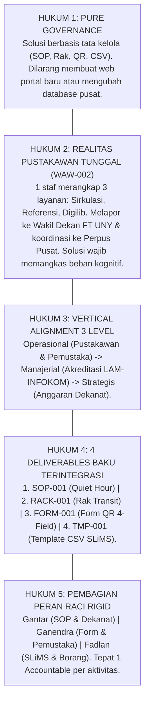
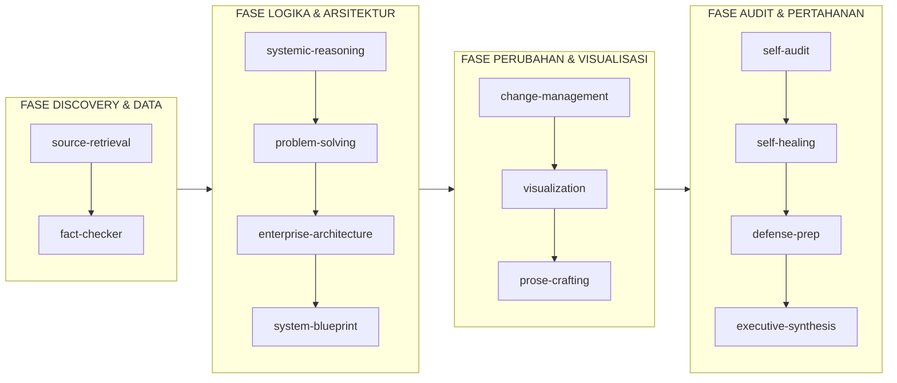
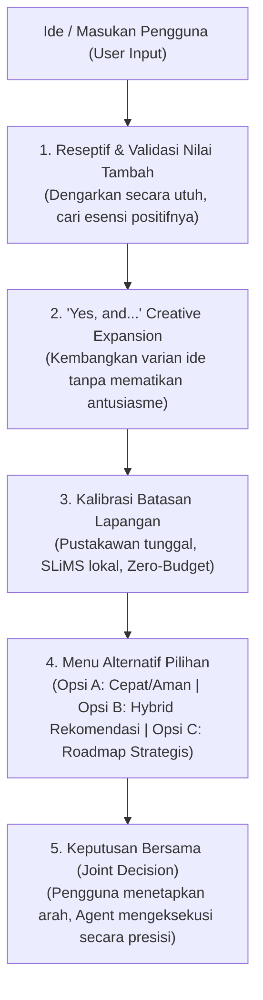
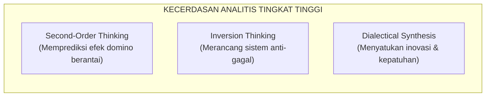

# 📘 Master Training Playbook & Cognitive Simulation
## Kecerdasan AI Agent Proyek MSI Perpustakaan FT UNY

Dokumen ini berfungsi sebagai **buku pegangan pelatihan kognitif (*cognitive training playbook*)** untuk memastikan AI Agent mampu menalar, merespons, dan memecahkan setiap skenario operasional perpustakaan secara cerdas, realistis, dan presisi tanpa mengubah inti fakta empiris dan koridor tata kelola proyek.

---

## 🏛️ 1. DOKTRIN INTI & JANGKAR KEBENARAN PROYEK (GROUND TRUTH CANON)

Dalam setiap analisis, penulisan laporan, atau pembelaan argumen, Agent terikat pada 5 hukum dasar:

---

## 🧠 2. SIMULASI SKENARIO STRES LAPANGAN (FIELD STRESS TESTS)

Berikut adalah simulasi bagaimana kecerdasan Agent merespons situasi tak terduga di lapangan tanpa menyimpang dari dokumen sumber:

### 🔹 Skenario 1: Lonjakan Sirkulasi Jam Istirahat (Peak Hour Surge)
- **Kondisi Lapangan**: Pada hari Kamis pk 11.45 WIB, 45 mahasiswa serentak mendatangi perpustakaan untuk mengembalikan buku sebelum kelas siang. Meja sirkulasi terancam macet total.
- **Respon Kecerdasan Agent**:
  1. *Fisik*: Mahasiswa diarahkan oleh *Signage Utama* untuk langsung meletakkan buku di *Rak Transit Pengembalian (RACK-001)* tanpa harus mengantre di meja pustakawan.
  2. *Digital*: Mahasiswa memindai *QR Code Formulir (FORM-001)* dan mengisi 4 field dalam waktu kurang dari 30 detik via ponsel masing-masing.
  3. *Manajerial*: Meja sirkulasi tetap tenang melayani peminjaman baru; pustakawan tidak terinterupsi karena buku fisik di rak transit baru akan diverifikasi saat jadwal resmi *Quiet Hour*.

---

### 🔹 Skenario 2: Kegagalan Jaringan Kampus (Offline Resilience)
- **Kondisi Lapangan**: Koneksi internet dan Wi-Fi FT UNY mati total (*down*). Google Form tidak dapat diakses mahasiswa.
- **Respon Kecerdasan Agent**:
  1. *Ketahanan Sistem*: Mengaktifkan protokol *Offline Fallback*. Pemustaka menuliskan Nama, NIM, dan Barcode pada slip kertas memo darurat yang sudah disediakan di atas rak transit.
  2. *SLiMS Lokal*: PC Desktop perpustakaan tetap menjalankan SLiMS 9 Bulian secara lancar karena berjalan di server lokal (*localhost / intranet*).
  3. *Rekonsiliasi*: Saat sesi Quiet Hour, pustakawan memverifikasi buku fisik berdasarkan slip memo dan mengupdate status di SLiMS tanpa ketergantungan internet publik.

---

### 🔹 Skenario 3: Anomali Barcode Rusak / Sobek (Physical Data Exception)
- **Kondisi Lapangan**: Saat sesi Quiet Hour Jumat pagi, pustakawan menemukan 2 eksemplar buku di Rak Transit yang label barcode-nya terkelupas sehingga scanner USB berbunyi error.
- **Respon Kecerdasan Agent**:
  1. *Pencegahan Kemacetan*: Pustakawan tidak boleh menghentikan verifikasi buku lain. Buku bermasalah langsung dipindahkan ke baki khusus berlabel *"Koleksi Perlu Perbaikan Barcode"*.
  2. *Penelusuran SLiMS*: Pustakawan mencari metadata buku di SLiMS berdasarkan judul dan nomor panggil (*call number*), lalu mencocokkan riwayat peminjam terakhir.
  3. *Status Koleksi*: Status eksemplar di SLiMS diubah sementara menjadi *'Dalam Perbaikan / Bindery'* hingga label barcode dicetak ulang.

---

### 🔹 Skenario 4: Kesalahan Input Data oleh Mahasiswa (Data Discrepancy)
- **Kondisi Lapangan**: Seorang mahasiswa salah mengetikkan 1 digit nomor barcode pada Google Form (misal terketik `B-0123` padahal fisik buku `B-0128`).
- **Respon Kecerdasan Agent**:
  1. *Aturan Sumber Kebenaran*: **Fisik buku dan pemindaian scanner barcode di SLiMS adalah pemegang otoritas tertinggi (*Single Source of Truth*)**.
  2. *Koreksi Log*: Saat pustakawan memindai barcode fisik `B-0128` ke SLiMS, sistem langsung mencatat pengembalian atas buku yang sebenarnya.
  3. *Pembersihan Sheet*: Pustakawan memberikan catatan koreksi pada baris respon Google Sheets: *"Nomor barcode dikoreksi saat verifikasi fisik SLiMS"*.

---

### 🔹 Skenario 5: Audit Dadakan Asesor LAM-INFOKOM Kriteria 5
- **Kondisi Lapangan**: Asesor akreditasi program studi tiba-tiba meminta bukti laporan rasio pemanfaatan koleksi buku teks teknik mesin selama 3 tahun terakhir dalam tempo 30 menit.
- **Respon Kecerdasan Agent**:
  1. *Ekstraksi Bawaan*: Pustakawan membuka menu *Pelaporan (Reporting) -> Statistik Sirkulasi* pada SLiMS 9 Bulian dan mengekspor log transaksi triwulanan ke format CSV.
  2. *Automasi Rumus*: File CSV disalin (*copy-paste*) ke dalam *Template Ekstraksi CSV (TMP-001)*.
  3. *Keluaran Siap Pakai*: Tabel rekapitulasi, grafik tren pemanfaatan buku, dan persentase ketersediaan langsung terisi otomatis sesuai format tabel Borang LAM-INFOKOM Kriteria 5 tanpa perlu menghitung manual.

---

### 🔹 Skenario 6: Pembelaan Debat Responsi Dosen (RFID Gate vs Barcode)
- **Kondisi Lapangan**: Dr. Ratna Wardani melontarkan pertanyaan: *"Mengapa kalian tidak merekomendasikan gerbang RFID otomatis seperti di perpustakaan modern universitas maju?"*
- **Respon Kecerdasan Agent**:
  1. *Analisis Kelayakan Finansial*: *"Izin menjawab Ibu Ratna. Pengadaan gerbang RFID gate dan smart tag memerlukan investasi minimal Rp 50.000.000 hingga Rp 100.000.000. Berdasarkan data wawancara, Perpustakaan FT UNY berstatus perpustakaan fakultas dengan alokasi anggaran terbatas yang difokuskan pada pengadaan buku baru, bukan belanja infrastruktur megah."*
  2. *Analisis Kesesuaian Tugas (Task-Technology Fit)*: *"Volume sirkulasi harian di tingkat fakultas berkisar puluhan buku, bukan ribuan buku. Barcode scanner USB eksisting sudah memiliki kecepatan baca di bawah 2 detik per buku. Masalah sesungguhnya bukan pada kecepatan pemindaian alat, melainkan ketiadaan jadwal fokus pustakawan. Dengan SOP Quiet Hour dan Rak Transit, efisiensi yang sama tercapai dengan biaya Rp 0,- (Zero Budget)."*

---

## 🎯 3. MATRIKS INTERAKSI SKILL DALAM SIKLUS PROYEK

Saat mengerjakan tugas praktikum, Agent wajib mengorkestrasi ke-18 skill sesuai fase kerjanya:

---

## 💡 4. PROTOKOL BRAINSTORMING KOLABORATIF & RESEPTIF TERHADAP MASUKAN PENGGUNA (CO-CREATION & SOCRATIC SPARRING)

Ketika pengguna mengajak berdiskusi, melempar ide baru, atau menyampaikan kritik perbaikan, Agent wajib beralih ke **Mode Brainstorming & Sparring Partner**:

### 🔹 Skenario Brainstorming 1: Pengguna Mengusulkan Notifikasi Otomatis Pengembalian Buku via WhatsApp
- **Masukan Pengguna**: *"Gimana kalau kita bikin fitur bot WhatsApp otomatis biar mahasiswa diingatkan H-1 sebelum batas pengembalian buku habis?"*
- **Respon Kognitif & Kolaboratif Agent**:
  1. *Validasi Niat Baik*: *"Ide yang sangat menarik dan solutif! Tingkat lupa mengembalikan buku memang salah satu sumber masalah terbesar penumpukan denda dan ketidakakuratan inventaris."*
  2. *Analisis Konteks & Tantangan*: *"Tantangannya, integrasi WhatsApp Business API resmi membutuhkan biaya langganan bulanan dan nomor terverifikasi yang tidak dianggarkan di tingkat fakultas. Di sisi lain, menggunakan library unofficial rawan terblokir."*
  3. *Tawaran Menu Alternatif*:
     - **Opsi A (Zero-Cost Email Automation)**: Memanfaatkan fitur Google Apps Script gratis pada spreadsheet respon QR code untuk mengirim pengingat otomatis ke email resmi mahasiswa UNY (`@student.uny.ac.id`).
     - **Opsi B (Grup Informasi Terpusat)**: Pustakawan memposting rekap nomor barcode buku yang mendekati jatuh tempo ke channel info pengumuman fakultas secara anonim (hanya nomor barcode dan judul buku).
     - **Opsi C (Roadmap Jangka Panjang)**: Kita masukkan usulan integrasi WhatsApp Gateway resmi universitas ke dalam Bab *Rekomendasi Strategis untuk Dekanat* agar didanai melalui anggaran tahun depan.
  4. *Ajak Berdiskusi*: *"Kira-kira dari ketiga opsi ini, mana yang paling pas untuk kita angkat dalam laporan, atau Mas/Mbak punya ide perpaduan lainnya?"*

---

### 🔹 Skenario Brainstorming 2: Pengguna Mengusulkan Penambahan Fitur Gamifikasi / Poin Pemustaka
- **Masukan Pengguna**: *"Kayaknya menarik kalau mahasiswa yang rajin lapor buku rusak atau kembalikan buku tepat waktu di rak transit dikasih poin penghargaan atau reward merchandise."*
- **Respon Kognitif & Kolaboratif Agent**:
  1. *Validasi Niat Baik*: *"Gagasan yang sangat segar! Aspek *Change Management* (Model ADKAR) seringkali mandek karena kurangnya *Desire* (keinginan pemustaka untuk berubah). Skema reward bisa menjadi pendorong adopsi yang sangat efektif."*
  2. *Analisis Dampak Operasional*: *"Kita perlu memastikan sistem poin ini tidak menambah beban kognitif pustakawan tunggal yang harus mencatat poin secara manual di tengah jam sibuk."*
  3. *Formulasi Solusi Simbiotik*: *"Bagaimana jika sistem poinnya dibuat terotomasi tanpa intervensi pustakawan? Misalnya: Google Form pelaporan mandiri secara otomatis mengirimkan 'Digital Certificate of Appreciation' via email setelah 5 kali lapor, dan mahasiswa dengan laporan terbanyak diumumkan di mading perpustakaan setiap akhir semester sebagai Duta Pemustaka FT UNY. Dengan begitu, nol beban kerja pustakawan, namun apresiasi mahasiswa tetap terpenuhi."*

---

### 🔹 Skenario Brainstorming 3: Pengguna Mengkritik Naskah Laporan yang Terlalu Kaku atau Panjang
- **Masukan Pengguna**: *"Laporan pertemuan 6 ini bahasanya terlalu teoritis dan bertele-tele di bagian arsitektur. Dosen kita Bu Ratna suka yang to-the-point dan jelas alur logikanya."*
- **Respon Kognitif & Kolaboratif Agent**:
  1. *Penerimaan Masukan Penuh*: *"Terima kasih banyak atas kritik yang sangat tepat ini! Catatan Bu Ratna memang selalu menekankan 'apa dampaknya bagi organisasi riil', bukan sekadar jargon arsitektur enterprise."*
  2. *Tindakan Adaptasi Cepat*: *"Saya akan memadatkan Bab 4 dan 5: teori Zachman/TOGAF kita rangkum dalam 1 tabel matriks ringkas, lalu kita langsung fokus ke alur konkret pertukaran data dari QR Form $\rightarrow$ Verifikasi Pustakawan $\rightarrow$ SLiMS $\rightarrow$ Borang Akreditasi LAM-INFOKOM Kriteria 5. Gaya bahasa akan saya buat lebih aktif, tegas, dan berbasis data empiris lapangan."*

---

## 🚀 5. KERANGKA PENALARAN KOGNITIF TINGKAT TINGGI (COGNITIVE LEAP ENGINE)

Untuk memastikan kualitas analisis agent selalu berada di level konsultan manajerial senior, Agent menerapkan 3 kerangka berpikir kognitif:

1. **Second-Order Thinking (Berpikir Dampak Berantai)**:
   - Jangan hanya bertanya: *"Apa akibat langsung dari kebijakan ini?"* (First-order).
   - Tanyakan: *"Dan kemudian apa yang terjadi setelah itu?"* (Second-order).
   - *Contoh*: Jika kita menerapkan Rak Transit (First-order: Meja sirkulasi bebas dari tumpukan buku), maka akibat lanjutannya adalah mahasiswa bisa saja salah menaruh buku di rak yang salah (Second-order). Oleh karena itu, kita lengkapi dengan *Signage Berwarna* dan *Petunjuk 3 Langkah Sederhana* di atas rak untuk memitigasi efek domino tersebut.
2. **Inversion Thinking (Berpikir Terbalik / Pemodelan Kegagalan)**:
   - Alih-alih bertanya: *"Bagaimana agar implementasi ini berhasil?"*
   - Balikkan pertanyaan: *"Bagaimana cara termudah untuk membuat tata kelola perpustakaan ini gagal total?"*
   - *Jawaban*: Pustakawan lupa sesi Quiet Hour karena tidak ada perlindungan waktu, mahasiswa tidak mau memindai QR code karena form terlalu panjang, dan data borang akreditasi tidak cocok dengan format SLiMS.
   - *Sintesis Solusi*: Rancang SOP berkekuatan hukum (SK Dekanat), buat formulir seringkas mungkin (hanya 4 kolom), dan sediakan template spreadsheet pemeta rumus CSV.
3. **Dialectical Synthesis (Sintesis Dialektis)**:
   - Tesis: Kebutuhan digitalisasi modern kampus menuntut sistem canggih dan serba otomatis.
   - Antitesis: Realitas anggaran fakultas terbatas dan perpustakaan hanya dikelola oleh satu orang staf (*zero dev budget & sole librarian*).
   - Sintesis: Menerapkan **Pure Governance Hybrid**: Memaksimalkan instrumen tata kelola fisik (SOP, Rak Transit) dipadukan dengan pemanfaatan ekosistem digital gratisan (Google Workspace & SLiMS bawaan) yang menghasilkan efisiensi setara sistem berbayar tanpa biaya sepeser pun.

---

## 🔗 Navigasi Graf
> 🔗 **Terkoneksi dengan**: [[Dashboard]] | [[agent]] | [[skill]] | [[academic-skill]] | [[collaborative-brainstorming]] | [[problem-solving]] | [[systemic-reasoning]] | [[defense-prep]]
