> Navigasi Vault: [[Dashboard]] | [[CONTEXT_INDEX]] | [[MASTER_PANDUAN_RESPONSI_MSI]] | [[catatan_5]] | [[Jawaban3_Final]]

# LAPORAN AKHIR PROYEK PRAKTIKUM MANAJEMEN SISTEM INFORMASI (PTF60234)
## RANCANG BANGUN TATA KELOLA PEMUTAKHIRAN DAN MONITORING DATA KOLEKSI PERPUSTAKAAN FAKULTAS TEKNIK UNIVERSITAS NEGERI YOGYAKARTA (SIMPEL KOLEKSI)

**Dosen Pengampu:** Dr. Ratna Wardani, S.Si., M.T.
**Penyusun Kelompok 3 (PTI F1):** Gantar Abimanyu (24050530042), Ganendra Pradipa (24050530038), M. Fadlan Dirmansyah (24050530034)
**Institusi:** Program Studi Pendidikan Teknik Informatika, Fakultas Teknik, Universitas Negeri Yogyakarta (2026)

## HALAMAN PENGESAHAN
Disusun dan divalidasi sebagai rancangan tata kelola dan purwarupa tervalidasi oleh Kelompok 3 Pendidikan Teknik Informatika F1.

# KATA PENGANTAR

Puji syukur penulis panjatkan ke hadirat Tuhan Yang Maha Esa atas limpahan rahmat, karunia, dan bimbingan sehingga Laporan Akhir Proyek Praktikum Manajemen Sistem Informasi berjudul Rancang Bangun Tata Kelola Pemutakhiran dan Monitoring Data Koleksi Perpustakaan Fakultas Teknik Universitas Negeri Yogyakarta dapat diselesaikan dengan baik.

Laporan akhir ini disusun sebagai bentuk konsolidasi menyeluruh atas rangkaian kegiatan analisis, perancangan tata kelola proses bisnis, pemodelan arsitektur informasi, penyusunan prototipe interaktif, hingga validasi skenario keputusan bersama pemangku kepentingan yang berlangsung sejak Pertemuan Pertama hingga Pertemuan Kesepuluh. Seluruh gagasan yang tertuang dalam dokumen ini berangkat dari observasi empiris dan wawancara langsung pada Perpustakaan Fakultas Teknik Universitas Negeri Yogyakarta, yang menghadapi kendala keterbatasan kapasitas satu orang pustakawan utama dalam melayani rata kunjungan harian yang padat sekaligus menjaga akurasi pangkalan data SLiMS.

Penyusunan laporan akhir ini tidak terlepas dari arahan akademis, kritik konstruktif, serta dukungan berbagai pihak. Oleh karena itu, kelompok menyampaikan ucapan terima kasih yang tulus kepada pihak pihak berikut:

1. Ibu Dr. Ratna Wardani, S.Si., M.T., selaku Dosen Pengampu Mata Kuliah Praktikum Manajemen Sistem Informasi yang senantiasa membimbing pemikiran analitis kelompok agar selalu berpijak pada prinsip tata kelola murni, keselarasan vertikal organisasi, serta realitas empiris lapangan.
2. Bapak Pustakawan Utama serta pengelola operasional Perpustakaan Fakultas Teknik Universitas Negeri Yogyakarta, yaitu Bapak Dapa dan Bapak Abdul, yang telah meluangkan waktu untuk memberikan data wawancara, membuka akses observasi alur sirkulasi, serta menguji purwarupa antarmuka secara objektif.
3. Rekan mahasiswa Fakultas Teknik Universitas Negeri Yogyakarta, yaitu Wildan, Daffa, Saipul, Rahmat, dan Ahmad Zaky, yang telah berpartisipasi aktif sebagai responden pemustaka maupun penguji simulasi peran pada sesi validasi akhir.
4. Seluruh anggota Kelompok 3 kelas Pendidikan Teknik Informatika F1, yakni Gantar Abimanyu, Ganendra Pradipa, dan M. Fadlan Dirmansyah, atas kerja sama, kedisiplinan mingguan, dan kontribusi masing masing sejak awal hingga akhir semester.

Kelompok menyadari bahwa rancangan tata kelola serta purwarupa sistem informasi dalam dokumen ini masih berupa desain tervalidasi yang siap memasuki tahap uji coba terbimbing dan terus terbuka terhadap penyempurnaan di masa mendatang. Semoga laporan akhir ini dapat memberikan kontribusi nyata bagi peningkatan kualitas tata kelola layanan literasi di lingkungan Fakultas Teknik Universitas Negeri Yogyakarta serta menjadi rujukan akademik yang bermanfaat.

Yogyakarta, 25 November 2026
Kelompok 3 Pendidikan Teknik Informatika F1

# RINGKASAN EKSEKUTIF

Perpustakaan Fakultas Teknik Universitas Negeri Yogyakarta memegang peranan strategis sebagai unit penunjang akademik yang melayani kebutuhan literatur mahasiswa dan dosen lintas lima departemen. Berdasarkan wawancara lapangan dan observasi langsung, operasional harian perpustakaan yang melayani rerata 52 kunjungan pemustaka setiap hari dengan koleksi sebanyak 2.349 eksemplar buku teks, 499 buku referensi, dan pengawasan 15 unit komputer Digital Library bertumpu pada satu orang pustakawan utama yang merangkap layanan sirkulasi, referensi, dan Digital Library secara bersamaan. Kondisi beban kerja tinggi tersebut mengakibatkan pustakawan kerap menunda pembaruan status koleksi yang rusak, hilang, atau salah letak pada sistem otomasi SLiMS 9 Bulian hingga 3 hingga 4 hari kerja karena harus memprioritaskan antrean layanan tatap muka.

Penundaan pembaruan data pada tingkat operasional menimbulkan dampak berantai ke tingkat manajerial dan strategis fakultas. Katalog daring OPAC menampilkan status buku seolah tersedia padahal fisiknya sedang rusak atau hilang di rak, buku yang sobek tetap beredar tanpa pemisahan fisik sehingga kerusakannya bertambah parah, koleksi buku teknik lama yang tidak lagi relevan dengan kurikulum terkini tidak tersaring secara otomatis, dan pimpinan fakultas kesulitan memperoleh rekapitulasi yang dapat dipertanggungjawabkan untuk pemenuhan Borang Akreditasi LAM INFOKOM Kriteria 5 maupun perencanaan anggaran pengadaan koleksi tahunan.

Menjawab persoalan tersebut, Kelompok 3 merancang ekosistem tata kelola bernama SIMPEL KOLEKSI yang berlandaskan doktrin Pure Governance tanpa biaya tambahan dan tanpa membangun aplikasi baru yang menggantikan SLiMS. Rancangan yang mengintegrasikan capaian Modul 1 hingga Modul 10 ini bertumpu pada empat instrumen utama yang menempel pada sistem SLiMS eksisting. Keempat instrumen tersebut meliputi penyusunan Buku Pedoman 10 Standar Operasional Prosedur dengan penetapan sesi kerja fokus mingguan Quiet Hour berdurasi 30 hingga 60 menit beserta standar waktu layanan maksimal 3 hari kerja untuk verifikasi fisik dan 7 hari kerja untuk pembaruan SLiMS, penyediaan fasilitas Rak Transit sebagai zona pemisah fisik sementara, penyediaan formulir pelaporan mandiri berbasis kode QR dengan empat isian inti berdurasi pengisian di bawah satu menit, serta Template Ekstraksi CSV SLiMS berfilter otomatis untuk pengawasan manajerial, penyiangan koleksi usang, dan disposisi anggaran kepada Dekanat.

Keseluruhan rancangan telah diturunkan ke dalam arsitektur empat lapisan, dipetakan ketergantungan informasinya dengan lintasan jalur kritis selama 36 hari kerja, diwujudkan menjadi sepuluh layar wireframe serta delapan layar purwarupa interaktif berfidelitas tinggi, dan divalidasi langsung bersama tujuh responden yang melibatkan dua pustakawan lapangan serta lima mahasiswa. Hasil validasi menunjukkan tingkat penerimaan operasional pustakawan sebesar 4,45 dari skala 5,00, menandakan bahwa rancangan tata kelola dan purwarupa sistem ini layak memasuki fase uji coba terbimbing pada Perpustakaan Fakultas Teknik Universitas Negeri Yogyakarta.

## Ringkasan Kebijakan Satu Halaman bagi Dekanat Fakultas Teknik UNY

**Tabel 0.1 Ringkasan Kebijakan (Policy Brief) Intervensi Tata Kelola Perpustakaan FT UNY**

| Dimensi Kebijakan | Uraian Ringkas untuk Pimpinan Fakultas |
| :--- | :--- |
| Sasaran Penerima Kebijakan | Dekan dan Wakil Dekan Bidang Akademik serta Perencanaan Fakultas Teknik Universitas Negeri Yogyakarta. |
| Masalah Faktual Lapangan | Satu pustakawan utama merangkap tiga layanan dengan 52 kunjungan harian sehingga pembaruan buku bermasalah pada SLiMS tertunda 3 hingga 4 hari kerja, memicu ketidaksinkronan OPAC dan hambatan bukti akreditasi LAM INFOKOM Kriteria 5. |
| Prinsip Solusi Terpilih | Intervensi Tata Kelola Murni tanpa anggaran perangkat lunak baru. Mempertahankan SLiMS 9 Bulian sebagai pangkalan data induk serta menghindari beban entri ganda. |
| Empat Instrumen Utama | 1. Buku Pedoman 10 SOP dan jadwal Quiet Hour mingguan 30 hingga 60 menit. 2. Rak Transit pemisah fisik buku bermasalah dan pengembalian normal. 3. Formulir Pelaporan Mandiri QR empat kolom tanpa login rumit. 4. Template Ekstraksi CSV SLiMS berfilter otomatis untuk weeding dan disposisi anggaran. |
| Estimasi Kebutuhan Biaya | Biaya perangkat lunak nol rupiah karena memanfaatkan akun institusi Google Suite UNY, fitur ekspor bawaan SLiMS, serta dudukan akrilik dan stiker kode QR tahan gores berbiaya minimal. |
| Rekomendasi Keputusan Dekanat | Menerbitkan pengesahan jadwal resmi Quiet Hour mingguan di luar jam sibuk layanan serta mengesahkan penggunaan Lembar Disposisi beridentitas Kop Fakultas sebagai basis penganggaran buku baru berbasis data. |

# DAFTAR ISI

**Struktur Sistematis Laporan Akhir Proyek (Modul 1 hingga Modul 10)**

| HALAMAN SAMPUL | Halaman Awal |
| HALAMAN PENGESAHAN | Halaman Awal |
| KATA PENGANTAR | Halaman Awal |
| RINGKASAN EKSEKUTIF DAN KEBIJAKAN DEKANAT | Halaman Awal |
| DAFTAR ISI, DAFTAR TABEL, DAN DAFTAR GAMBAR | Halaman Awal |
| BAB I PENDAHULUAN | Latar Belakang, Rumusan Masalah, Tujuan SMART, Ruang Lingkup, Manfaat, Sistematika |
| BAB II LANDASAN TEORI DAN KONTEKSTUALISASI ORGANISASI | Konsep MSI, 7 Aspek Bu Ratna, Teori TTF dan TAM, Profil Organisasi, Lingkungan Bisnis, Power Interest Grid |
| BAB III ANALISIS PERMASALAHAN DAN PERANCANGAN TATA KELOLA PROSES BISNIS | Alur Eksisting As Is, 5 Why, Fishbone 4M, Kebijakan Weeding, Pure Governance, Grand Design, Alur To Be, Matriks RACI |
| BAB IV STRATEGI IMPLEMENTASI, MANAJEMEN PERUBAHAN, DAN PENJADWALAN PROYEK | Arsitektur 4 Lapisan, Strategi Hibrid, Mitigasi Resistensi 4 Kuadran, Ketergantungan Informasi, PERT dan Jalur Kritis 36 Hari |
| BAB V PERANCANGAN ANTARMUKA, PURWARUPA INTERAKTIF, DAN VALIDASI PEMANGKU KEPENTINGAN | Alur Pengguna, 11 Kartu Layar, 10 Gambar Wireframe Modul 8, 8 Gambar Mockup 3 Modul 9, Traceability, Validasi 7 Responden, Revisi Before vs After |
| BAB VI EVALUASI DAMPAK, ANALISIS RISIKO, REFLEKSI, DAN PENUTUP | Komparasi As Is vs To Be, Pihak Diuntungkan vs Terbebani, Mitigasi Risiko, Refleksi Lintas Modul, Kesimpulan dan Rekomendasi |
| DAFTAR PUSTAKA | Rujukan Ilmiah, Regulasi Nasional, dan Modul Praktikum |
| LAMPIRAN A PEDOMAN LENGKAP SEPULUH STANDAR OPERASIONAL PROSEDUR | Rincian SOP 001 hingga SOP 010 beserta Dokumentasi Visual Buku Pedoman |
| LAMPIRAN B DATA PRIMER WAWANCARA DAN REKAPITULASI VALIDASI LAPANGAN | Ringkasan 12 Butir Wawancara 3, 10 Butir Wawancara 2, dan Tabulasi Respons Kuisioner 7 Penguji |

## Daftar Tabel

**Daftar Tabel dalam Laporan Akhir**

| Tabel 0.1 | Ringkasan Kebijakan (Policy Brief) Intervensi Tata Kelola Perpustakaan FT UNY |
| Tabel 1.1 | Rumusan Tujuan Proyek Menggunakan Kriteria SMART |
| Tabel 1.2 | Matriks Ruang Lingkup Pekerjaan Dalam Proyek (In Scope) dan Kriteria Penerimaan |
| Tabel 1.3 | Batasan Pengecualian Ruang Lingkup Proyek (Out of Scope) dan Yurisdiksi Wewenang |
| Tabel 1.4 | Asumsi Dasar dan Batasan Kendala Pelaksanaan Proyek |
| Tabel 2.1 | Peta Keselarasan Vertikal Tiga Tingkatan Manajemen Perpustakaan FT UNY |
| Tabel 2.2 | Matriks Penerapan Tujuh Aspek Pengelolaan MSI pada Proyek SIMPEL KOLEKSI |
| Tabel 2.3 | Analisis Empat Kategori Lingkungan Bisnis Perpustakaan FT UNY |
| Tabel 2.4 | Pemetaan Pemangku Kepentingan Menggunakan Power Interest Grid Empat Kuadran |
| Tabel 3.1 | Validasi Status Bukti Empiris Fakta Lapangan versus Hipotesis Analisis |
| Tabel 3.2 | Matriks Penilaian Prioritas Masalah Berdasarkan Skala Dampak dan Upaya |
| Tabel 3.3 | Penelusuran Akar Masalah Berjenjang Menggunakan Metode Five Why |
| Tabel 3.4 | Peta Aliran Data dan Informasi pada Grand Design SIMPEL KOLEKSI |
| Tabel 3.5 | Matriks Akuntabilitas RACI Tim Kelompok 3 dan Alokasi Peran Eksternal |
| Tabel 3.6 | Rencana Ritme Kolaborasi dan Koordinasi Mingguan Tim Proyek |
| Tabel 4.1 | Arsitektur Sistem Informasi Empat Lapisan Tanpa Modifikasi Kode Sumber SLiMS |
| Tabel 4.2 | Matriks Penilaian Strategi Implementasi per Modul dan Komponen Solusi |
| Tabel 4.3 | Analisis Potensi Resistensi dan Strategi Mitigasi pada Empat Kuadran Pemangku Kepentingan |
| Tabel 4.4 | Daftar Aktivitas Implementasi, Estimasi Durasi, dan Ketergantungan Informasi |
| Tabel 4.5 | Perhitungan Lintasan Jaringan PERT dan Penetapan Jalur Kritis 36 Hari Kerja |
| Tabel 5.1 | Daftar Alur Pengguna Lintas Peran pada Rancangan Antarmuka Modul 8 |
| Tabel 5.2 | Dokumentasi Kartu Layar Terstruktur (Screen Cards) L1A hingga L5 |
| Tabel 5.3 | Spesifikasi Data Contoh dan Kepemilikan Data (Data Ownership) pada Mockup 3 |
| Tabel 5.4 | Matriks Penelusuran Kebutuhan Masalah ke Layar Antarmuka (Traceability Matrix) |
| Tabel 5.5 | Rancangan Skenario Pengujian Keputusan Pemangku Kepentingan (K1 hingga K4) |
| Tabel 5.6 | Profil Tujuh Responden Pengujian Lapangan dan Simulasi Peran Modul 10 |
| Tabel 5.7 | Rekapitulasi Skor Evaluasi Pemecahan Masalah oleh Pemustaka (M1 hingga M3) |
| Tabel 5.8 | Triangulasi Penilaian Operasional Sepuluh Dimensi oleh Dua Pustakawan Lapangan |
| Tabel 5.9 | Klasifikasi Delapan Temuan Celah Tata Kelola dan Tindak Lanjut Revisi (Before vs After) |
| Tabel 5.10 | Estimasi Manfaat Terukur dari Sudut Pandang Pemangku Kepentingan |
| Tabel 6.1 | Komparasi Menyeluruh Alur Kerja Eksisting (As Is) terhadap Alur Kerja Baru (To Be) |
| Tabel 6.2 | Matriks Risiko Operasional dan Mekanisme Pengendalian Proses Bisnis |
| Tabel A.1 | Ringkasan Target Waktu Layanan (SLA) Seluruh Layanan Mandiri SIMPEL KOLEKSI |
| Tabel A.2 | Matriks Spesifikasi Baku Sepuluh Standar Operasional Prosedur (SOP 001 hingga SOP 010) |
| Tabel B.1 | Ikhtisar Butir Temuan Kunci Wawancara 3 dan Implikasi Rancangan Tata Kelola |
| Tabel B.2 | Ikhtisar Sepuluh Poin Wawancara Observasi Awal (Wawancara 2) Perpustakaan FT UNY |
| Tabel B.3 | Tabulasi Lengkap Suara dan Kritik Tujuh Responden Validasi Lapangan Modul 10 |

## Daftar Gambar

**Daftar Gambar Visualisasi Desain Antarmuka dan Pedoman SOP**

| Gambar 5.1 | Wireframe Layar L1A Portal Seleksi Layanan Mandiri Pemustaka (Tampilan Seluler) |
| Gambar 5.2 | Wireframe Layar L1B Formulir Lapor Buku Rusak dan Panduan Rak Transit |
| Gambar 5.3 | Wireframe Layar L1C Formulir Perpanjangan Masa Pinjam Mandiri SLiMS |
| Gambar 5.4 | Wireframe Layar L1D Formulir Usulan Referensi dan Buku Baru LAM INFOKOM |
| Gambar 5.5 | Wireframe Layar L2A Gerbang Autentikasi Meja Kerja Pustakawan |
| Gambar 5.6 | Wireframe Layar L2B Dashboard Utama dan Rangkuman Layanan Operasional |
| Gambar 5.7 | Wireframe Layar L2C Ruang Kerja Verifikasi Koleksi Rusak SOP 001 |
| Gambar 5.8 | Wireframe Layar L2D Konsol Antrean Perpanjangan Masa Pinjam SLiMS |
| Gambar 5.9 | Wireframe Layar L2E Konsolidasi Usulan Koleksi Baru untuk Pagu Dekanat |
| Gambar 5.10 | Wireframe Alternatif Tata Letak Ruang Kendali Meja Kerja Pustakawan |
| Gambar 5.11 | Mockup 3 Layar 1 Beranda Pilihan Layanan Mandiri Pemustaka |
| Gambar 5.12 | Mockup 3 Layar 2 Formulir Pelaporan Kerusakan Buku dan Diagram Rak Transit |
| Gambar 5.13 | Mockup 3 Layar 3 Antarmuka Layanan Mandiri Digital Perpanjangan dan Request Buku |
| Gambar 5.14 | Mockup 3 Layar 4 Halaman Masuk Otorisasi Meja Kerja Pustakawan |
| Gambar 5.15 | Mockup 3 Layar 5 Dashboard Utama dengan Peringatan SLA Quiet Hour dan Empat Kartu KPI |
| Gambar 5.16 | Mockup 3 Layar 6 Panel Verifikasi Koleksi Rusak, Timer 60 Menit, dan Ekspor CSV |
| Gambar 5.17 | Mockup 3 Layar 7 Konsol Perpanjangan SLiMS dengan Tombol Salin Barcode Otomatis |
| Gambar 5.18 | Mockup 3 Layar 8 Panel Usulan Referensi Baru dan Ekspor Disposisi Dekanat FT UNY |
| Gambar A.1 | Tampilan Halaman Sampul Resmi Buku Pedoman SOP Digital SIMPEL KOLEKSI |
| Gambar A.2 | Visualisasi Matriks Tanggung Jawab dan Prinsip Tata Kelola pada Buku Pedoman SOP |
| Gambar A.3 | Visualisasi Alur Triase Fisik Koleksi Bermasalah pada Buku Pedoman SOP |

# BAB I PENDAHULUAN

## 1.1. Latar Belakang Masalah dan Konteks Lapangan

Perpustakaan tingkat fakultas memegang fungsi vital sebagai pusat sumber belajar, literasi ilmiah, serta penopang kegiatan riset bagi mahasiswa dan dosen di perguruan tinggi. Di Fakultas Teknik Universitas Negeri Yogyakarta, layanan perpustakaan tersebut tidak hanya mendukung perkuliahan harian lima departemen keteknikan, tetapi juga menjadi salah satu elemen bukti penjaminan mutu pada asesmen akreditasi program studi melalui instrumen LAM INFOKOM Kriteria 5. Guna mendukung pengelolaan katalog dan sirkulasi, perpustakaan telah mengoperasikan perangkat lunak otomasi Senayan Library Management System versi 9 Bulian atau SLiMS.

Meskipun sistem otomasi digital telah tersedia dan berjalan stabil secara teknis, temuan investigasi lapangan melalui observasi langsung dan wawancara mendalam dengan pengelola perpustakaan menyingkap adanya ketimpangan nyata antara ketersediaan teknologi dengan tata kelola operasional manusia di lapangan. Operasional harian perpustakaan yang mencatat rerata kunjungan sekitar 52 pemustaka setiap hari, mengelola 2.349 eksemplar buku teks, 499 buku referensi tugas akhir, serta mengawasi 15 unit komputer Digital Library dijalankan oleh satu orang pustakawan utama. Petugas tunggal ini harus merangkap tiga fungsi layanan secara bersamaan, yakni layanan sirkulasi peminjaman dan pengembalian, layanan referensi, serta pengawasan ruang Digital Library, dengan bantuan mahasiswa magang yang bersifat tidak tetap.

Beban kapasitas ganda tersebut menciptakan friksi proses bisnis yang nyata pada pemeliharaan akurasi data koleksi. Ketika mahasiswa atau dosen menemukan buku dengan halaman sobek, punggung jilid terlepas, atau terselip salah rak, laporan disampaikan secara informal melalui lisan di loket, pesan WhatsApp pribadi kepada petugas, atau secarik kertas memo. Karena pustakawan tunggal harus memprioritaskan antrean pelayanan tatap muka yang terus berjalan, laporan kondisi koleksi tersebut kerap tertimbun dan baru sempat diperiksa fisiknya serta diperbarui statusnya di pangkalan data SLiMS setelah tertunda selama 3 hingga 4 hari kerja. Di samping itu, ketiadaan rak transit pemisah menyebabkan buku bermasalah menumpuk di meja sirkulasi atau terbawa kembali ke rak layanan, sementara ketiadaan penyaringan otomatis membuat koleksi ilmu keteknikan dan komputer edisi lama yang sudah tidak relevan tetap bercampur di rak tanpa agenda penyiangan yang teratur.

Rangkaian kondisi tersebut melahirkan fenomena ketidaksinkronan informasi antara katalog daring OPAC dengan realitas fisik di rak perpustakaan. Pemustaka dirugikan karena mendapati status buku tertulis tersedia di sistem padahal fisiknya rusak atau tidak ditemukan di lorong rak. Lebih jauh lagi, pada tingkat manajerial dan strategis, ketiadaan rekam jejak tindak lanjut laporan dan format ekstraksi sirkulasi yang terstandar menyulitkan Kepala Perpustakaan dan Tim Akreditasi Program Studi ketika menyusun bukti pemanfaatan koleksi, sekaligus melemahkan dasar data objektif bagi Dekanat dalam menyetujui alokasi anggaran pengadaan buku baru tahunan.

## 1.2. Identifikasi dan Rumusan Masalah

Berpijak pada triangulasi fakta lapangan dari transkrip wawancara, observasi fisik ruang baca, serta telaah tata kelola sistem informasi, kelompok memisahkan secara tegas antara batasan kapasitas sumber daya manusia dengan akar masalah tata kelola yang dapat diintervensi melalui proyek praktikum. Keberadaan satu orang pustakawan utama merupakan batasan operasional nyata karena perekrutan pegawai baru berada di luar kendali proyek. Berdasarkan pemilahan tersebut, dirumuskan empat masalah operasional saling berkorelasi yang bermuara pada satu rumusan masalah utama sebagai berikut:

1. Mengapa pemutakhiran status dan kondisi koleksi pada pangkalan data SLiMS di Perpustakaan Fakultas Teknik UNY mengalami keterlambatan hingga 3 hingga 4 hari kerja di tengah batasan kapasitas satu orang pustakawan utama yang merangkap tiga fungsi layanan.
2. Bagaimana merancang ekosistem tata kelola proses bisnis tanpa pembangunan aplikasi baru yang mampu menyatukan saluran pelaporan yang terfragmentasi, mengisolasi fisik koleksi bermasalah sebelum diverifikasi, dan melindungi waktu kerja administratif pustakawan.
3. Bagaimana merancang arsitektur aliran informasi, pembagian tanggung jawab tim, strategi implementasi hibrid, serta penjadwalan proyek yang memperhitungkan ketergantungan informasi agar rancangan dapat diterapkan tanpa memicu penolakan pengguna.
4. Sejauh mana rancangan antarmuka dan alur kerja tata kelola tersebut memenuhi kebutuhan pengambilan keputusan pemangku kepentingan pada tingkat operasional, manajerial, hingga strategis fakultas berdasarkan hasil validasi lapangan.

## 1.3. Tujuan Proyek dan Kriteria SMART

Tujuan utama proyek ini adalah menyusun dan menguji ekosistem tata kelola pemutakhiran serta pemantauan data koleksi Perpustakaan Fakultas Teknik UNY bernama SIMPEL KOLEKSI yang mampu menjamin keakuratan katalog SLiMS sekaligus efisiensi kerja pustakawan tunggal. Agar capaian proyek dapat diukur secara objektif dari Modul 1 hingga Modul 10, perumusan tujuan proyek diturunkan menggunakan lima kriteria SMART sebagaimana tersaji pada Tabel 1.1 berikut.

**Tabel 1.1 Rumusan Tujuan Proyek Menggunakan Kriteria SMART**

| Kriteria SMART | Definisi Operasional | Penerapan pada Proyek SIMPEL KOLEKSI FT UNY |
| :--- | :--- | :--- |
| Specific (Spesifik) | Sasaran dirumuskan secara konkret pada perubahan tata kelola, prosedur, dan instrumen kerja. | Merancang Buku Pedoman 10 SOP dan jadwal Quiet Hour, alur fisik Rak Transit, prototipe Formulir Pelaporan Mandiri QR empat kolom, serta Template Ekstraksi CSV berfilter otomatis pada sistem SLiMS. |
| Measurable (Terukur) | Tersedia parameter kuantitatif untuk menilai ketepatan waktu dan keberhasilan uji rancangan. | Menetapkan target kepatuhan Service Level Agreement minimal 85 persen untuk verifikasi fisik dalam 3 hari kerja dan pembaruan SLiMS dalam 7 hari kerja, serta mengukur tingkat penerimaan uji purwarupa pada skala Likert 1 hingga 5. |
| Achievable (Dapat Dicapai) | Solusi realistis dieksekusi dengan batasan satu petugas dan tanpa anggaran pembelian perangkat lunak baru. | Mengoptimalkan fitur ekspor bawaan SLiMS 9 Bulian yang dipadukan instrumen berbiaya nol rupiah seperti formulir Google Form, spreadsheet cloud, dan tata kelola ruang fisik. |
| Relevant (Relevan) | Menjawab langsung empat masalah operasional sekaligus memenuhi tuntutan akreditasi program studi. | Menghilangkan penumpukan buku di meja loket, mengurangi interupsi chat WhatsApp pribadi, memfasilitasi kurasi koleksi usang, serta menghasilkan rekap siap pakai bagi borang LAM INFOKOM Kriteria 5. |
| Time Bound (Berbatas Waktu) | Seluruh fase analisis, perancangan, prototipe, dan validasi selesai dalam rentang waktu yang terukur. | Seluruh rangkaian deliverable Modul 1 hingga Modul 10 diselesaikan dalam satu semester perkuliahan dengan estimasi jalur kritis uji coba implementasi terpadu selama 36 hari kerja. |

## 1.4. Ruang Lingkup dan Batasan Proyek

Pengendalian ruang lingkup sangat krusial dalam proyek Manajemen Sistem Informasi agar tim tidak terjebak pada perluasan fitur teknis yang tidak relevan atau melewati batas wewenang unit kerja tingkat fakultas. Pada Pertemuan 4, kelompok menetapkan empat deliverable utama yang berada di dalam ruang lingkup proyek (*In Scope*) beserta enam batas pengecualian tegas (*Out of Scope*) sebagaimana dirangkum pada Tabel 1.2 dan Tabel 1.3.

**Tabel 1.2 Matriks Ruang Lingkup Pekerjaan Dalam Proyek (In Scope) dan Kriteria Penerimaan**

| No | Deliverable Pekerjaan Dalam Ruang Lingkup | Kriteria Penerimaan (Acceptance Criteria) |
| :--- | :--- | :--- |
| 1 | Buku Pedoman 10 Standar Operasional Prosedur dan Penetapan Jadwal Fokus Mingguan (Quiet Hour 30 hingga 60 Menit) beserta Target SLA. | Dokumen mengatur alur pelaporan, verifikasi fisik, triase kerusakan, penyiangan koleksi usang, kontinjensi listrik padam, hingga aturan kerja magang serta memuat batas SLA 3 hari verifikasi dan 7 hari pembaruan SLiMS. |
| 2 | Panduan Alur Fisik dan Penanda Visual (Signage) Rak Penampungan Sementara (Rak Transit). | Tersedia rancangan zonasi dua tingkat dengan pemisahan Zona Hijau untuk pengembalian normal dan Zona Merah yang terbagi atas sekat rusak ringan, rusak berat, serta salah letak disertai desain papan petunjuk akrilik. |
| 3 | Purwarupa Formulir Pelaporan Mandiri QR Code dan Dasbor Monitoring Log Tiket. | Tersedia antarmuka layanan mandiri tanpa wajib login akun petugas dengan waktu pengisian di bawah satu menit serta dasbor meja kerja pustakawan dengan peringatan dini batas waktu SLA. |
| 4 | Template Ekstraksi Data Sirkulasi SLiMS Berfilter Otomatis dan Lembar Disposisi Anggaran Dekanat. | Template mampu memetakan berkas CSV bawaan SLiMS menjadi ringkasan keterpakaian koleksi per program studi, daftar kandidat penyiangan koleksi usang, serta format cetak disposisi resmi beridentitas Kop FT UNY. |

**Tabel 1.3 Batasan Pengecualian Ruang Lingkup Proyek (Out of Scope) dan Yurisdiksi Wewenang**

| No | Pekerjaan di Luar Ruang Lingkup Proyek | Alasan Pembatasan dan Batas Yurisdiksi Organisasi |
| :--- | :--- | :--- |
| 1 | Pembangunan Portal Web Pengganti atau Aplikasi Mandiri Berbasis Server Terpisah. | Berpotensi memicu pencatatan ganda bagi pustakawan tunggal dan menimbulkan utang pemeliharaan teknis jangka panjang. |
| 2 | Modifikasi Kode Sumber PHP maupun Struktur Basis Data Inti SLiMS Pusat. | Otoritas penuh pengelolaan peladen dan kode sumber SLiMS terintegrasi berada pada UPT Perpustakaan Pusat Universitas Negeri Yogyakarta. |
| 3 | Perekrutan atau Penambahan Pegawai Pustakawan Permanen Baru. | Penetapan formasi kepegawaian dan anggaran belanja pegawai merupakan kewenangan manajemen sumber daya manusia tingkat universitas. |
| 4 | Pengadaan Perangkat Keras Baru atau Pembelian Fisik Koleksi Buku secara Langsung. | Proyek berfokus pada penyediaan justifikasi data berbasis bukti agar Dekanat memiliki dasar anggaran yang kuat pada siklus perencanaan tahunan. |
| 5 | Sinkronisasi Basis Data Mahasiswa SIAKAD ke SLiMS pada Awal Semester. | Integrasi otomatis keanggotaan SIAKAD merupakan tanggung jawab teknis UPT TIK dan UPT Perpustakaan Pusat UNY, meskipun tata kelola peminjaman daruratnya diakomodasi dalam SOP Transisi. |
| 6 | Perbaikan dan Pemeliharaan 15 Unit Komputer Ruang Digital Library. | Pemeliharaan perangkat keras komputer laboratorium berada di bawah koordinasi pengelola laboratorium teknik dan UPT TIK di luar alur sirkulasi koleksi buku fisik. |

Di samping penetapan lingkup pekerjaan tersebut, pelaksanaan proyek bertumpu pada empat asumsi operasional dan empat kendala proyek yang dirangkum dalam Tabel 1.4. Pemetaan asumsi dan kendala sejak fase perencanaan menjamin bahwa rancangan solusi tidak mengawang di atas kertas, melainkan berpijak pada realitas anggaran dan kewenangan Perpustakaan Fakultas Teknik UNY.

**Tabel 1.4 Asumsi Dasar dan Batasan Kendala Pelaksanaan Proyek**

| Kategori | Rincian Kondisi Empiris | Implikasi terhadap Perancangan Tata Kelola |
| :--- | :--- | :--- |
| Asumsi Waktu Pustakawan | Pustakawan utama dapat mengalokasikan slot tenang mingguan berdurasi 30 hingga 60 menit pada jam lengang kunjungan, misalnya hari Jumat pagi. | Penetapan jadwal Quiet Hour disertai opsi pengaktifan sesi tambahan apabila antrean tiket melampaui ambang batas. |
| Asumsi Partisipasi Pengguna | Pemustaka bersedia memindai kode QR dan menaruh buku bermasalah di Rak Transit apabila prosesnya cepat. | Jumlah isian wajib formulir dipangkas hingga empat kolom inti tanpa mewajibkan login akun yang rumit. |
| Kendala Anggaran (Zero Budget) | Tidak tersedia alokasi anggaran proyek pengembangan sistem perangkat lunak khusus pada tahun berjalan. | Seluruh desain memanfaatkan fasilitas gratis eksisting berupa Google Forms, Spreadsheet, fitur CSV SLiMS, dan aplikasi web statis. |
| Kendala Akses dan SDM | Tim mahasiswa tidak memegang akses administrator server pusat dan operasional hanya dijalankan satu petugas. | Pangkalan data SLiMS dipertahankan sebagai pusat kebenaran data dengan mekanisme integrasi longgar melalui salin tempel dan ekspor CSV. |

## 1.5. Manfaat Proyek bagi Tiga Tingkatan Manajemen

Penerapan tata kelola SIMPEL KOLEKSI memberikan nilai tambah yang terdistribusi secara selaras pada seluruh tingkatan organisasi. Pada tingkat operasional, pustakawan utama terbebas dari tekanan interupsi pelaporan lisan yang bertubi saat jam sibuk dan dapat memproses verifikasi fisik serta pemutakhiran SLiMS secara tertib tanpa melelahkan mental. Bagi mahasiswa dan dosen sebagai pemustaka, katalog daring OPAC menjadi jauh lebih dapat dipercaya sehingga menghemat waktu pencarian literatur di lorong rak sekaligus menyediakan saluran pengajuan perpanjangan serta usulan referensi secara mandiri.

Pada tingkat manajerial, Kepala Perpustakaan dan Tim Akreditasi Program Studi memperoleh kejelasan pengawasan kepatuhan batas waktu layanan serta berkas rekapitulasi kondisi dan pemanfaatan koleksi yang siap audit kapan pun dibutuhkan bagi Borang Akreditasi LAM INFOKOM Kriteria 5. Sementara pada tingkat strategis, Dekanat Fakultas Teknik UNY memperoleh basis pengambilan keputusan anggaran belanja modal pengadaan buku tahunan yang objektif dan dapat dipertanggungjawabkan karena disokong oleh data tren keterpakaian koleksi riil per program studi.

## 1.6. Sistematika Penulisan Laporan Akhir

Laporan akhir ini disusun secara berurutan ke dalam enam bab utama beserta bagian awal dan lampiran untuk memandu pembaca memahami benang merah proyek dari Modul 1 hingga Modul 10. Bab I memaparkan latar belakang empiris, rumusan masalah, tujuan SMART, serta ruang lingkup proyek. Bab II menguraikan landasan teori Manajemen Sistem Informasi, profil organisasi, lingkungan bisnis, dan pemetaan pemangku kepentingan. Bab III membedah permasalahan alur eksisting hingga perancangan solusi tata kelola murni, Grand Design aliran data, alur kerja baru, serta matriks tanggung jawab RACI.

Selanjutnya, Bab IV membahas arsitektur sistem informasi empat lapisan, strategi implementasi hibrid, mitigasi resistensi perubahan, serta analisis ketergantungan informasi dan jalur kritis 36 hari kerja. Bab V mendokumentasikan secara komprehensif rancangan alur pengguna, sebelas kartu layar, sepuluh wireframe berfidelitas rendah, delapan layar purwarupa interaktif berfidelitas tinggi beserta tangkapan layarnya, serta hasil validasi empiris bersama tujuh responden lapangan dan simulasi. Bab VI menutup pembahasan melalui komparasi alur kerja lama dan baru, analisis dampak keuntungan dan beban penyesuaian pemangku kepentingan, pengendalian risiko proses, refleksi pembelajaran, kesimpulan akhir, serta rekomendasi implementasi, yang diikuti oleh Daftar Pustaka dan Lampiran lengkap sepuluh SOP beserta rekapitulasi data wawancara dan kuisioner.

# BAB II LANDASAN TEORI DAN KONTEKSTUALISASI ORGANISASI

## 2.1. Konsep Dasar Manajemen Sistem Informasi dan Keselarasan Vertikal

Menurut Laudon dan Laudon (2014), sistem informasi manajemen merupakan sekumpulan komponen yang saling terkait dalam mengumpulkan, memproses, menyimpan, dan mendistribusikan informasi untuk mendukung pengambilan keputusan, koordinasi, serta pengendalian dalam suatu organisasi. Definisi tersebut menegaskan bahwa esensi sistem informasi jauh melampaui keberadaan perangkat keras komputer atau perangkat lunak semata, melainkan mencakup keterpaduan antara dimensi manusia, tata kerja organisasi, dan teknologi informasi.

Sejalan dengan pandangan tersebut, Sousa dan Oz (2014) menekankan bahwa aliran informasi di dalam organisasi yang sehat harus bergerak secara vertikal menghubungkan tiga tingkatan manajemen. Data transaksi harian yang terekam pada lapisan operasional tidak boleh berhenti sebagai arsip pasif, melainkan wajib diagregasi menjadi informasi pemantauan pada lapisan manajerial dan diringkas kembali menjadi indikator kebijakan pada lapisan strategis. Di lingkungan Perpustakaan Fakultas Teknik UNY, prinsip keselarasan vertikal tersebut dipetakan secara eksplisit dalam Tabel 2.1 guna memastikan setiap aktivitas pencatatan di meja sirkulasi memiliki dampak nyata terhadap kualitas keputusan pimpinan fakultas.

**Tabel 2.1 Peta Keselarasan Vertikal Tiga Tingkatan Manajemen Perpustakaan FT UNY**

| Tingkatan Manajemen | Pemangku Kepentingan | Kebutuhan Informasi Utama | Keputusan Organisasi yang Didukung |
| :--- | :--- | :--- | :--- |
| Operasional (Harian) | Pustakawan Tunggal dan Pemustaka (Mahasiswa serta Dosen) | Status ketersediaan fisik eksemplar pada rak, identitas tiket laporan kerusakan, dan lokasi penampungan sementara. | Menentukan pemisahan fisik buku ke Rak Transit, memperbarui status eksemplar pada SLiMS saat sesi Quiet Hour, dan mengeksekusi perpanjangan masa pinjam. |
| Manajerial (Mingguan dan Semesteran) | Kepala Perpustakaan / UPT Pusat dan Tim Akreditasi Program Studi | Rekapitulasi tiket laporan sesuai SLA, tingkat akurasi katalog terhadap fisik rak, daftar kandidat koleksi usang, dan rasio pemanfaatan buku per prodi. | Mengevaluasi kinerja pemutakhiran data, memvalidasi rekomendasi penyiangan koleksi bersama prodi, dan menyusun bukti fisik Borang Akreditasi LAM INFOKOM Kriteria 5. |
| Strategis (Tahunan) | Dekan dan Wakil Dekan Bidang Akademik serta Perencanaan FT UNY | Tren pemanfaatan koleksi lintas lima departemen, daftar judul rusak berat yang memerlukan penggantian, dan akumulasi usulan referensi mutakhir. | Mengesahkan alokasi pagu anggaran pengadaan buku tahunan berbasis bukti empiris serta menetapkan kebijakan penguatan tata kelola layanan perpustakaan. |

## 2.2. Tujuh Aspek Pengelolaan Sistem Informasi dan Landasan Teori Pendukung

Seluruh siklus perancangan SIMPEL KOLEKSI berpedoman pada tujuh aspek pengelolaan Manajemen Sistem Informasi sebagaimana diajarkan oleh Dr. Ratna Wardani sepanjang perkuliahan. Ketujuh aspek tersebut menjadi tolok ukur konsistensi antara hasil diagnosis masalah dengan rancangan solusi yang diajukan, sebagaimana dipetakan pada Tabel 2.2.

**Tabel 2.2 Matriks Penerapan Tujuh Aspek Pengelolaan MSI pada Proyek SIMPEL KOLEKSI**

| No | Aspek Pengelolaan MSI | Manifestasi Konkret dalam Rancangan Proyek Kelompok 3 |
| :--- | :--- | :--- |
| 1 | Keselarasan Strategis | Menyambungkan rekaman sirkulasi SLiMS dan usulan referensi sivitas akademika langsung ke Lembar Disposisi Anggaran tahunan Dekanat FT UNY. |
| 2 | Tata Kelola dan Kualitas Informasi | Menetapkan kepemilikan tanggung jawab tunggal pada Matriks RACI, aturan verifikasi fisik sebelum ubah data, serta validasi keakuratan data contoh dari basis data SLiMS. |
| 3 | Dukungan Pengambilan Keputusan | Menghadirkan indikator warna peringatan SLA 3 hari untuk keputusan prioritas kerja pustakawan dan dasbor rasio sirkulasi prodi untuk keputusan pengadaan pimpinan. |
| 4 | Kebutuhan Informasi Pemangku Kepentingan | Menyajikan tampilan sederhana empat kolom bagi pemustaka di rak, konsol terpadu satu layar bagi pustakawan tunggal, dan ekspor CSV terformat bagi tim akreditasi. |
| 5 | Nilai Informasi | Mengukur nilai informasi bukan dari kecanggihan bahasa pemrograman, melainkan dari pemangkasan waktu pelaporan dari belasan menit menjadi di bawah satu menit serta kesiapan data audit akreditasi. |
| 6 | Integrasi Proses Bisnis | Menyatukan rantai aliran tertutup mulai dari pemindaian kode QR di lorong rak, isolasi buku di Rak Transit, verifikasi pada Quiet Hour, pembaruan SLiMS, hingga pelaporan eksekutif. |
| 7 | Adopsi dan Perilaku Organisasi | Merancang strategi perubahan bertahap hibrid dengan mengunci slot fokus Quiet Hour guna melindungi kondisi psikologis pustakawan tunggal dan menghilangkan hambatan login bagi mahasiswa. |

Secara akademis, pilihan rancangan tata kelola murni pada proyek ini berdiri di atas tiga teori utama sistem informasi yang saling melengkapi. Pertama, teori Kesesuaian Tugas dan Teknologi atau Task Technology Fit yang dikemukakan oleh Goodhue dan Thompson (1995) menjelaskan bahwa teknologi informasi hanya mampu meningkatkan kinerja individu apabila fungsionalitasnya sesuai dengan karakteristik tugas serta kemampuan pelakunya. Bagi seorang pustakawan tunggal yang menangani tiga layanan sekaligus, pengadaan aplikasi portal baru justru akan memperburuk kecocokan tugas karena memaksa pencatatan ganda. Sebaliknya, penggunaan formulir QR ringan dan fitur ekspor bawaan SLiMS memiliki kecocokan tinggi dengan kapasitas kerja di lapangan.

Kedua, teori Model Penerimaan Teknologi atau Technology Acceptance Model oleh Davis (1989) menegaskan bahwa niat pengguna mengadopsi sistem baru ditentukan oleh persepsi kemanfaatan serta persepsi kemudahan penggunaan. Penerapan teori ini terwujud melalui desain formulir mandiri yang dapat diakses tanpa kata sandi akun institusi dan selesai diisi dalam hitungan detik di lorong rak. Ketiga, kerangka Pengendalian Internal dan Pemisahan Tugas dari Romney dan Steinbart (2018) diterapkan untuk menjaga keutuhan pangkalan data induk SLiMS. Meskipun pemustaka diberdayakan sebagai agen pelapor mandiri melalui formulir digital, mereka dilarang memiliki akses pengubah status katalog secara langsung karena setiap perubahan status di SLiMS wajib melewati gerbang verifikasi fisik oleh petugas resmi.

## 2.3. Profil Organisasi Perpustakaan Fakultas Teknik Universitas Negeri Yogyakarta

Berdasarkan pengamatan langsung dan transkrip wawancara primer pada Pertemuan 1 hingga Pertemuan 3, Perpustakaan Fakultas Teknik UNY merupakan unit layanan literasi akademik yang berlokasi di Kampus Karangmalang, Yogyakarta. Unit ini melayani mahasiswa program Sarjana, Sarjana Terapan, dosen, serta tenaga kependidikan dari berbagai program studi keteknikan, seperti Pendidikan Teknik Informatika, Teknik Elektro, Teknik Mesin, Teknik Sipil, dan Teknik Boga atau Busana.

Aset informasi dan fasilitas operasional yang dikelola pada unit ini meliputi sebanyak 2.349 eksemplar buku teks perkuliahan, 499 eksemplar koleksi buku referensi dan tugas akhir, serta 15 unit komputer pada area Digital Library untuk akses jurnal ilmiah elektronik. Volume interaksi harian tergolong padat dengan rerata kunjungan mencapai 52 pemustaka setiap hari. Seluruh pengelolaan katalogisasi, keanggotaan, dan transaksi peminjaman maupun pengembalian bertumpu pada sistem otomasi perpustakaan SLiMS 9 Bulian yang terhubung secara daring pada laman katalog perpustakaan fakultas.

Dari sisi struktur tenaga pelaksana harian, Perpustakaan Fakultas Teknik UNY berada pada kondisi kapasitas minimal dengan hanya satu orang pustakawan utama fungsional yang bertanggung jawab terhadap operasional tiga fungsi layanan secara paralel. Pustakawan utama tersebut melayani transaksi peminjaman tatap muka pada meja sirkulasi, mendampingi penelusuran koleksi referensi skripsi, sekaligus mengawasi pemanfaatan area Digital Library. Secara struktural dan fungsional, pengelola perpustakaan fakultas melaporkan capaian administrasi serta kebutuhan fasilitas kepada pimpinan fakultas melalui Wakil Dekan Fakultas Teknik UNY dan menjalin koordinasi teknis pengelolaan sistem otomasi SLiMS maupun kebijakan penyiangan aset bersama UPT Perpustakaan Pusat UNY.

## 2.4. Analisis Lingkungan Bisnis dan Tekanan Regulasi Eksternal

Pada Pertemuan 2, kelompok menelaah faktor lingkungan eksternal dan internal yang membentuk kebutuhan informasi perpustakaan. Hasil pemetaan empat dimensi lingkungan bisnis dirangkum secara sistematis pada Tabel 2.3.

**Tabel 2.3 Analisis Empat Kategori Lingkungan Bisnis Perpustakaan FT UNY**

| Kategori Lingkungan Bisnis | Fakta Kondisi Perpustakaan FT UNY | Implikasi terhadap Kebutuhan Sistem Informasi |
| :--- | :--- | :--- |
| Regulasi dan Kepatuhan Hukum | Tunduk pada Undang Undang Nomor 43 Tahun 2007 tentang Perpustakaan, Standar Nasional Perpustakaan Perguruan Tinggi, aturan denda UPT Perpustakaan Pusat, serta standar akreditasi LAM INFOKOM Kriteria 5 dan pengelolaan Barang Milik Negara. | Sistem tata kelola wajib menghasilkan catatan transaksi, kondisi fisik koleksi, dan berita acara penyiangan yang sah, akurat, dan siap diperiksa dalam proses audit mutu akademik. |
| Tolok Ukur (Benchmarking) dan Perkembangan Layanan | UPT Perpustakaan Pusat UNY serta perpustakaan fakultas teknik di universitas rujukan lain mulai mengoptimalkan layanan mandiri berbasis teknologi pelacakan seperti RFID dan akses jurnal digital. | Menuntut Perpustakaan FT UNY menghadirkan terobosan layanan mandiri digital berbiaya terjangkau seperti kode QR guna memangkas antrean manual tanpa menunggu pengadaan perangkat keras mahal. |
| Kapasitas Internal Organisasi | Satu orang pustakawan tunggal menangani 52 kunjungan harian, 2.349 buku teks, 499 referensi, dan 15 PC Digital Library tanpa dukungan staf teknologi informasi khusus di tingkat fakultas. | Rancangan alur informasi harus sangat sederhana, bebas pemeliharaan kode server rumit, serta menyediakan proteksi waktu kerja terfokus untuk mencegah penundaan pemutakhiran data. |
| Tren dan Tekanan Kebutuhan Eksternal | Meningkatnya tuntutan akreditasi berbasis bukti terukur dan kebutuhan literatur keteknikan mutakhir seperti kecerdasan buatan serta komputasi awan menggantikan buku pemrograman lawas. | Memerlukan mekanisme pengusulan literatur baru yang terbuka sepanjang tahun bagi dosen dan mahasiswa serta filter otomatis pendeteksi buku usang yang jarang dipinjam. |

## 2.5. Pemetaan Pemangku Kepentingan Menggunakan Power Interest Grid

Identifikasi pihak yang berpengaruh dan terdampak merupakan langkah krusial untuk menjamin dukungan kebijakan serta kesesuaian penyajian data. Penilaian kekuatan (*power*) ditentukan oleh otoritas aktor terhadap kebijakan fakultas, persetujuan anggaran, dan pengendalian basis data resmi, sedangkan tingkat kepentingan (*interest*) ditentukan oleh intensitas pemanfaatan informasi perpustakaan dalam tugas harian maupun evaluasi program studi. Tabel 2.4 menyajikan klasifikasi pemangku kepentingan pada empat kuadran beserta strategi keterlibatannya.

**Tabel 2.4 Pemetaan Pemangku Kepentingan Menggunakan Power Interest Grid Empat Kuadran**

| Kuadran Grid | Pemangku Kepentingan | Peran terhadap Sistem Informasi | Strategi Komunikasi dan Pengelolaan |
| :--- | :--- | :--- | :--- |
| Manage Closely (Kekuasaan Tinggi, Kepentingan Tinggi) | Pustakawan Utama FT UNY dan Kepala Perpustakaan atau UPT Perpustakaan Pusat UNY. | Pelaksana operasional pembaruan status SLiMS, pemeriksa fisik koleksi, serta pengarah koordinasi teknis pangkalan data dan aturan penyiangan aset. | Melibatkan secara intensif dalam perumusan SOP Quiet Hour, penyepakatan kolom formulir QR, serta pengujian langsung kelayakan meja kerja. |
| Keep Satisfied (Kekuasaan Tinggi, Kepentingan Rendah) | Pimpinan Fakultas (Dekan dan Wakil Dekan FT UNY) serta Tim Akreditasi Program Studi. | Pengambil keputusan alokasi pagu anggaran pengadaan buku tahunan serta pengguna rekapitulasi valid bagi Borang LAM INFOKOM Kriteria 5. | Menjaga kepuasan melalui solusi tanpa beban anggaran pengembangan perangkat lunak baru dan menyediakan lembar disposisi serta ekspor CSV siap pakai. |
| Keep Informed (Kekuasaan Rendah, Kepentingan Tinggi) | Mahasiswa dan Dosen Fakultas Teknik Universitas Negeri Yogyakarta. | Pengguna harian katalog OPAC, pelapor mandiri kerusakan koleksi di rak, dan pengusul literatur riset atau tugas akhir. | Memberikan panduan visual yang sangat jelas di rak, formulir QR tanpa login rumit, serta banner pemberitahuan saat sesi Quiet Hour berlangsung. |
| Monitor (Kekuasaan Rendah, Kepentingan Rendah) | Pengelola SIAKAD UPT TIK, Mahasiswa Magang PKL insidental, serta staf keamanan dan kebersihan ruang. | Berhubungan dengan sinkronisasi data anggota awal semester dan bantuan penataan fisik sesaat tanpa otoritas mengubah kebijakan sirkulasi. | Memantau kelancaran jadwal sinkronisasi keanggotaan universitas dan mengatur batas tugas mahasiswa magang dalam SOP khusus agar tidak mengakses akun induk SLiMS. |

# BAB III ANALISIS PERMASALAHAN DAN PERANCANGAN TATA KELOLA PROSES BISNIS

## 3.1. Analisis Alur Kerja Eksisting (As Is) dan Titik Kemacetan

Pada Pertemuan 3, kelompok menelusuri alur kerja aktual yang berlangsung di Perpustakaan Fakultas Teknik UNY sebelum perancangan solusi dilakukan. Alur pemutakhiran status kondisi koleksi yang berjalan saat ini terbagi menjadi empat tahapan berurutan yang setiap tahapannya menyimpan celah kegagalan operasional.

Pada tahap pertama, yaitu temuan dan pelaporan kondisi koleksi, pemustaka yang menemukan buku dalam keadaan sobek, halaman hilang, atau salah tempat melapor secara lisan di meja loket, menghubungi nomor WhatsApp pribadi petugas, atau menulis catatan kecil di atas secarik kertas memo. Ketiadaan format baku dan saluran tunggal mengakibatkan laporan tersebar pada berbagai media informal sehingga sangat rawan terlupa apabila petugas sedang sibuk melayani peminjaman.

Pada tahap kedua, yaitu penyerahan fisik buku bermasalah, buku yang rusak diletakkan begitu saja di atas meja kerja sirkulasi bercampur dengan tumpukan buku pengembalian harian. Ketiadaan fasilitas penampungan sementara yang terpisah membuat buku rusak berisiko terselip atau terbawa kembali ke rak layanan oleh pemustaka maupun petugas magang, sehingga kondisi fisiknya semakin memburuk akibat terus dipinjam.

Pada tahap ketiga, yaitu pemeriksaan fisik dan pembaruan pangkalan data SLiMS, pustakawan baru dapat mencocokkan barcode buku serta mengubah status eksemplar ketika terdapat waktu senggang di luar antrean layanan. Persaingan waktu dengan 52 transaksi tatap muka per hari menyebabkan pembaruan data pada SLiMS tertunda hingga 3 hingga 4 hari kerja tanpa adanya batas waktu layanan yang jelas. Pada tahap keempat, yakni tindak lanjut dan pelaporan berkala, perbaikan buku dilakukan secara tambal sulam dan rekapitulasi kondisi koleksi baru diketik secara manual apabila diminta mendadak oleh pimpinan fakultas atau tim akreditasi program studi, tanpa didukung riwayat penyelesaian formal.

## 3.2. Pemilahan Fakta Empiris, Empat Masalah Operasional, dan Matriks Prioritas

Untuk menjaga ketajaman ilmiah dan mencegah generalisasi yang keliru, kelompok memverifikasi setiap pernyataan kendala di perpustakaan terhadap bukti transkrip wawancara dan observasi langsung sebagaimana dirangkum pada Tabel 3.1. Selanjutnya, empat masalah operasional yang tervalidasi dinilai bobot dampak dan tingkat upayanya menggunakan Matriks Prioritas Dampak terhadap Upaya pada Tabel 3.2.

**Tabel 3.1 Validasi Status Bukti Empiris Fakta Lapangan versus Hipotesis Analisis**

| Pernyataan Kondisi Lapangan | Status Validitas Bukti | Rujukan Bukti Empiris Lapangan |
| :--- | :--- | :--- |
| Satu orang pustakawan utama menangani tiga fungsi layanan sekaligus | Faktual Terbukti | Wawancara 2 dan Wawancara 3 butir pertama serta kedua. |
| Belum tersedia SOP tertulis dan jadwal fokus pemutakhiran SLiMS | Faktual Terbukti | Wawancara 3 butir ketiga dan keempat. |
| Aduan kondisi buku masuk melalui lisan, WhatsApp pribadi, dan kertas memo | Faktual Terbukti | Wawancara 2 dan Wawancara 3 butir kelima serta keenam. |
| Belum tersedia fasilitas rak pemisah sementara sebelum buku dikembalikan ke rak | Faktual Terbukti | Observasi ruang baca dan Wawancara 3 butir kelima serta kedelapan. |
| Belum terdapat rekam jejak formal penyelesaian laporan (audit trail) | Faktual Terbukti | Wawancara 3 butir pertama dan kesepuluh. |
| Penataan SOP terpadu dan jadwal fokus mampu menekan penumpukan dan beban mental | Hipotesis Solusi Teruji | Sintesis kerangka Task Technology Fit dan divalidasi melalui pengujian Modul 10. |

**Tabel 3.2 Matriks Penilaian Prioritas Masalah Berdasarkan Skala Dampak dan Upaya**

| No | Masalah Operasional Teridentifikasi | Skor Dampak | Skor Upaya | Kategori Prioritas |
| :--- | :--- | :--- | :--- | :--- |
| 1 | Ketiadaan SOP tertulis dan jadwal rutin terfokus untuk pemutakhiran data SLiMS | 5 (Sangat Tinggi) | 3 (Sedang) | Prioritas 1 Fokus Strategis Utama |
| 2 | Fragmentasi saluran pelaporan kondisi buku dan catatan aduan yang tercecer | 5 (Sangat Tinggi) | 3 (Sedang) | Prioritas 2 Perbaikan Alur Inti |
| 3 | Ketiadaan fasilitas fisik rak penampungan sementara (Rak Transit) | 4 (Tinggi) | 2 (Rendah) | Prioritas 3 Kemenangan Cepat (Quick Win) |
| 4 | Ketiadaan rekam jejak penyelesaian dan format rekapitulasi berkala untuk akreditasi | 4 (Tinggi) | 3 (Sedang) | Prioritas 4 Penguat Tata Kelola |

## 3.3. Penelusuran Akar Masalah Metode Five Why dan Diagram Fishbone 4M

Keempat masalah operasional tersebut bermuara pada persoalan inti berupa keterlambatan pemutakhiran status dan kondisi koleksi pada SLiMS yang menimbulkan ketidaksinkronan katalog daring OPAC dengan realitas rak. Kelompok menelusuri rantai sebab akibat menggunakan metode pertanyaan berjenjang Five Why pada Tabel 3.3 serta memetakannya ke dalam empat kategori penyebab pada Diagram Fishbone 4M.

**Tabel 3.3 Penelusuran Akar Masalah Berjenjang Menggunakan Metode Five Why**

| Tahap Analisis | Pertanyaan Kritis | Jawaban Empiris Berbasis Kondisi Lapangan |
| :--- | :--- | :--- |
| Gejala Utama | Apa persoalan nyata yang diamati di perpustakaan? | Data ketersediaan dan kondisi fisik koleksi pada katalog SLiMS sering terlambat diperbarui sehingga tidak selaras dengan kondisi buku di rak. |
| Mengapa ke 1 | Mengapa pembaruan status pada sistem SLiMS sering tertunda? | Karena informasi temuan kerusakan buku masuk secara terpencar melalui lisan, WhatsApp, serta kertas memo, sementara fisik buku menumpuk di meja sirkulasi. |
| Mengapa ke 2 | Mengapa laporan terpencar dan buku menumpuk di meja layanan? | Karena pustakawan harus melayani 52 kunjungan tatap muka setiap hari tanpa adanya saluran pelaporan mandiri pemustaka maupun rak transit pemisah fisik. |
| Mengapa ke 3 | Mengapa verifikasi fisik dan input ke SLiMS tidak dikerjakan langsung saat itu juga? | Karena pustakawan belum memiliki alokasi slot waktu khusus yang terlindungi dari gangguan antrean sirkulasi harian. |
| Mengapa ke 4 | Mengapa penanganan koleksi bergantung pada waktu luang dan ingatan pribadi? | Karena belum tersedia instrumen pencatatan tiket terpusat beserta batas waktu layanan dan mekanisme pemantauan rekapitulasi. |
| Mengapa ke 5 (Akar Masalah) | Mengapa seluruh mekanisme pengendalian dan jadwal kerja tersebut belum berjalan? | Karena belum adanya dokumen tata kelola dan SOP tertulis terpadu yang mengikat alur pelaporan mandiri, pemisahan rak transit, sesi fokus Quiet Hour, serta ekstraksi data berkala. |

Selanjutnya, untuk melihat spektrum penyebab secara menyeluruh, faktor penyebab dikelompokkan dalam empat dimensi Fishbone 4M yakni Man, Method, Machine, dan Material. Pada dimensi Man, satu orang pustakawan utama harus merangkap tiga fungsi layanan sekaligus dan menghadapi interupsi antrean tatap muka. Pada dimensi Method, belum tersedia SOP tertulis maupun alokasi jadwal fokus rutin pemutakhiran data. Pada dimensi Machine, sistem SLiMS memang sudah tersedia dan stabil, namun belum dilengkapi pencatatan tiket terpusat maupun fitur filter otomatis untuk menyaring buku lama yang usang dan jarang dibaca. Pada dimensi Material, perpustakaan belum memiliki rak transit penampungan sementara yang terstandar sehingga buku rusak menumpuk di meja loket.

**BAGAN SEBAB AKIBAT DIAGRAM FISHBONE 4M**

> Dimensi Man (Kapasitas SDM): 1 Pustakawan merangkap 3 layanan → Fokus terpecah melayani 52 kunjungan per hari → Pemustaka enggan melapor lewat antrean loket.
> Dimensi Method (Tata Kerja): Belum ada SOP tertulis pemutakhiran data → Belum ada jadwal fokus Quiet Hour → Penanganan laporan masih bersifat insidental.
> Dimensi Machine (Sistem dan Alat): SLiMS tersedia namun butuh input petugas → Belum ada pencatatan tiket terpusat → Belum ada filter otomatis penyaring buku usang (weeding).
> Dimensi Material (Sarana Fisik): Belum tersedia rak transit sementara → Buku bermasalah menumpuk di meja sirkulasi → Aduan tersebar di WA, lisan, dan memo.
> MUARA AKIBAT UTAMA → Pemutakhiran status dan kondisi koleksi pada SLiMS tertunda 3 hingga 4 hari kerja sehingga OPAC tidak sinkron dan pelaporan akreditasi terhambat.

## 3.4. Integrasi Kebijakan Penyiangan Koleksi Usang (Weeding)

Menindaklanjuti masukan substantif dosen pengampu pada catatan perkuliahan Pertemuan 5, masalah pemutakhiran koleksi di Perpustakaan Fakultas Teknik UNY tidak hanya terbatas pada buku yang mengalami kerusakan fisik seperti sobek atau lepas jilid. Di antara 2.349 eksemplar buku teks yang tersimpan pada rak, terdapat pula buku teks bidang komputer dan teknik edisi sangat lama yang sudah tidak relevan dengan kurikulum teknologi mutakhir serta hampir tidak pernah dipinjam lagi, namun tetap menumpuk di rak layanan.

Apabila pustakawan tunggal dibebani tugas menyortir ribuan judul buku usang tersebut satu per satu secara manual di rak, beban kerja kognitifnya akan melonjak drastis. Oleh sebab itu, rancangan tata kelola memasukkan fitur penyaringan otomatis melalui Template Ekstraksi CSV SLiMS yang menyaring koleksi berdasarkan usia terbitan minimal 5 hingga 10 tahun untuk literatur teknologi dan frekuensi sirkulasi bernilai nol dalam empat semester berturut turut. Namun demikian, hasil penyaringan otomatis ini diposisikan hanya sebagai daftar kandidat penyiangan awal (*weeding*). Mengingat seluruh buku berstatus aset Barang Milik Negara, keputusan penarikan permanen tetap harus disetujui secara berjenjang oleh Kepala Perpustakaan, Program Studi atau Dosen pengampu mata kuliah guna mencegah terbuangnya buku rujukan klasik wajib, serta dilaporkan kepada Bagian BMN Universitas dan UPT Perpustakaan Pusat.

## 3.5. Perancangan Solusi Tata Kelola Murni (Pure Governance)

Berbekal hasil diagnosis akar masalah, kelompok merancang solusi yang berpegang teguh pada doktrin Tata Kelola Murni (*Pure Governance*) dan mengoptimalkan sistem SLiMS yang sudah beroperasi. Keputusan tidak membangun aplikasi web pengganti SLiMS diambil guna mencegah lahirnya beban kerja entri ganda, biaya pengembangan yang mahal, dan risiko sistem mangkrak ketika tim mahasiswa tidak lagi mendampingi. Empat pilar solusi yang dirancang untuk saling mengunci terdiri atas komponen berikut:

1. Buku Pedoman 10 Standar Operasional Prosedur dan Sesi Quiet Hour: Menetapkan aturan kerja tertulis yang melindungi waktu kerja pustakawan selama 30 hingga 60 menit setiap minggu pada jam paling sepi kunjungan guna memverifikasi fisik buku serta memperbarui SLiMS sekaligus, dilengkapi target SLA maksimal 3 hari kerja untuk verifikasi fisik dan 7 hari kerja untuk pembaruan SLiMS.
2. Formulir Pelaporan Mandiri Berbasis Kode QR: Kanal digital satu pintu yang ditempel pada ujung lorong rak dan meja baca. Formulir dirancang sangat ringkas dengan empat isian inti agar waktu pengisian kurang dari satu menit tanpa membebani mahasiswa.
3. Alur Fisik Rak Transit Penampungan Sementara: Rak penyangga fisik yang diletakkan di dekat meja loket dengan pemisahan tingkat pengembalian normal dan tingkat isolasi koleksi bermasalah yang dibagi menjadi tiga sekat triase, yakni sekat rusak ringan, rusak berat, dan salah letak.
4. Dasbor Monitoring dan Template Ekstraksi CSV Berfilter Otomatis: Lembar kerja spreadsheet yang memantau antrean tiket masuk serta batas waktu SLA bagi Kepala Perpustakaan, sekaligus mengolah berkas CSV bawaan SLiMS secara otomatis untuk kebutuhan penyaringan koleksi usang, pengisian Borang Akreditasi LAM INFOKOM Kriteria 5, dan Lembar Disposisi anggaran belanja buku kepada Dekanat.

## 3.6. Arsitektur Grand Design dan Alur Kerja Masa Depan (To Be)

Keempat pilar solusi tersebut dipetakan alirannya pada Pertemuan 5 ke dalam Grand Design Sistem Informasi SIMPEL KOLEKSI guna memperjelas pihak penghasil data, media pembawa data, sistem pengolah utama, dan pihak penerima informasi pada tingkat manajerial serta strategis. Seluruh lintasan perpindahan data dirangkum pada Tabel 3.4.

**Tabel 3.4 Peta Aliran Data dan Informasi pada Grand Design SIMPEL KOLEKSI**

| No | Unit Pengirim | Unit Penerima | Jenis Data dan Informasi yang Berpindah | Instrumen Tata Kelola Pendukung |
| :--- | :--- | :--- | :--- | :--- |
| 1 | Pemustaka (Mahasiswa dan Dosen) | Pustakawan Utama FT UNY | Laporan kondisi fisik buku rusak atau salah letak beserta penempatan fisik buku pada zona karantina sementara. | Formulir Pelaporan Mandiri QR dan Rak Transit Tiga Sekat. |
| 2 | Pustakawan Utama FT UNY | Sistem Utama SLiMS 9 Bulian | Pembaruan status ketersediaan eksemplar yang telah lolos verifikasi fisik secara terjadwal serta sinkronisasi langsung ke OPAC. | SOP Quiet Hour mingguan dan Protokol Triase Fisik tiga opsi. |
| 3 | Sistem Utama SLiMS 9 Bulian | Pustakawan Utama FT UNY | Ekstraksi mentah transaksi peminjaman, tahun terbit koleksi, serta kondisi inventaris aktif untuk agregasi bulanan. | Fitur Ekspor CSV bawaan SLiMS dan Template Ekstraksi Berfilter Otomatis. |
| 4 | Pustakawan Utama FT UNY | Kepala Perpustakaan / UPT Pusat | Rekapitulasi kepatuhan batas waktu layanan SLA, tren kerusakan koleksi, dan daftar rekomendasi penyiangan koleksi usang. | Dasbor Monitoring Rekapitulasi dan Berita Acara Kandidat Weeding. |
| 5 | Pustakawan Utama FT UNY | Tim Akreditasi Program Studi | Rekapitulasi rasio keterpakaian buku dan kecukupan literatur mutakhir per program studi untuk bukti fisik borang. | Template Agregasi Laporan Akreditasi LAM INFOKOM Kriteria 5. |
| 6 | Pustakawan Utama FT UNY | Dekanat FT UNY (Wakil Dekan) | Laporan tren kebutuhan referensi sivitas akademika dan justifikasi pengadaan buku baru pengganti koleksi rusak atau afkir. | Lembar Disposisi Resmi Beridentitas Kop Fakultas Teknik UNY. |

Berdasarkan Grand Design tersebut, alur kerja masa depan (*To Be*) berjalan dalam empat langkah terstruktur. Langkah pertama adalah pelaporan mandiri melalui pemindaian kode QR di lorong rak oleh pemustaka dengan durasi di bawah satu menit. Langkah kedua adalah pemisahan fisik oleh pemustaka dengan menaruh buku pada Rak Transit sesuai sekat masalahnya agar terisolasi dan tidak dipinjam ulang oleh pengunjung lain. Langkah ketiga adalah pemeriksaan fisik dan pembaruan status pada SLiMS secara terjadwal saat sesi Quiet Hour oleh pustakawan sesuai batas SLA maksimal 3 hari verifikasi dan 7 hari pembaruan sistem. Langkah keempat adalah pengawasan dan rekapitulasi otomatis melalui dasbor serta template CSV untuk menyokong pengambilan keputusan pimpinan perpustakaan, tim akreditasi, dan Dekanat.

**BAGAN ALUR PROSES TERPADU GRAND DESIGN (ALUR TO BE)**

> Tingkat 1 Aliran Masuk dan Fisik: Pemustaka FT UNY → Scan Kode QR Formulir 4 Kolom → Letakkan Fisik Buku pada Rak Transit Zona Merah (Sekat Rusak Ringan, Berat, atau Salah Rak).
> Tingkat 2 Verifikasi dan Sistem Utama: Pustakawan Tunggal (Sesi Quiet Hour 30 hingga 60 menit) → Verifikasi Fisik dan Pembaruan Status SLiMS 9 Bulian → Sinkronisasi Katalog OPAC.
> Tingkat 3 Keluaran Manajerial dan Strategis: Ekstraksi CSV Template Otomatis → Dasbor SLA Kepala Perpus → Borang Akreditasi LAM INFOKOM Kriteria 5 → Lembar Disposisi Anggaran Dekanat FT UNY.

## 3.7. Struktur Tim, Matriks Akuntabilitas RACI, dan Ritme Kolaborasi

Guna memastikan seluruh komponen Grand Design dieksekusi dengan kepemilikan tanggung jawab yang jelas oleh tiga anggota Kelompok 3, seluruh aktivitas proyek dipetakan menggunakan Matriks RACI sebagaimana tertuang pada Tabel 3.5. Mengacu pada pedoman manajemen proyek PMI (2021), setiap aktivitas wajib memiliki tepat satu pihak pemegang tanggung jawab akhir (*Accountable*) untuk mencegah kekosongan komando. Karena ketiga anggota kelompok terlibat aktif berkolaborasi tatap muka setiap minggu, seluruh anggota internal mengemban peran aktif R, A, atau C, sementara peran penerima informasi satu arah (*Informed*) diberikan kepada pemustaka serta Dekanat FT UNY.

**Tabel 3.5 Matriks Akuntabilitas RACI Tim Kelompok 3 dan Alokasi Peran Eksternal**

| Aktivitas Utama Proyek | Gantar Abimanyu (Project Lead) | Ganendra Pradipa (Analis) | M. Fadlan Dirmansyah (Desainer & Dokumentator) |
| :--- | :--- | :--- | :--- |
| Penyusunan Draf SOP Pemutakhiran Data dan Jadwal Quiet Hour | A | R | C |
| Perancangan Alur Fisik Rak Penampungan Sementara (Rak Transit) | C | R | A |
| Perancangan Formulir Pelaporan Mandiri Kondisi Koleksi (Form QR) | C | A | R |
| Perancangan Prosedur Pemutakhiran Data Koleksi pada SLiMS | R | C | A |
| Penyusunan Template Ekstraksi Data Sirkulasi SLiMS Berfilter | C | A | R |
| Penyusunan Dashboard Rekapitulasi Data Koleksi | R | C | A |
| Penyusunan Template Pelaporan Data Sirkulasi Akreditasi | A | R | C |
| Integrasi dan Dokumentasi Alur Pemutakhiran Informasi | A | R | R |

Pembagian tersebut mendudukkan **Gantar Abimanyu** sebagai Project Lead yang bertanggung jawab penuh atas penyusunan aturan 10 SOP, jadwal Quiet Hour, kesesuaian format pelaporan akreditasi, serta koordinasi keseluruhan proyek. **Ganendra Pradipa** sebagai Analis memegang tanggung jawab akhir pada perancangan sisi input dan sisi output aliran data, yakni memastikan formulir QR tetap ringkas dengan empat isian minimum serta merancang Template Ekstraksi CSV SLiMS berfilter otomatis agar data mentah dapat langsung diolah untuk pimpinan. Sementara itu, **M. Fadlan Dirmansyah** sebagai Desainer dan Dokumentator memegang tanggung jawab akhir pada perancangan tata alur Rak Transit fisik, prosedur eksekusi pada SLiMS, serta perancangan antarmuka dasbor monitoring beserta dokumentasi visualnya. Seluruh kegiatan diselaraskan melalui ritme kolaborasi mingguan seperti dicatat pada Tabel 3.6.

**Tabel 3.6 Rencana Ritme Kolaborasi dan Koordinasi Mingguan Tim Proyek**

| Mekanisme Kolaborasi | Frekuensi Pelaksanaan | Media Pendukung | Sasaran Koordinasi |
| :--- | :--- | :--- | :--- |
| Rapat Koordinasi dan Evaluasi Progres | Satu kali setiap minggu setelah perkuliahan | Pertemuan tatap muka di kampus | Mengevaluasi kesesuaian hasil kerja antaranggota terhadap Grand Design, Matriks RACI, serta batasan ruang lingkup proyek. |
| Diskusi Cepat dan Penyelesaian Hambatan | Insidental sesuai kebutuhan lapangan | Grup komunikasi pesan instan | Membahas temuan baru wawancara atau umpan balik dosen tanpa harus menunggu jadwal rapat mingguan. |
| Repositori Dokumen dan Kendali Versi | Setiap terjadi pembaruan naskah atau artefak | Penyimpanan awan bersama dan repositori Git | Menjaga konsistensi versi dokumen laporan, kode purwarupa antarmuka, dan buku pedoman SOP agar selalu mutakhir. |

# BAB IV STRATEGI IMPLEMENTASI, MANAJEMEN PERUBAHAN, DAN PENJADWALAN PROYEK

## 4.1. Arsitektur Sistem Informasi Empat Lapisan

Pada Pertemuan 6, kelompok menerjemahkan rancangan Grand Design menjadi arsitektur sistem informasi berlapis agar perpindahan aliran informasi antaraktor dapat berjalan aman tanpa mengganggu kestabilan pangkalan data induk SLiMS. Arsitektur tersebut tersusun atas empat lapisan yang memiliki batas tanggung jawab tegas, yaitu lapisan antarmuka, lapisan aplikasi dan proses bisnis, lapisan data, serta lapisan integrasi, sebagaimana terinci pada Tabel 4.1.

**Tabel 4.1 Arsitektur Sistem Informasi Empat Lapisan Tanpa Modifikasi Kode Sumber SLiMS**

| Komponen Solusi | Lapisan Arsitektur | Pihak atau Sistem Terhubung |
| :--- | :--- | :--- |
| Formulir QR Code dan Portal Layanan Mandiri | Lapisan Antarmuka | Pemustaka di lorong rak, Google Spreadsheet Log, dan Meja Kerja Pustakawan. |
| Dashboard Rekapitulasi dan Lembar Disposisi | Lapisan Antarmuka dan Pelaporan | Template Ekstraksi CSV, Kepala Perpustakaan, Tim Akreditasi, dan Dekanat FT UNY. |
| Buku Pedoman 10 SOP dan Jadwal Quiet Hour | Lapisan Logika Bisnis dan Proses | Formulir Pelaporan QR, Rak Transit fisik, serta Prosedur Pembaruan SLiMS. |
| Rak Transit Penampungan Sementara Tiga Sekat | Lapisan Alur Kerja Fisik | Meja layanan sirkulasi, area baca, dan lorong koleksi DDC. |
| Template Ekstraksi CSV Berfilter Otomatis | Lapisan Logika Pelaporan | Berkas ekspor bawaan SLiMS, Daftar Kandidat Weeding, dan Borang LAM INFOKOM. |
| Basis Data Koleksi dan Sirkulasi SLiMS 9 Bulian | Lapisan Data Utama | Pustakawan Utama sebagai pengelola tunggal dan modul ekspor CSV bawaan. |
| Google Spreadsheet Responden Tiket Laporan | Lapisan Data Sementara | Formulir QR Code dan Dasbor Antrean Verifikasi Meja Kerja. |
| Sinkronisasi Anggota SIAKAD ke SLiMS | Lapisan Integrasi Eksisting (Out of Scope) | Dikelola penuh oleh UPT TIK dan UPT Perpustakaan Pusat Universitas Negeri Yogyakarta. |

Pada lapisan antarmuka dan proses, interaksi pemustaka dipusatkan pada kode QR yang membuka formulir ringan di gawai tanpa memerlukan akun login petugas. Pada lapisan data, SLiMS 9 Bulian dipertahankan secara mutlak sebagai pangkalan data kebenaran tunggal (*Single Source of Truth*), sementara lembar spreadsheet hanya berfungsi menampung tiket masuk sementara sebelum diverifikasi fisik. Pada lapisan integrasi, kelompok tidak membangun jembatan pemrograman otomatis (*API bridge*) ke server pusat agar proyek tetap berbiaya nol, melainkan mengandalkan integrasi alur kerja manual terjadwal melalui fitur salin tempel barcode dan ekspor berkas CSV.

## 4.2. Matriks Penilaian dan Pemilihan Strategi Implementasi Hibrid

Tidak semua komponen dalam ekosistem tata kelola tepat dikerjakan menggunakan satu pendekatan implementasi yang sama. Mengacu pada panduan Modul 6, kelompok mengevaluasi delapan komponen solusi berdasarkan parameter kejelasan kebutuhan dan kebutuhan pengujian berulang (*iteratif*), sebagaimana tersaji pada Tabel 4.2.

**Tabel 4.2 Matriks Penilaian Strategi Implementasi per Modul dan Komponen Solusi**

| Komponen Implementasi | Kejelasan Kebutuhan | Kebutuhan Uji Iteratif | Strategi Terpilih |
| :--- | :--- | :--- | :--- |
| Penyusunan Buku Pedoman 10 SOP dan Jadwal Quiet Hour | Tinggi | Rendah | Waterfall |
| Penyiapan Fisik Rak Transit dan Penanda Akrilik | Tinggi | Rendah | Waterfall |
| Template Ekstraksi CSV SLiMS Berfilter Otomatis | Tinggi | Rendah | Waterfall |
| Pemanfaatan Fitur Ekspor Bawaan SLiMS 9 Bulian | Tinggi | Rendah | Waterfall |
| Formulir Pelaporan Mandiri QR Code | Tinggi | Sedang | Hibrid |
| Pelatihan dan Pendampingan Pustakawan Tunggal | Tinggi | Sedang | Hibrid |
| Sosialisasi dan Edukasi Pemustaka Mahasiswa | Sedang | Tinggi | Agile |
| Pemantauan dan Penyesuaian Alur Kerja Operasional | Sedang | Tinggi | Agile |

Berdasarkan evaluasi komponen tersebut, kelompok menetapkan **Strategi Implementasi Hibrid** secara menyeluruh. Tahap persiapan dokumen regulasi (SOP), pengadaan rak transit, serta penyusunan format Template CSV dieksekusi dengan metode berurutan (*Waterfall*) karena ketentuannya telah pasti sejak awal. Sebaliknya, tahap peluncuran formulir QR, sosialisasi kepada mahasiswa, pelatihan pustakawan, dan penyesuaian durasi Quiet Hour dijalankan secara bertahap dan adaptif (*Agile*) agar tata aturan dapat disempurnakan berdasarkan umpan balik nyata pemustaka dan petugas selama minggu awal penerapan.

## 4.3. Analisis Potensi Resistensi dan Strategi Manajemen Perubahan

Penerapan tata kelola baru hampir selalu berhadapan dengan penolakan psikologis maupun kebiasaan lama pengguna. Sebagaimana ditegaskan oleh Markus (1983), kegagalan implementasi sistem informasi sering dipicu oleh ketidaksesuaian antara rancangan proses baru dengan insentif kerja dan budaya penggunanya. Kelompok memetakan potensi resistensi pada empat kuadran pemangku kepentingan beserta langkah mitigasinya pada Tabel 4.3.

**Tabel 4.3 Analisis Potensi Resistensi dan Strategi Mitigasi pada Empat Kuadran Pemangku Kepentingan**

| Kuadran Pemangku Kepentingan | Potensi Penolakan atau Resistensi | Strategi Mitigasi Manajemen Perubahan |
| :--- | :--- | :--- |
| Manage Closely (Pustakawan Utama) | Kekhawatiran bahwa verifikasi Rak Transit dan pengecekan spreadsheet QR akan menambah beban kerja ganda pada jam layanan sibuk. | Mengisolasi pemrosesan ke dalam sesi Quiet Hour 30 hingga 60 menit per minggu pada jam sepi, melarang input ganda di luar SLiMS, dan menyediakan tombol salin barcode satu klik. |
| Keep Satisfied (Dekanat dan Akreditasi) | Keraguan pimpinan fakultas apabila rancangan membutuhkan dana perangkat lunak baru atau mengganggu sistem SLiMS terpusat universitas. | Menunjukkan skema berbiaya nol tanpa pengadaan server baru serta menyajikan keluaran bernilai tinggi berupa Lembar Disposisi Dekanat dan tabel LAM INFOKOM Kriteria 5. |
| Keep Informed (Mahasiswa dan Dosen) | Keengganan mahasiswa memindai QR apabila formulir terlalu panjang atau wajib login, serta kebiasaan menaruh buku rusak sembarangan di meja baca. | Memangkas kolom wajib menjadi empat isian di bawah satu menit tanpa login petugas, memasang kode QR di ujung lorong rak, dan memberi petunjuk visual langsung pada Rak Transit. |
| Monitor (Mahasiswa Magang PKL) | Ketidakseragaman bantuan tenaga magang insidental yang berisiko merusak data katalog apabila tidak dibimbing aturan tertulis. | Membatasi hak akses mahasiswa magang hanya pada level penyortiran fisik dan entri draf melalui SOP Pengawasan Magang tanpa akses akun induk SLiMS. |

## 4.4. Struktur Rincian Pekerjaan dan Ketergantungan Informasi

Pada Pertemuan 7, rancangan solusi dipecah menjadi tujuh aktivitas implementasi berurutan (kode aktivitas B hingga H) dengan menempatkan **ketergantungan informasi** sebagai prinsip pengurut utama. Dalam perspektif Manajemen Sistem Informasi, aktivitas teknis seperti pembuatan formulir daring atau penyiapan ekspor data tidak boleh mendahului kesepakatan informasi organisasi. Sebagai contoh, pembuatan Formulir Pelaporan Mandiri QR tidak dapat dimulai sebelum Perumusan SOP disepakati, sebab daftar kolom pertanyaan dan kategori masalah kerusakan pada formulir wajib mengikuti standar klasifikasi triase yang ditetapkan di dalam SOP. Rincian tujuh aktivitas dan ketergantungannya tersaji pada Tabel 4.4.

**Tabel 4.4 Daftar Aktivitas Implementasi, Estimasi Durasi, dan Ketergantungan Informasi**

| Kode | Aktivitas Implementasi Proyek | Durasi (Hari Kerja) | Aktivitas Prasyarat | Alasan Ketergantungan Informasi |
| :--- | :--- | :--- | :--- | :--- |
| B | Perumusan SOP Quiet Hour dan Desain Rak Transit | 7 Hari | Tidak ada (Awal) | Fondasi aturan baku triase fisik, batas waktu SLA, dan penetapan kolom wajib laporan. |
| D | Penyusunan Format Template Akreditasi LAM INFOKOM | 5 Hari | Tidak ada (Awal) | Penentuan indikator rasio sirkulasi dan kriteria penyaringan koleksi usang sesuai kebutuhan pimpinan. |
| C | Pembuatan Formulir Pelaporan Mandiri dan Kode QR | 3 Hari | Aktivitas B | Kolom formulir wajib merujuk pada kategori kerusakan dan alur penampungan yang disahkan di SOP. |
| E | Uji Coba Ekstraksi Data CSV SLiMS ke Template | 4 Hari | Aktivitas D | Pemetaan kolom berkas ekspor SLiMS harus menyesuaikan struktur tabel akreditasi yang disepakati pada D. |
| F | Sosialisasi Aturan kepada Pustakawan dan Pemustaka | 5 Hari | Aktivitas B dan C | Materi edukasi di lorong rak baru dapat disebarluaskan setelah dokumen SOP dan tautan QR tersedia. |
| G | Implementasi Terpadu Uji Coba Operasional (Go Live) | 14 Hari | Aktivitas E dan F | Eksekusi penuh alur kerja baru hanya dapat berjalan setelah kesiapan instrumen sistem dan pengguna tercapai. |
| H | Monitoring, Evaluasi Kepatuhan SLA, dan Perbaikan | 7 Hari | Aktivitas G | Pengukuran tingkat kepatuhan batas waktu dan evaluasi beban pustakawan baru dapat dihitung setelah fase operasional berjalan. |

## 4.5. Analisis Gantt Chart, PERT Chart, dan Jalur Kritis 36 Hari Kerja

Berdasarkan rangkaian ketergantungan pada Tabel 4.4, kelompok menyusun penjadwalan Gantt serta pemetaan jaringan kerja *PERT Chart* guna mengidentifikasi jalur lintasan terpanjang yang tidak boleh mengalami keterlambatan sedikit pun (*Critical Path*). Hasil perhitungan kedua lintasan paralel dirangkum dalam Tabel 4.5.

**Tabel 4.5 Perhitungan Lintasan Jaringan PERT dan Penetapan Jalur Kritis 36 Hari Kerja**

| Jalur Jaringan Kerja | Rangkaian Aktivitas dan Durasi | Total Waktu | Status Lintasan |
| :--- | :--- | :--- | :--- |
| Jalur 1 (Operasional dan Tata Kelola) | B (7 hari) menuju C (3 hari) menuju F (5 hari) menuju G (14 hari) menuju H (7 hari) | 36 Hari Kerja | Jalur Kritis (Critical Path) |
| Jalur 2 (Manajerial dan Ekstraksi Data) | D (5 hari) menuju E (4 hari) menuju G (14 hari) menuju H (7 hari) | 30 Hari Kerja | Jalur Nonkritis (Memiliki Kelonggaran 6 Hari) |

Analisis Jalur Kritis tersebut memberikan kesimpulan manajerial yang sangat penting. Penyiapan aspek teknis berupa penyusunan Template Ekstraksi CSV SLiMS pada Jalur 2 hanya membutuhkan waktu 9 hari pada tahap pra implementasi dan masih menyisakan waktu longgar (*slack*) selama 6 hari. Sebaliknya, **Jalur Kritis berdurasi 36 hari kerja** terletak pada lintasan operasional yang bertumpu pada perumusan kesepakatan SOP, pembuatan formulir QR, serta sosialisasi perubahan perilaku kepada pustakawan dan mahasiswa. Apabila penetapan SOP dan jadwal Quiet Hour tertunda dua hari saja, maka keseluruhan jadwal penyelesaian implementasi proyek selama 36 hari kerja akan ikut mundur. Temuan ini mengonfirmasi bahwa keberhasilan proyek sistem informasi perpustakaan paling ditentukan oleh kecepatan kesepakatan organisasi dan perubahan perilaku penggunanya.

**BAGAN JARINGAN PERT DAN JALUR KRITIS IMPLEMENTASI (36 HARI KERJA)**

> Lintasan Jalur Kritis (36 Hari): B Perumusan SOP (7 Hari) → C Pembuatan Form QR (3 Hari) → F Sosialisasi Pengguna (5 Hari) → G Implementasi Terpadu (14 Hari) → H Monitoring Evaluasi (7 Hari).
> Lintasan Jalur Nonkritis (30 Hari): D Format Template Akreditasi (5 Hari) → E Uji Coba Ekstraksi SLiMS (4 Hari) → G Implementasi Terpadu (14 Hari) → H Monitoring Evaluasi (7 Hari).
> Kesimpulan Penjadwalan: Kelonggaran waktu sebesar 6 hari hanya terdapat pada jalur teknis D ke E, sedangkan seluruh simpul tata kelola dan manusia berada pada Jalur Kritis tanpa waktu tunda.

# BAB V PERANCANGAN ANTARMUKA, PURWARUPA INTERAKTIF, DAN VALIDASI PEMANGKU KEPENTINGAN

## 5.1. Metodologi Alur Pengguna dan Seleksi Layar Prioritas

Berpijak pada Jalur Kritis 36 hari kerja dan doktrin keselarasan vertikal tiga tingkatan manajemen, kelompok merancang alur pengguna (*user flow*) pada Pertemuan 8 guna menjamin agar tidak ada elemen informasi yang terbuang atau membebani fokus petugas (*information clutter*). Seluruh peran pengguna dipetakan ke dalam sembilan skenario interaksi utama yang menghubungkan ponsel pemustaka di lorong rak, terminal meja kerja pustakawan tunggal, hingga dasbor pimpinan fakultas, sebagaimana disajikan dalam Tabel 5.1.

**Tabel 5.1 Daftar Alur Pengguna Lintas Peran pada Rancangan Antarmuka Modul 8**

| No | Peran Pengguna | Tugas Pokok yang Dijalankan | Rangkaian Layar | Keluaran Tata Kelola |
| :--- | :--- | :--- | :--- | :--- |
| 1 | Mahasiswa (Pelapor Isu Fisik) | Melaporkan buku sobek, lepas jilid, atau salah letak langsung dari lorong rak. | L1A menuju L1B menuju L5 | Terbit nomor tiket resmi dan buku diisolasi ke Rak Transit Zona Merah. |
| 2 | Mahasiswa (Perpanjangan Mandiri) | Mengajukan perpanjangan masa pinjam buku tanpa mengantre di loket sirkulasi. | L1A menuju L1C | Permohonan tercatat di antrean cepat meja kerja tanpa membawa fisik buku. |
| 3 | Mahasiswa dan Dosen (Usulan Buku) | Mengajukan referensi literatur terbaru untuk skripsi, praktikum, atau riset. | L1A menuju L1D | Usulan terekam pada tabel konsolidasi kebutuhan belanja buku fakultas. |
| 4 | Pustakawan Tunggal (Autentikasi) | Membuka akses ruang kendali meja sirkulasi secara aman. | L2A menuju L2B | Terbuka akses operasional khusus petugas berwenang. |
| 5 | Pustakawan Tunggal (Verifikasi Fisik) | Memeriksa fisik buku di Rak Transit saat sesi Quiet Hour dan memperbarui SLiMS. | L2B menuju L2C menuju L3 | Status tiket selesai diverifikasi dan status eksemplar di SLiMS akurat. |
| 6 | Pustakawan Tunggal (Sirkulasi Cepat) | Memproses pengajuan perpanjangan masa pinjam mandiri ke SLiMS. | L2B menuju L2D | Masa pinjam di SLiMS bertambah tujuh hari kerja dan konfirmasi dikirim. |
| 7 | Pustakawan Tunggal (Telaah Usulan) | Menyeleksi usulan buku sivitas dan memeriksa duplikasi di gudang. | L2B menuju L2E | Terbit berkas konsolidasi usulan belanja untuk rapat Dekanat. |
| 8 | Tim Akreditasi Program Studi | Mengunduh rekapitulasi rasio keterpakaian koleksi per program studi. | L4 (Dasbor Eksekutif) | Tersedia tabel pendukung Borang LAM INFOKOM Kriteria 5. |
| 9 | Dekanat Fakultas Teknik UNY | Mengevaluasi tren utilitas buku lintas prodi dan menyetujui anggaran. | L4 (Dasbor Eksekutif) | Pengesahan alokasi belanja koleksi berbasis bukti pemanfaatan riil. |

## 5.2. Dokumentasi Kartu Layar Terstruktur (Screen Cards)

Sebelum menggambar tampilan antarmuka, setiap layar prioritas ditetapkan spesifikasinya ke dalam Tabel 5.2 yang merinci jenis informasi yang tampil, keputusan organisasi yang didukung, landasan kebutuhan dari wawancara lapangan, serta penanggung jawab akhirnya sesuai Matriks RACI.

**Tabel 5.2 Dokumentasi Kartu Layar Terstruktur (Screen Cards) L1A hingga L5**

| ID Layar | Nama Layar dan Pengguna | Informasi Utama pada Layar | Keputusan Didukung dan Sumber Kebutuhan | Penanggung Jawab |
| :--- | :--- | :--- | :--- | :--- |
| L1A | Portal Seleksi Layanan Mandiri (Mahasiswa) | Identitas FT UNY, status layanan, kartu pilihan Masalah Fisik, dan kartu Layanan Mandiri Digital serta kotak panduan Rak Transit. | Memilih kanal layanan tanpa bertanya ke loket. Bersumber dari Wawancara 3 poin keempat terkait kebingungan alur pelaporan. | Ganendra Pradipa |
| L1B | Formulir Lapor Buku Rusak dan Rak Transit (Mahasiswa) | Nama, NIM, Barcode (beserta tombol sampel cepat), Judul Buku, empat kategori masalah, catatan tambahan, dan diagram Rak Transit. | Mengisolasi buku bermasalah ke Rak Transit agar tidak dipinjam ulang. Bersumber dari SOP 001 dan rancangan empat kolom Modul 4. | Ganendra Pradipa |
| L1C | Formulir Perpanjangan Masa Pinjam (Mahasiswa) | Ketentuan perpanjangan SLiMS tanpa bawa buku, identitas peminjam, barcode buku, tambahan tujuh hari, dan nomor WhatsApp. | Mengajukan perpanjangan mandiri guna memangkas antrean loket sirkulasi. Bersumber dari Wawancara 3 poin pertama. | M. Fadlan Dirmansyah |
| L1D | Formulir Usulan Referensi dan Buku Baru (Mahasiswa dan Dosen) | Kotak dukungan akreditasi LAM INFOKOM, status pemohon, pilihan program studi FT, judul topik riset, dan tingkat urgensi keperluan. | Menyalurkan aspirasi literatur mutakhir sepanjang tahun secara partisipatif untuk pagu Dekanat. | M. Fadlan Dirmansyah |
| L2A | Gerbang Autentikasi Meja Kerja (Pustakawan) | Logo institusi, penanda komputer loket sirkulasi, input kredensial sandi tersamar, dan tautan pratinjau portal pemustaka. | Menegakkan pengendalian akses berbasis peran agar mahasiswa tidak mengubah data master SLiMS. | Gantar Abimanyu |
| L2B | Dashboard Utama Operasional (Pustakawan) | Status koneksi SLiMS 9, spanduk peringatan batas waktu SLA Quiet Hour, empat kartu metrik KPI, serta dua tabel ringkasan antrean cepat. | Menentukan prioritas kerja harian serta mendeteksi tiket yang mendekati batas SLA tiga hari kerja. | Gantar Abimanyu |
| L2C | Ruang Kerja Verifikasi Koleksi Rusak (Pustakawan) | Tombol pengatur waktu Quiet Hour 60 menit, ekspor CSV buku rusak, empat tab filter status, dan tabel delapan kolom antrean verifikasi. | Menjalankan pemeriksaan terfokus mingguan tanpa gangguan loket sesuai prosedur SOP 001. | Gantar Abimanyu |
| L2D | Konsol Antrean Perpanjangan SLiMS (Pustakawan) | Panduan alur sirkulasi, tiga tab filter antrean, daftar barcode peminjam, serta tombol Salin dan Eksekusi SLiMS satu klik. | Mengeksekusi pembaruan tanggal kembali di SLiMS secara cepat tanpa salah ketik barcode. | M. Fadlan Dirmansyah |
| L2E | Konsolidasi Usulan Literatur Baru (Pustakawan) | Tombol Ekspor CSV Usulan Pengadaan Dekanat, empat tab status telaah, dan kolom urgensi skripsi atau riset dosen. | Memilah buku yang sudah tersedia di gudang dan menyusun daftar belanja prioritas fakultas. | M. Fadlan Dirmansyah |
| L3 | Modal Verifikasi Fisik dan Checklist SLiMS (Pustakawan) | Rincian tiket, pratinjau bukti kerusakan, daftar periksa ganda verifikasi fisik dan pembaruan SLiMS, serta pilihan tindakan perbaikan. | Mencegah penutupan tiket secara prematur sebelum fisik buku benar benar diperiksa. | M. Fadlan Dirmansyah |
| L4 dan L5 | Dasbor Eksekutif dan Denah Tata Ruang Rak Transit (Pimpinan dan Pengguna) | Grafik keterpakaian koleksi per prodi, komposisi kondisi buku, tombol unduh borang Kriteria 5, dan peta letak Rak Transit dekat loket. | Mendukung keputusan pagu anggaran belanja buku Dekanat serta orientasi lokasi fisik rak di ruangan. | Ganendra Pradipa dan M. Fadlan Dirmansyah |

## 5.3. Rancangan Wireframe Berfidelitas Rendah dan Analisis Layar (Modul 8)

Mengikuti metode perancangan berfidelitas rendah dari Rettig (1994), seluruh layar *wireframe* pada Pertemuan 8 digambar menggunakan estetika monokrom netral agar diskusi bersama pengelola perpustakaan berfokus penuh pada kejelasan tata letak informasi dan alur keputusan tanpa terdistraksi oleh pemilihan warna dekoratif. Sepuluh rancangan layar *wireframe* untuk tampilan seluler pemustaka maupun tampilan desktop meja kerja pustakawan didokumentasikan pada Gambar 5.1 hingga Gambar 5.10.

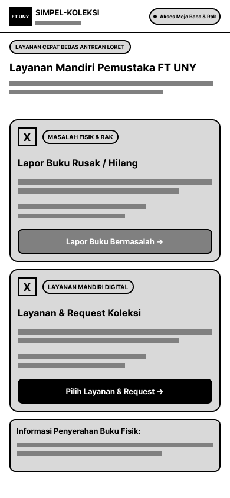
*Gambar 5.1 Wireframe Layar L1A Portal Seleksi Layanan Mandiri Pemustaka (Tampilan Seluler)*

Layar L1A pada Gambar 5.1 bertindak sebagai gerbang masuk utama saat mahasiswa memindai stiker kode QR di meja baca atau ujung lorong rak. Di bagian atas terpasang lencana identitas resmi Perpustakaan FT UNY dan penanda layanan bebas antrean loket, diikuti oleh dua kartu pilihan tegas yang memisahkan laporan kerusakan fisik dengan layanan mandiri digital sehingga mahasiswa tidak bingung memilih jalur pelaporan.

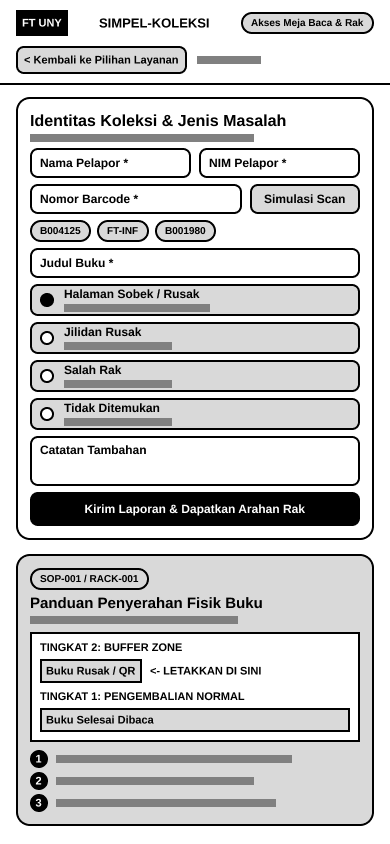
*Gambar 5.2 Wireframe Layar L1B Formulir Lapor Buku Rusak dan Panduan Rak Transit*

Layar L1B pada Gambar 5.2 mewujudkan formulir pelaporan ringkas empat elemen utama yang dilengkapi tombol sampel barcode cepat dan pemilihan kategori kerusakan tunggal. Keunggulan tata kelola layar ini tampak pada bagian bawah yang memuat skema visual Rak Transit agar mahasiswa segera meletakkan fisik buku bermasalah ke zona karantina setelah menekan tombol kirim.

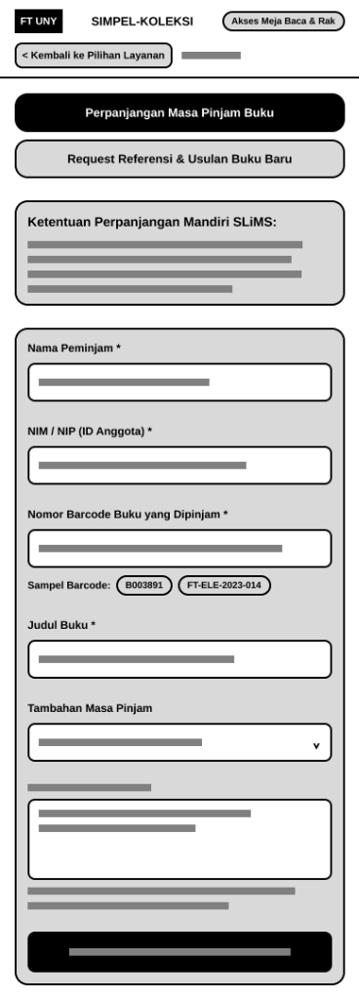
*Gambar 5.3 Wireframe Layar L1C Formulir Perpanjangan Masa Pinjam Mandiri SLiMS*

Layar L1C pada Gambar 5.3 memindahkan transaksi perpanjangan rutin dari loket tatap muka ke ponsel mahasiswa. Kotak kebijakan di bawah pengalih tab menegaskan aturan SLiMS bahwa buku tidak perlu dibawa ke perpustakaan dan batas perpanjangan dikunci pada tujuh hari kerja agar mahasiswa tidak dapat memanipulasi durasi pinjaman.

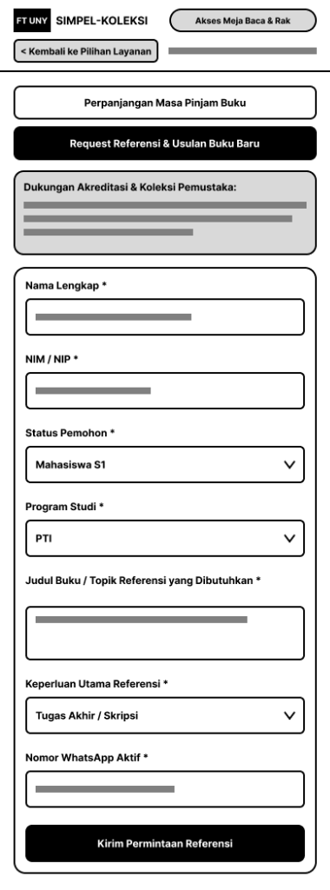
*Gambar 5.4 Wireframe Layar L1D Formulir Usulan Referensi dan Buku Baru LAM INFOKOM*

Layar L1D pada Gambar 5.4 membuka jalur pengusulan literatur baru secara partisipatif sepanjang tahun bagi mahasiswa dan dosen tanpa menunggu surat edaran tahunan. Pemilihan status pemohon, program studi, serta keperluan skripsi atau riset menjadi atribut kunci pengelompokan prioritas pengadaan buku pada level manajerial dan Dekanat.

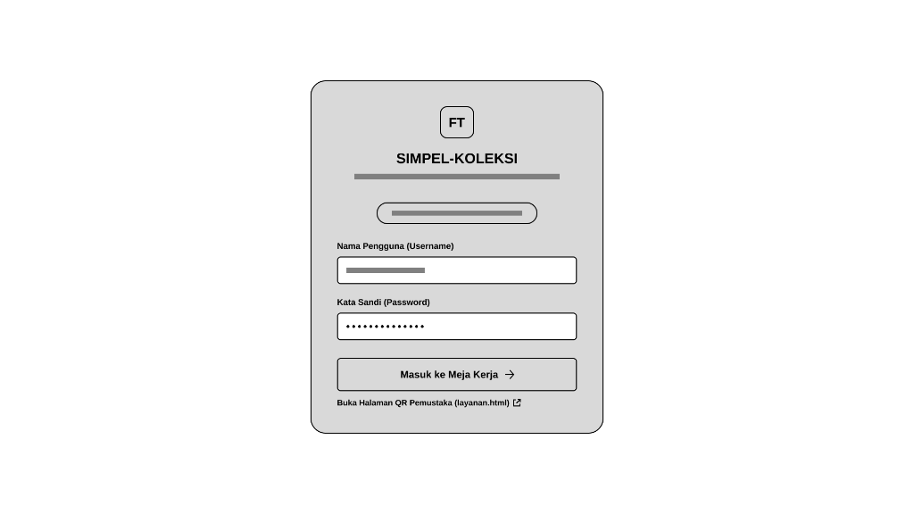
*Gambar 5.5 Wireframe Layar L2A Gerbang Autentikasi Meja Kerja Pustakawan*

Layar L2A pada Gambar 5.5 menerapkan kontrol akses berbasis peran pada komputer loket sirkulasi. Pemisahan gerbang autentikasi melindungi otoritas pustakawan tunggal sebagai pemegang kendali pembaruan inventaris SLiMS, sembari tetap menyediakan tautan pratinjau cepat ke portal QR mahasiswa guna memudahkan pengujian lintas sudut pandang.

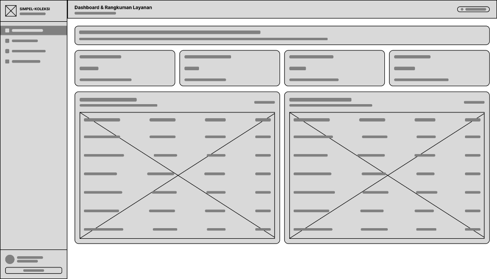
*Gambar 5.6 Wireframe Layar L2B Dashboard Utama dan Rangkuman Layanan Operasional*

Layar L2B pada Gambar 5.6 berfungsi sebagai kokpit pemantauan harian bagi pustakawan tunggal. Kehadiran bilah navigasi samping yang tetap, indikator status koneksi pangkalan data SLiMS 9, spanduk peringatan batas waktu SLA Quiet Hour, empat kartu metrik KPI, serta dua tabel ringkasan cepat membantu pustakawan menilai kondisi antrean dalam satu pandangan tanpa berpindah banyak jendela.

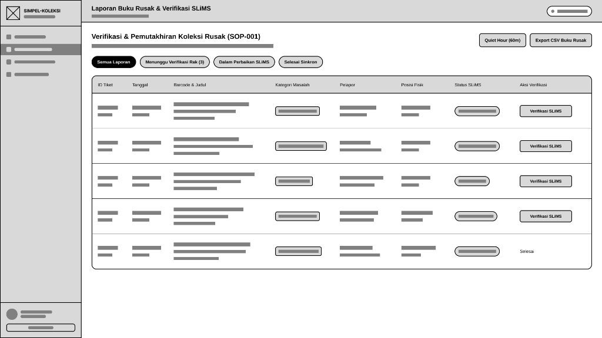
*Gambar 5.7 Wireframe Layar L2C Ruang Kerja Verifikasi Koleksi Rusak SOP 001*

Layar L2C pada Gambar 5.7 menampung seluruh tiket kerusakan buku yang dikirim dari lorong rak. Di sudut kanan atas terpasang tombol pengaktif sesi Quiet Hour 60 menit dan tombol ekspor CSV buku rusak, sedangkan di bagian tengah terdapat empat tab penyaring status antrean yang memisahkan laporan menunggu verifikasi fisik dari laporan yang sudah tuntas tersinkronisasi.

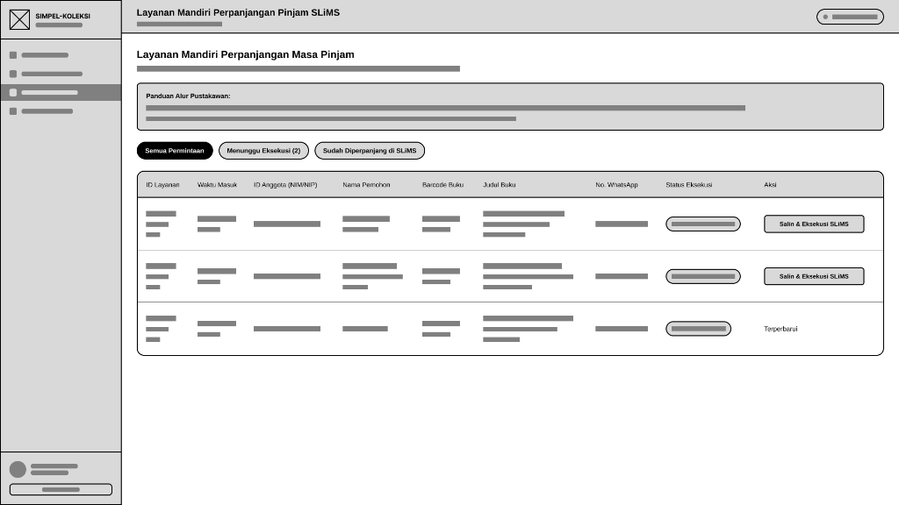
*Gambar 5.8 Wireframe Layar L2D Konsol Antrean Perpanjangan Masa Pinjam SLiMS*

Layar L2D pada Gambar 5.8 dirancang untuk mempercepat pemrosesan perpanjangan pinjam secara massal. Kehadiran tombol Salin dan Eksekusi SLiMS pada setiap baris data menyalin nomor barcode ke memori papan klip komputer loket sehingga petugas terhindar dari kesalahan pengetikan manual nomor barcode panjang.

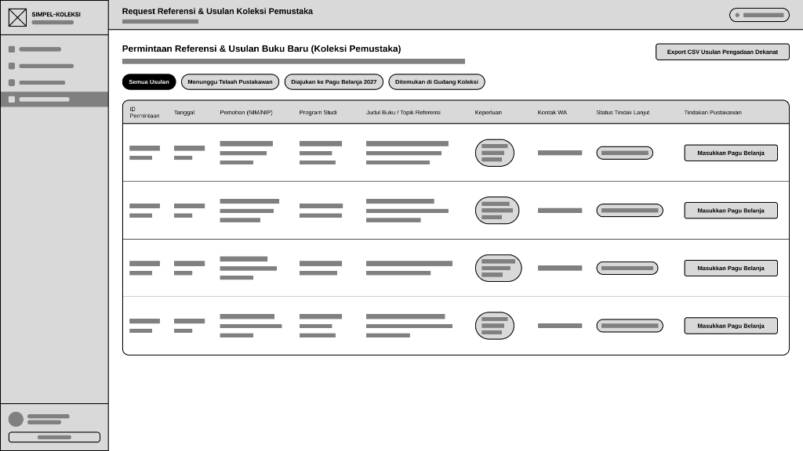
*Gambar 5.9 Wireframe Layar L2E Konsolidasi Usulan Koleksi Baru untuk Pagu Dekanat*

Layar L2E pada Gambar 5.9 menjembatani suara kebutuhan referensi sivitas akademika dengan perencanaan anggaran fakultas. Tab penyaring memungkinkan pustakawan menandai judul yang ternyata sudah tersimpan di gudang koleksi atau meneruskannya menjadi daftar pagu belanja tahunan melalui tombol ekspor berkas CSV Dekanat.

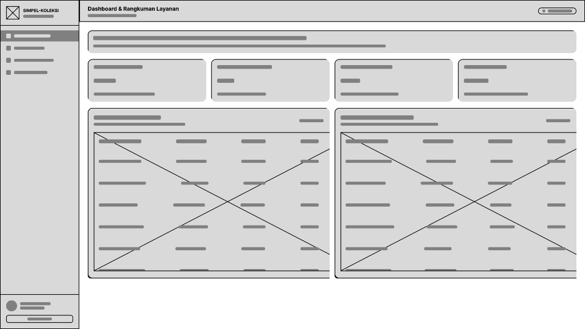
*Gambar 5.10 Wireframe Alternatif Tata Letak Ruang Kendali Meja Kerja Pustakawan*

Gambar 5.10 mendokumentasikan eksplorasi tata letak alternatif meja kerja terpadu pada tahap awal perancangan sebelum modul verifikasi, perpanjangan, dan usulan referensi dipisahkan ke dalam tab navigasi khusus untuk mengurangi kepadatan informasi di satu layar.

## 5.4. Transformasi Menjadi Purwarupa Interaktif High Fidelity Mockup 3 (Modul 9)

Pada Pertemuan 9, seluruh rancangan wireframe monokrom ditingkatkan menjadi **Purwarupa Interaktif Berfidelitas Tinggi (`Mockup 3`)** yang memisahkan kanal akses pemustaka (`layanan.html`) dan meja kerja pustakawan (`index.html`) tanpa membutuhkan instalasi server basis data eksternal. Untuk memenuhi standar tata kelola data, purwarupa tidak memakai teks acak tanpa makna, melainkan menggunakan data sampel faktual dari lingkungan FT UNY seperti nomor barcode `B004125`, `FT INF 2024 072`, dan nomor tiket terstandar sebagaimana diuraikan dalam Tabel 5.3.

**Tabel 5.3 Spesifikasi Data Contoh dan Kepemilikan Data (Data Ownership) pada Mockup 3**

| Layar Sasaran | Kelompok Data Contoh | Sumber Faktual Lapangan | Penanggung Jawab Kebenaran |
| :--- | :--- | :--- | :--- |
| Layar 1 dan 2 | Identitas pelapor dan kode barcode buku (misal B004125, Algoritma Pemrograman). | Basis data keanggotaan mahasiswa dan katalog SLiMS Perpustakaan FT UNY. | Pemustaka Pelapor dan Pustakawan Utama |
| Layar 5 dan 6 | Metrik antrean harian, peringatan batas waktu SLA, serta daftar tiket kondisi fisik. | Rekam jejak stempel waktu pelaporan mandiri dan observasi rak DDC FT UNY. | Pustakawan Utama FT UNY |
| Layar 7 dan 8 | Antrean perpanjangan aktif dan empat usulan literatur bidang informatika serta teknik. | Pangkalan data transaksi peminjaman SLiMS serta usulan referensi skripsi mahasiswa. | Pustakawan Utama dan Wakil Dekan FT UNY |

Selain menggunakan data autentik, purwarupa *Mockup 3* menyematkan logika penanganan kondisi khusus (*edge cases*) guna menjamin adopsi oleh petugas tunggal. Pertama, terdapat spanduk peringatan kuning batas waktu SLA apabila tiket mendekati ambang 3 hari kerja. Kedua, terdapat bilah pengatur waktu hitung mundur sesi Quiet Hour berdurasi 60 menit untuk mengunci fokus kerja petugas. Ketiga, terdapat tampilan status kosong (*empty state*) yang memberi kepastian bahwa seluruh laporan pada tab tersebut sudah tuntas ditangani. Keempat, terdapat validasi isian formulir yang mengunci tombol kirim dan menyorot kolom kosong tanpa menghapus data yang sudah diketik mahasiswa.

Seluruh delapan layar purwarupa interaktif berfidelitas tinggi ditampilkan berturut turut pada Gambar 5.11 hingga Gambar 5.18 sebagai bukti visual lengkap transformasi rancangan sistem informasi.

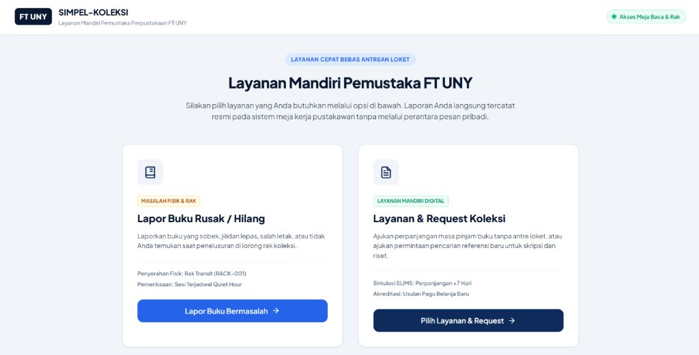
*Gambar 5.11 Mockup 3 Layar 1 Beranda Pilihan Layanan Mandiri Pemustaka*

Pada Gambar 5.11, portal pemustaka tampil bersih dengan hirarki visual biru akademik UNY, memisahkan akses pelaporan kerusakan fisik dan layanan perpanjangan maupun usulan buku dalam dua kartu besar yang mudah dipahami dalam sekali pandang.

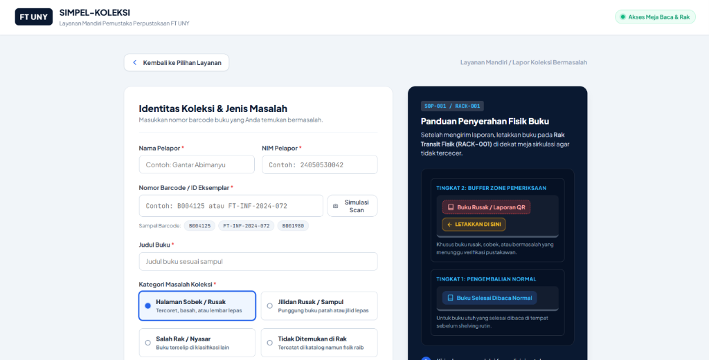
*Gambar 5.12 Mockup 3 Layar 2 Formulir Pelaporan Kerusakan Buku dan Diagram Rak Transit*

Gambar 5.12 memperlihatkan tata letak berdampingan antara formulir pelaporan empat kolom inti di sisi kiri dengan diagram zonasi Rak Transit dua tingkat di sisi kanan, sehingga pemustaka langsung mengetahui di mana fisik buku bermasalah harus diletakkan.

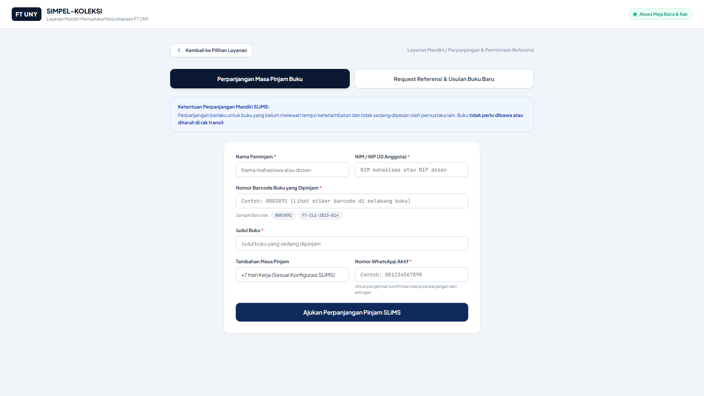
*Gambar 5.13 Mockup 3 Layar 3 Antarmuka Layanan Mandiri Digital Perpanjangan dan Request Buku*

Gambar 5.13 menampilkan layanan mandiri digital berbasis tab yang memungkinkan mahasiswa mengajukan perpanjangan masa pinjam atau mengusulkan referensi buku baru dari gawai masing masing tanpa harus antre di loket.

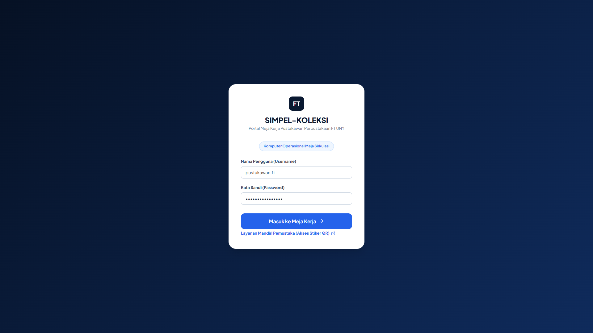
*Gambar 5.14 Mockup 3 Layar 4 Halaman Masuk Otorisasi Meja Kerja Pustakawan*

Gambar 5.14 menunjukkan gerbang masuk resmi bagi pengelola loket sirkulasi yang membatasi hak pemutakhiran inventaris hanya kepada petugas terotorisasi sekaligus menyediakan akses cepat ke halaman QR pemustaka.

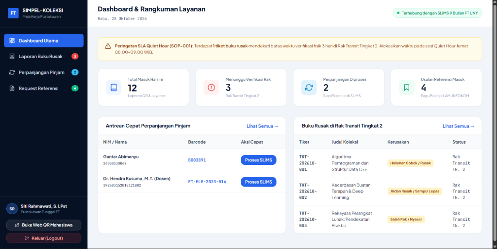
*Gambar 5.15 Mockup 3 Layar 5 Dashboard Utama dengan Peringatan SLA Quiet Hour dan Empat Kartu KPI*

Gambar 5.15 menyajikan pusat kendali operasional pustakawan tunggal yang dilengkapi lencana koneksi aktif SLiMS 9 Bulian, peringatan dini tiket mendekati batas 3 hari SLA, empat metrik KPI harian, dan panel antrean cepat berdampingan.

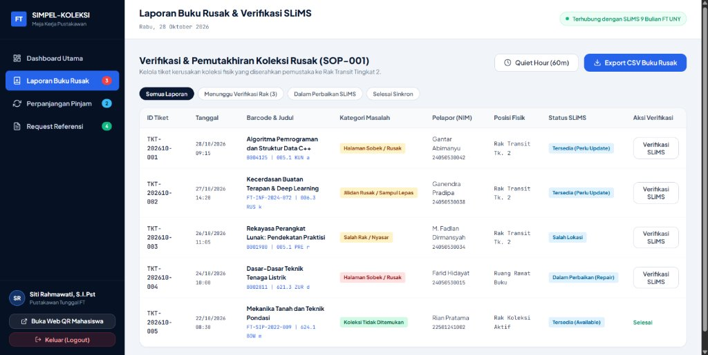
*Gambar 5.16 Mockup 3 Layar 6 Panel Verifikasi Koleksi Rusak, Timer 60 Menit, dan Ekspor CSV*

Gambar 5.16 memperlihatkan ruang kerja verifikasi SOP 001 yang mengintegrasikan tombol hitung mundur sesi Quiet Hour berdurasi 60 menit, penyaring status laporan, tombol verifikasi fisik, serta ekspor CSV laporan kondisi koleksi.

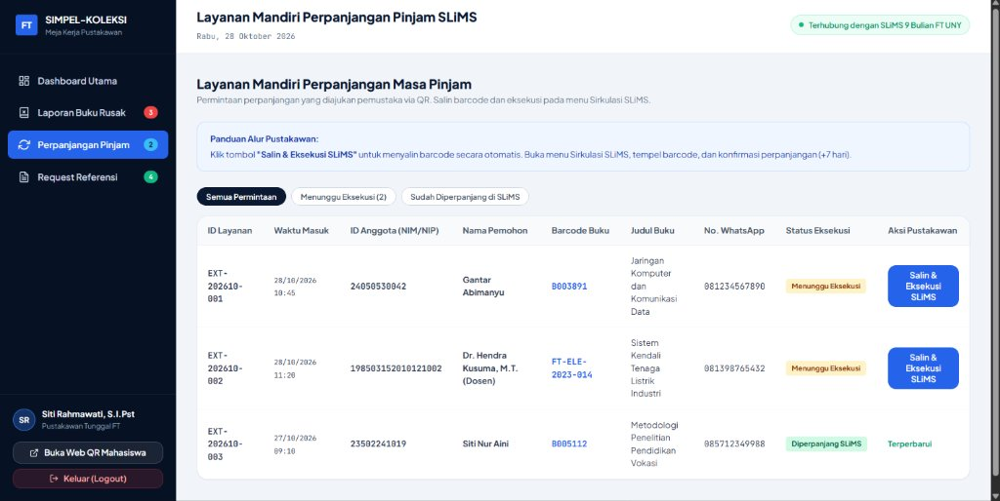
*Gambar 5.17 Mockup 3 Layar 7 Konsol Perpanjangan SLiMS dengan Tombol Salin Barcode Otomatis*

Gambar 5.17 menampilkan konsol manajemen perpanjangan pinjam yang dilengkapi instruksi alur petugas dan tombol Salin Barcode sekali klik guna mempercepat penyalinan kode eksemplar langsung ke modul sirkulasi SLiMS 9 Bulian.

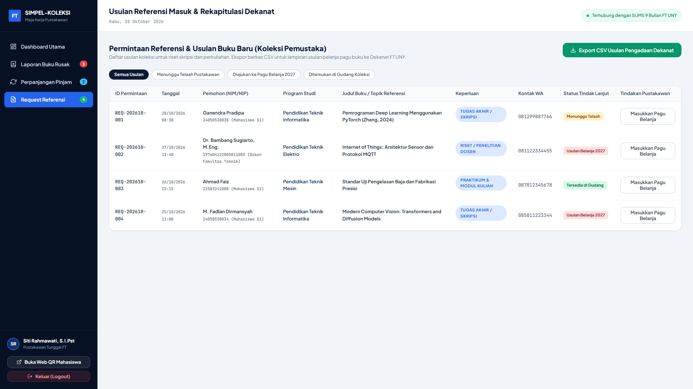
*Gambar 5.18 Mockup 3 Layar 8 Panel Usulan Referensi Baru dan Ekspor Disposisi Dekanat FT UNY*

Gambar 5.18 mendemonstrasikan penyelarasan strategis dari usulan referensi mahasiswa dan dosen hingga ke tingkat Dekanat melalui tombol ekspor usulan belanja buku baru yang siap dilampirkan pada rapat anggaran fakultas.

## 5.5. Penelusuran Kebutuhan dan Validasi Skenario Keputusan Pemangku Kepentingan (Modul 10)

Mengacu pada konsep penelusuran kebutuhan perangkat lunak oleh Gotel dan Finkelstein (1994), pada Pertemuan 10 kelompok memverifikasi bahwa kelima elemen masalah inti dari Pertemuan 3 telah terpetakan secara utuh ke delapan layar purwarupa *Mockup 3* tanpa satu pun kebutuhan yang terlewat, sebagaimana dibuktikan pada Tabel 5.4.

**Tabel 5.4 Matriks Penelusuran Kebutuhan Masalah ke Layar Antarmuka (Traceability Matrix)**

| Elemen Masalah Inti | Sasaran Kinerja Proyek | Layar Penangan | Status Cakupan |
| :--- | :--- | :--- | :--- |
| M1 Keengganan mahasiswa melapor buku rusak karena antrean loket sirkulasi padat | 100 persen aduan fisik dapat dikirim mandiri via QR di bawah satu menit. | Layar 1 dan Layar 2 (layanan.html) | Terpenuhi Utuh |
| M2 Buku terselip salah rak terbengkalai di meja baca tanpa penataan | 100 persen buku bermasalah dialirkan ke Rak Transit Zona Merah terpisah. | Layar 2 Diagram Rak Transit | Terpenuhi Utuh |
| M3 Ketergantungan menghubungi WhatsApp pribadi petugas untuk perpanjangan pinjam | Penurunan gangguan pesan pribadi ke petugas hingga lebih dari 80 persen. | Layar 3 dan Layar 7 | Terpenuhi Utuh |
| M4 Ketiadaan waktu fokus pemutakhiran data katalog SLiMS karena interupsi loket | Terselenggaranya sesi Quiet Hour 60 menit mingguan dan batas SLA verifikasi 3 hari. | Layar 5 dan Layar 6 (index.html) | Terpenuhi Utuh |
| M5 Ketiadaan rekap usulan referensi terstruktur untuk akreditasi dan Dekanat | Tersedianya ekspor usulan referensi berstandar borang LAM INFOKOM Kriteria 5. | Layar 8 (index.html) | Terpenuhi Utuh |

Pengujian pada Pertemuan 10 mengadopsi pendekatan **Validasi Skenario Keputusan**, yang membedakan evaluasi sistem informasi dari sekadar uji klik tombol konvensional ala Nielsen dan Molich (1990). Fokus pengujian diarahkan untuk menilai apakah informasi di layar benar benar membantu pengguna mengambil keputusan manajerial yang tepat. Keempat skenario keputusan dirumuskan pada Tabel 5.5, dan diujikan pada tanggal 27 hingga 30 Oktober 2026 terhadap tujuh responden dengan komposisi transparan pada Tabel 5.6.

**Tabel 5.5 Rancangan Skenario Pengujian Keputusan Pemangku Kepentingan (K1 hingga K4)**

| Kode | Aktor Penguji | Keputusan Manajerial yang Diuji | Indikator Keberhasilan Pengambilan Keputusan |
| :--- | :--- | :--- | :--- |
| K1 | Mahasiswa Pemustaka | Memutuskan melapor kerusakan buku tanpa login dan menaruh buku fisik di rak yang benar. | Melaporkan di bawah satu menit dan tepat mengarahkan buku ke Rak Transit Tingkat 2. |
| K2 | Pustakawan Tunggal | Memutuskan prioritas tiket verifikasi saat sesi Quiet Hour berdasarkan peringatan SLA. | Mendahulukan tiket berlabel merah atau kuning, menyalakan timer fokus, dan memeriksa fisik buku. |
| K3 | Pustakawan Tunggal | Memutuskan persetujuan perpanjangan pinjam dan menyinkronkannya ke SLiMS lokal. | Memanfaatkan tombol Salin Barcode satu klik ke SLiMS tanpa mengetik ulang kode manual. |
| K4 | Dekanat atau Pimpinan | Memutuskan prioritas pengadaan buku baru semester mendatang berdasarkan data riil. | Mengunduh berkas rekapitulasi usulan referensi dan menilai kesesuaiannya terhadap akreditasi. |

**Tabel 5.6 Profil Tujuh Responden Pengujian Lapangan dan Simulasi Peran Modul 10**

| No | Nama dan Identitas | Peran dalam Pengujian | Sifat Keterlibatan Responden |
| :--- | :--- | :--- | :--- |
| 1 | Dapa (NIP 199712052023022002) | Pustakawan Pengelola Perpustakaan FT UNY (Sesi 1) | Pemangku Kepentingan Nyata Lapangan (57,1 Persen Total Responden) |
| 2 | Abdul (NIP 199205122019031045) | Pustakawan Pengelola Perpustakaan FT UNY (Sesi 2) | Pemangku Kepentingan Nyata Lapangan |
| 3 | Wildan (NIM 24050530051) | Mahasiswa Aktif Pemustaka Fakultas Teknik UNY | Pemangku Kepentingan Nyata Lapangan |
| 4 | Daffa (NIM 24050530037) | Mahasiswa Aktif Pemustaka Fakultas Teknik UNY | Pemangku Kepentingan Nyata Lapangan |
| 5 | Saipul (NIM 24050530060) | Mahasiswa Pendidikan Teknik Informatika | Simulasi Peran Teman Sebaya (42,9 Persen Total Responden) |
| 6 | Rahmat (NIM 23050530032) | Mahasiswa Pendidikan Teknik Informatika | Simulasi Peran Teman Sebaya |
| 7 | Ahmad Zaky (NIM 24050530048) | Mahasiswa Pendidikan Teknik Informatika | Simulasi Peran Teman Sebaya |

Hasil pengukuran kuantitatif terhadap lima penguji sisi pemustaka serta triangulasi sepuluh dimensi operasional oleh dua pengelola perpustakaan nyata dirangkum pada Tabel 5.7 dan Tabel 5.8.

**Tabel 5.7 Rekapitulasi Skor Evaluasi Pemecahan Masalah oleh Pemustaka (M1 hingga M3)**

| Elemen Masalah yang Dinilai | Rincian Skor Lima Responden | Rerata Skor (Skala 5) | Ringkasan Umpan Balik Kualitatif |
| :--- | :--- | :--- | :--- |
| M1 Keengganan melapor buku rusak karena antrean loket | Saipul 5, Wildan 5, Rahmat 5, Zaky 5, Daffa 4 | 4,80 / 5,00 | Alur sangat mudah tanpa antre, namun perlu tanda terima konfirmasi dan stiker tahan gores. |
| M2 Buku salah rak dibiarkan di meja baca tanpa tindak lanjut | Saipul 5, Wildan 4, Rahmat 5, Zaky 5, Daffa 4 | 4,60 / 5,00 | Keberadaan Rak Transit sangat membantu penataan, perlu poster himbauan di ruang baca. |
| M3 Ketergantungan chat WhatsApp pribadi untuk perpanjangan | Saipul 5, Wildan 4, Rahmat 4, Zaky 2, Daffa 4 | 3,80 / 5,00 | Mengurangi rasa sungkan menghubungi pribadi petugas, namun mahasiswa butuh kepastian status persetujuan perpanjangan langsung terlihat. |

**Tabel 5.8 Triangulasi Penilaian Operasional Sepuluh Dimensi oleh Dua Pustakawan Lapangan**

| No | Dimensi Operasional Meja Kerja Pustakawan | Skor Dapa | Skor Abdul | Rerata Skor |
| :--- | :--- | :--- | :--- | :--- |
| 1 | Pemisahan hak akses login khusus pengelola perpustakaan | 5 | 5 | 5,00 |
| 2 | Kejelasan dasbor antrean tiket dan peringatan warna batas waktu SLA | 5 | 4 | 4,50 |
| 3 | Bantuan fitur hitung mundur sesi fokus Quiet Hour 60 menit | 4 | 4 | 4,00 |
| 4 | Efektivitas kontrol internal checklist verifikasi fisik ganda | 5 | 4 | 4,50 |
| 5 | Kemudahan tombol salin barcode satu klik ke sistem sirkulasi SLiMS | 5 | 5 | 5,00 |
| 6 | Penurunan gangguan pesan perpanjangan melalui WhatsApp pribadi petugas | 4 | 4 | 4,00 |
| 7 | Penyelesaian penumpukan fisik buku bermasalah di meja sirkulasi | 4 | 4 | 4,00 |
| 8 | Dukungan terhadap akurasi status ketersediaan koleksi pada katalog OPAC | 5 | 4 | 4,50 |
| 9 | Perlindungan waktu kerja administratif dari interupsi pengunjung | 4 | 4 | 4,00 |
| 10 | Tingkat kemudahan dan efisiensi keseluruhan alur kerja meja sirkulasi | 5 | 4 | 4,50 |
|  | RERATA KESELURUHAN PENILAIAN OPERASIONAL PUSTAKAWAN | 4,60 | 4,20 | 4,45 / 5,00 |

## 5.6. Analisis Celah Tata Kelola, Revisi Before vs After, dan Estimasi Manfaat

Meskipun skor rata keseluruhan mencapai tingkat penerimaan yang tinggi sebesar 4,45 dari 5,00, responden penguji memberikan delapan temuan kritis (T1 hingga T8) pada kolom evaluasi terbuka. Kelompok memisahkan secara cermat mana temuan yang diselesaikan melalui pembaruan antarmuka layar dan mana yang wajib ditangani melalui aturan non sistem di lapangan, sebagaimana didokumentasikan pada Tabel 5.9 dan estimasi manfaat pada Tabel 5.10.

**Tabel 5.9 Klasifikasi Delapan Temuan Celah Tata Kelola dan Tindak Lanjut Revisi (Before vs After)**

| Kode | Kategori Celah | Kondisi Sebelum Revisi (Before) | Tindakan Revisi Antarmuka atau Kebijakan (After) |
| :--- | :--- | :--- | :--- |
| T1 | Celah Informasi | Setelah tombol kirim ditekan, formulir tereset hanya dengan notifikasi kecil sehingga mahasiswa ragu apakah laporannya masuk. | Revisi Mockup 3: Memunculkan jendela modal tanda terima resmi berisi nomor tiket unik dan estimasi waktu verifikasi. |
| T2 | Celah Tata Kelola dan Adopsi | Penghitung waktu Quiet Hour hanya tampak di layar pustakawan, sementara mahasiswa tetap mengetuk loket karena tidak tahu. | Revisi Mockup 3 dan Kebijakan: Menampilkan spanduk kuning status Quiet Hour pada portal pemustaka serta pengadaan plang akrilik loket. |
| T3 | Celah Informasi | Tabel antrean meja kerja belum memiliki kolom pencarian cepat saat laporan ramai. | Revisi Mockup 3: Menambahkan bilah pencarian instan berbasis NIM, nama mahasiswa, atau pemindai barcode USB. |
| T4 | Celah Efisiensi Alur | Tombol salin barcode masih ditekan satu per satu sehingga memicu kelelahan klik. | Revisi Mockup 3: Menambahkan kotak centang pemilihan massal (batch selection) untuk menyalin banyak barcode sekaligus. |
| T5 | Celah Keputusan | Modal verifikasi fisik hanya mengubah status menjadi satu pilihan generik dalam perbaikan. | Revisi Mockup 3: Menambahkan daftar pilihan disposisi triase (Perbaikan Ringan Loket, Karantina Jilid, atau Usulan Penghapusan). |
| T6 | Celah Keselarasan Strategis | Ekspor data usulan Dekanat masih berupa berkas CSV mentah tanpa identitas surat resmi. | Revisi Mockup 3: Menambahkan fitur cetak Lembar Disposisi resmi beridentitas Kop Fakultas Teknik UNY dan kolom pengesahan pimpinan. |
| T7 | Celah Adopsi Kanal | Sebagian mahasiswa tetap mengirim chat perpanjangan ke WhatsApp pribadi karena sudah menyimpan kontak lama. | Tindakan di Luar Layar: Mengaktifkan pesan balasan otomatis WhatsApp Business yang mengarahkan langsung ke tautan resmi portal QR. |
| T8 | Catatan Kegunaan Fisik | Stiker kode QR berisiko pudar atau terkelupas akibat gesekan tas dan buku di meja baca. | Spesifikasi Fisik SOP 010: Memakai stiker vinil berlapis laminasi doff anti gores pada dudukan mika akrilik meja baca. |

**Tabel 5.10 Estimasi Manfaat Terukur dari Sudut Pandang Pemangku Kepentingan**

| Manfaat yang Diharapkan | Estimasi Dampak Terukur Berdasarkan Uji Simulasi | Sumber Pemberi Estimasi | Tingkat Keyakinan |
| :--- | :--- | :--- | :--- |
| Pemangkasan Waktu Pelaporan Pemustaka | Durasi melapor terpangkas dari 10 hingga 15 menit antre di loket menjadi kurang dari 1 menit di rak atau meja baca. | Mahasiswa Pemustaka (Wildan dan Zaky) | Tinggi |
| Penurunan Gangguan Chat Pribadi Petugas | Frekuensi pesan WhatsApp perpanjangan ke nomor pribadi petugas diperkirakan turun sekitar 80 hingga 90 persen. | Pustakawan Pengelola (Dapa dan Abdul) | Tinggi |
| Eliminasi Kesalahan Ketik Barcode | Risiko salah ketik nomor barcode panjang saat memproses sirkulasi SLiMS ditekan hingga nol lewat salin otomatis. | Pustakawan Pengelola (Dapa dan Abdul) | Tinggi |
| Kebersihan Fisik Meja Sirkulasi | Meja layanan utama terbebas dari tumpukan buku bermasalah karena langsung masuk ke Rak Transit Zona Merah. | Pustakawan Pengelola (Dapa dan Abdul) | Tinggi |
| Efisiensi Penyusunan Rekap Akreditasi | Waktu pengumpulan rekap usulan buku dan sirkulasi dipangkas dari berhari hari kerja manual menjadi satu kali ekspor CSV. | Pustakawan dan Tim Akreditasi | Sedang |

# BAB VI EVALUASI DAMPAK, ANALISIS RISIKO, REFLEKSI, DAN PENUTUP

## 6.1. Komparasi Menyeluruh Alur As Is dan Alur To Be

Transformasi inti yang dibawa oleh rancangan SIMPEL KOLEKSI adalah pergeseran budaya kerja perpustakaan dari mekanisme reaktif berbasis ingatan individu menuju tata kelola proaktif, terstandar, dan terjadwal dalam bentuk pemrosesan kelompok (*batch processing*). Perbandingan rinci antara alur kerja sebelum dan sesudah perancangan dirangkum dalam Tabel 6.1.

**Tabel 6.1 Komparasi Menyeluruh Alur Kerja Eksisting (As Is) terhadap Alur Kerja Baru (To Be)**

| Dimensi Proses | Alur Kerja Lama (As Is) | Alur Kerja Rancangan Baru (To Be) |
| :--- | :--- | :--- |
| Saluran Pelaporan | Disampaikan secara lisan di loket, pesan WhatsApp pribadi, atau secarik kertas memo yang rawan tercecer. | Satu pintu melalui Formulir Pelaporan Mandiri QR empat kolom inti dengan waktu pengisian di bawah satu menit serta nomor tiket otomatis. |
| Penanganan Fisik Buku | Ditumpuk langsung di atas meja sirkulasi tanpa pemisahan hingga berisiko terbawa kembali ke rak umum. | Dipisahkan langsung pada Rak Transit dua tingkat dengan Zona Merah tiga sekat triase (rusak ringan, rusak berat, salah letak). |
| Jadwal Input ke SLiMS | Dilakukan secara insidental saat waktu luang tanpa jadwal pasti sehingga tertunda 3 hingga 4 hari kerja. | Diproses sekaligus pada jadwal baku Quiet Hour 30 hingga 60 menit per minggu di jam sepi dengan SLA maksimal 3 hari verifikasi dan 7 hari pembaruan. |
| Kurasi Koleksi Usang | Belum tersedia mekanisme penyaringan sehingga buku teknik lama bercampur dengan buku mutakhir. | Template Ekstraksi CSV menyaring kandidat buku usang secara otomatis berdasarkan usia terbitan dan frekuensi pinjam nol sebelum divalidasi prodi. |
| Pelaporan ke Pimpinan | Diketik ulang secara manual dari nol ketika diminta mendadak oleh pimpinan fakultas atau tim akreditasi. | Rekapitulasi bulanan dan Lembar Disposisi beridentitas Kop FT UNY otomatis tersedia untuk Kepala Perpus, LAM INFOKOM Kriteria 5, dan Dekanat. |

## 6.2. Analisis Dampak Organisasi dan Pihak yang Diuntungkan versus Terbebani

Setiap perubahan tata kelola proses bisnis selalu memunculkan pihak yang memetik manfaat terbesar sekaligus pihak yang harus menanggung beban penyesuaian pada fase awal penerapan. Kepekaan menganalisis keseimbangan ini menjadi kunci keberhasilan manajemen perubahan di lingkungan kampus.

Pihak yang paling diuntungkan oleh rancangan ini adalah **Pustakawan Utama FT UNY** karena pekerjaannya menjadi jauh lebih tenang, terstruktur, terhindar dari gangguan pesan di luar jam kerja, dan terlindungi secara hukum organisasi oleh aturan SOP serta jadwal Quiet Hour. Di samping itu, **Kepala Perpustakaan, Tim Akreditasi Program Studi, dan Dekanat FT UNY** turut memperoleh keuntungan besar berupa tersedianya data inventarisasi serta keterpakaian koleksi yang siap audit kapan pun diperlukan untuk Borang LAM INFOKOM Kriteria 5 dan penyusunan anggaran buku baru. **Mahasiswa secara umum** juga diuntungkan karena keakuratan katalog OPAC meningkat sehingga mereka tidak kecewa mendapati status buku tersedia padahal fisiknya rusak atau hilang.

Sebaliknya, pihak yang berpotensi merasa sedikit terbebani pada masa transisi awal adalah **pemustaka yang sedang terburu waktu**, karena mereka tidak lagi sekadar meninggalkan buku di meja atau melapor lisan sambil berlalu, melainkan diminta meluangkan waktu kurang dari satu menit untuk memindai QR serta menaruh buku pada Rak Transit. Selain itu, **pengunjung yang datang bertepatan pada sesi Quiet Hour** harus menunggu sebentar apabila memerlukan layanan tatap muka di loket. Penyesuaian kecil tersebut telah dimitigasi dengan memindahkan sesi Quiet Hour ke jam pagi paling sepi kunjungan dan menyediakan tautan portal mandiri yang selalu aktif di gawai pemustaka.

## 6.3. Analisis Risiko Operasional dan Mekanisme Mitigasi

Walaupun rancangan tata kelola dan purwarupa telah divalidasi, penerapan berkelanjutan di lingkungan yang hanya memiliki satu pustakawan utama tetap menyimpan sejumlah risiko proses yang harus diantisipasi sejak dini. Tabel 6.2 merinci empat skenario risiko operasional utama beserta pengendaliannya di dalam tata kerja SOP.

**Tabel 6.2 Matriks Risiko Operasional dan Mekanisme Pengendalian Proses Bisnis**

| Skenario Risiko Proses | Dampak jika Terjadi | Mekanisme Pengendalian dan Mitigasi |
| :--- | :--- | :--- |
| Lonjakan laporan pada musim ujian sehingga sesi Quiet Hour 60 menit tidak mencukupi. | Buku menumpuk di Rak Transit dan melampaui target batas SLA tiga hari kerja. | Indikator warna merah di dasbor otomatis memicu pembukaan sesi Quiet Hour tambahan 30 menit di jam sepi dengan bantuan sortir fisik mahasiswa magang sesuai SOP 009. |
| Pemustaka salah memilih sekat, lupa mengisi QR, atau berniat iseng melaporkan buku sehat. | Ketidaksesuaian data laporan awal terhadap kondisi fisik buku sebenarnya. | Mahasiswa tidak memiliki hak mengubah database SLiMS secara langsung. Buku tetap terisolasi aman dan status SLiMS hanya diubah setelah verifikasi fisik oleh pustakawan. |
| Filter otomatis penyiangan (weeding) menandai buku rujukan klasik wajib yang dibaca di tempat. | Risiko buku penting ikut terhapus dari rak dan merugikan dosen serta mahasiswa. | Hasil filter Template CSV hanyalah daftar rekomendasi awal. Eksekusi penarikan permanen wajib melewati telaah Kepala Perpustakaan bersama Koordinator Program Studi. |
| Pustakawan utama sakit, cuti panjang, atau terjadi pergantian petugas pengelola. | Operasional alur baru kembali macet karena ketergantungan pada satu individu. | Seluruh tata cara kerja telah dibakukan dalam Buku Pedoman 10 SOP tertulis sehingga petugas pengganti atau mahasiswa magang dapat langsung mengikuti panduan baku tanpa bergantung ingatan pribadi. |

## 6.4. Refleksi Pembelajaran Lintas Modul 1 hingga Modul 10

Pelaksanaan proyek terpadu sepanjang sepuluh pertemuan memberikan pembelajaran mendasar bagi kelompok mengenai hakikat disiplin Manajemen Sistem Informasi. Pertama, persoalan informasi di dalam organisasi tidak selalu berakar pada ketiadaan perangkat lunak canggih. Meskipun Perpustakaan Fakultas Teknik UNY telah memiliki sistem otomasi SLiMS 9 Bulian yang stabil, kinerja informasi tetap terhambat apabila proses manusia, kejelasan kewenangan, jadwal kerja, serta sarana pemisahan fisiknya tidak ditata terlebih dahulu.

Kedua, pendekatan Tata Kelola Murni dan penelusuran kebutuhan yang ketat mencegah kelompok terjebak pada godaan rekayasa fitur berlebihan yang justru membebani satu orang pengelola di lapangan. Ketiga, keterlibatan langsung pengelola perpustakaan nyata dan mahasiswa pemustaka pada sesi validasi Modul 10 membuktikan bahwa rincian kecil seperti bukti tanda terima tiket digital, pengumuman status jam hening di ponsel pemustaka, serta tombol salin massal memiliki dampak jauh lebih besar terhadap keberterimaan sistem daripada sekadar tampilan grafis yang rumit.

## 6.5. Kesimpulan Akhir

Berdasarkan rangkaian perancangan, analisis, pembuatan purwarupa, hingga validasi lapangan dari Modul 1 hingga Modul 10, dapat ditarik tiga kesimpulan utama sebagai berikut:

1. Akar masalah keterlambatan pemutakhiran data koleksi selama 3 hingga 4 hari kerja pada Perpustakaan Fakultas Teknik UNY bukan disebabkan oleh kegagalan perangkat lunak SLiMS, melainkan oleh ketiadaan tata kelola proses kerja terpadu yang mampu mengakomodasi keterbatasan kapasitas satu pustakawan utama yang melayani tiga fungsi layanan sekaligus.
2. Ekosistem tata kelola SIMPEL KOLEKSI yang memadukan Buku Pedoman 10 SOP dan sesi Quiet Hour mingguan, Rak Transit pemisah fisik, Formulir Pelaporan Mandiri QR empat isian, serta Template Ekstraksi CSV SLiMS berfilter otomatis untuk penyaringan koleksi usang berhasil menyelaraskan aliran informasi dari tingkat operasional hingga pemenuhan Borang Akreditasi LAM INFOKOM Kriteria 5 dan perumusan anggaran Dekanat tanpa biaya pengadaan perangkat lunak baru.
3. Hasil validasi skenario keputusan terhadap tujuh responden yang melibatkan dua pustakawan lapangan dan lima mahasiswa menghasilkan skor rata operasional pustakawan sebesar 4,45 dari skala 5,00 serta delapan tindak lanjut penyempurnaan yang telah terakomodasi ke dalam rancangan revisi, menandakan bahwa keseluruhan artefak proyek telah siap untuk diuji coba secara terbimbing sesuai Jalur Kritis 36 hari kerja.

## 6.6. Rekomendasi Implementasi bagi Dekanat dan Pengelola Perpustakaan

Agar rancangan tata kelola SIMPEL KOLEKSI dan purwarupa tervalidasi ini dapat segera memberikan manfaat nyata di Perpustakaan Fakultas Teknik UNY, kelompok mengajukan tiga rekomendasi tindak lanjut kepada pemangku kepentingan terkait:

1. Dekanat Fakultas Teknik UNY melalui Wakil Dekan Bidang Akademik disarankan untuk menerbitkan pengesahan resmi jadwal sesi Quiet Hour mingguan berdurasi 30 hingga 60 menit pada hari kunjungan paling lengang serta mengadopsi Lembar Disposisi beridentitas Kop Fakultas sebagai standar usulan anggaran belanja buku tahunan.
2. Kepala Perpustakaan dan Pustakawan Utama disarankan untuk melaksanakan uji coba terbimbing selama 36 hari kerja mengikuti urutan Jalur Kritis Modul 7, diawali penyiapan dudukan akrilik QR Code berbahan tahan gores, pelabelan fisik Rak Transit di samping meja loket, serta pemanfaatan balasan otomatis WhatsApp Business untuk mengarahkan mahasiswa ke portal layanan resmi.
3. Koordinator Program Studi bersama pengelola perpustakaan disarankan untuk melakukan peninjauan berkala setiap akhir semester terhadap daftar kandidat penyiangan koleksi usang hasil ekstraksi CSV guna menjaga relevansi literatur kurikulum teknik sekaligus mengamankan rasio kecukupan pustaka pada asesmen akreditasi.

# DAFTAR PUSTAKA

1. Davis, F. D. (1989). Perceived usefulness, perceived ease of use, and user acceptance of information technology. MIS Quarterly, 13(3), halaman 319 hingga 340.
2. Goodhue, D. L., dan Thompson, R. L. (1995). Task technology fit and individual performance. MIS Quarterly, 19(2), halaman 213 hingga 236.
3. Gotel, O., dan Finkelstein, A. (1994). An analysis of the requirements traceability problem. Proceedings of the 1st International Conference on Requirements Engineering, halaman 94 hingga 101. IEEE Computer Society Press.
4. Keen, P. G. W., dan Scott Morton, M. S. (1978). Decision Support Systems: An Organizational Perspective. Addison Wesley Publishing Company.
5. Laudon, K. C., dan Laudon, J. P. (2014). Management Information Systems: Managing the Digital Firm (Edisi ke 13). Pearson Education.
6. Markus, M. L. (1983). Power, politics, and MIS implementation. Communications of the ACM, 26(6), halaman 430 hingga 444.
7. Nielsen, J., dan Molich, R. (1990). Heuristic evaluation of user interfaces. Proceedings of the SIGCHI Conference on Human Factors in Computing Systems, halaman 249 hingga 256. ACM.
8. Peraturan Menteri Pendayagunaan Aparatur Negara dan Reformasi Birokrasi Republik Indonesia Nomor 35 Tahun 2012 tentang Pedoman Penyusunan Standar Operasional Prosedur Administrasi Pemerintahan.
9. Project Management Institute. (2021). A Guide to the Project Management Body of Knowledge (PMBOK Guide) (Edisi ke 7). Project Management Institute.
10. Republik Indonesia. (2007). Undang Undang Nomor 43 Tahun 2007 tentang Perpustakaan. Lembaran Negara Republik Indonesia.
11. Rettig, M. (1994). Prototyping for tiny fingers. Communications of the ACM, 37(4), halaman 21 hingga 27.
12. Romney, M. B., dan Steinbart, P. J. (2018). Accounting Information Systems (Edisi ke 14). Pearson Education.
13. Sousa, K. J., dan Oz, E. (2014). Management Information Systems (Edisi ke 7). Cengage Learning.
14. Wardani, R. (2026). Modul 1 hingga Modul 10 Praktikum Manajemen Sistem Informasi (PTF60234). Program Studi Pendidikan Teknik Informatika, Fakultas Teknik, Universitas Negeri Yogyakarta.
15. Data Primer Lapangan Kelompok 3: Transkrip Wawancara Observasi (Wawancara 2), Transkrip Wawancara Operasional Sirkulasi (Wawancara 3), Catatan Kuliah Pertemuan 1 hingga 5, dan Rekapitulasi Kuisioner Validasi SIMPEL UNY Tahun 2026.

# LAMPIRAN A PEDOMAN LENGKAP SEPULUH STANDAR OPERASIONAL PROSEDUR SIMPEL KOLEKSI

Lampiran ini menyajikan konsolidasi lengkap sepuluh Standar Operasional Prosedur (SOP 001 hingga SOP 010) yang disusun sebagai dokumen normatif pengoperasian tata kelola Perpustakaan Fakultas Teknik Universitas Negeri Yogyakarta. Seluruh dokumen berstatus rancangan pedoman siap uji coba.

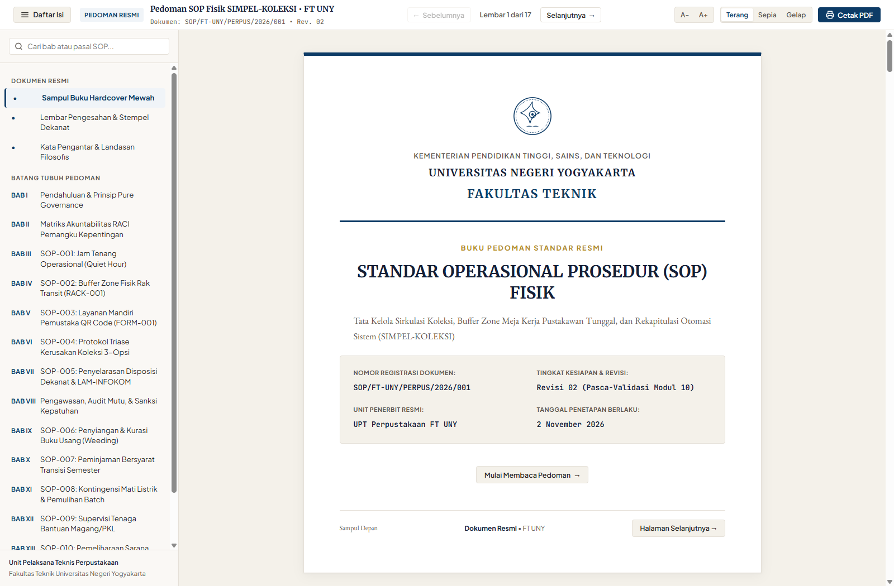
*Gambar A.1 Tampilan Halaman Sampul Resmi Buku Pedoman SOP Digital SIMPEL KOLEKSI*

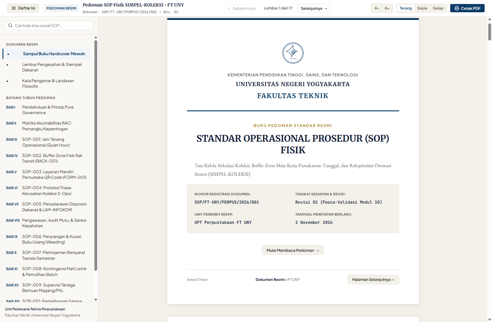
*Gambar A.2 Visualisasi Matriks Tanggung Jawab dan Prinsip Tata Kelola pada Buku Pedoman SOP*

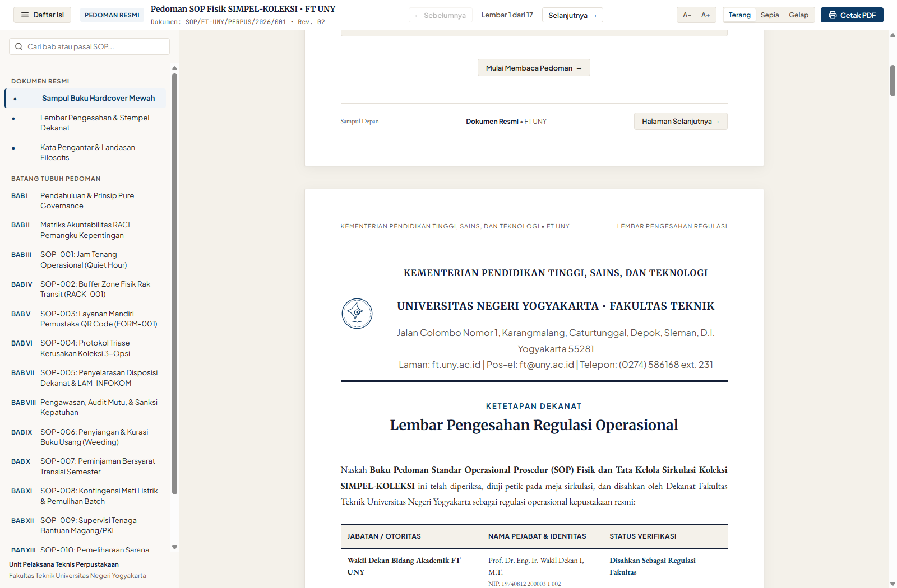
*Gambar A.3 Visualisasi Alur Triase Fisik Koleksi Bermasalah pada Buku Pedoman SOP*

## A.1. SOP 001 Pengelolaan Sesi Jam Tenang (Quiet Hour) dan Pemutakhiran Data Terfokus

Sesi Quiet Hour adalah alokasi waktu resmi berdurasi 30 hingga 60 menit setiap minggu pada hari dengan kepadatan kunjungan terendah, misalnya Jumat pagi pukul 08.00 hingga 09.00 WIB, ketika pelayanan tatap muka meja sirkulasi dialihkan sementara ke layanan mandiri agar pustakawan dapat memeriksa fisik buku di Rak Transit dan memutakhirkan data SLiMS tanpa interupsi. Apabila antrean tiket melebihi ambang batas kritis lebih dari tiga hari kerja, pustakawan membuka sesi Quiet Hour tambahan selama 30 menit di jam sepi. Selama sesi berlangsung, papan penanda fisik diletakkan di loket, spanduk pengumuman aktif ditampilkan pada portal pemustaka, dan ruang baca tetap terbuka dengan tenang bagi pengunjung.

## A.2. SOP 002 Tata Kelola Fisik Penangga Sementara Rak Transit (RACK 001)

Fasilitas Rak Transit ditempatkan di samping meja sirkulasi utama dan dibagi menjadi dua tingkat zonasi. Tingkat 1 (Zona Hijau) menampung buku utuh yang selesai dibaca di ruang baca untuk dikembalikan ke rak DDC pada sore hari. Tingkat 2 (Zona Merah) berfungsi mengisolasi koleksi bermasalah ke dalam tiga sekat triase yang jelas, meliputi Sekat A untuk rusak ringan, Sekat B untuk rusak berat, dan Sekat C untuk buku salah letak. Pemustaka dilarang mengambil atau meminjam buku yang berada di Zona Merah sebelum verifikasi fisik diselesaikan oleh petugas.

## A.3. SOP 003 Layanan Mandiri Pemustaka Berbasis Kode QR (FORM 001)

Stiker kode QR berbahan vinil laminasi ditempel pada dua belas meja baca, ujung setiap lorong rak program studi, serta di samping Rak Transit. Pemustaka yang menemukan buku bermasalah memindai kode QR untuk mengisi empat kolom informasi wajib secara ringkas tanpa harus login akun petugas, kemudian memperoleh slip tiket digital beserta arahan menaruh buku di Rak Transit Tingkat 2. Selain pelaporan kerusakan, portal QR menyediakan layanan perpanjangan masa pinjam mandiri maksimal satu kali per eksemplar selama tujuh hari kerja serta pengajuan usulan buku baru sepanjang tahun secara partisipatif. Standar batas waktu penyelesaian seluruh layanan diatur pada Tabel A.1.

**Tabel A.1 Ringkasan Target Waktu Layanan (SLA) Seluruh Layanan Mandiri SIMPEL KOLEKSI**

| Jenis Layanan Mandiri | Target Batas Waktu Penyelesaian | Mekanisme Tindak Lanjut Apabila Lewat Batas Waktu |
| :--- | :--- | :--- |
| Pelaporan Buku Rusak atau Salah Rak | Maksimal 3 Hari Kerja untuk Verifikasi Fisik dan 7 Hari Kerja untuk Pembaruan SLiMS | Indikator merah pada dasbor memicu pembukaan sesi Quiet Hour darurat. |
| Perpanjangan Masa Pinjam Mandiri SLiMS | Maksimal 1 Kali 24 Jam Kerja setelah Tiket Masuk | Dieksekusi massal melalui fitur salin barcode meja kerja pustakawan. |
| Usulan Referensi Buku Baru Sivitas | Dikompilasi per Siklus Semester untuk Pagu RKAT Fakultas | Dimasukkan dalam Lembar Disposisi resmi untuk persetujuan Wakil Dekan I. |

## A.4. SOP 004 Protokol Triase Fisik Koleksi Bermasalah

Pada saat verifikasi di sesi Quiet Hour, pustakawan memilah koleksi bermasalah pada Rak Transit ke dalam tiga opsi tindakan triase. Opsi A (Perbaikan Ringan Lima Menit di Loket) berlaku bagi sobekan tepi kurang dari tiga lembar atau salah letak rak, di mana buku direkatkan dengan selotip mika dan status SLiMS tetap Tersedia. Opsi B (Kerusakan Berat) berlaku bagi punggung jilid patah atau lebih dari sepuluh halaman rontok, sehingga buku dipindahkan ke lemari karantina penjilidan dan status SLiMS diubah menjadi Dalam Perbaikan. Opsi C (Penyiangan atau Hilang) berlaku apabila buku tidak ditemukan setelah penyisiran tiga kali lorong rak atau rusak berat akibat air dan jamur, sehingga status di SLiMS diubah menjadi Hilang dan diajukan penggantian. Eksemplar yang mengalami kerusakan berulang minimal dua kali dalam satu tahun dilarang ditangani dengan Opsi A dan wajib dialihkan ke penjilidan ulang atau pengusulan penggantian.

## A.5. SOP 005 Ekstraksi Data Sirkulasi, Akreditasi, dan Disposisi Dekanat (TMP 001)

Setiap akhir bulan atau akhir semester, pustakawan mengekspor data transaksi peminjaman SLiMS ke dalam berkas CSV lalu memasukkannya ke dalam Template Ekstraksi untuk menghitung rasio keterpakaian koleksi per program studi bagi Borang Akreditasi LAM INFOKOM Kriteria 5. Untuk pengajuan anggaran belanja buku tahunan kepada Dekanat, pustakawan mencetak Lembar Disposisi resmi beridentitas Kop Fakultas Teknik UNY yang memuat rincian daftar usulan prioritas beserta estimasi anggarannya, bukan menyerahkan berkas tabel mentah tanpa pengesahan.

## A.6. SOP 006 Penyiangan dan Kurasi Koleksi Usang (Weeding dan Pengelolaan Aset BMN)

Untuk mencegah buku teks lama yang sudah kedaluwarsa menumpuk di rak, Template Ekstraksi CSV menyaring secara otomatis koleksi bidang ilmu teknik dan komputer yang berusia minimal lima hingga sepuluh tahun dengan frekuensi peminjaman bernilai nol selama empat semester berturut turut. Daftar hasil penyaringan tersebut berstatus rekomendasi kandidat penyiangan dan wajib diperiksa oleh Wakil Dekan I bersama Koordinator Program Studi serta divalidasi oleh UPT Perpustakaan Pusat dan Bagian BMN Universitas sebelum diterbitkan Berita Acara resmi guna menentukan retur gudang, hibah ke sekolah kejuruan binaan, atau afkir aset, disertai pengusulan judul mutakhir pengganti.

## A.7. SOP 007 Peminjaman Bersyarat Masa Transisi Semester (SIAKAD Rollover Gap)

Apabila pada minggu awal perkuliahan terjadi keterlambatan sinkronisasi data anggota dari SIAKAD ke SLiMS oleh tim IT universitas sehingga mahasiswa aktif terbaca nonaktif, pustakawan dilarang menolak layanan. Mahasiswa cukup menunjukkan KRS aktif atau KTM fisik untuk dicatat dalam antrean peminjaman bersyarat maksimal satu eksemplar selama tiga hari kerja, lalu direkonsiliasi ke masa pinjam normal tujuh hari setelah data SIAKAD selesai diimpor tanpa dikenai denda.

## A.8. SOP 008 Kontinjensi Mati Listrik dan Pemulihan Sistem (Offline Blackout Recovery)

Ketika aliran listrik padam atau jaringan internet kampus terputus, layanan sirkulasi tetap berlangsung menggunakan Buku Log Cadangan Fisik Sampul Merah di meja loket yang mencatat tanggal, nomor barcode, NIM, nama, nomor kontak, serta paraf. Maksimal dalam 120 menit setelah listrik dan jaringan pulih kembali, pustakawan wajib menyalin seluruh transaksi darurat ke sistem SLiMS menggunakan masukan kilat salin massal sebelum meninggalkan ruangan kerja.

## A.9. SOP 009 Supervisi dan Kontrol Mutu Tenaga Bantuan Magang atau PKL

Mahasiswa magang atau peserta praktik kerja lapangan yang membantu operasional harian secara insidental dilarang keras memiliki akun administrator SLiMS atau menghapus serta mengubah nomor panggil katalog secara mandiri. Tenaga magang hanya diperbolehkan membantu penyisiran fisik rak, mengumpulkan buku dari Rak Transit, dan menginput temuan berstatus draf yang tetap harus divalidasi oleh pustakawan utama sebagai pemegang akuntabilitas hukum data katalog.

## A.10. SOP 010 Pemeliharaan Sarana Fisik Dudukan Akrilik dan Stiker Kode QR

Seluruh media kode QR di ruang baca wajib dicetak di atas bahan vinil doff berlapis laminasi dingin tahan gores dan dipasang pada dudukan akrilik bening berukuran A6 dengan ketebalan minimal dua milimeter. Petugas melakukan pembersihan mingguan sebelum sesi Quiet Hour dan menguji keterbacaan pemindaian lima titik acak setiap awal bulan guna menjamin tidak ada stiker pudar yang menghambat pelaporan mandiri pemustaka.

**Tabel A.2 Matriks Spesifikasi Baku Sepuluh Standar Operasional Prosedur (SOP 001 hingga SOP 010)**

| Kode SOP | Judul Prosedur Baku | Pelaksana Utama | Masukan dan Prasyarat | Keluaran dan Bukti Kepatuhan |
| :--- | :--- | :--- | :--- | :--- |
| SOP 001 | Pengelolaan Sesi Jam Tenang Quiet Hour | Pustakawan Utama FT UNY | Papan pengumuman loket, spanduk status aktif portal QR, dan daftar tiket antrean. | Verifikasi fisik buku dan pembaruan status SLiMS selesai sesuai SLA 3 dan 7 hari kerja. |
| SOP 002 | Tata Kelola Fisik Rak Transit Penampungan | Pemustaka dan Pustakawan Utama | Buku bacaan normal maupun koleksi rusak atau salah letak di ruang baca. | Koleksi sehat tertata pada Zona Hijau serta buku bermasalah terisolasi rapi di Zona Merah. |
| SOP 003 | Layanan Mandiri Pemustaka via Kode QR | Pemustaka Mahasiswa dan Dosen | Pemindaian stiker QR di lorong rak atau meja baca dan pengisian empat kolom wajib. | Terbit slip nomor tiket resmi pelaporan, perpanjangan masa pinjam, atau usulan referensi. |
| SOP 004 | Protokol Triase Fisik Koleksi Bermasalah | Pustakawan Utama FT UNY | Kondisi fisik buku pada Rak Transit Zona Merah serta catatan riwayat kerusakan tahunan. | Keputusan disposisi tiga opsi yakni perbaikan ringan loket, karantina jilid, atau usul penggantian. |
| SOP 005 | Ekstraksi Data Sirkulasi dan Disposisi Dekanat | Pustakawan Utama dan Kepala Perpus | Berkas ekspor CSV SLiMS 9 Bulian dan daftar usulan referensi terkurasi. | Tabel rasio keterpakaian LAM INFOKOM Kriteria 5 dan Lembar Disposisi Kop Fakultas Teknik. |
| SOP 006 | Penyiangan dan Kurasi Koleksi Usang (Weeding) | Pustakawan, Wadek I, Prodi, dan BMN | Filter usia terbitan 5 hingga 10 tahun dengan frekuensi pinjam nol pada Template CSV. | Berita Acara kandidat penyiangan resmi, retur gudang, hibah binaan, serta usulan judul pengganti. |
| SOP 007 | Peminjaman Bersyarat Masa Transisi Semester | Pustakawan Utama FT UNY | Bukti KRS Aktif atau KTM mahasiswa saat sinkronisasi SIAKAD ke SLiMS tertunda. | Catatan antrean pinjam bersyarat 1 buku selama 3 hari sebelum direkonsiliasi ke SLiMS. |
| SOP 008 | Kontinjensi Mati Listrik dan Pemulihan Sistem | Pustakawan Utama FT UNY | Buku Log Cadangan Fisik Sampul Merah di meja sirkulasi loket saat listrik padam. | Seluruh transaksi darurat tersalin kembali ke SLiMS maksimal 120 menit setelah sistem pulih. |
| SOP 009 | Supervisi dan Kontrol Mutu Tenaga Magang PKL | Pustakawan Utama dan Mahasiswa Magang | Hasil penyisiran fisik lorong rak dan pemilahan buku di Rak Transit. | Entri draf temuan fisik terpisah dari akun induk SLiMS dan disahkan oleh pustakawan utama. |
| SOP 010 | Pemeliharaan Dudukan Akrilik dan Stiker QR | Pustakawan dan Petugas Kebersihan Ruang | Stiker bahan vinil doff laminasi dingin anti gores pada dudukan akrilik ukuran A6. | Pembersihan rutin mingguan dan uji pindai bulanan sehingga 100 persen kode QR terbaca baik. |

# LAMPIRAN B DATA PRIMER WAWANCARA DAN REKAPITULASI VALIDASI LAPANGAN

Lampiran B mendokumentasikan ringkasan bukti empiris dari dua belas butir transkrip Wawancara 3, konteks organisasi sepuluh poin pada Wawancara 2, serta tabulasi lengkap suara tujuh responden validasi Modul 10 yang menjadi pijakan seluruh analisis di dalam laporan akhir ini.

## B.1. Ikhtisar Bukti Empiris Wawancara Lapangan (Wawancara 2 dan Wawancara 3)

Berdasarkan wawancara observasi awal (Wawancara 2) dan wawancara operasional sirkulasi terperinci (Wawancara 3) bersama pengelola Perpustakaan Fakultas Teknik UNY, diperoleh fakta lapangan bahwa satu orang pustakawan merangkap tiga fungsi layanan (Sirkulasi, Referensi, dan Digital Library) dengan rerata 52 pemustaka per hari, melapor secara struktural kepada Wakil Dekan Fakultas Teknik, dan berkoordinasi teknis dengan UPT Perpustakaan Pusat UNY. Tabel B.1 memetakan kedua belas butir temuan Wawancara 3, sedangkan Tabel B.2 merangkum sepuluh poin konteks organisasi dari Wawancara 2.

**Tabel B.1 Ikhtisar Butir Temuan Kunci Wawancara 3 dan Implikasi Rancangan Tata Kelola**

| Butir | Topik Pertanyaan Wawancara | Inti Jawaban Faktual Pustakawan Lapangan | Implikasi Desain dalam SIMPEL KOLEKSI |
| :--- | :--- | :--- | :--- |
| 1 | Alur Aktual Pemutakhiran | Informasi diterima pustakawan tunggal lewat lisan atau WhatsApp, diperiksa fisik, lalu diperbarui di SLiMS. | Perlunya alur tunggal terstandar dalam SOP agar tidak mengandalkan ingatan individu. |
| 2 | Titik Keterlambatan Utama | Penundaan paling sering terjadi sebelum verifikasi dan saat pembaruan SLiMS karena bersaing dengan antrean harian. | Menetapkan sesi Quiet Hour sebagai jeda proteksi pembaruan sistem. |
| 3 | Ketiadaan Jadwal dan SOP | Belum ada SOP tertulis maupun jadwal rutin, sehingga jadwal paling realistis adalah slot mingguan 30 hingga 60 menit di jam sepi. | Mengunci jadwal Quiet Hour mingguan setiap Jumat pagi beserta SLA 3 dan 7 hari. |
| 4 | Mekanisme Verifikasi Fisik | Pemeriksaan mencakup kondisi sampul, halaman, kecocokan nomor barcode dengan SLiMS, serta riwayat sirkulasi. | Menyematkan daftar periksa verifikasi fisik ganda sebelum penutupan tiket di Layar L3. |
| 5 | Pencatatan Sementara | Catatan masih tersebar di kertas memo, buku tulis, dan pesan WhatsApp pribadi kepada diri sendiri. | Menggantikan catatan tercecer dengan satu tabel antrean digital terpusat. |
| 6 | Kewenangan di SLiMS | Pustakawan berwenang penuh mengubah status eksemplar lokal menjadi Hilang, Rusak, Dalam Perbaikan, atau Tersedia. | Memfokuskan solusi pada otoritas lokal SLiMS tanpa menyentuh server pusat. |
| 7 | Tahap Melibatkan Pihak Lain | Penghapusan inventaris permanen (weeding), konfigurasi server, dan pengadaan buku membutuhkan persetujuan pimpinan dan Pusat. | Menyusun alur koordinasi berita acara penyiangan BMN serta Lembar Disposisi Dekanat. |
| 8 | Kelayakan Formulir QR | Pustakawan menyetujui formulir digital asal isian singkat, banyak opsi pilihan, dan diperiksa terjadwal mingguan. | Merancang portal layanan mandiri ringan berbasis kode QR dengan waktu pengisian di bawah satu menit. |
| 9 | Isian Wajib Formulir | Identitas koleksi (judul dan barcode), jenis masalah, lokasi rak, dan keterangan singkat bersifat wajib, sedangkan foto opsional. | Menetapkan standar minimal empat kolom wajib pada Formulir Pelaporan Mandiri QR. |
| 10 | Alur Tindak Lanjut Praktis | Alur ringkas meliputi penerimaan laporan, pemeriksaan awal, verifikasi fisik, pembaruan SLiMS, dan penutupan status. | Dituangkan langsung ke dalam urutan status tab meja kerja pustakawan di Layar L2C. |
| 11 | Kebutuhan Pemantauan | Petugas butuh melihat daftar laporan yang bisa disaring menurut status dan penanda tiket yang lewat batas waktu. | Menghadirkan empat tab penyaring status serta lencana kuning dan merah peringatan SLA. |
| 12 | Kebutuhan Laporan Berkala | Rekap bulanan dan per semester untuk daftar buku rusak berulang, rata waktu penyelesaian, serta usulan pengadaan ke fakultas. | Diwujudkan dalam fitur ekspor CSV Template Ekstraksi dan cetak Lembar Disposisi Dekanat. |

**Tabel B.2 Ikhtisar Sepuluh Poin Wawancara Observasi Awal (Wawancara 2) Perpustakaan FT UNY**

| Poin | Fokus Observasi Organisasi | Temuan Empiris Lapangan |
| :--- | :--- | :--- |
| 1 | Proses Pengelolaan Data Saat Ini | Bersifat semi manual dan diinput bertahap pada sela waktu pelayanan tatap muka. |
| 2 | Media dan Sistem yang Digunakan | SLiMS untuk katalog serta sirkulasi, buku manual saat darurat listrik, dan WhatsApp untuk permintaan referensi atau perpanjangan. |
| 3 | Jenis Data Paling Dibutuhkan | Keanggotaan aktif, status ketersediaan buku di rak, transaksi harian, serta statistik untuk pimpinan. |
| 4 | Akar Hambatan Beban Waktu | Satu pustakawan tunggal menangani tiga layanan sekaligus yakni Sirkulasi, Referensi, dan Digital Library. |
| 5 | Titik Keterlambatan Pembaruan | Terjadi saat pergantian semester untuk data keanggotaan serta pembaruan status buku rusak atau hilang. |
| 6 | Dampak Keterlambatan | Pelayanan melambat karena pengecekan fisik manual dan laporan ke pimpinan fakultas berisiko kurang mutakhir. |
| 7 | Strategi Penanganan Eksisting | Pemeriksaan silang manual antara catatan dengan sistem SLiMS serta memprioritaskan antrean peminjaman aktif. |
| 8 | Penyebab Utama Masalah | Beban pelayanan tinggi, sistem pelaporan belum terintegrasi, dan ketiadaan staf pembantu tetap. |
| 9 | Garis Komando Struktural | Bertanggung jawab administratif kepada Wakil Dekan FT UNY serta berkoordinasi teknis dengan Perpustakaan Pusat UNY. |
| 10 | Lingkungan Bisnis dan Regulasi | Mengacu pada Undang Undang Nomor 43 Tahun 2007, Standar Nasional Perpustakaan, borang akreditasi, serta anggaran fakultas terbatas. |

## B.2. Rekapitulasi Protokol Pengujian dan Suara Pemangku Kepentingan Modul 10

Instrumen pengujian Modul 10 disusun secara terstruktur dengan memisahkan jalur pertanyaan mahasiswa pemustaka dan pustakawan pengelola, serta mewajibkan setiap responden menulis alasan rasional di balik skor angka 1 hingga 5 yang dipilih. Dari 43 kolom rekaman tanggapan kuesioner digital `Kuisioner untuk SIMPEL UNY` terhadap tujuh responden, tabulasi terperinci suara dan kritik pemangku kepentingan dirangkum pada Tabel B.3.

**Tabel B.3 Tabulasi Lengkap Suara dan Kritik Tujuh Responden Validasi Lapangan Modul 10**

| Responden | Peran dan Sifat Pengujian | Penilaian Kuantitatif Utama | Kutipan Inti dan Saran Konstruktif Lapangan |
| :--- | :--- | :--- | :--- |
| Saipul (24050530060) | Mahasiswa Pemustaka (Simulasi Peran) | Skor M1: 5, M2: 5, M3: 5. | Alur pelaporan langsung ke inti masalah, mudah, masuk akal, dan mengarahkan langsung ke Rak Transit Tingkat 2. |
| Dapa (NIP 199712052023022002) | Pustakawan Pengelola Lapangan (Sesi 1) | Rerata 10 Dimensi: 4,60 dari 5,00 (Skor 5 pada login RBAC, dasbor SLA, checklist fisik, salin barcode, akurasi OPAC). | Indikator warna SLA sangat membantu prioritas kerja, salin barcode mencegah salah ketik, tetapi Quiet Hour tetap butuh pengumuman fisik agar pengunjung tidak nyelonong bertanya. |
| Wildan (24050530051) | Mahasiswa Pemustaka Nyata FT UNY | Skor M1: 5, M2: 4, M3: 4. | Tidak perlu login SSO saat terburu waktu dan tidak sungkan chat pribadi lagi. Menyarankan penambahan stiker pengingat dan notifikasi konfirmasi perpanjangan berhasil. |
| Rahmat (23050530032) | Mahasiswa Pemustaka (Simulasi Peran) | Skor M1: 5, M2: 5, M3: 4. | Menilai ketiadaan login SSO mempermudah pelaporan, Rak Transit mendorong penataan buku, dan sistem mengurangi rasa sungkan menghubungi pribadi petugas. |
| Ahmad Zaky (24050530048) | Mahasiswa Pemustaka (Simulasi Peran) | Skor M1: 5, M2: 5, M3: 2. | Memberi skor kritis 2 pada M3 karena kepastian status perpanjangan belum tampil otomatis di layar pemustaka, serta menyarankan tanda terima instan agar yakin laporan terkirim. |
| Daffa (24050530037) | Mahasiswa Pemustaka Nyata FT UNY | Skor M1: 4, M2: 4, M3: 4. | Diagram visual sangat jelas menunjuk letak Rak Transit. Menyarankan penggunaan bahan stiker tahan gores, poster himbauan di tiang ruang baca, dan estimasi waktu verifikasi. |
| Abdul (NIP 199205122019031045) | Pustakawan Pengelola Lapangan (Sesi 2) | Rerata 10 Dimensi: 4,20 dari 5,00 (Skor 5 pada pemisahan login serta salin barcode SLiMS). | Memberikan lima saran kunci yaitu kolom pencarian instan NIM atau barcode, tombol salin massal, tiga pilihan disposisi triase fisik, pengumuman Quiet Hour di layar pemustaka, serta cetak Lembar Disposisi beridentitas Kop FT UNY. |

## B.3. Penutup Laporan Akhir dan Pernyataan Keaslian Karya Kelompok

Seluruh bab, instrumen rancangan tata kelola, purwarupa antarmuka, dan hasil validasi pemangku kepentingan pada Laporan Akhir Proyek Praktikum Manajemen Sistem Informasi ini telah disusun, diaudit, serta diverifikasi berdasarkan data primer Perpustakaan Fakultas Teknik Universitas Negeri Yogyakarta. Dokumen ini menjadi arsip resmi capaian Kelompok 3 Pendidikan Teknik Informatika F1 Tahun Akademik 2026 dan siap digunakan sebagai bahan pertanggungjawaban responsi akhir.

Ditetapkan dan diselesaikan di Yogyakarta pada tanggal 25 November 2026 oleh Tim Penyusun Kelompok 3: Gantar Abimanyu (24050530042), Ganendra Pradipa (24050530038), dan M. Fadlan Dirmansyah (24050530034).
