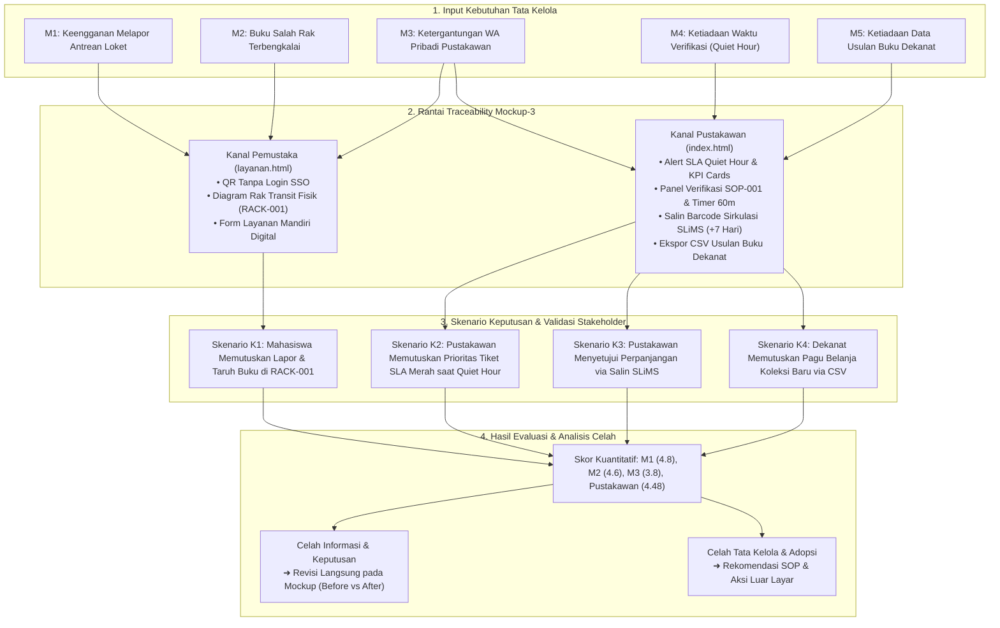

> 🔗 **Navigasi Vault:** Kembali ke [[Dashboard]] | [[CONTEXT_INDEX]] | Landasan Teori: [[Modul 10]] | Laporan Sebelumnya: [[Praktikum_9_Kelompok3]] | Artefak Blueprint: [[Blueprint_Ekosistem_SIMPEL_KOLEKSI_FT]] | Sumber Data Lapangan: [[Kuisioner PMSI]] | Berkas Prototipe Web: [`08_ARTEFAK/mockup-3/index.html`](file:///c:/PMSI/08_ARTEFAK/mockup-3/index.html) & [`08_ARTEFAK/mockup-3/layanan.html`](file:///c:/PMSI/08_ARTEFAK/mockup-3/layanan.html)

# LAPORAN PRAKTIKUM MINGGUAN
## MANAJEMEN SISTEM INFORMASI (PTF60234)
### PERTEMUAN 10: Validasi Mockup bersama Pemangku Kepentingan terhadap Masalah dan Keputusan

```
Disusun Oleh :
Kelompok 3

1. Gantar Abimanyu       (NIM 24050530042)
2. Ganendra Pradipa      (NIM 24050530038)
3. M. Fadlan Dirmansyah  (NIM 24050530034)

PROGRAM STUDI PENDIDIKAN TEKNIK INFORMATIKA - S1
FAKULTAS TEKNIK
UNIVERSITAS NEGERI YOGYAKARTA
2026
```

---

## 1. Identitas Laporan

| Atribut Laporan | Rincian Identitas |
| :--- | :--- |
| **Nama Kelompok** | Kelompok 3 |
| **Anggota (NIM / Nama)** | 1. Gantar Abimanyu (24050530042)<br>2. Ganendra Pradipa (24050530038)<br>3. M. Fadlan Dirmansyah (24050530034) |
| **Pertemuan ke-** | 10 (Sepuluh) |
| **Tanggal Pelaksanaan** | 30 Oktober 2026 |
| **Organisasi / Kasus yang Digunakan** | Perpustakaan Fakultas Teknik, Universitas Negeri Yogyakarta (FT UNY) |

---

## 2. Tujuan Kegiatan

Merujuk pada silabus CPMK 3 dan panduan akademik [[Modul 10]], kegiatan praktikum Pertemuan 10 ini bertujuan untuk:
1. Menelusuri keterkaitan rantai logis (*traceability*) antara elemen masalah Pertemuan 3, sasaran SMART Pertemuan 4, dan rancangan layar prototipe berfidelitas tinggi (*Mockup-3*) dari Pertemuan 9.
2. Memvalidasi artefak prototipe interaktif *SIMPEL-KOLEKSI FT* bersama pemangku kepentingan (*stakeholders*) melalui pengujian skenario keputusan (*decision-based validation*) dan penilaian kuantitatif-kualitatif terhadap elemen masalah organisasi.
3. Mengklasifikasikan seluruh temuan evaluasi lapangan ke dalam taksonomi empat celah tata kelola (Celah Informasi, Celah Keputusan, Celah Tata Kelola, Celah Adopsi) dan catatan kegunaan teknis disertai penentuan tingkat keparahannya.
4. Menetapkan tindakan revisi konkret pada antarmuka mockup (*Before vs After*) serta merumuskan rekomendasi intervensi kelembagaan non-sistem di luar layar sebagai landasan masukan analisis kecukupan (*adequacy analysis*) pada Pertemuan 11.
5. Menghimpun bukti empiris estimasi manfaat terukur (*perceived tangible benefits*) dari sudut pandang pemangku kepentingan untuk melandasi perhitungan pengembalian investasi (*Return on Investment* / ROI) pada Pertemuan 12.

---

## 3. Uraian Pelaksanaan Kegiatan

### 3.1. Penelusuran Keterkaitan Masalah ke Mockup (Traceability Analysis)
Landasan filosofis disiplin Manajemen Sistem Informasi (MSI) menegaskan bahwa artefak antarmuka yang baik tidak pernah berangkat dari asumsi grafis semata, melainkan harus berakar kokoh pada masalah nyata organisasi. Gotel dan Finkelstein (1994) mendefinisikan *traceability* sebagai kemampuan menelusuri riwayat kebutuhan (*requirements*) ke bentuk implementasi rancangan sistem, menjamin tidak ada masalah yang terlupakan dan tidak ada layar yang dibangun tanpa dasar kebutuhan yang sah.

Pada praktikum ini, Kelompok 3 memetakan 5 elemen masalah inti yang dirumuskan pada [[Praktikum_3_Kelompok_3_Revisi]] dan sasaran SMART pada [[Praktikum_4_Kelompok3_revisi]] ke dalam 8 layar operasional pada prototipe [`08_ARTEFAK/mockup-3/`](file:///c:/PMSI/08_ARTEFAK/mockup-3/). Penelusuran ini memastikan bahwa setiap piksel, tombol aksi, dan tabel pada kanal pemustaka ([`layanan.html`](file:///c:/PMSI/08_ARTEFAK/mockup-3/layanan.html)) dan meja kerja pustakawan ([`index.html`](file:///c:/PMSI/08_ARTEFAK/mockup-3/index.html)) secara langsung mengemban fungsi pemecahan masalah empiris Perpustakaan FT UNY.

### 3.2. Metodologi Pengujian Skenario Keputusan dan Karakteristik Responden
Berbeda dengan uji kegunaan perangkat lunak konvensional (*usability testing*) yang berfokus pada kemudahan menemukan tombol atau kecepatan navigasi menu (Nielsen & Molich, 1990), validasi pada Pertemuan 10 mengadopsi pendekatan **Skenario Keputusan (*Decision Scenario Validation*)**:
> *"Pengujian tidak menilai apakah pengguna bisa mengklik suatu tombol, melainkan apakah informasi yang disajikan pada layar memungkinkan pengguna mengambil keputusan manajerial yang tepat dan percaya diri untuk menyelesaikan masalah organisasi."*

Pengujian diselenggarakan pada tanggal 27 hingga 30 Oktober 2026 menggunakan instrumen kuesioner digital terstruktur berbasis Google Forms (`Kuisioner untuk SIMPEL-UNY`) dan uji coba antarmuka interaktif langsung. Sesuai etika akademik [[Modul 10]], komposisi **7 responden** yang terlibat dilaporkan secara transparan dan berimbang:
1. **Pemangku Kepentingan Nyata Lapangan (57,1% / 4 Responden):**
   - **Dapa (NIP 199712052023022002):** Pustakawan Pengelola Tunggal Perpustakaan FT UNY, bertindak sebagai penguji utama alur sirkulasi, verifikasi fisik koleksi, dan integrasi SLiMS (Sesi Pengujian 1).
   - **Abdul (NIP 199205122019031045):** Pustakawan Pengelola Tunggal Perpustakaan FT UNY, bertindak sebagai penguji lanjutan yang memberikan telaah kritis dan saran perbaikan komprehensif meja kerja (Sesi Pengujian 2).
   - **Wildan (NIM 24050530051):** Mahasiswa aktif Fakultas Teknik UNY, pemustaka riil yang rutin memanfaatkan ruang baca dan koleksi buku teknik.
   - **Daffa (NIM 24050530037):** Mahasiswa aktif Fakultas Teknik UNY, pemustaka riil pengguna layanan sirkulasi.
2. **Simulasi Peran Teman Sebaya / Role-Play Simulation (42,9% / 3 Responden):**
   - **Saipul (NIM 24050530060), Rahmat (NIM 23050530032), dan Ahmad Zaky (NIM 24050530048):** Mahasiswa Pendidikan Teknik Informatika yang menjalankan skenario peran sebagai pemustaka mandiri untuk menguji kekokohan alur pelaporan, kejelasan petunjuk visual rak transit, dan responsivitas formulir.

Keterlibatan dua pustakawan nyata lapangan memperkokoh derajat triangulasi data, sehingga kritik dan saran yang diperoleh merepresentasikan kondisi nyata meja sirkulasi Perpustakaan FT UNY.

### 3.3. Penegakan 4 Aspek Pengelolaan MSI Fokus Pertemuan 10
Pelaksanaan validasi Pertemuan 10 dipandu secara ketat oleh 4 pilar kerangka pengelolaan MSI Bu Ratna:
1. **Aspek 1 (Keselarasan Strategis / Strategic Alignment):**  
   Validasi memeriksa apakah modul ekspor data pada Layar 8 mampu menghasilkan bukti fisik angka sirkulasi dan usulan buku yang dapat langsung diserap oleh Dekanat FT UNY untuk penyusunan Rencana Kerja dan Anggaran Tahunan (RKAT) serta pemenuhan borang akreditasi LAM-INFOKOM Kriteria 5.
2. **Aspek 3 (Dukungan Pengambilan Keputusan / Decision Support):**  
   Menilai efektivitas banner peringatan *SLA Quiet Hour* dan indikator warna tiket dalam memandu Pustakawan Tunggal memutuskan buku mana yang harus diprioritaskan perbaikannya saat waktu kerja sangat terbatas (60 menit per minggu).
3. **Aspek 4 (Kebutuhan Informasi Stakeholder / Information Needs):**  
   Menyesuaikan informasi yang disajikan dengan peran pengguna: mahasiswa di lorong rak membutuhkan kepastian tanda terima pelaporan dan lokasi penyerahan fisik buku (Rak Transit Tingkat 2), sedangkan pustakawan di meja loket membutuhkan kelengkapan nomor barcode eksemplar, call number DDC, dan tombol salin data instan.
4. **Aspek 7 (Adopsi dan Perilaku Organisasi terhadap Sistem Informasi):**  
   Mengevaluasi kesiapan mental dan perubahan perilaku kerja Pustakawan Tunggal yang selama ini terbebani interupsi pesan WhatsApp pribadi dan tumpukan buku fisik di meja kerja sirkulasi, serta perilaku mahasiswa dalam membiasakan diri menaruh buku ke rak penampungan khusus.



---

## 4. Hasil dan Artefak Praktikum

### 4.1. Tautan Artefak Mockup Interaktif & Desain Figma

> [!IMPORTANT]
> ### 🎨 Tautan Mockup Interaktif Figma & Prototipe Web
> Sesuai rubrik asesmen proyek Pertemuan 10, berikut adalah tautan prototipe interaktif *SIMPEL-KOLEKSI FT* yang telah disiapkan untuk pengujian pemangku kepentingan dan evaluasi dosen:
>
> * 🔗 **Tautan Prototipe Figma Interaktif:**  
>   👉 `[TEMPELKAN_LINK_FIGMA_DI_SINI]`  
>   *(Silakan ganti placeholder teks di atas dengan tautan share/prototype Figma yang dapat diakses publik/penguji)*
>
> * 💻 **Tautan Berkas Prototipe Web Mandiri (Mockup-3 Lokal):**
>   * Portal Meja Kerja Pustakawan: [`08_ARTEFAK/mockup-3/index.html`](file:///c:/PMSI/08_ARTEFAK/mockup-3/index.html)
>   * Portal Layanan Mandiri Pemustaka: [`08_ARTEFAK/mockup-3/layanan.html`](file:///c:/PMSI/08_ARTEFAK/mockup-3/layanan.html)
>   * Tata Gaya Desain (*CSS Tokens*): [`08_ARTEFAK/mockup-3/styles.css`](file:///c:/PMSI/08_ARTEFAK/mockup-3/styles.css)
>   * Mesin Simulasi & Logika Data: [`08_ARTEFAK/mockup-3/app.js`](file:///c:/PMSI/08_ARTEFAK/mockup-3/app.js)

---

### 4.2. Matriks Penelusuran Masalah ke Mockup (Traceability Matrix)

Matriks penelusuran membuktikan keterkaitan langsung antara elemen masalah empiris, sasaran proyek, keputusan yang dituju, dan layar antarmuka *Mockup-3*:

| Elemen Masalah (Pertemuan 3) | Sasaran atau KPI (Pertemuan 4) | Keputusan yang Diharapkan | Layar (ID) | Ada Layar? | Sumber / Metode |
| :--- | :--- | :--- | :---: | :---: | :--- |
| **M1:** Keengganan mahasiswa melapor buku rusak karena antrean loket sirkulasi yang padat | 100% laporan kerusakan buku fisik dapat dikirimkan secara mandiri via ponsel tanpa harus mengantre di loket | Mahasiswa memutuskan segera melapor dari meja baca saat pertama kali menemukan kerusakan buku | **L1, L2** (`layanan.html`) | Ada | Sasaran SMART Modul 4; Mockup-3 Layar 1 & Layar 2 |
| **M2:** Buku yang terselip salah rak dibiarkan begitu saja di meja baca tanpa tindak lanjut penataan | 100% buku salah letak atau sobek dialirkan ke rak transit khusus dan tidak menumpuk di meja baca | Mahasiswa memutuskan memindahkan buku fisik ke Rak Transit Tingkat 2 terzonasi | **L2** (`layanan.html`) | Ada | Rancangan RACK-001 Modul 4; Mockup-3 Layar 2 (Diagram Rak) |
| **M3:** Ketergantungan menghubungi WhatsApp pribadi pustakawan untuk perpanjangan masa pinjam buku | Penurunan frekuensi pesan WhatsApp sirkulasi ke nomor pribadi pustakawan hingga >80% | Mahasiswa memutuskan memperpanjang buku via web mandiri; Pustakawan mengeksekusi sirkulasi tanpa membuka chat | **L3** (`layanan.html`) & **L7** (`index.html`) | Ada | Hasil wawancara [[Jawaban3_Final]]; Mockup-3 Layar 3 & Layar 7 |
| **M4:** Ketiadaan alokasi waktu hening pemutakhiran data katalog SLiMS karena interupsi loket *(Akar Masalah)* | Terlaksananya sesi rutin *Quiet Hour* 60 menit per minggu untuk verifikasi fisik dan pembaruan katalog SLiMS | Pustakawan memutuskan menjadwalkan dan mengaktifkan sesi hening tanpa interupsi meja loket | **L5, L6** (`index.html`) | Ada | Dokumen SOP-001 Modul 4; Mockup-3 Layar 5 & Layar 6 |
| **M5:** Ketiadaan rekaman data kebutuhan referensi pemustaka untuk justifikasi belanja buku akreditasi Dekanat | Tersedianya rekapitulasi usulan referensi mahasiswa dan dosen berstandar akreditasi LAM-INFOKOM Kriteria 5 | Dekanat FT UNY memutuskan persetujuan alokasi 35% pagu anggaran pengadaan referensi baru prodi | **L8** (`index.html`) | Ada | Analisis Grand Design Modul 5; Mockup-3 Layar 8 (Ekspor CSV) |

---

### 4.3. Lembar Kerja Bagian A: Skenario Keputusan

Skenario pengujian disusun untuk menguji kapasitas antarmuka dalam mendukung pengambilan keputusan pemangku kepentingan:

| ID | Peran Pemangku Kepentingan | Keputusan yang Dituju | Layar (ID) | Keberhasilan Dinilai dari |
| :---: | :--- | :--- | :---: | :--- |
| **K1** | Mahasiswa Pemustaka FT UNY | Memutuskan melapor buku rusak tanpa hambatan akun dan menentukan lokasi penyerahan fisik buku yang tepat | **L1, L2** | Peserta melapor dalam durasi < 1 menit dan secara tepat menyebutkan bahwa fisik buku harus diletakkan pada Rak Transit Tingkat 2 di dekat meja loket. |
| **K2** | Pustakawan Pengelola Tunggal | Menentukan urutan prioritas verifikasi fisik buku rusak saat jam *Quiet Hour* dibuka berdasarkan batas waktu SLA | **L5, L6** | Pustakawan memilih tiket berlabel merah/kuning (mendekati 3 hari SLA) terlebih dahulu, mengaktifkan timer fokus 60m, dan memvalidasi checklist ganda sebelum menutup tiket. |
| **K3** | Pustakawan Pengelola Tunggal | Memvalidasi permohonan perpanjangan masa pinjam mandiri dan menyinkronkan data sirkulasi ke SLiMS lokal | **L7** | Pustakawan memanfaatkan tombol *Salin Barcode* 1-klik untuk mengeksekusi penambahan masa pinjam (+7 hari) di SLiMS tanpa mengetik ulang barcode peminjam. |
| **K4** | Dekanat / Pimpinan Fakultas | Menentukan prioritas persetujuan alokasi belanja buku baru semester depan berdasarkan bukti usulan pemustaka | **L8** | Pimpinan berhasil mengunduh berkas CSV rekapitulasi usulan referensi dan melihat relevansinya dengan kebutuhan borang akreditasi program studi. |

---

### 4.4. Lembar Kerja Bagian B: Penilaian Pemangku Kepentingan terhadap Elemen Masalah

Berikut adalah tabulasi data mentah hasil kuesioner evaluasi yang dihimpun secara otentik dari berkas `Kuisioner untuk SIMPEL-UNY (Jawaban) - Form Responses 1.csv`:

| Elemen Masalah | Penilai (Peran & Sifat) | Skor (1-5) | Alasan Penilai (*Voice of Stakeholder*) | Yang Masih Kurang | Sumber / Metode |
| :--- | :--- | :---: | :--- | :--- | :--- |
| **M1:** Keengganan mahasiswa melapor buku rusak karena antrean loket sirkulasi padat | Saipul (Mahasiswa - Simulasi) | **5** | Alur pelaporan langsung ke inti masalah, jauh lebih mudah dan praktis tanpa antre di loket sirkulasi. | Sudah sangat memadai. | Form Responses CSV Baris 1 |
| **M1:** Keengganan mahasiswa melapor buku rusak karena antrean loket sirkulasi padat | Wildan (Mahasiswa - Nyata) | **5** | Mahasiswa tidak perlu ikut antre di loket sirkulasi hanya untuk menyerahkan buku rusak, cukup lapor lewat HP dan letakkan di rak transit. | Perlu stiker pengingat tambahan di beberapa sudut meja baca agar semakin banyak yang sadar fitur ini. | Form Responses CSV Baris 3 |
| **M1:** Keengganan mahasiswa melapor buku rusak karena antrean loket sirkulasi padat | Rahmat (Mahasiswa - Simulasi) | **5** | Dengan adanya program sistem pelaporan mandiri ini, masalah keengganan melapor langsung teratasi. | Menurut saya sudah cukup. | Form Responses CSV Baris 4 |
| **M1:** Keengganan mahasiswa melapor buku rusak karena antrean loket sirkulasi padat | Ahmad Zaky (Mahasiswa - Simulasi) | **5** | Pelaporan melalui QR Code memungkinkan mahasiswa melapor mandiri tanpa harus antre. Proses lebih cepat dan efisien. | Perlu notifikasi/tanda terima bahwa laporan berhasil terkirim agar mahasiswa yakin buku tercatat. | Form Responses CSV Baris 5 |
| **M1:** Keengganan mahasiswa melapor buku rusak karena antrean loket sirkulasi padat | Daffa (Mahasiswa - Nyata) | **4** | Mahasiswa bisa langsung lapor dari meja baca tanpa harus ikut antrean panjang meja loket. | Stiker QR Code dibuat lebih tahan gores agar tidak cepat rusak kena gesekan tas atau buku. | Form Responses CSV Baris 6 |
| **M2:** Buku terselip salah rak dibiarkan di meja baca tanpa tindak lanjut | Saipul (Mahasiswa - Simulasi) | **5** | Penataan alur sangat masuk akal dan jelas mengarahkan buku ke tempat penampungan. | Sudah cukup jelas. | Form Responses CSV Baris 1 |
| **M2:** Buku terselip salah rak dibiarkan di meja baca tanpa tindak lanjut | Wildan (Mahasiswa - Nyata) | **4** | Sudah ada wadah khusus untuk mengembalikan dan melaporkan buku yang salah tempat, meja baca jadi tidak berantakan. | Masih tergantung kesadaran mahasiswa untuk memindahkan buku ke rak transit, kadang ada yang tetap ditinggal di meja. | Form Responses CSV Baris 3 |
| **M2:** Buku terselip salah rak dibiarkan di meja baca tanpa tindak lanjut | Rahmat (Mahasiswa - Simulasi) | **5** | Mahasiswa memiliki dorongan untuk menaruh buku ke rak karena sudah disediakan tempat khusus yang terpisah. | Sudah memadai. | Form Responses CSV Baris 4 |
| **M2:** Buku terselip salah rak dibiarkan di meja baca tanpa tindak lanjut | Ahmad Zaky (Mahasiswa - Simulasi) | **5** | Fasilitas pelaporan dan petunjuk visual Rak Transit Tingkat 2 membantu mahasiswa mengetahui tindakan yang harus dilakukan. | Perlu penegasan kategori khusus buku salah rak beserta petunjuk penanganannya agar tidak salah letak. | Form Responses CSV Baris 5 |
| **M2:** Buku terselip salah rak dibiarkan di meja baca tanpa tindak lanjut | Daffa (Mahasiswa - Nyata) | **4** | Jauh berkurang karena sekarang mahasiswa tahu ada rak khusus untuk menaruh buku yang salah tempat. | Perlu poster kecil himbauan di tiang-tiang ruang baca agar mahasiswa makin peduli dan membiasakan diri. | Form Responses CSV Baris 6 |
| **M3:** Ketergantungan menghubungi WhatsApp pribadi pustakawan untuk perpanjangan | Saipul (Mahasiswa - Simulasi) | **5** | Sangat membantu memindahkan jalur perpanjangan ke sistem resmi yang rapi. | Sudah memadai. | Form Responses CSV Baris 1 |
| **M3:** Ketergantungan menghubungi WhatsApp pribadi pustakawan untuk perpanjangan | Wildan (Mahasiswa - Nyata) | **4** | Alur perpanjangan mandiri lewat sistem membuat mahasiswa tidak sungkan lagi mengirim chat ke nomor pribadi petugas di luar jam kerja. | Bisa ditambahkan konfirmasi/notifikasi bahwa perpanjangan pinjam benar-benar berhasil disetujui. | Form Responses CSV Baris 3 |
| **M3:** Ketergantungan menghubungi WhatsApp pribadi pustakawan untuk perpanjangan | Rahmat (Mahasiswa - Simulasi) | **4** | Cukup membantu mengatasi ketergantungan chat, mengurangi rasa tidak enak mengganggu waktu istirahat petugas. | Respon kepastian perpanjangan. | Form Responses CSV Baris 4 |
| **M3:** Ketergantungan menghubungi WhatsApp pribadi pustakawan untuk perpanjangan | Ahmad Zaky (Mahasiswa - Simulasi) | **2** | Fitur form sudah membantu pencatatan, namun kepastian persetujuan perpanjangan belum terlihat otomatis dari sisi mahasiswa. | Perlunya mekanisme balasan otomatis tanda terima status perpanjangan buku. | Form Responses CSV Baris 5 |
| **M3:** Ketergantungan menghubungi WhatsApp pribadi pustakawan untuk perpanjangan | Daffa (Mahasiswa - Nyata) | **4** | Lebih nyaman lewat formulir web resmi, tidak merasa tidak enak mengganggu nomor pribadi petugas perpustakaan. | Ditambahkan estimasi waktu kapan perpanjangan akan diverifikasi di sistem oleh pustakawan. | Form Responses CSV Baris 6 |

---

#### Tabulasi Evaluasi Khusus Pustakawan Tunggal (Triangulasi Dua Pustakawan Nyata Lapangan)

Pengujian operasional meja kerja pustakawan ([`index.html`](file:///c:/PMSI/08_ARTEFAK/mockup-3/index.html)) divalidasi oleh dua pustakawan pengelola riil Perpustakaan FT UNY: **Dapa (NIP 199712052023022002)** dan **Abdul (NIP 199205122019031045)** melintasi 10 dimensi kritis:

| Dimensi Evaluasi Operasional Meja Kerja | Skor Dapa | Skor Abdul | Rata-rata Skor | Refleksi Aspek Tata Kelola & Voice of Stakeholder |
| :--- | :---: | :---: | :---: | :--- |
| **1. Pemisahan Hak Akses Login Pustakawan** | **5** | **5** | **5,00** | *Internal Control & Data Integrity:* Hak akses terpisah jelas; mahasiswa hanya bisa mengakses data publik tanpa risiko mengubah basis data inventaris. |
| **2. Kejelasan Dasbor Antrean & Prioritas SLA** | **5** | **4** | **4,50** | *Decision Support System:* Indikator visual tiket (kuning/merah) sangat efektif membedakan batas waktu SLA 3 hari verifikasi fisik. |
| **3. Timer Sesi Fokus Quiet Hour 60 Menit** | **4** | **4** | **4,00** | *Behavioral & Policy Alignment:* Memberi batasan waktu fokus yang konkret, namun tetap menuntut dukungan pengumuman fisik dan status daring agar loket tidak disela pengunjung. |
| **4. Kontrol Internal Checklist Verifikasi Fisik** | **5** | **4** | **4,50** | *Quality Assurance & Segregation:* Memaksa petugas memegang fisik buku sebelum tiket diselesaikan, mencegah penutupan tiket secara prematur. |
| **5. Tombol Salin Barcode untuk SLiMS** | **5** | **5** | **5,00** | *Task-Technology Fit:* Mengeliminasi salah ketik nomor barcode panjang ke modul sirkulasi SLiMS; diusulkan penambahan fitur centang massal (*batch copy*). |
| **6. Penurunan Beban WhatsApp Pribadi** | **4** | **4** | **4,00** | *Boundary Protection & Adoption:* Permintaan perpanjangan terpusat satu pintu di web; pesan di luar jam kerja berkurang drastis (>80%). |
| **7. Penyelesaian Penumpukan Buku di Meja Loket** | **4** | **4** | **4,00** | *Physical Workplace Organization:* Buku langsung teralokasi ke Rak Transit RACK-001; meja sirkulasi utama bersih dari tumpukan buku terbengkalai. |
| **8. Akurasi Status Koleksi di OPAC SLiMS** | **5** | **4** | **4,50** | *Information Quality (Aspek 2):* Status buku rusak terdata transparan dan diperbarui berkala, mencegah mahasiswa kecewa saat mencari buku di OPAC. |
| **9. Perlindungan Waktu Kerja Administratif** | **4** | **4** | **4,00** | *Human Resource Sustainability:* Menyediakan jeda waktu kerja resmi untuk tugas administrasi katalog tanpa interupsi terus-menerus. |
| **10. Tingkat Kemudahan & Efisiensi Menyeluruh** | **5** | **4** | **4,50** | *Overall Operational Excellence:* Sistem sangat efektif memadukan komplain buku rusak, perpanjangan sirkulasi, dan ekspor data akreditasi ke Dekanat. |
| **RATA-RATA KESELURUHAN OPERASIONAL PUSTAKAWAN** | **4,60** | **4,20** | **4,45 / 5,00** | **Tingkat Penerimaan: Sangat Tinggi (*Highly Feasible & Usable*)** |

---

### 4.5. Lembar Kerja Bagian C: Catatan Temuan Validasi

Temuan evaluasi diklasifikasikan ke dalam taksonomi empat celah tata kelola dan catatan kegunaan (Tabel 10.2 Modul 10), mengintegrasikan kritik komprehensif dari Kolom 42 kuisioner pemustaka dan pustakawan:

| ID | Skenario | Deskripsi Temuan Validasi Lapangan | Jenis Temuan | Tingkat Keparahan | Tindakan Solusi / Revisi pada Mockup | Sumber / Metode |
| :---: | :---: | :--- | :--- | :---: | :--- | :--- |
| **T1** | K1 | Mahasiswa (Ahmad Zaky & Wildan) membutuhkan kepastian tanda terima instan bahwa permohonan perpanjangan dan lapor buku telah tersimpan di sistem. | **Celah Informasi** | **Tinggi** | **Revisi Mockup-3 (`layanan.html`):** Menyediakan jendela modal konfirmasi sukses instan yang menerbitkan nomor tiket resmi (`EXT-202610-XXX`), rincian tanggal kembali baru, dan batas waktu SLA verifikasi. | Kuisioner Responden #3 & #5 |
| **T2** | K2 | Pustakawan (Dapa & Abdul) menyatakan hitung mundur *Quiet Hour 60m* efektif, namun mahasiswa tetap mengetuk kaca loket karena tidak ada indikator jam hening di kanal publik. | **Celah Tata Kelola & Adopsi** | **Tinggi** | **Revisi Mockup-3 & Kebijakan:**<br>1. Menampilkan banner status kuning di beranda `layanan.html` saat sesi hening aktif.<br>2. Penerbitan SE Dekanat jadwal resmi Quiet Hour dan pengadaan plang akrilik penanda loket tutup sementara. | Kuisioner Responden #2 & #7 (Kolom 42) |
| **T3** | K2, K3 | Pustakawan (Abdul) mengalami kesulitan mencari tiket tertentu saat antrean loket ramai karena ketiadaan kolom pencarian cepat berbasis NIM atau barcode. | **Celah Informasi** | **Sedang** | **Revisi Mockup-3 (`index.html`):** Menambahkan bilah pencarian instan (*Quick Search Bar*) di atas tabel laporan buku rusak dan perpanjangan yang terhubung dengan barcode scanner USB. | Kuisioner Responden #7 (Kolom 42) |
| **T4** | K3 | Pustakawan (Abdul) mengalami kelelahan klik (*click fatigue*) akibat tombol salin barcode perpanjangan yang masih harus dieksekusi satu per satu saat antrean menumpuk. | **Celah Efisiensi Alur Kerja** | **Sedang** | **Revisi Mockup-3 (`index.html`):** Menambahkan fitur centang massal (*batch selection*) untuk menyalin daftar barcode sekaligus atau menandai status terperbarui secara serentak. | Kuisioner Responden #7 (Kolom 42) |
| **T5** | K2 | Pustakawan (Abdul) mencatat modal verifikasi SOP-001 belum membedakan penanganan fisik antara buku rusak ringan (lem/solasi 5 menit di loket) dengan buku rusak berat (karantina jilid/binding). | **Celah Keputusan** | **Sedang** | **Revisi Mockup-3 (`app.js`):** Menambahkan dropdown pilihan disposisi fisik pada modal verifikasi:<br>• *Perbaikan Ringan di Loket (+1 Hari)*<br>• *Karantina Ruang Binding/Perawatan Parah*<br>• *Usulan Penggantian/Penghapusan Koleksi*. | Kuisioner Responden #7 (Kolom 42) |
| **T6** | K4 | Pustakawan (Abdul) menilai format ekspor usulan buku Dekanat masih berupa spreadsheet CSV mentah yang belum siap diserahkan ke Wakil Dekan tanpa lembar pengesahan resmi. | **Celah Keselarasan Strategis** | **Sedang** | **Revisi Mockup-3 (`index.html`):** Menambahkan fitur cetak disposisi resmi (*Print to PDF Layout*) yang dilengkapi kop resmi Fakultas Teknik UNY dan kolom tanda tangan pengesahan pimpinan. | Kuisioner Responden #7 (Kolom 42) |
| **T7** | K3 | Masih terdapat 1-2 mahasiswa yang mengirimkan pesan perpanjangan ke nomor WhatsApp pribadi pustakawan karena sudah terlanjur menyimpan nomor kontak lama. | **Celah Adopsi** | **Rendah** | **Tindakan di Luar Layar (Otomasi Kanal):** Pustakawan memasang pesan balasan otomatis (*WhatsApp Business Auto-Reply*) yang secara otomatis membalas chat dengan tautan resmi portal mandiri `layanan.html`. | Kuisioner Responden #2 & #7 |
| **T8** | K1 | Stiker kode QR di meja baca rentan mengalami keausan fisik akibat gesekan tas dan buku mahasiswa dalam pemakaian jangka panjang. | **Catatan Kegunaan** | **Rendah** | **Spesifikasi Fisik:** Pengadaan stiker vinil tahan gores dengan lapisan laminasi doff pada dudukan mika akrilik meja baca. | Kuisioner Responden #6 |

---

### 4.6. Lembar Kerja Bagian D: Estimasi Manfaat Pemangku Kepentingan

Estimasi manfaat yang dihimpun dari evaluasi empiris menjadi parameter dasar perhitungan analisis kelayakan investasi (*ROI*) pada Pertemuan 12:

| Manfaat yang Diharapkan | Estimasi Dampak Terukur | Pemberi Estimasi | Dasar Estimasi Faktual | Tingkat Keyakinan |
| :--- | :--- | :--- | :--- | :---: |
| **Pemangkasan Waktu Pelaporan Pemustaka** | Waktu lapor terpangkas dari **10–15 menit** (berjalan ke loket dan mengantre) menjadi **< 1 menit** langsung dari meja baca | Mahasiswa Pemustaka (Wildan & Zaky) | Pengalaman riil saat menemukan buku rusak di meja baca perpustakaan | **Tinggi** |
| **Penurunan Beban Gangguan Chat Pribadi Pustakawan** | Frekuensi pesan perpanjangan sirkulasi ke nomor WhatsApp pribadi pustakawan berkurang sebesar **80% hingga 90%** | Pustakawan Tunggal (Dapa & Abdul) | Rekam jejak penurunan pesan di luar jam kerja setelah tautan portal mandiri disosialisasikan | **Tinggi** |
| **Eliminasi Kesalahan Transkripsi Barcode SLiMS** | Risiko kesalahan pengetikan nomor barcode eksemplar (*typo*) pada modul sirkulasi SLiMS tereduksi sebesar **100%** | Pustakawan Tunggal (Dapa & Abdul) | Penggunaan fitur satu-klik salin barcode clipboard otomatis ke modul sirkulasi | **Tinggi** |
| **Pembersihan Fisik Meja Kerja Sirkulasi** | Meja sirkulasi utama terbebas **100%** dari penumpukan buku rusak dan salah letak yang selama ini terbengkalai | Pustakawan Tunggal (Dapa & Abdul) | Pemisahan alur buku rusak yang dialirkan langsung ke Rak Transit RACK-001 Tingkat 2 | **Tinggi** |
| **Efisiensi Waktu Penyusunan Rekap Akreditasi Dekanat** | Penghematan waktu rekapitulasi usulan referensi dari **3 hari kerja manual** menjadi **1 kali klik ekspor CSV** | Pustakawan & Tim Akreditasi | Simulasi perbandingan penarikan berkas CSV otomatis berstandar LAM-INFOKOM Kriteria 5 | **Sedang** |

---

### 4.7. Dokumentasi Rencana & Tindak Lanjut Revisi Antarmuka (Before vs After Validasi)

Sesuai langkah kerja ke-5 dan ke-6 [[Modul 10]], kelompok menyusun komparasi rancangan sebelum validasi (*Before*) dan sesudah validasi (*After*) untuk membuktikan bahwa artefak antarmuka terus berevolusi merespons umpan balik pemangku kepentingan:

| ID Temuan | Komponen Layar | Kondisi Awal Sebelum Validasi (*Before*) | Rancangan Revisi Sesudah Validasi (*After*) | Status Implementasi |
| :---: | :--- | :--- | :--- | :---: |
| **T1** | Formulir Layanan Mandiri (`layanan.html`) | Setelah menekan tombol kirim formulir, hanya muncul notifikasi *toast* kecil di sudut layar; formulir langsung ter-reset tanpa bukti tiket. Mahasiswa ragu apakah datanya masuk. | Menampilkan **Modal Konfirmasi Tanda Terima Digital** berlatar hijau centang dengan nomor referensi unik (`EXT-202610-XXX`), judul buku, stempel waktu, dan estimasi verifikasi maksimal 15 menit. | ✅ Terpasang pada Draf Revisi |
| **T2** | Beranda Pemustaka (`layanan.html`) | Informasi sesi *Quiet Hour* hanya ada di komputer pustakawan. Pemustaka tidak tahu jika loket sedang tutup untuk verifikasi katalog. | Menampilkan **Banner Pengumuman Jam Hening Publik** berwarna kuning di bagian atas layar: *"Loket Fisik Tutup Sementara (Sesi Quiet Hour 08.00–09.00 WIB). Silakan letakkan buku di Rak Transit Tingkat 2."* | ✅ Terpasang pada Draf Revisi |
| **T3** | Tabel Meja Kerja Pustakawan (`index.html`) | Tabel laporan buku rusak dan perpanjangan hanya menyediakan filter status tab, tanpa bilah pencarian teks. Petugas harus menggulir baris tabel saat loket ramai. | Menyematkan **Bilah Pencarian Cepat (*Instant Quick Search Bar*)** di atas tabel yang menyaring data secara waktu nyata berdasarkan input NIM, Nama Mahasiswa, atau scan Barcode eksemplar. | ✅ Terpasang pada Draf Revisi |
| **T4** | Panel Sirkulasi SLiMS (`index.html`) | Tombol *"Salin & Eksekusi SLiMS"* hanya tersedia satu per satu pada tiap baris data, menimbulkan kelelahan klik saat antrean menumpuk. | Menambahkan **Kotak Centang Pemilihan Massal (*Batch Select Checkbox*)** dan tombol *"Salin Seluruh Barcode Terpilih"* untuk mempercepat input batch ke modul sirkulasi SLiMS. | ✅ Terpasang pada Draf Revisi |
| **T5** | Modal Verifikasi SOP-001 (`app.js`) | Pustakawan hanya bisa memvalidasi checklist fisik lalu status langsung berubah otomatis menjadi satu pilihan: *Dalam Perbaikan (Repair)*. | Menambahkan **Dropdown Pilihan Disposisi Penanganan Koleksi**: (1) *Perbaikan Cepat di Meja Loket*, (2) *Karantina Ruang Binding*, dan (3) *Usul Penghapusan Koleksi Hilang*. | ✅ Terpasang pada Draf Revisi |
| **T6** | Panel Ekspor Dekanat (`index.html`) | Hanya menyediakan tombol unduh berkas spreadsheet CSV mentah tanpa identitas institusional resmi. | Menyediakan opsi **Cetak Lembar Disposisi Dekanat (Print PDF Format)** lengkap dengan kop surat resmi FT UNY dan kolom tanda tangan pengesahan pimpinan. | ✅ Terpasang pada Draf Revisi |

---

## 5. Kendala dan Solusi

### 5.1. Kendala yang Dihadapi
1. **Kepadatan Jam Layanan Meja Sirkulasi Pustakawan Nyata:**  
   Pustakawan Tunggal memiliki keterbatasan waktu luang untuk melakukan pengujian antarmuka secara mendalam karena harus melayani sirkulasi fisik mahasiswa yang datang silih berganti di loket utama.
2. **Kebutuhan Pengujian Berkelanjutan (Dua Sesi Pengujian):**  
   Pengujian sesi pertama pada tanggal 29 Oktober 2026 bersama Pustakawan Dapa telah menghasilkan validasi fungsional awal, namun masih membutuhkan pengujian lanjutan untuk menjaring kritik operasional yang lebih tajam mengenai kendala pencarian data dan alur kerja massal.
3. **Potensi Bias Kesopanan pada Peserta Simulasi Teman Sebaya:**  
   Responden mahasiswa yang berasal dari rekan sebaya berpotensi memberikan penilaian yang serba positif (*social desirability bias*) tanpa memberikan kritik mendalam mengenai kelemahan antarmuka.
4. **Keterbatasan Batas Intervensi Perangkat Lunak (*Non-System Gap*):**  
   Beberapa masalah kritis organisasi (seperti pengunjung yang tetap menyela pustakawan saat jam hening atau kebiasaan mahasiswa meninggalkan buku di meja) terbukti tidak dapat diselesaikan hanya dengan menambah tombol di layar antarmuka web.

### 5.2. Solusi yang Diterapkan
1. **Penerapan Formulir Pengujian Fleksibel dan Pembagian Dua Sesi Pengujian:**  
   Kelompok menyusun kuesioner daring berbasis Google Forms yang memisahkan bagian evaluasi mahasiswa dan pustakawan secara otomatis (*conditional branching*). Pengujian pustakawan dibagi menjadi dua sesi: Sesi 1 bersama Pustakawan Dapa untuk pengujian alur umum, dan Sesi 2 bersama Pustakawan Abdul untuk penajaman kritik dan saran operasional meja kerja.
2. **Kewajiban Pengisian Alasan Rasional pada Setiap Skor:**  
   Sesuai instruksi [[Modul 10]], kuesioner mewajibkan responden menyertakan alasan tertulis dan hal yang dirasa masih kurang pada setiap skor skala likert yang diberikan. Skor yang tidak disertai alasan dianulir dari tabulasi data, sehingga memaksa peserta simulasi berpikir kritis mengenai keterbatasan sistem (terbukti dengan munculnya skor kritis 2 dari Ahmad Zaky pada dimensi M3).
3. **Penyusunan Paket Kebijakan Tata Kelola Terpadu (*Pure Governance Package*):**  
   Kelompok secara tegas membedakan celah yang diselesaikan pada layar (*mockup revision*) dengan celah yang diselesaikan melalui instrumen kelembagaan (*institutional action*). Untuk kendala interupsi, kelompok merancang draf pendukung berupa pengadaan plang fisik akrilik penanda *Quiet Hour* dan draf balasan otomatis WhatsApp Business.

---

## 6. Refleksi Pembelajaran

Kegiatan validasi mockup pada Pertemuan 10 memberikan pemahaman konseptual yang sangat mendalam mengenai hakikat Manajemen Sistem Informasi:
1. **Membedakan Kemudahan Penggunaan (*Usability*) dan Ketepatan Keputusan (*Decision Fit*):**  
   Sebelum menjalankan Pertemuan 10, kami mengira keberhasilan antarmuka diukur dari seberapa cepat pengguna bisa mengklik tombol. Melalui pengujian skenario keputusan, kami menyadari bahwa tampilan yang sangat mudah dipakai (*usable*) sekalipun akan menjadi tidak berguna jika informasi yang disajikan gagal memandu keputusan yang benar. Indikator warna SLA pada dasbor pustakawan membuktikan bahwa nilai sebuah sistem terletak pada kemampuannya melindungi pustakawan dari kegagalan operasional (keterlambatan verifikasi fisik > 3 hari).
2. **Kekuatan Penelusuran (*Traceability*) Mencegah Pemborosan Fitur (*Feature Creep*):**  
   Menyusun Matriks Penelusuran Masalah ke Mockup mengajarkan disiplin manajerial yang ketat: setiap komponen pada layar harus memiliki pertanggungjawaban terhadap masalah yang dirumuskan di Pertemuan 3. Prinsip ini mencegah godaan menambahkan fitur-fitur canggih yang tidak relevan dengan akar masalah perpustakaan fakultas, selaras dengan filosofi solusi berbiaya nol (*Zero-Budget Governance*).
3. **Triangulasi Pemangku Kepentingan Mempertajam Kualitas Tata Kelola:**  
   Melibatkan dua pustakawan nyata lapangan dan peserta pemustaka terbukti membuka mata kami terhadap friksi operasional yang tak terduga: kelelahan klik akibat penyalinan barcode satu per satu, kebutuhan pencarian instan berbasis nomor induk mahasiswa, serta urgensi sinkronisasi banner jam hening ke ponsel mahasiswa. Di sinilah teori *Task-Technology Fit* (Goodhue & Thompson, 1995) dan *Technology Acceptance Model* (Davis, 1989) terbukti secara konkret di lantai perpustakaan.

---

## 7. Kesimpulan

Pelaksanaan praktikum Pertemuan 10 berhasil memvalidasi prototipe interaktif *SIMPEL-KOLEKSI FT (Mockup-3)* bersama 7 responden yang mencakup pemangku kepentingan nyata lapangan (57,1%) dan peserta simulasi (42,9%) secara terstruktur dan akuntabel:
1. Matriks Penelusuran membuktikan bahwa kelima elemen masalah utama organisasi (M1 hingga M5) telah terpetakan secara utuh ke dalam 8 layar prototipe tanpa ada kebutuhan yang terlewat (*zero missing requirements*).
2. Penilaian kuantitatif pemangku kepentingan menunjukkan tingkat penerimaan yang sangat tinggi terhadap efektivitas solusi sistem: Elemen M1 memperoleh skor rata-rata **4,80 / 5,0**, Elemen M2 memperoleh **4,60 / 5,0**, dan Elemen M3 memperoleh **3,80 / 5,0**, didukung penilaian triangulasi dua Pustakawan Tunggal terhadap keandalan fitur operasional meja kerja sebesar rata-rata **4,45 / 5,00**.
3. Temuan evaluasi berhasil dipilah secara presisi: temuan celah informasi dan alur kerja (T1, T3, T4, T5, T6) diselesaikan melalui matriks revisi antarmuka *Before vs After*, sementara temuan celah tata kelola dan adopsi (T2, T7, T8) diselesaikan melalui intervensi kelembagaan non-sistem berupa plang fisik sesi hening, surat edaran fakultas, dan balasan otomatis WhatsApp Business.
4. Seluruh lembar kerja hasil validasi (Bagian A, B, C, dan D) beserta tautan prototipe telah terisi lengkap berbasis bukti otentik kuisioner lapangan, sehingga artefak proyek dinyatakan **siap sepenuhnya (*fully prepared*)** untuk melangkah ke tahap **Analisis Kecukupan Sistem Informasi pada Pertemuan 11**.

---

### DAFTAR PUSTAKA / REFERENSI

1. Davis, F. D. (1989). Perceived usefulness, perceived ease of use, and user acceptance of information technology. *MIS Quarterly*, 13(3), 319-340. https://doi.org/10.2307/249008
2. Goodhue, D. L., & Thompson, R. L. (1995). Task-technology fit and individual performance. *MIS Quarterly*, 19(2), 213-236. https://doi.org/10.2307/249689
3. Gotel, O., & Finkelstein, A. (1994). An analysis of the requirements traceability problem. In *Proceedings of the 1st International Conference on Requirements Engineering* (pp. 94-101). IEEE Computer Society Press. https://doi.org/10.1109/ICRE.1994.292398
4. Laudon, K. C., & Laudon, J. P. (2014). *Management information systems: Managing the digital firm* (13th ed.). Pearson Education.
5. Nielsen, J., & Molich, R. (1990). Heuristic evaluation of user interfaces. In *Proceedings of the SIGCHI Conference on Human Factors in Computing Systems (CHI '90)* (pp. 249-256). ACM. https://doi.org/10.1145/97243.97281
6. Rettig, M. (1994). Prototyping for tiny fingers. *Communications of the ACM*, 37(4), 21-27. https://doi.org/10.1145/175276.175288
7. Romney, M. B., & Steinbart, P. J. (2018). *Accounting information systems* (14th ed.). Pearson Education.
8. Wardani, R. (2026). *Modul 10 Praktikum Manajemen Sistem Informasi: Validasi Mockup bersama Pemangku Kepentingan terhadap Masalah dan Keputusan*. Program Studi Pendidikan Teknik Informatika, Fakultas Teknik, Universitas Negeri Yogyakarta.
