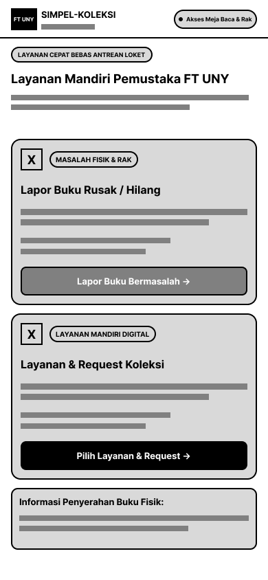
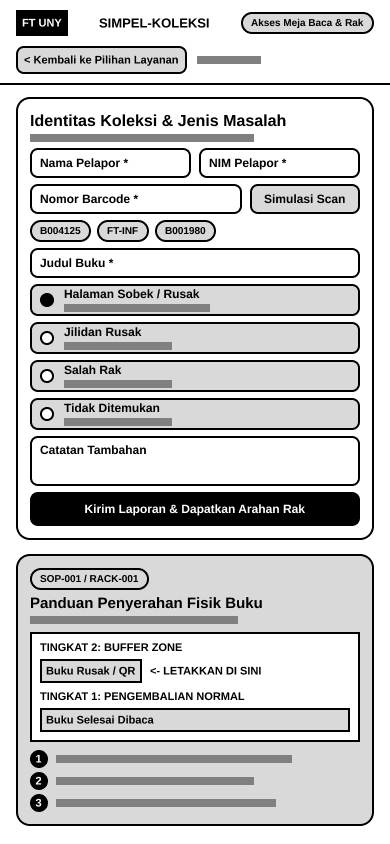
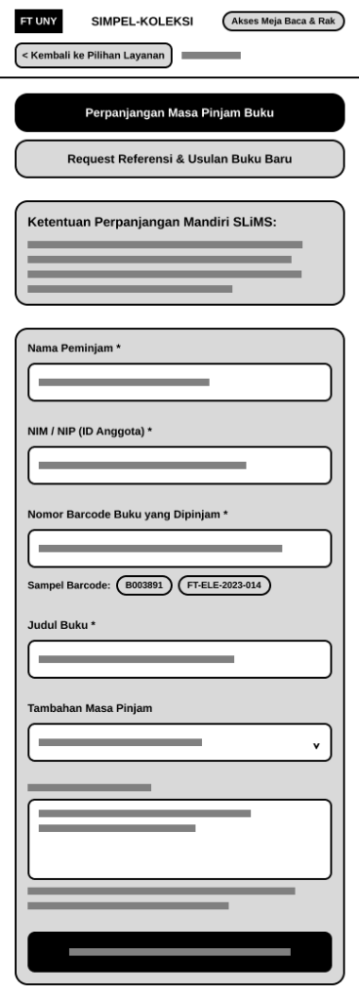
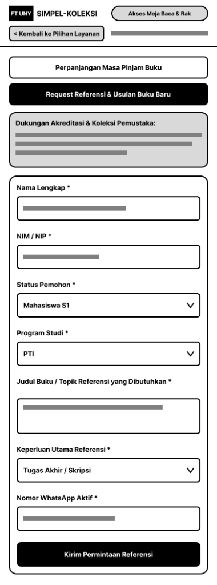
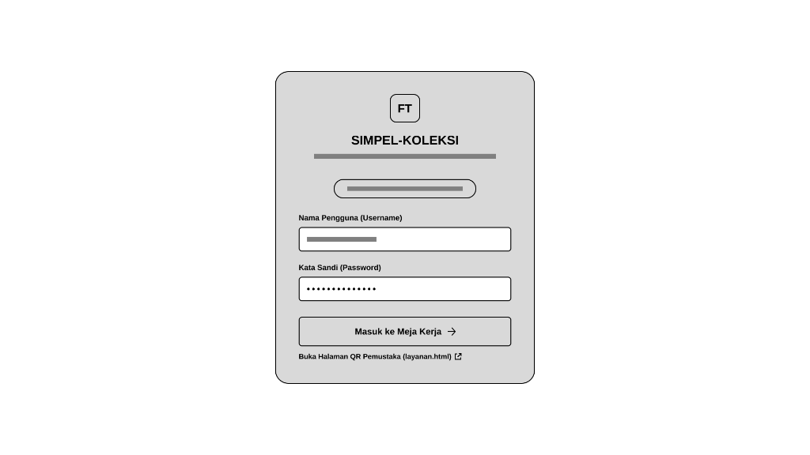
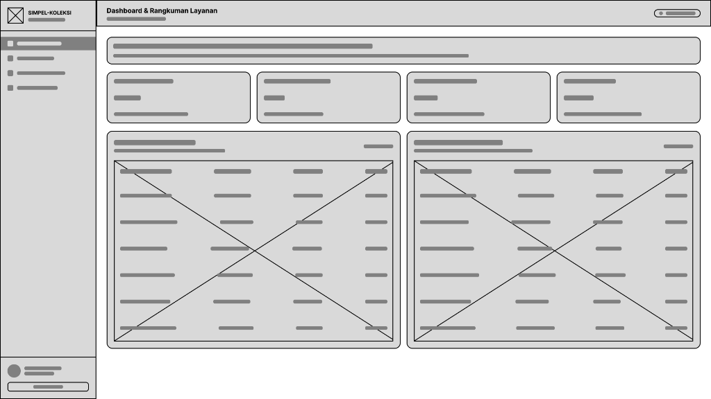
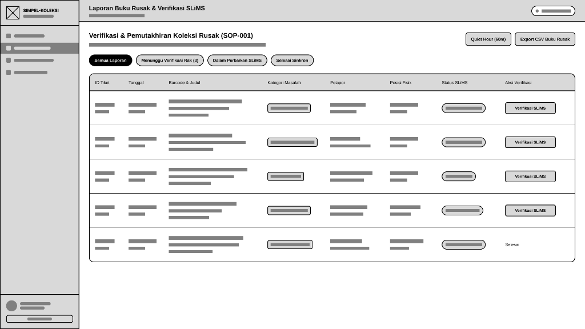
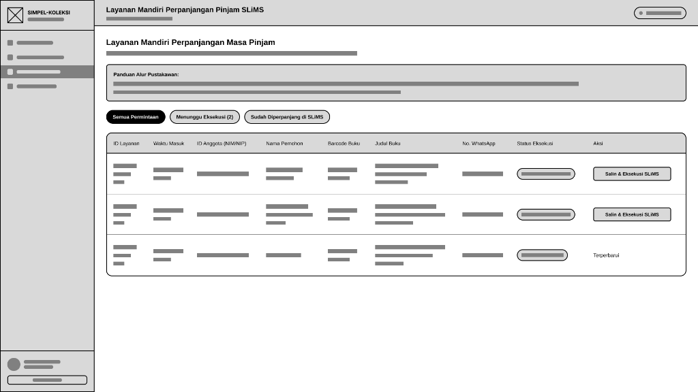
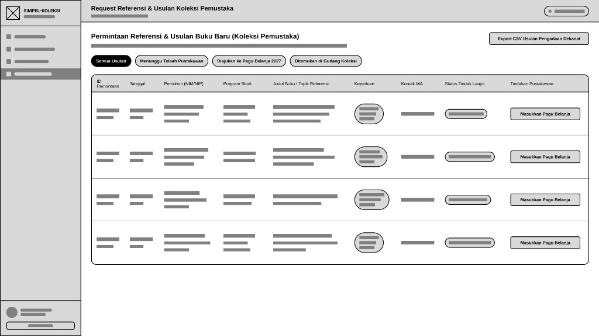

> 🔗 **Navigasi Vault:** Kembali ke [[Dashboard]] | [[CONTEXT_INDEX]] | Landasan Teori: [[Modul 8]] | Laporan Sebelumnya: [[Praktikum_7_Kelompok3]] | Laporan Selanjutnya: [[Praktikum_9_Kelompok3]] | Artefak Blueprint: [[Blueprint_Ekosistem_SIMPEL_KOLEKSI_FT]]

# LAPORAN PRAKTIKUM MINGGUAN
## MANAJEMEN SISTEM INFORMASI (PTF60234)
### PERTEMUAN 8: Perancangan Alur Pengguna dan Wireframe Sistem Informasi

Disusun Oleh :
Kelompok 3

1. Gantar Abimanyu       (NIM 24050530042)
2. Ganendra Pradipa      (NIM 24050530038)
3. M. Fadlan Dirmansyah  (NIM 24050530034)

PROGRAM STUDI PENDIDIKAN TEKNIK INFORMATIKA - S1
FAKULTAS TEKNIK
UNIVERSITAS NEGERI YOGYAKARTA
2026

---

## 1. Identitas Laporan

| Atribut Laporan | Rincian Identitas |
| :--- | :--- |
| **Nama Kelompok** | Kelompok 3 |
| **Anggota (NIM / Nama)** | 1. Gantar Abimanyu (24050530042) 2. Ganendra Pradipa (24050530038) 3. M. Fadlan Dirmansyah (24050530034) |
| **Pertemuan ke-** | 8 (Delapan) |
| **Tanggal Pelaksanaan** | 16 Oktober 2026 (Revisi Komprehensif: 30 Oktober 2026) |
| **Organisasi / Kasus yang Digunakan** | Perpustakaan Fakultas Teknik, Universitas Negeri Yogyakarta (FT UNY) |

---

## 2. Tujuan Kegiatan

Merujuk pada silabus CPMK 3 dan panduan [[Modul 8]], kegiatan praktikum Pertemuan 8 ini bertujuan untuk:
1. Menyusun alur pengguna (*user flow*) yang merefleksikan integrasi proses bisnis lintas tingkatan manajerial perpustakaan (Pemustaka Mahasiswa, Pustakawan Pengelola Tunggal, dan Dekanat/Tim Akreditasi Program Studi).
2. Merancang artefak *wireframe* berfidelitas rendah (*low-fidelity*) berbasis spesifikasi struktural Balsamiq untuk seluruh modul prioritas pada Grand Design *SIMPEL-KOLEKSI FT*, yang diturunkan secara langsung dari analisis lintasan kritis (*critical path analysis*) Pertemuan 7.
3. Mendokumentasikan Kartu Layar (*Screen Cards*) terstruktur yang memetakan taksonomi informasi, peran pengguna, keputusan manajerial yang didukung (*decision support*), serta landasan empiris lapangan.
4. Menegaskan paradigma fundamental Manajemen Sistem Informasi, yaitu bahwa perancangan antarmuka didasarkan pada eliminasi limbah informasi (*information clutter*) dan penyediaan kecukupan data untuk pengambilan keputusan organisasi, bukan sekadar penumpukan fitur perangkat lunak.

---

## 3. Uraian Pelaksanaan Kegiatan

### 3.1. Peninjauan Kembali Akar Masalah, Grand Design, dan Jalur Kritis Pertemuan 7
Penyusunan rancangan antarmuka pada pertemuan ini tidak bertolak dari asumsi subjektif mengenai estetika visual, melainkan berakar secara ketat dari dekomposisi masalah tata kelola pada [[Praktikum_3_Kelompok_3_Revisi]], batasan ruang lingkup pada [[Praktikum_4_Kelompok3_revisi]], matriks akuntabilitas RACI pada [[Praktikum_5_Kelompok3]], serta kalkulasi lintasan kritis PERT pada [[Praktikum_7_Kelompok3]].

Berdasarkan investigasi empiris pada transkrip wawancara [[Jawaban3_Final]], kendala operasional mendasar Perpustakaan FT UNY bersumber dari keterbatasan kapasitas sumber daya manusia, yaitu keberadaan **1 orang pustakawan tunggal** yang harus melayani rata-rata **52 pengunjung per hari** pada meja sirkulasi fisik. Ketiadaan segregasi waktu kerja menimbulkan peran ganda yang berat (*high cognitive load*), sehingga aktivitas pencatatan dan rekonsiliasi data inventarisasi pada pangkalan data SLiMS (*Senayan Library Management System*) kerap tertunda (*lagging data*). Buku yang rusak, salah letak pada klasifikasi rak DDC, atau hilang fisik tidak segera diperbarui statusnya pada katalog publik OPAC. Disparitas pencatatan ini merugikan mahasiswa dalam penelusuran pustaka, menyulitkan pustakawan dalam stok opname, dan menghambat penyediaan bukti sirkulasi untuk Borang Akreditasi LAM-INFOKOM Kriteria 5 bagi program studi di lingkungan Fakultas Teknik.

Analisis jaringan PERT pada Pertemuan 7 membuktikan bahwa **Jalur Kritis proyek berdurasi 36 hari kerja** terkonsentrasi pada rantai tata kelola berikut:
$$\text{Perumusan SOP (B)} \rightarrow \text{Pembuatan Form QR (C)} \rightarrow \text{Sosialisasi Pengguna (F)} \rightarrow \text{Implementasi Terpadu (G)} \rightarrow \text{Monitoring \& Evaluasi (H)}$$

Lintasan kritis tersebut menegaskan bahwa keberhasilan sistem informasi ditentukan oleh adopsi tata laksana dan disiplin operasional pengguna, bukan pada kompleksitas pemrograman backend. Oleh karena itu, Kelompok 3 menetapkan strategi perancangan *wireframe* berbasis doktrin **Pure Governance** sebagaimana ditegaskan dalam [[Blueprint_Ekosistem_SIMPEL_KOLEKSI_FT]]:
1. **Preservasi Otoritas SLiMS:** Pangkalan data SLiMS 9 Bulian dipertahankan sebagai pemegang kebenaran data tunggal (*Single Source of Truth*). Sistem pendukung ini tidak mengganti maupun memodifikasi skema basis data inti SLiMS.
2. **Pemberdayaan Pemustaka sebagai Sensor Data:** Mahasiswa difungsikan sebagai agen pelapor mandiri melalui antarmuka seluler guna memutus kebutuhan pelaporan tatap muka di loket.
3. **Penyediaan Penyangga Fisik (*Buffer Zone*):** Pemisahan fisik koleksi bermasalah menggunakan fasilitas Rak Transit (RACK-001) dua tingkat agar meja loket sirkulasi terbebas dari akumulasi tumpukan fisik buku.
4. **Penyediaan Ruang Kerja Terfokus (*Quiet Hour*):** Pustakawan memproses verifikasi fisik dan pembaruan pangkalan data pada slot waktu khusus yang terlindungi (Jumat pukul 08.00–09.00 WIB) dengan panduan batas waktu layanan (*Service Level Agreement* / SLA) yang terukur.

### 3.2. Metodologi Seleksi Layar Prioritas Berbasis Jalur Kritis
Sesuai arahan evaluasi Dr. Ratna Wardani pada [[catatan_4]], perancangan sistem informasi wajib membuktikan keterhubungan vertikal lintas tiga tingkatan manajemen (*vertical organizational alignment*). Berdasarkan prinsip tersebut, Kelompok 3 merancang rangkaian antarmuka yang saling mengunci dalam satu siklus informasi tertutup (*closed-loop governance workflow*):

mermaid
flowchart TD
    subgraph S_OPS ["Tingkat Operasional: Pemustaka & Pustakawan Tunggal"]
        L1A["Layar L1-A Portal Seleksi Layanan Mandiri (Mobile Landing 390x844)"]
        L1B["Layar L1-B Form Lapor Buku Rusak & Rak Transit (RACK-001)"]
        L1C["Layar L1-C Form Perpanjangan Mandiri (Integrasi Aturan SLiMS)"]
        L1D["Layar L1-D Form Request Referensi (Borang LAM-INFOKOM)"]
        
        subgraph S_L2 ["Suite Meja Kerja Pustakawan (Desktop 1920x1080)"]
            L2A["Layar L2-A: Gerbang Autentikasi Loket"]
            L2B["Layar L2-B: Dashboard Utama & KPI"]
            L2C["Layar L2-C: Workspace Koleksi Rusak SOP-001"]
            L2D["Layar L2-D: Konsol Perpanjangan SLiMS"]
            L2E["Layar L2-E: Konsolidasi Usulan Belanja"]
        end
        
        L3["Layar L3 Modal Verifikasi Fisik & Checklist SLiMS (Quiet Hour)"]
        L5["Layar L5 Blueprint Tata Ruang Fasilitas & Rak Transit (RACK-001)"]
    end

    subgraph S_MAN ["Tingkat Manajerial & Strategis Fakultas"]
        L4["Layar L4 Dashboard Eksekutif & Akreditasi (Dekanat & Tim Borang Prodi)"]
    end

    L1A -->|Pilih Isu Fisik| L1B
    L1A -->|Pilih Perpanjangan| L1C
    L1A -->|Pilih Usulan Buku| L1D
    L1B -->|Arahan Alur Fisik| L5
    L1B -->|Tiket Masuk & SLA Alert| L2C
    L1C -->|Antrean SLiMS Cepat| L2D
    L1D -->|Usulan Pagu Koleksi| L2E
    L2A -->|Otorisasi RBAC| L2B
    L2B -->|Navigasi Modul| L2C
    L2B -->|Navigasi Modul| L2D
    L2B -->|Navigasi Modul| L2E
    L2C -->|Pemicu Tindakan Verifikasi| L3
    L2E -.->|Agregasi Data Sirkulasi & Usulan| L4

1. **Rangkaian Layar Pemustaka (Mobile Responsive 390x844):** Terdiri atas Layar L1-A (Gerbang Seleksi Layanan Mandiri), L1-B (Formulir Pelaporan Kerusakan Fisik dan Panduan Rak Transit), L1-C (Formulir Pengajuan Perpanjangan Masa Pinjam SLiMS), dan L1-D (Formulir Partisipasi Usulan Koleksi Baru untuk Akreditasi). Seluruh antarmuka ini menyelesaikan simpul kritis aktivitas C (Pembuatan Form QR Code).
2. **Rangkaian Layar Meja Kerja Pustakawan (Desktop Layout 1920x1080):** Merupakan kokpit operasional terpadu yang membebaskan pustakawan dari ketergantungan pencatatan manual. Rangkaian ini mencakup Layar L2-A (Gerbang Autentikasi Pengelola), L2-B (Dashboard Status Operasional & KPI Rangkuman), L2-C (Workspace Verifikasi Koleksi Rusak berbasis Kepatuhan SOP-001), L2-D (Konsol Eksekusi Cepat Perpanjangan SLiMS), serta L2-E (Konsolidasi Usulan Koleksi Baru untuk Usulan Pagu Belanja Dekanat).
3. **Layar L3 (Modal Verifikasi Fisik & Pemutakhiran SLiMS):** Layar sembul (*overlay dialog*) yang memandu pencocokan kondisi fisik buku di Rak Transit dengan data bibliografi SLiMS pada sesi *Quiet Hour* dalam waktu kurang dari 90 detik per eksemplar.
4. **Layar L4 (Dashboard Eksekutif & Akreditasi Fakultas):** Antarmuka agregasi data makro bagi Tim Akreditasi Program Studi dan Dekanat FT UNY untuk memantau utilitas koleksi serta mengunduh berkas tabel standar Kriteria 5 LAM-INFOKOM.
5. **Layar L5 (Blueprint Tata Ruang Fasilitas Fisik):** Panduan spasial dua dimensi yang menjamin penempatan stiker QR, Meja Sirkulasi, dan Rak Transit (RACK-001) berada pada posisi yang ergonomis dan mencegah kebingungan alur fisik pemustaka.

### 3.3. Penegakan 7 Aspek Pengelolaan MSI pada Wireframe
Perancangan seluruh layar wireframe ditinjau secara ketat melalui kerangka teoritis 7 Aspek Pengelolaan Sistem Informasi Bu Ratna:
- **Aspek 2 (Tata Kelola dan Kualitas Informasi):** Ditegakkan melalui pemisahan hak akses otorisasi (*Role-Based Access Control*) pada Layar L2-A, validasi format barcode pada formulir pemustaka, serta protokol verifikasi fisik bertingkat sebelum status katalog diubah permanen (*no unverified database update*).
- **Aspek 3 (Dukungan Pengambilan Keputusan):** Setiap bidang data pada antarmuka dirancang untuk memicu tindakan (*actionable data*). Pada Layar L2-B dan L2-C, visualisasi batas waktu SLA berwarna kuning dan merah memandu pustakawan memprioritaskan buku yang harus diperiksa di Rak Transit. Pada Layar L4 dan L2-E, tingginya frekuensi permintaan literatur prodi memicu Dekanat mengesahkan alokasi belanja modal buku baru.
- **Aspek 4 (Kebutuhan Informasi Stakeholder):** Struktur penyajian data disesuaikan dengan profil beban kognitif pengguna. Pemustaka disajikan formulir seluler minimalis dengan petunjuk fisik langsung; pustakawan disajikan konsol meja kerja yang mengelompokkan tugas berdasarkan urgensi; pimpinan fakultas disajikan grafik tren dan metrik persentase kelayakan koleksi.
- **Aspek 6 (Integrasi Proses Bisnis):** Menghubungkan proses pelaporan digital di ponsel pintar mahasiswa, penyerahan buku di rak transit fisik, verifikasi di meja kerja pustakawan, hingga pembaruan katalog publik OPAC secara terpadu tanpa friksi operasional.
- **Aspek 7 (Adopsi dan Perilaku Organisasi):** Memfasilitasi adaptasi perilaku pustakawan tunggal melalui integrasi tombol *Quiet Hour (60m)* dan tombol salin eksekusi SLiMS satu klik, sehingga staf tidak merasa terbebani entri data ganda (*double entry*).

---

## 4. Hasil/Artefak Praktikum

### 3.4 Use‑Case Diagram (Ringkasan Interaksi)

### 4.1. Alur Pengguna (User Flow) Lintas Peran

Berikut adalah pemetaan alur pengguna yang menggambarkan urutan layar yang dilalui oleh setiap peran pemangku kepentingan untuk menuntaskan tanggung jawab informasinya:

mermaid
sequenceDiagram
    autonumber
    actor M as Mahasiswa (Pemustaka)
    participant L1A as Layar L1-A (Portal Landing)
    participant L1B as Layar L1-B (Form Buku Rusak)
    participant L1C as Layar L1-C (Form Perpanjang)
    participant L1D as Layar L1-D (Form Request)
    actor P as Pustakawan Tunggal
    participant L2A as Layar L2-A (Login Loket)
    participant L2B as Layar L2-B (Dashboard Utama)
    participant L2C as Layar L2-C (Workspace SOP-001)
    participant L2D as Layar L2-D (Konsol Perpanjang)
    participant L2E as Layar L2-E (Konsol Usulan)
    participant L3 as Layar L3 (Modal Verifikasi)
    actor D as Tim Akreditasi & Dekanat FT
    participant L4 as Layar L4 (Dashboard Eksekutif)

    Note over M,L1D: 1. Fase Pelaporan & Layanan Mandiri Pemustaka
    M->>L1A: Pindai stiker QR di meja baca / lorong rak
    alt Jalur Pelaporan Fisik Koleksi
        M->>L1B: Akses formulir "Lapor Buku Rusak / Hilang"
        M->>L1B: Input identitas, nomor barcode, kategori kerusakan
        L1B-->>M: Tiket terbit & Tampil diagram Rak Transit Tingkat 2
        M->>P: Bawa fisik buku dan letakkan di Rak Transit (RACK-001)
    else Jalur Perpanjangan Sirkulasi
        M->>L1C: Akses formulir "Perpanjangan Masa Pinjam Buku"
        M->>L1C: Input NIM dan Barcode buku yang dipinjam
        L1C-->>M: Konfirmasi permohonan masuk antrean pemutakhiran
    else Jalur Usulan Belanja Buku Baru
        M->>L1D: Akses formulir "Request Referensi & Usulan Buku Baru"
        M->>L1D: Input judul literatur, prodi, dan nomor kontak
        L1D-->>M: Usulan tercatat pada basis data pengadaan fakultas
    end

    Note over P,L3: 2. Fase Pemutakhiran SLiMS & Sesi Quiet Hour
    P->>L2A: Otentikasi kredensial pustakawan pada meja loket
    L2A->>L2B: Buka Dashboard Rangkuman Status Operasional
    P->>L2B: Pantau 4 kartu metrik KPI dan alert peringatan SLA
    
    alt Penanganan Antrean Perpanjangan SLiMS
        P->>L2D: Buka Konsol Perpanjangan Masa Pinjam
        P->>L2D: Klik tombol "Salin & Eksekusi SLiMS" (+7 hari kerja)
        L2D-->>P: Status terperbarui dan notifikasi WhatsApp terkirim
    else Penanganan Buku Rusak di Rak Transit (Quiet Hour)
        P->>L2C: Buka Workspace Verifikasi Koleksi Rusak (SOP-001)
        P->>L2C: Aktifkan timer sesi Quiet Hour (60 menit)
        P->>L3: Buka Modal Verifikasi untuk tiket terpilih
        P->>L3: Ambil buku di Rak Transit Tingkat 2, centang checklist audit fisik
        P->>L3: Ubah status eksemplar di database SLiMS dan tutup tiket
    else Penelaahan Usulan Referensi Akreditasi
        P->>L2E: Buka Konsol Request Referensi Sivitas Akademika
        P->>L2E: Telaah relevansi kurikulum dan klik "Masukkan Pagu Belanja"
        P->>L2E: Unduh berkas konsolidasi via tombol "Export CSV Usulan Dekanat"
    end

    Note over D,L4: 3. Fase Manajerial & Strategis Fakultas
    D->>L4: Akses Dashboard Eksekutif per triwulan
    D->>L4: Evaluasi tren rasio pemanfaatan koleksi per program studi
    D->>L4: Unduh tabel Kriteria 5 LAM-INFOKOM format Excel
    D->>L4: Tetapkan alokasi anggaran belanja buku tahunan berbasis bukti riil

#### Tabel Lembar Kerja Bagian A: Alur Pengguna (*User Flow Table*)

| No | Peran Pengguna | Tugas Pokok yang Dilakukan | Urutan Layar (ID) | Hasil Keluaran / Tindakan Lanjutan |
| :-: | :--- | :--- | :--- | :--- |
| 1 | **Mahasiswa (Pelapor Isu Fisik)** | Melaporkan temuan buku rusak atau salah letak secara mandiri tanpa membebani antrean loket sirkulasi | **L1-A** $\rightarrow$ **L1-B** $\rightarrow$ **L5** | Tiket pelaporan resmi terbit; buku diletakkan disiplin di Rak Transit Tingkat 2 |
| 2 | **Mahasiswa (Perpanjangan Mandiri)** | Mengajukan perpanjangan tempo pinjam koleksi mandiri dari gawai seluler | **L1-A** $\rightarrow$ **L1-C** | Permohonan terdata pada antrean meja kerja pustakawan tanpa penyerahan fisik buku |
| 3 | **Mahasiswa & Dosen (Usulan Pustaka)** | Mengusulkan judul buku literatur riset yang belum tersedia pada katalog perpustakaan | **L1-A** $\rightarrow$ **L1-D** | Data usulan masuk ke basis konsolidasi pagu pengadaan bahan pustaka fakultas |
| 4 | **Pustakawan Tunggal (Autentikasi)** | Mengakses portal meja kerja terpadu secara aman dari komputer loket sirkulasi | **L2-A** $\rightarrow$ **L2-B** | Terbuka akses operasional meja kerja dengan profil identitas pengelola resmi |
| 5 | **Pustakawan Tunggal (Verifikasi Fisik)** | Memvalidasi kondisi fisik buku rusak pada sesi *Quiet Hour* dan memperbarui status pangkalan data SLiMS | **L2-B** $\rightarrow$ **L2-C** $\rightarrow$ **L3** | Status tiket menjadi `RESOLVED`; status eksemplar di SLiMS menjadi `RUSAK`/`PERBAIKAN` |
| 6 | **Pustakawan Tunggal (Eksekusi Sirkulasi)** | Memproses perpanjangan masa pinjam buku tanpa interaksi tatap muka | **L2-B** $\rightarrow$ **L2-D** | Transaksi disinkronkan ke SLiMS (+7 hari kerja); notifikasi konfirmasi terkirim |
| 7 | **Pustakawan Tunggal (Telaah Koleksi)** | Mengelompokkan usulan buku pemustaka untuk persiapan perencanaan anggaran tahunan | **L2-B** $\rightarrow$ **L2-E** | Terbit berkas rekapitulasi CSV usulan belanja buku untuk diajukan ke pimpinan fakultas |
| 8 | **Tim Akreditasi Program Studi** | Memperoleh data sirkulasi dan kecukupan pustaka untuk instrumen borang prodi | **L4** (Dashboard Eksekutif) | Berkas tabel Kriteria 5 LAM-INFOKOM terunduh dalam format standar Excel/CSV |
| 9 | **Pimpinan Fakultas (Dekanat FT UNY)** | Mengevaluasi utilitas koleksi dan menetapkan proporsi anggaran belanja modal buku | **L4** (Dashboard Eksekutif) | Pengesahan alokasi belanja modal pustaka berbasis bukti empiris (*evidence-based procurement*) |

---

### 4.2. Kartu Layar (Screen Cards)

Setiap layar prioritas dirumuskan melalui empat parameter baku untuk menjamin bahwa kehadiran setiap bidang (*field*) informasi memiliki pertanggungjawaban manajerial yang tegas.

#### Tabel Lembar Kerja Bagian B: Kartu Layar Terstruktur

| ID Layar | Nama Layar & Pengguna Utama | Informasi yang Ditampilkan pada Layar | Keputusan atau Tindakan yang Didukung | Dasar Kebutuhan Lapangan (Sumber / Metode) | Penanggung Jawab (*Accountable*) |
| :--- | :--- | :--- | :--- | :--- | :--- |
| **L1-A** | **Portal Seleksi Layanan Mandiri** *(Pengguna: Mahasiswa FT UNY)* | • Brand SIMPEL-KOLEKSI & Badge FT UNY • Status Layanan (Akses Meja Baca & Rak) • Hero Title & Badge Bebas Antrean Loket • 2 Kartu Pilihan Layanan: (1) Masalah Fisik & Rak, (2) Layanan Mandiri Digital • Info Box Penyerahan Buku Fisik di Rak Transit | • Memutuskan jalur layanan yang tepat sesuai kebutuhan riil tanpa harus bertanya ke loket sirkulasi. • Memahami prosedur penyerahan fisik buku sejak awal sebelum mengisi data. | • Dokumen [[Jawaban3_Final]] (Poin 4: pemustaka ragu melapor karena tidak tahu alur pemisahan buku). • Observasi antrean sirkulasi saat jam sibuk perkuliahan. | **Ganendra Pradipa** *(PIC Pengguna & Form QR)* |
| **L1-B** | **Formulir Lapor Buku Rusak & Rak Transit** *(Pengguna: Mahasiswa FT UNY)* | • Tombol Navigasi Kembali & Breadcrumb • Field Input Identitas: Nama & NIM Pelapor • Field Barcode Buku + Tombol Simulasi Scan & Quick Chips Barcode • Input Judul Koleksi Buku • Radio Group Kategori Kerusakan (4 opsi: Sobek, Jilid Lepas, Salah Rak, Hilang Fisik) • Textarea Catatan Tambahan Kerusakan • Card Diagram Rak Transit (Tingkat 2: Buffer Zone Pemeriksaan & Tingkat 1: Normal) • 3 Langkah Penyerahan Fisik Buku | • Memutuskan pelaporan langsung saat menemukan buku rusak tanpa rasa takut disalahkan. • Memandu mahasiswa meletakkan fisik buku secara mandiri pada Rak Transit Tingkat 2 agar tidak bercampur dengan pengembalian normal. | • Dokumen [[Jawaban3_Final]] (Poin 5: buku rusak sering ditaruh sembarangan sehingga hilang). • Rancang Bangun SOP-001 Rak Transit pada [[Blueprint_Ekosistem_SIMPEL_KOLEKSI_FT]]. • Rekomendasi formulir 4 kolom pada [[Praktikum_4_Kelompok3_revisi]]. | **Ganendra Pradipa** *(PIC Pengguna & Form QR)* |
| **L1-C** | **Formulir Perpanjangan Masa Pinjam** *(Pengguna: Mahasiswa FT UNY)* | • Tab Switcher Layanan Mandiri Digital (Tab Aktif: Perpanjangan) • Kotak Ketentuan Perpanjangan Mandiri SLiMS (Buku tidak perlu dibawa ke loket) • Input Identitas: Nama Peminjam & NIM/NIP Anggota • Input Nomor Barcode Buku + Quick Chips Sampel • Field Judul Buku Terpinjam • Field Tambahan Waktu (+7 Hari Kerja Konfigurasi SLiMS) • Input Nomor WhatsApp Aktif Konfirmasi | • Memutuskan perpanjangan masa pinjam mandiri dari perangkat seluler tanpa mengantre loket fisik. • Memastikan mahasiswa mengetahui hak perpanjangan hanya berlaku untuk koleksi yang belum melewati masa jatuh tempo. | • Dokumen [[Jawaban3_Final]] (Poin 1: transaksi sirkulasi rutin menyita 65% waktu kerja pustakawan). • Aturan sirkulasi standar SLiMS 9 Bulian Perpustakaan FT UNY. | **M. Fadlan Dirmansyah** *(PIC SLiMS & Borang)* |
| **L1-D** | **Formulir Request Referensi & Usulan Buku** *(Pengguna: Mahasiswa & Dosen)* | • Tab Switcher Layanan Mandiri Digital (Tab Aktif: Request Referensi) • Kotak Penjelasan Dukungan Akreditasi LAM-INFOKOM Kriteria 5 • Input Identitas: Nama Lengkap & NIM/NIP • Dropdown Status Pemohon (Mahasiswa S1/D4, Dosen, Tendik) • Dropdown Program Studi (PTI, TI, PTE, PTM, PTSP) • Input Judul/Topik Referensi Baru yang Dibutuhkan • Dropdown Keperluan Utama (Skripsi, Praktikum, Riset) • Input Nomor WhatsApp | • Mengakomodasi kebutuhan literatur mutakhir sivitas akademika yang belum terindeks di perpustakaan. • Menghasilkan basis data empiris usulan belanja koleksi tahunan yang siap diajukan ke Dekanat. | • Panduan Akreditasi LAM-INFOKOM Kriteria 5 (Kecukupan Sumber Belajar). • Notulen evaluasi dosen pengampu terkait kekurangan buku teks kecerdasan buatan dan robotika. | **M. Fadlan Dirmansyah** *(PIC SLiMS & Borang)* |
| **L2-A** | **Gerbang Autentikasi Meja Kerja Pustakawan** *(Pengguna: Pustakawan Tunggal)* | • Logo Box Institusi FT & Brand SIMPEL-KOLEKSI • Subtitle Deskriptif Komputer Operasional Loket Sirkulasi • Input Kredensial Pengguna (Username & Password) • Tombol Eksekusi Autentikasi (Masuk ke Meja Kerja) • Tautan Akses Silang Portal QR Mahasiswa (layanan.html) | • Mencegah akses manipulasi data inventarisasi oleh pihak yang tidak terotorisasi (*Role-Based Access Control*). • Memungkinkan pustakawan memvalidasi sudut pandang antarmuka pemustaka secara berdampingan. | • Standar Pengendalian Internal Sistem Informasi Akuntansi (Romney & Steinbart, 2018). • Dokumen [[Jawaban3_Final]] (Poin 2: workstation loket digunakan secara bergantian saat piket). | **Gantar Abimanyu** *(PIC Tata Kelola & SOP)* |
| **L2-B** | **Dashboard Utama & Status Operasional** *(Pengguna: Pustakawan Tunggal)* | • Sidebar Navigasi Terpadu & Profil Pustakawan Tunggal • Header Status Koneksi SLiMS 9 Bulian & Tanggal Kerja • Spanduk Peringatan Batas Waktu SLA Quiet Hour (SOP-001) • 4 Kartu KPI Metrik (Total Masuk Hari Ini, Menunggu Verifikasi Rak, Perpanjangan Diproses, Usulan Referensi) • Dual Table: Antrean Cepat Perpanjangan SLiMS & Status Buku Rusak di Rak Transit Tingkat 2 | • Menilai kondisi beban kerja harian secara menyeluruh dalam satu jendela (*cockpit overview*). • Mengidentifikasi keberadaan tiket kritis yang mendekati kedaluwarsa batas waktu SLA 3 hari kerja. • Menentukan prioritas penanganan antara verifikasi fisik rak atau sinkronisasi sirkulasi digital. | • Teori Pengambilan Keputusan Manajerial (*Decision Support Systems*, Keen & Scott Morton, 1978). • Arahan Dr. Ratna Wardani pada [[catatan_4]] mengenai sarana pengukur waktu kerja pustakawan. • Konsep *Task-Technology Fit* (Goodhue & Thompson, 1995). | **Gantar Abimanyu** *(PIC Tata Kelola & SOP)* |
| **L2-C** | **Workspace Verifikasi Koleksi Rusak (SOP-001)** *(Pengguna: Pustakawan Tunggal)* | • Header Aksi & Tombol Pengendali Sesi Quiet Hour (Timer 60m) • Tombol Ekspor CSV Buku Rusak untuk Rekonsiliasi Offline • 4 Filter Tab Status: Semua Laporan, Menunggu Verifikasi Rak (3), Dalam Perbaikan SLiMS, Selesai Sinkron • Tabel Data Tiket: ID Tiket, Tanggal, Barcode & Judul, Kategori Masalah, Pelapor, Posisi Fisik, Status SLiMS, Tombol Aksi Verifikasi | • Mengunci alokasi waktu 60 menit per minggu untuk fokus verifikasi fisik tanpa interupsi loket sirkulasi. • Memilah buku yang harus diambil dari Rak Transit Tingkat 2 untuk diperiksa tingkat kerusakannya. • Memicu pembukaan Layar L3 untuk pembaruan status katalog SLiMS. | • SOP-001 Pemutakhiran Data & Rak Transit pada [[Blueprint_Ekosistem_SIMPEL_KOLEKSI_FT]]. • Dokumen [[Jawaban3_Final]] (Poin 5: pustakawan butuh pencocokan fisik sebelum ubah status katalog). | **Gantar Abimanyu** *(PIC Tata Kelola & SOP)* |
| **L2-D** | **Konsol Antrean Perpanjangan SLiMS** *(Pengguna: Pustakawan Tunggal)* | • Banner Panduan Alur Kerja Pustakawan Sirkulasi • 3 Filter Tab: Semua Permintaan, Menunggu Eksekusi (2), Sudah Diperpanjang di SLiMS • Tabel Data: ID Layanan, Waktu Masuk, NIM/NIP, Nama Pemohon, Barcode Buku, Judul Buku, No. WhatsApp, Status Eksekusi, Tombol Aksi (Salin & Eksekusi SLiMS) | • Memproses permohonan perpanjangan pinjaman tanpa membebani pemustaka hadir fisik di loket. • Menyalin parameter barcode langsung ke sistem sirkulasi SLiMS bawaan dalam satu klik. • Mengirimkan konfirmasi otomatis perubahan tanggal jatuh tempo kepada mahasiswa. | • Dokumen [[Jawaban3_Final]] (Poin 1: sirkulasi rutin menyita 65% waktu loket tatap muka). • Prinsip efisiensi transaksi operasional (Laudon & Laudon, 2014). | **M. Fadlan Dirmansyah** *(PIC SLiMS & Borang)* |
| **L2-E** | **Konsolidasi Usulan Literatur Baru** *(Pengguna: Pustakawan Tunggal)* | • Header Aksi & Tombol Ekspor CSV Usulan Pengadaan Dekanat • 4 Filter Tab: Semua Usulan, Menunggu Telaah, Diajukan ke Pagu Belanja 2027, Ditemukan di Gudang • Tabel Data: ID Permintaan, Tanggal, Pemohon, Program Studi, Judul/Topik Referensi, Keperluan Riset, Kontak WA, Status Tindak Lanjut, Tombol Aksi (Masukkan Pagu Belanja) | • Mengagregasi permohonan literatur sivitas akademika sebagai usulan belanja koleksi fakultas. • Memilah judul buku yang sudah tersedia di gudang penyimpanan (*depository library*) sebelum belanja baru diajukan. • Menerbitkan berkas usulan belanja terstruktur untuk diproses pada rapat anggaran Dekanat. | • Panduan Akreditasi LAM-INFOKOM Kriteria 5 (Pendidikan dan Sumber Belajar). • Dokumen [[Jawaban3_Final]] (Poin 7: data usulan buku sering tercecer dalam pesan singkat pribadi). | **M. Fadlan Dirmansyah** *(PIC SLiMS & Borang)* |
| **L3** | **Modal Verifikasi Fisik & Checklist SLiMS** *(Pengguna: Pustakawan Tunggal)* | • Rincian Lengkap Tiket (ID Tiket, Pelapor, Barcode, Judul, Kategori Masalah) • Kotak Pratinjau Bukti Foto Kerusakan Fisik dari Pemustaka • Checklist 1: Fisik buku telah diambil dari Rak Transit Tingkat 2 dan diperiksa kondisinya • Checklist 2: Status eksemplar di SLiMS 9 Bulian telah diubah (Rusak / Perbaikan / Hilang) • Opsi Tindakan Kuratif (Perbaikan Ringan Loket / Kirim Vendor Jilid Ulang) • Tombol Eksekusi (Batalkan / Selesaikan Tiket & Update) | • Memutuskan tindakan kuratif fisik koleksi (perbaikan mandiri, pengikatan ulang, atau usulan penghapusan aset). • Menjamin integritas data katalog sebelum tiket ditutup, mencegah kesalahan pencatatan ganda (*double entry*). | • Wawancara [[Jawaban3_Final]] (Poin 5: pustakawan butuh pencocokan fisik sebelum ubah status katalog). • Kajian SOP *Quiet Hour* pada [[Rancang SOP Sistem Informasi]]. • Matriks RACI [[Praktikum_5_Kelompok3]]. | **M. Fadlan Dirmansyah** *(PIC SLiMS & Borang)* |
| **L4** | **Dashboard Eksekutif & Akreditasi** *(Pengguna: Tim Akreditasi & Dekanat FT)* | • Kartu Metrik Strategis (Total Koleksi 4.287 judul, Frekuensi Sirkulasi 1.842 transaksi, Rasio Koleksi Rusak 6,2%) • Grafik Batang Frekuensi Sirkulasi per Program Studi • Diagram Komposisi Kondisi Koleksi (Prima 93,8%, Perbaikan 3,7%, Rusak Berat 2,5%) • Generator Unduhan Borang Kriteria 5 LAM-INFOKOM (Ekspor CSV/Excel) • Panel Rekomendasi Alokasi Anggaran Belanja Buku (*Evidence-Based Procurement*) | • Tim Akreditasi: Mengunduh data sirkulasi dan kecukupan pustaka secara mandiri tanpa membebani pustakawan. • Dekanat: Mengambil keputusan alokasi anggaran belanja buku tahunan secara proporsional berdasarkan data keterpakaian riil (misal: 35% pagu dialokasikan ke Prodi PTI karena keterpakaian mencapai 94,1%). | • Wawancara [[Jawaban3_Final]] (Poin 7: tim akreditasi sering meminta rekap mendadak dengan format kaku). • Panduan Akreditasi LAM-INFOKOM Kriteria 5. • Arahan Dr. Ratna Wardani pada [[catatan_4]] mengenai keterkaitan sistem perpustakaan dengan alokasi belanja fakultas. | **M. Fadlan Dirmansyah** & **Gantar Abimanyu** |
| **L5** | **Blueprint Tata Ruang & Rak Transit** *(Pengguna: Mahasiswa, Pustakawan, & Dekanat)* | • Denah Zonasi Ruang Fisik 2 Dimensi (Pintu Masuk, Loket Sirkulasi Bebas Beban, Rak Utama DDC 000-900, Meja Baca) • Posisi Stand Akrilik QR Code Signage di Pintu Masuk dan Meja Baca • Posisi Rak Transit 2 Tingkat (RACK-001) di Samping Pintu Masuk • Panduan Teknis Zonasi Tingkat 1 (Pengembalian Normal) dan Tingkat 2 (Koleksi Rusak / Form QR) | • Mahasiswa: Mengetahui lokasi fisik peletakan buku setelah mengisi formulir digital. • Pustakawan: Mengambil buku terorganisasi di Rak Transit saat jam *Quiet Hour* tanpa mencari di tumpukan acak meja loket. • Dekanat: Memvalidasi kecukupan sarana prasarana fisik pendukung operasional perpustakaan. | • Observasi tata letak ruang fisik Perpustakaan FT UNY. • Dokumen [[Jawaban3_Final]] (Poin 6: meja sirkulasi sering penuh tumpukan buku pengembalian). • Konsep Tata Kelola *Buffer Zone* pada [[Blueprint_Ekosistem_SIMPEL_KOLEKSI_FT]]. | **Ganendra Pradipa** *(PIC Tata Ruang & Fisik)* |

---

### 4.3. Dokumentasi Visual Wireframe Berfidelitas Rendah (*Low-Fidelity Layouts*)

Sesuai metodologi prototipe berfidelitas rendah (*low-fidelity prototyping*) yang diadvokasi oleh Rettig (1994), seluruh wireframe dirancang secara ketat menggunakan kaidah struktural Balsamiq monokrom. Standar visual ini menegakkan kontrak perancangan yang kaku: garis pembatas tegas (*outline 2px solid black #000000*), latar komponen abu-abu netral (*fill #D9D9D9*), teks penjelas bergaris horizontal (*skeleton bars #808080*), serta tipografi *sans-serif bold* hitam murni yang dibatasi penggunaannya hanya pada judul utama dan tombol tindakan. 

Tujuan epistemologis dari pendekatan ini adalah mengeliminasi bias persepsi visual pemangku kepentingan. Dengan meniadakan dekorasi warna, bayangan (*shadows*), maupun animasi, diskusi perancangan dapat difokuskan sepenuhnya pada relevansi arsitektur informasi, kelengkapan bidang data, serta ketepatan dukungan keputusan manajerial (*decision support*).

Berikut adalah dokumentasi visual artefak wireframe yang telah selesai dikonstruksi:

---

#### A. Wireframe Layar L1-A: Portal Seleksi Layanan Mandiri Pemustaka (Mobile View 390x844)

Layar L1-A berfungsi sebagai gerbang utama (*primary entry point*) yang diakses oleh pemustaka saat memindai stiker QR Code pada meja baca atau lorong rak perpustakaan.

*Gambar 8.1 Wireframe Layar L1-A: Portal Seleksi Layanan Mandiri Pemustaka (Mobile View 390x844).*

**Analisis Struktur & Tata Kelola Layar L1-A:**
1. **Topbar Publik:** Menampilkan identitas institusi `[FT UNY]`, judul sistem `SIMPEL-KOLEKSI`, dan indikator status lonjong `Akses Meja Baca & Rak`. Penandaan ini memberi kepastian hukum bagi pemustaka bahwa pelaporan dilakukan pada saluran resmi perpustakaan fakultas.
2. **Hero Header:** Memuat lencana penanda `LAYANAN CEPAT BEBAS ANTREAN LOKET`, judul utama `Layanan Mandiri Pemustaka FT UNY`, dan teks pengantar bergaris skeleton. Komponen ini menjelaskan secara langsung bahwa laporan pemustaka akan masuk ke meja kerja pustakawan tanpa memerlukan perantara pesan pribadi WhatsApp.
3. **Kartu Pilihan 1 (Masalah Fisik & Rak):** Dilengkapi ikon kotak placeholder `[X]`, lencana kategori `MASALAH FISIK & RAK`, judul `Lapor Buku Rusak / Hilang`, garis skeleton deskripsi, metadata alur (Penyerahan Fisik ke RACK-001 dan Pemeriksaan Quiet Hour), serta tombol aksi penuh `[Lapor Buku Bermasalah ->]`. Kartu ini mengarahkan mahasiswa yang memegang buku fisik bermasalah ke Layar L1-B.
4. **Kartu Pilihan 2 (Layanan Mandiri Digital):** Dilengkapi ikon kotak placeholder `[X]`, lencana kategori `LAYANAN MANDIRI DIGITAL`, judul `Layanan & Request Koleksi`, garis skeleton deskripsi, metadata sirkulasi (Perpanjangan SLiMS +7 Hari dan Akreditasi Pagu Belanja Baru), serta tombol aksi gelap `[Pilih Layanan & Request ->]`. Kartu ini mengarahkan pemustaka ke Layar L1-C dan L1-D.
5. **Kotak Informasi Penyerahan Buku Fisik:** Berada di bagian bawah frame untuk menegaskan aturan tata kelola bahwa pelaporan fisik wajib disertai penempatan buku pada Rak Transit Tingkat 2 di dekat meja sirkulasi.

---

#### B. Wireframe Layar L1-B: Formulir Lapor Buku Rusak & Panduan Rak Transit Fisik (Mobile View 390x844)

Layar L1-B mengimplementasikan simpul jalur kritis aktivitas C (Pembuatan Form QR Code) untuk menangani keluhan fisik buku yang sobek, lepas jilidan, salah letak di rak, atau hilang.

*Gambar 8.2 Wireframe Layar L1-B: Formulir Lapor Buku Rusak dan Panduan Rak Transit (Mobile View 390x844).*

**Analisis Struktur & Tata Kelola Layar L1-B:**
1. **Navigasi & Breadcrumb:** Tombol penjelajah `[< Kembali ke Pilihan Layanan]` di bawah topbar memungkinkan mahasiswa membatalkan alur dan kembali ke gerbang utama kapan saja tanpa kehilangan konteks.
2. **Formulir Isian Minimum (Data Eksemplar):** 
   - Isian identitas pelapor mencakup `Nama Pelapor *` dan `NIM Pelapor *` untuk akuntabilitas data.
   - Isian `Nomor Barcode *` dilengkapi tombol pendukung `[Simulasi Scan]` dan tombol cepat (*sample chips*) `[B004125]`, `[FT-INF]`, dan `[B001980]` guna mempermudah mahasiswa memasukkan kode eksemplar tanpa harus mengetik panjang.
   - Isian `Judul Buku *` untuk memvalidasi kesesuaian barcode dengan fisik buku.
3. **Grup Kartu Radio Kategori Masalah Koleksi:** 
   - Opsi terpilih ditandai dengan lingkaran radio hitam penuh pada `Halaman Sobek / Rusak` beserta garis skeleton keterangan.
   - Opsi non-aktif meliputi `Jilidan Rusak`, `Salah Rak`, dan `Tidak Ditemukan`. Pemilihan radio tunggal mencegah kebingungan taksonomi kerusakan.
4. **Catatan Tambahan & Tombol Kirim:** Bidang teks multibaris `Catatan Tambahan` menampung detail halaman yang rusak, diakhiri dengan tombol penuh `[Kirim Laporan & Dapatkan Arahan Rak]`.
5. **Diagram Visual Rak Transit Fisik (RACK-001):**
   - Menampilkan kotak representasi dua tingkat rak fisik:
     * **Tingkat 2 (Buffer Zone Pemeriksaan):** Menampung buku bermasalah dengan lencana instruksi tegas `<- LETAKKAN DI SINI`.
     * **Tingkat 1 (Pengembalian Normal):** Khusus buku utuh yang selesai dibaca di tempat sebelum proses *shelving* rutin.
   - Tiga bulatan langkah bernomor `[1]`, `[2]`, dan `[3]` memandu tindakan fisik mahasiswa: submit tiket digital, membawa buku ke samping loket, dan meletakkannya di rak tingkat 2.

---

#### C. Wireframe Layar L1-C: Formulir Perpanjangan Masa Pinjam Mandiri SLiMS (Mobile View 390x844)

Layar L1-C memfasilitasi transaksi perpanjangan masa peminjaman mandiri secara daring tanpa interaksi tatap muka, memangkas 65% beban antrean meja sirkulasi pustakawan tunggal.

*Gambar 8.3 Wireframe Layar L1-C: Formulir Perpanjangan Masa Pinjam Mandiri SLiMS (Mobile View 390x844).*

**Analisis Struktur & Tata Kelola Layar L1-C:**
1. **Pengalih Tab Layanan (*Service Tabs*):** Tab atas terbagi menjadi `Perpanjangan Masa Pinjam Buku` (aktif, berlatar hitam pekat) dan `Request Referensi & Usulan Buku Baru` (non-aktif, berlatar abu-abu terang). Hal ini memudahkan mahasiswa berpindah kebutuhan dalam satu domain layanan digital.
2. **Kotak Kebijakan Tata Kelola SLiMS:** Kotak pengantar abu-abu di bawah tab menegaskan bahwa perpanjangan hanya dapat diproses untuk buku yang belum melewati masa kedaluwarsa dan tidak sedang dipesan pemustaka lain. Keterangan ini menegaskan bahwa buku fisik **tidak perlu dibawa atau ditaruh di rak transit**.
3. **Identitas & Eksemplar Peminjaman:** 
   - Isian `Nama Peminjam *` dan `NIM / NIP (ID Anggota) *` disinkronkan dengan data keanggotaan SLiMS.
   - Isian `Nomor Barcode Buku yang Dipinjam *` dilengkapi tombol cepat sampel barcode `[B003891]` dan `[FT-ELE-2023-014]`.
   - Isian `Judul Buku *` untuk validasi silang.
4. **Parameter Durasi SLiMS & WhatsApp:** 
   - Bidang `Tambahan Masa Pinjam` dikunci (*readonly*) pada konfigurasi baku sistem SLiMS (+7 Hari Kerja), menutup celah manipulasi jangka waktu pinjam oleh mahasiswa.
   - Isian `Nomor WhatsApp Aktif` untuk menerima notifikasi otomatis saat pustakawan menyetujui pembaruan masa pinjam di meja kerja.
5. **Tombol Pengajuan:** Tombol penuh hitam di bagian dasar mengeksekusi pengiriman data langsung ke antrean cepat meja kerja pustakawan.

---

#### D. Wireframe Layar L1-D: Formulir Request Referensi & Usulan Buku Baru LAM-INFOKOM (Mobile View 390x844)

Layar L1-D berfungsi menjembatani aspirasi literatur sivitas akademika dengan kebijakan alokasi pengadaan koleksi fakultas, yang bermuara pada pemenuhan bukti dukung akreditasi.

*Gambar 8.4 Wireframe Layar L1-D: Formulir Request Referensi dan Usulan Buku Baru (Mobile View 390x844).*

**Analisis Struktur & Tata Kelola Layar L1-D:**
1. **Aktivasi Tab Usulan:** Tab `Request Referensi & Usulan Buku Baru` aktif dengan warna hitam penuh, menunjukkan pemustaka sedang mengakses jalur partisipasi pengadaan koleksi.
2. **Kotak Edukasi Nilai Akreditasi:** Menjelaskan secara transparan kepada mahasiswa dan dosen bahwa usulan referensi yang dimasukkan akan diagregasi sebagai dasar penyusunan belanja buku baru ke Dekanat sesuai Kriteria 5 LAM-INFOKOM.
3. **Segmentasi Pemohon & Program Studi:**
   - Dropdown `Status Pemohon *` menyediakan pilihan terstandar: Mahasiswa S1, Mahasiswa D4/Vokasi, Dosen Fakultas Teknik, atau Tenaga Kependidikan.
   - Dropdown `Program Studi *` memuat daftar prodi di lingkungan FT UNY (default: `Pendidikan Teknik Informatika (PTI)`). Data ini penting agar agregasi belanja buku pada Layar L4 dapat dipetakan secara proporsional.
4. **Spesifikasi Referensi & Urgensi Kebutuhan:**
   - Isian `Judul Buku / Topik Referensi yang Dibutuhkan *` untuk mencatat judul spesifik, nama penulis, atau edisi buku.
   - Dropdown `Keperluan Utama Referensi *` (Tugas Akhir/Skripsi, Praktikum, Riset Dosen) untuk menentukan bobot prioritas pengadaan.
5. **Tombol Submit:** Tombol penuh hitam `[Kirim Permintaan Referensi]` membukukan usulan secara permanen ke pangkalan data tata kelola.

---

#### E. Rangkaian Wireframe Layar L2: Suite Meja Kerja Pustakawan Tunggal (Desktop View 1920x1080)

Rangkaian Layar L2 merepresentasikan **Pusat Kendali Operasional Terpadu (*Integrated Operational Cockpit*)** bagi pustakawan pengelola tunggal. Mengacu pada teori *Task-Technology Fit* (Goodhue & Thompson, 1995), kinerja individual staf meningkat secara signifikan apabila kapabilitas sistem informasi selaras dengan karakteristik tugas yang diembannya. Pada konteks Perpustakaan FT UNY, pustakawan tunggal menghadapi tugas heterogen yang mencakup pelayanan sirkulasi langsung, pemeliharaan fisik eksemplar, serta penyiapan data akreditasi.

Untuk mencegah disorientasi kognitif (*cognitive friction*) akibat perpindahan jendela aplikasi yang berulang, Kelompok 3 menyusun 5 (lima) layar antarmuka desktop terintegrasi yang saling melengkapi dalam tata kelola sirkulasi dan inventarisasi koleksi:

---

##### 1. Layar L2-A: Gerbang Autentikasi Pengelola Sirkulasi (Desktop View 1920x1080)

Layar L2-A menerapkan prinsip pengendalian internal sistem informasi (*Internal Control over Information Systems*, Romney & Steinbart, 2018) melalui otorisasi akses berbasis peran (*Role-Based Access Control* / RBAC).

*Gambar 8.5 Wireframe Layar L2-A: Gerbang Autentikasi Meja Kerja Pustakawan (Desktop View 1920x1080).*

**Analisis Struktur & Tata Kelola Layar L2-A:**
1. **Kartu Modal Terpusat (*Centered Card Modal*):** Dirancang dengan kanvas bersih berlatar putih (#FFFFFF) dan kartu modal berbingkai tegas (border 2px #000000, radius 20px, fill #D9D9D9). Tata letak simetris ini membatasi fokus perhatian pustakawan hanya pada proses verifikasi kredensial.
2. **Identitas Institusi & Sistem:** Menampilkan kotak logo terpusat `[FT]`, nama sistem `SIMPEL-KOLEKSI`, garis skeleton subjudul, serta lencana lonjong penanda `Komputer Operasional Meja Sirkulasi`. Penandaan ini menegaskan batasan yuridis bahwa terminal komputer loket hanya dapat diakses oleh petugas pengelola resmi.
3. **Formulir Isian Kredensial:** Memuat bidang teks `Nama Pengguna (Username)` dengan garis skeleton pengingat format, serta bidang terproteksi `Kata Sandi (Password)` yang disamarkan (*masked dots* `••••••••••••••`) untuk mencegah kebocoran otentikasi di lingkungan ruang baca terbuka.
4. **Tombol Aksi Utama:** Tombol bergaris tegas `[Masuk ke Meja Kerja ->]` mengeksekusi validasi kredensial ke modul otentikasi lokal.
5. **Tautan Akses Silang Portal Pemustaka:** Tautan bawah `Buka Halaman QR Pemustaka (layanan.html) [↗]` memungkinkan pustakawan membuka tampilan pemustaka pada jendela terpisah guna memeriksa kondisi sistem dari sudut pandang mahasiswa tanpa keluar dari sesi kerja.

---

##### 2. Layar L2-B: Dashboard Utama & Status Operasional Koleksi (Desktop View 1920x1080)

Layar L2-B berfungsi sebagai instrumen penyaring informasi (*information filtering*) dan pendukung keputusan operasional (*Operational Decision Support System*, Keen & Scott Morton, 1978).

*Gambar 8.6 Wireframe Layar L2-B: Dashboard Utama dan Rangkuman Layanan Operasional (Desktop View 1920x1080).*

**Analisis Struktur & Tata Kelola Layar L2-B:**
1. **Sidebar Navigasi Kiri (Lebar 270px):** Menetapkan navigasi persisten yang memuat logo kotak silang `[X]`, judul `SIMPEL-KOLEKSI`, 4 tombol modul kerja (dengan `Dashboard Utama` dalam status aktif berlatar abu-abu gelap #808080), serta footer identitas pustakawan tunggal (Siti Rahmawati, S.I.Pst) dan tombol keluar (*logout*). Struktur ini menjamin ketercapaian navigasi satu klik (*one-click navigation*) ke seluruh fungsi sistem.
2. **Topbar Operasional:** Menampilkan judul halaman `Dashboard & Rangkuman Layanan`, garis penanda tanggal kalender kerja, serta lencana status koneksi pangkalan data `SLiMS 9 Connected`. Indikator status ini memberi kepastian teknis bahwa integrasi data dengan SLiMS 9 Bulian berada dalam status aktif.
3. **Spanduk Peringatan Batas Waktu SLA (*Alert Banner*):** Kotak peringatan memanjang dengan batas garis 2px berlatar abu-abu menampung notifikasi kritis SOP-001. Banner ini secara otomatis aktif saat terdapat tiket buku rusak yang mendekati batas waktu verifikasi fisik 3 hari kerja di Rak Transit Tingkat 2, mengarahkan pustakawan mengalokasikan slot waktu pada sesi *Quiet Hour*.
4. **Kisi 4 Kartu Metrik KPI Operasional:**
   - **Kartu 1 (Total Masuk Hari Ini):** Mengagregasi volume transaksi masuk (laporan kerusakan, perpanjangan, dan usulan baru) guna memantau dinamika beban harian.
   - **Kartu 2 (Menunggu Verifikasi Rak):** Menampilkan jumlah buku fisik bermasalah yang saat ini tertampung pada Rak Transit Tingkat 2 dan membutuhkan inspeksi manual.
   - **Kartu 3 (Perpanjangan Diproses):** Menghitung antrean pengajuan perpanjangan mandiri mahasiswa yang siap dieksekusi ke pangkalan data SLiMS.
   - **Kartu 4 (Usulan Referensi Masuk):** Memantau akumulasi usulan literatur baru sivitas akademika untuk diteruskan ke Dekanat.
5. **Dua Kontainer Tabel Berdampingan (*Dual-Panel Data Containers*):**
   - **Panel Kiri (Antrean Cepat Perpanjangan SLiMS):** Menyajikan ringkasan antrean perpanjangan dengan judul dan tombol tautan `[Lihat Semua ->]`. Area tabel ditandai dengan kotak silang diagonal wireframe `[X]` dan 6 baris skeleton data berkolom tiga.
   - **Panel Kanan (Buku Rusak di Rak Transit Tingkat 2):** Menyajikan ringkasan tiket kerusakan koleksi dengan judul dan tombol tautan `[Lihat Semua ->]`, ditandai dengan silang diagonal `[X]` dan baris skeleton data berkolom empat. Panel ini mencegah pustakawan melewatkan keberadaan buku rusak di rak fisik.

---

##### 3. Layar L2-C: Workspace Verifikasi Koleksi Rusak & Kepatuhan SOP-001 (Desktop View 1920x1080)

Layar L2-C merupakan instrumen eksekusi jalur kritis aktivitas B (SOP Quiet Hour) dan C (Form QR) yang mengarahkan pustakawan melakukan rekonsiliasi data inventarisasi secara disiplin.

*Gambar 8.7 Wireframe Layar L2-C: Workspace Verifikasi Koleksi Rusak dan Kepatuhan SOP-001 (Desktop View 1920x1080).*

**Analisis Struktur & Tata Kelola Layar L2-C:**
1. **Navigasi Modul Aktif:** Tombol kedua pada sidebar `Laporan Buku Rusak` berada dalam status terpilih, menegaskan konteks kerja pustakawan pada domain tata kelola koleksi fisik.
2. **Bilah Aksi & Pengendali Sesi Quiet Hour:**
   - Judul panel menegaskan regulasi tata kelola: `Verifikasi & Pemutakhiran Koleksi Rusak (SOP-001)`.
   - Tombol outline `[Quiet Hour (60m)]` berfungsi mengaktifkan penanda waktu fokus (*countdown focus timer*). Fitur ini secara psikologis melindungi pustakawan dari interupsi layanan sirkulasi tatap muka selama 60 menit per minggu.
   - Tombol `[Export CSV Buku Rusak]` memfasilitasi pencadangan data tiket dan analisis histori kerusakan koleksi secara luring (*offline reconciliation*).
3. **Bilah Filter Tab Status Pemrosesan:** Menyediakan 4 pil penyaring antrean:
   - `[Semua Laporan]` (status aktif berlatar hitam penuh).
   - `[Menunggu Verifikasi Rak (3)]` (pil bernomor yang menunjukkan jumlah fisik buku di Rak Transit).
   - `[Dalam Perbaikan SLiMS]` (koleksi yang telah diubah statusnya dan sedang dalam tahap perbaikan fisik).
   - `[Selesai Sinkron]` (arsip tiket yang telah tuntas diverifikasi).
4. **Tabel Data Antrean Verifikasi (Wireframe Grid):**
   - Header tabel berlatar abu-abu muda (#D9D9D9) memuat 8 atribut esensial: `ID Tiket`, `Tanggal`, `Barcode & Judul`, `Kategori Masalah`, `Pelapor`, `Posisi Fisik`, `Status SLiMS`, dan `Aksi Verifikasi`.
   - Setiap baris data digambarkan dengan garis skeleton abu-abu (#808080) yang merepresentasikan data riil.
   - Kolom `Kategori Masalah` dan `Status SLiMS` ditampilkan dalam bentuk pil berbingkai tegas.
   - Kolom `Aksi Verifikasi` menyediakan tombol terstandar `[Verifikasi SLiMS]` untuk tiket yang membutuhkan tindakan, serta teks penanda `Selesai` untuk tiket yang telah ditutup. Mengklik tombol verifikasi akan memicu kemunculan Layar L3.

---

##### 4. Layar L2-D: Konsol Antrean Perpanjangan Masa Pinjam Mandiri SLiMS (Desktop View 1920x1080)

Layar L2-D mengimplementasikan prinsip efisiensi proses bisnis (*Business Process Reengineering*, Hammer & Champy, 1993) dengan mentransformasi transaksi perpanjangan sirkulasi menjadi alur persetujuan cepat (*fast-track approval*).

*Gambar 8.8 Wireframe Layar L2-D: Konsol Antrean Perpanjangan Masa Pinjam Mandiri SLiMS (Desktop View 1920x1080).*

**Analisis Struktur & Tata Kelola Layar L2-D:**
1. **Navigasi Modul Aktif:** Tombol ketiga pada sidebar `Perpanjangan Pinjam` berada dalam status aktif, membatasi lingkup kerja pustakawan hanya pada antrean transaksi peminjaman.
2. **Spanduk Panduan Alur Pustakawan:** Kotak memanjang berbingkai 2px berlatar abu-abu memuat instruksi operasional baku: verifikasi status keterlambatan anggota pada SLiMS, klik tombol eksekusi, dan pastikan tanggal jatuh tempo bertambah 7 hari kerja secara sah.
3. **Bilah Filter Antrean Sirkulasi:** Menyediakan 3 pil penyaring: `[Semua Permintaan]`, `[Menunggu Eksekusi (2)]`, dan `[Sudah Diperpanjang di SLiMS]`. Pemisahan ini menjamin pustakawan dapat langsung memproses permohonan yang belum terselesaikan tanpa terdistraksi arsip transaksi lama.
4. **Tabel Antrean Eksekusi SLiMS:**
   - Memuat 9 atribut kolom: `ID Layanan`, `Waktu Masuk`, `ID Anggota (NIM/NIP)`, `Nama Pemohon`, `Barcode Buku`, `Judul Buku`, `No. WhatsApp`, `Status Eksekusi`, dan `Aksi`.
   - Kolom tindakan menyediakan tombol khusus berbingkai tegas `[Salin & Eksekusi SLiMS]`. Tombol ini mengotomatiskan penyalinan barcode dan NIM ke memori kerja komputer loket, memangkas durasi pemrosesan dari 4 menit per pemustaka menjadi kurang dari 30 detik.
   - Transaksi yang telah selesai ditandai dengan label teks status `Terperbarui`.

---

##### 5. Layar L2-E: Konsolidasi Usulan Literatur Baru untuk Pagu Belanja Dekanat (Desktop View 1920x1080)

Layar L2-E menghubungkan tingkatan operasional perpustakaan dengan tingkatan strategis fakultas melalui tata kelola pengadaan berbasis bukti (*Evidence-Based Procurement*, Laudon & Laudon, 2014).

*Gambar 8.9 Wireframe Layar L2-E: Konsolidasi Usulan Koleksi Baru untuk Pagu Belanja (Desktop View 1920x1080).*

**Analisis Struktur & Tata Kelola Layar L2-E:**
1. **Navigasi Modul Aktif:** Tombol keempat pada sidebar `Request Referensi` terpilih, memfokuskan antarmuka pada pengolahan aspirasi literatur sivitas akademika.
2. **Bilah Aksi & Generator Berkas Dekanat:**
   - Header modul menegaskan fungsi tata kelola: `Permintaan Referensi & Usulan Buku Baru (Koleksi Pemustaka)`.
   - Tombol utama `[Export CSV Usulan Pengadaan Dekanat]` memungkinkan pustakawan mengekspor data usulan terstruktur dalam format CSV/Excel. Berkas ini siap dilampirkan pada rapat penetapan Rencana Kerja dan Anggaran Tahunan (RKAT) Fakultas Teknik.
3. **Bilah Filter Tab Disposisi Usulan:** Menyediakan 4 pil pengelompokan data:
   - `[Semua Usulan]` (status aktif).
   - `[Menunggu Telaah Pustakawan]` (usulan baru yang belum diverifikasi ketersediaannya di katalog).
   - `[Diajukan ke Pagu Belanja 2027]` (usulan yang disetujui untuk diusulkan ke Dekanat).
   - `[Ditemukan di Gudang Koleksi]` (koleksi yang ternyata sudah dimiliki perpustakaan namun berada di ruang deposit).
4. **Tabel Konsolidasi Aspirasi Literatur:**
   - Menyajikan 9 atribut kolom komprehensif: `ID Permintaan`, `Tanggal`, `Pemohon (NIM/NIP)`, `Program Studi`, `Judul Buku / Topik Referensi`, `Keperluan`, `Kontak WA`, `Status Tindak Lanjut`, dan `Tindakan Pustakawan`.
   - Kolom `Keperluan` menampilkan lencana grafis yang membedakan urgensi kebutuhan (Skripsi, Riset Dosen, atau Praktikum).
   - Kolom tindakan menyediakan tombol aksi manajerial `[Masukkan Pagu Belanja]` yang mengubah status usulan menjadi rekomendasi resmi belanja modal fakultas.

---

#### F. Wireframe Layar L3: Modal Verifikasi Fisik & Checklist SLiMS (Desktop Overlay)

Layar L3 berwujud jendela sembul (*modal dialog pop-up*) yang muncul di atas Layar L2-C saat pustakawan mengklik tombol periksa tiket buku rusak pada sesi *Quiet Hour*.

┌────────────────────────────────────────────────────────────────────────┐
│ VERIFIKASI FISIK & PEMUTAKHIRAN STATUS SLIMS                     [ X ] │
├────────────────────────────────────────────────────────────────────────┤
│ Rincian Tiket : TKT-202610-009                Tanggal: 16 Oktober 2026 │
│ Nama Pelapor  : Farid Hidayat (NIM: 24050530015)                       │
│ Data Koleksi  : Kecerdasan Buatan Terapan                              │
│ Nomor Barcode : FT-INF-2024-072               Posisi : Rak Transit Tk 2│
│ Kategori Isu  : Halaman Sobek / Lembar Lepas                           │
├────────────────────────────────────────────────────────────────────────┤
│ [KOTAK PRATINJAU FOTO BUKTI KERUSAKAN DARI PEMUSTAKA]                  │
│ ┌────────────────────────────────────────────────────────────────────┐ │
│ │                  [ Area Gambar Foto Bukti Kerusakan ]              │ │
│ └────────────────────────────────────────────────────────────────────┘ │
│ Catatan Mahasiswa: "Halaman 45-50 lepas dari jilidan utama."           │
├────────────────────────────────────────────────────────────────────────┤
│ DAFTAR PERIKSA WAJIB PUSTAKAWAN TUNGGAL (SOP-001):                     │
│ [ ] 1. Fisik buku telah diambil dari Rak Transit Tingkat 2 dan         │
│        kondisi kerusakan diverifikasi secara langsung.                 │
│ [ ] 2. Status eksemplar pada pangkalan data SLiMS 9 Bulian telah diubah│
│        menjadi status: [ RUSAK / DALAM PERBAIKAN v ].                  │
├────────────────────────────────────────────────────────────────────────┤
│ Tindakan Lanjutan: ( ) Perbaikan Ringan Loket   ( ) Kirim Vendor Jilid │
├────────────────────────────────────────────────────────────────────────┤
│ [ Batalkan ]                             [ Selesaikan Tiket & Update ] │
└────────────────────────────────────────────────────────────────────────┘

*Gambar 8.10 Skema Layout Modal Layar L3: Checklist Verifikasi Fisik dan Pemutakhiran SLiMS.*

---

#### G. Wireframe Layar L4: Dashboard Eksekutif & Akreditasi Fakultas (Desktop View 1920x1080)

Layar L4 dirancang untuk pemangku kepentingan tingkat manajerial (Tim Akreditasi Program Studi) dan tingkat strategis (Dekanat Fakultas Teknik UNY).

┌────────────────────────────────────────────────────────────────────────────────────────┐
│ [FT UNY] SIMPEL-KOLEKSI | Dashboard Eksekutif & Akreditasi        [Unduh Borang Kriteria 5]│
├────────────────────────────────────────────────────────────────────────────────────────┤
│ [RINGKASAN TATA KELOLA KOLEKSI FAKULTAS TEKNIK]                                        │
│ ┌─────────────────────────┐ ┌─────────────────────────┐ ┌────────────────────────────┐│
│ │ Total Koleksi Aktif     │ │ Frekuensi Peminjaman    │ │ Rasio Buku Rusak/Hilang    ││
│ │   [ 4.287 Judul ]       │ │   [ 1.842 Transaksi ]   │ │   [ 6,2% (Target < 8%) ]   ││
│ └─────────────────────────┘ └─────────────────────────┘ └────────────────────────────┘│
├────────────────────────────────────────────────────────────────────────────────────────┤
│ [GRAFIK TREN KETERPAKAIAN KOLEKSI PER PRODI]     [KOMPOSISI KONDISI EKSEMPLAR]         │
│  PTI    : [========================] 94,1%        Koleksi Siap Pinjam: 93,8% (4.022)   │
│  PTE    : [====================    ] 78,5%        Sedang Diperbaiki  :  3,7% (  157)   │
│  Mesin  : [==================      ] 72,0%        Afkir / Hilang     :  2,5% (  108)   │
│  Sipil  : [================        ] 65,4%                                             │
│  Elko   : [===========             ] 45,2%                                             │
├────────────────────────────────────────────────────────────────────────────────────────┤
│ [REKOMENDASI ALOKASI ANGGARAN BELANJA BUKU FAKULTAS (EVIDENCE-BASED PROCUREMENT)]      │
│ "Tingginya permintaan referensi kecerdasan buatan pada prodi PTI (rasio 94,1%) serta   │
│  banyaknya buku pemrograman rusak merekomendasikan alokasi 35% pagu belanja tahunan     │
│  difokuskan pada literatur rumpun informatika dan komputer untuk akreditasi LAM-INFOKOM"│
└────────────────────────────────────────────────────────────────────────────────────────┘

*Gambar 8.11 Skema Layout Layar L4: Dashboard Eksekutif dan Generator Borang Akreditasi.*

---

#### H. Wireframe Layar L5: Blueprint Tata Ruang Fisik & Rak Transit (Spatial Layout)

Layar L5 merupakan cetak biru penataan spasial fasilitas fisik di gedung Perpustakaan FT UNY guna memastikan alur pergerakan pengguna digital selaras dengan tata letak perabot perpustakaan.

┌────────────────────────────────────────────────────────────────────────────────────────┐
│ CETAK BIRU TATA RUANG FASILITAS FISIK PERPUSTAKAAN FT UNY           [Standar RACK-001] │
├────────────────────────────────────────────────────────────────────────────────────────┤
│ [PINTU MASUK & KELUAR RUANG PERPUSTAKAAN]                                              │
│     │                                                                                  │
│     ├──► [STAND AKRILIK SIGNAGE QR CODE]                                               │
│     │    "Pindai untuk Akses Layanan Mandiri SIMPEL-KOLEKSI (Layar L1-A)"              │
│     │                                                                                  │
│     ├──► [RAK TRANSIT DUA TINGKAT - KODE: RACK-001]                                    │
│     │    ┌───────────────────────────────────────────────────────────────────────┐     │
│     │    │ TINGKAT 2: BUFFER ZONE BUKU RUSAK (Wajib Input Layar L1-B)            │     │
│     │    ├───────────────────────────────────────────────────────────────────────┤     │
│     │    │ TINGKAT 1: PENGEMBALIAN BUKU NORMAL SELESAI BACA                      │     │
│     │    └───────────────────────────────────────────────────────────────────────┘     │
│     │                                                                                  │
│     └──► [MEJA SIRKULASI PUSTAKAWAN TUNGGAL]                                           │
│          ├── PC All-in-One: SLiMS 9 Bulian + Meja Kerja Layar L2                       │
│          ├── Barcode Scanner USB untuk Validasi Eksemplar                              │
│          └── Meja Layanan Bersih Bebas Tumpukan Buku (Pelayanan Prima)                 │
│                                                                                        │
│ [LORONG RAK UTAMA: DDC 000 - 900]           [AREA MEJA BACA & STIKER QR MEJA]          │
└────────────────────────────────────────────────────────────────────────────────────────┘

*Gambar 8.12 Skema Spasial Layar L5: Penataan Fisik Rak Transit dan Meja Sirkulasi.*

---

## 5. Kendala dan Solusi

### 5.1. Kendala yang Dihadapi
1. **Risiko Pemekaran Fitur (*Feature Creep*):** Pada awal perancangan, terdapat kecenderungan untuk menambahkan fitur pelacakan denda keterlambatan buku dan fitur obrolan daring langsung dengan pustakawan pada antarmuka mahasiswa. Namun, fitur ini tidak menjawab akar masalah utama (keterlambatan pemutakhiran data katalog karena beban kerja 1 orang staf) dan berada di luar ruang lingkup WBS yang disepakati pada Pertemuan 4 dan 7.
2. **Keterbatasan Kapasitas Perangkat Keras di Loket Pustakawan:** Pustakawan tunggal bekerja menggunakan 1 (satu) unit PC All-in-One di meja sirkulasi. Jika sistem antarmuka antrean menuntut perpindahan jendela (*alt-tab*) yang terlalu sering dengan antarmuka SLiMS lokal, pustakawan akan mengalami beban kognitif tinggi (*high cognitive friction*).
3. **Penyelarasan Format Data Akreditasi:** Tim penyusun borang akreditasi program studi di lingkungan FT UNY sering meminta tabel rekapitulasi dengan nomenklatur kolom yang kaku sesuai panduan LAM-INFOKOM, sementara tabel bawaan SLiMS hanya mengekspor atribut bibliografi mentah.

### 5.2. Solusi yang Diterapkan
1. **Penerapan Batasan *Pure Governance* secara Ketat:** Kelompok memangkas fitur-fitur yang tidak esensial dan hanya mempertahankan rangkaian layar yang berada pada simpul jalur kritis. Fitur denda diabaikan karena sudah ditangani secara *native* oleh modul sirkulasi SLiMS bawaan.
2. **Penyatuan Alur Verifikasi dalam Modal Tunggal (Layar L3):** Antarmuka verifikasi dirancang dalam format *modal pop-up checklist*. Pustakawan cukup membuka satu kartu, menyalin barcode secara cepat menggunakan pemindai USB ke SLiMS, mencentang dua kotak verifikasi, dan menutup tiket. Hal ini menghemat waktu rata-rata proses verifikasi menjadi kurang dari 90 detik per buku.
3. **Perancangan Modul Ekstraksi Satu Klik pada Layar L2-E dan L4:** Pada meja kerja pustakawan dan dashboard eksekutif, disediakan tombol parser CSV yang secara otomatis memetakan kolom database SLiMS ke dalam tabel Kriteria 5 LAM-INFOKOM (Jumlah Judul, Jumlah Eksemplar, Frekuensi Peminjaman per Prodi) sehingga tim akreditasi dapat mengunduh berkas tanpa meminta bantuan manual dari pustakawan.

---

## 6. Refleksi Pembelajaran

Praktikum Pertemuan 8 memberikan pemahaman fundamental mengenai distingsi antara **Rekayasa Perangkat Lunak Umum** dan **Manajemen Sistem Informasi**:
1. **Merancang Antarmuka dari Pertanyaan Keputusan, Bukan Daftar Fitur:** Dalam rekayasa perangkat lunak biasa, perancang sering kali berfokus pada keindahan tata letak, animasi transisi, dan kelengkapan menu input. Sebaliknya, dalam Manajemen Sistem Informasi, setiap kotak pada layar harus dapat menjawab pertanyaan kritis: *"Informasi apa yang dibutuhkan oleh siapa, dan keputusan manajerial apa yang diambil setelah melihat informasi tersebut?"*. Jika suatu elemen pada layar tidak memicu keputusan, elemen tersebut merupakan limbah informasi (*information clutter*).
2. **Kekuatan Prototipe Berfidelitas Rendah (*Low-Fidelity*):** Sebagaimana ditegaskan oleh Rettig (1994), mempertahankan rancangan pada tingkat wireframe kotak abu-abu memberi ruang psikologis bagi tim dan pemangku kepentingan untuk berdiskusi secara objektif mengenai relevansi aliran data. Tidak adanya perdebatan mengenai warna tombol atau estetika visual memungkinkan kelompok mengaudit apakah formulir isian benar-benar cukup untuk mengidentifikasi buku di pangkalan data SLiMS.
3. **Menghubungkan Lapisan Fisik dan Digital:** Masalah perpustakaan tidak pernah dapat diselesaikan hanya dengan aplikasi di layar gawai. Tanpa adanya Rak Transit fisik (RACK-001) dan SOP *Quiet Hour*, pelaporan digital mahasiswa hanya akan menjadi tumpukan catatan maya yang tidak pernah diverifikasi. Wireframe sistem informasi harus selalu berpijak pada realitas operasional organisasi tempat sistem tersebut beroperasi.

---

## 7. Kesimpulan

Praktikum Pertemuan 8 berhasil menghasilkan alur pengguna terintegrasi dan rangkaian wireframe berfidelitas rendah (*low-fidelity*) untuk sistem pendukung tata kelola *SIMPEL-KOLEKSI FT* Perpustakaan Fakultas Teknik UNY:
1. Alur pengguna secara utuh berhasil menghubungkan tiga lapisan organisasi: **Operasional** (Mahasiswa dan Pustakawan Tunggal melalui Layar L1-A s/d L1-D, L2-A s/d L2-E, L3, dan L5), **Manajerial** (Tim Akreditasi melalui Layar L4), dan **Strategis** (Dekanat FT UNY melalui Layar L4).
2. Rangkaian wireframe yang dirancang secara ketat merefleksikan simpul jalur kritis Pertemuan 7, dengan menempatkan SLiMS sebagai pusat otoritas data (*Single Source of Truth*) dan memanfaatkan formulir QR Code serta Rak Transit sebagai penyangga operasional (*buffer zone*).
3. Artefak Kartu Layar dan wireframe berfidelitas rendah yang telah divisualisasikan secara lengkap ini menjadi fondasi yang kokoh untuk ditingkatkan menjadi **Mockup Interaktif Berfidelitas Tinggi (*High-Fidelity*)** pada Pertemuan 9, yang dilengkapi dengan data dinamis, gaya modern, dan penanganan kondisi sistem (*system states*).

---

### DAFTAR PUSTAKA / REFERENSI

1. Davis, F. D. (1989). Perceived usefulness, perceived ease of use, and user acceptance of information technology. *MIS Quarterly*, 13(3), 319-340. https://doi.org/10.2307/249008
2. Goodhue, D. L., & Thompson, R. L. (1995). Task-technology fit and individual performance. *MIS Quarterly*, 19(2), 213-236. https://doi.org/10.2307/249689
3. Hammer, M., & Champy, J. (1993). *Reengineering the corporation: A manifesto for business revolution*. Harper Business.
4. Keen, P. G., & Scott Morton, M. S. (1978). *Decision support systems: An organizational perspective*. Addison-Wesley.
5. Laudon, K. C., & Laudon, J. P. (2014). *Management information systems: Managing the digital firm* (13th ed.). Pearson Education.
6. Markus, M. L. (1983). Power, politics, and MIS implementation. *Communications of the ACM*, 26(6), 430-444. https://doi.org/10.1145/358141.358148
7. Rettig, M. (1994). Prototyping for tiny fingers. *Communications of the ACM*, 37(4), 21-27. https://doi.org/10.1145/175276.175288
8. Romney, M. B., & Steinbart, P. J. (2018). *Accounting information systems* (14th ed.). Pearson.
9. Simon, H. A. (1960). *The new science of management decision*. Harper & Row.
10. Wardani, R. (2026). *Modul 8 Praktikum Manajemen Sistem Informasi: Perancangan Alur Pengguna dan Wireframe Sistem Informasi*. Program Studi Pendidikan Teknik Informatika, Fakultas Teknik, Universitas Negeri Yogyakarta.
