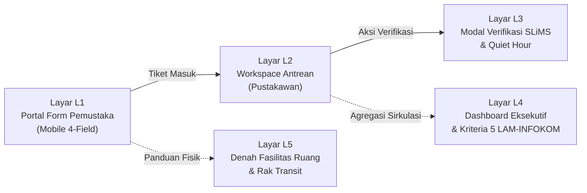
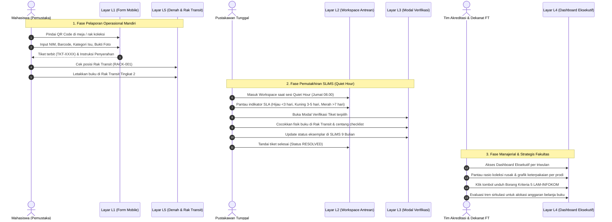

> 🔗 **Navigasi Vault:** Kembali ke [[Dashboard]] | [[CONTEXT_INDEX]] | Landasan Teori: [[Modul 8]] | Laporan Sebelumnya: [[Praktikum_7_Kelompok3]] | Laporan Selanjutnya: [[Praktikum_9_Kelompok3]] | Artefak Blueprint: [[Blueprint_Ekosistem_SIMPEL_KOLEKSI_FT]]

# LAPORAN PRAKTIKUM MINGGUAN
## MANAJEMEN SISTEM INFORMASI (PTF60234)
### PERTEMUAN 8: Perancangan Alur Pengguna dan Wireframe Sistem Informasi

```
Disusun Oleh :
Kelompok 3

1. Gantar Abimanyu       (NIM 24050530042)
2. Ganendra Pradipa      (NIM 24050530038)
3. M. Fadlan Dirmansyah  (NIM 24050530034)

PROGRAM STUDI PENDIDIKAN TEKNIK INFORMATIKA - S1
FAKULTAS TEKNIK
UNIVERSITAS NEGERI YOGYAKARTA
2026
```

---

## 1. Identitas Laporan

| Atribut Laporan | Rincian Identitas |
| :--- | :--- |
| **Nama Kelompok** | Kelompok 3 |
| **Anggota (NIM / Nama)** | 1. Gantar Abimanyu (24050530042)<br>2. Ganendra Pradipa (24050530038)<br>3. M. Fadlan Dirmansyah (24050530034) |
| **Pertemuan ke-** | 8 (Delapan) |
| **Tanggal Pelaksanaan** | 16 Oktober 2026 |
| **Organisasi / Kasus yang Digunakan** | Perpustakaan Fakultas Teknik, Universitas Negeri Yogyakarta (FT UNY) |

---

## 2. Tujuan Kegiatan

Merujuk pada silabus CPMK 3 dan panduan [[Modul 8]], kegiatan praktikum Pertemuan 8 ini bertujuan untuk:
1. Menyusun alur pengguna (*user flow*) yang mencerminkan integrasi proses bisnis lintas peran pemangku kepentingan perpustakaan (Pemustaka, Pustakawan Tunggal, dan Dekanat/Tim Akreditasi).
2. Merancang *wireframe* berfidelitas rendah (*low-fidelity*) untuk layar-layar prioritas pada Grand Design sistem pendukung tata kelola *SIMPEL-KOLEKSI FT*, yang diturunkan secara langsung dari analisis jalur kritis Pertemuan 7.
3. Mendokumentasikan Kartu Layar (*Screen Cards*) yang memetakan secara presisi informasi yang disajikan, peran pengguna, keputusan atau tindakan manajerial yang didukung, serta dasar kebutuhan empiris lapangan.
4. Menegaskan distingsi filosofis Manajemen Sistem Informasi, yaitu bahwa perancangan antarmuka didasarkan pada kecukupan informasi untuk pengambilan keputusan organisasi, bukan sekadar penumpukan fitur aplikasi komputasi.

---

## 3. Uraian Pelaksanaan Kegiatan

### 3.1. Peninjauan Kembali Akar Masalah, Grand Design, dan Jalur Kritis Pertemuan 7
Penyusunan wireframe pada pertemuan ini tidak dimulai dari imajinasi bebas mengenai fitur perangkat lunak yang menarik, melainkan berakar dari perumusan masalah tata kelola pada [[Praktikum_3_Kelompok_3_Revisi]], batasan ruang lingkup pada [[Praktikum_4_Kelompok3_revisi]], Grand Design dan RACI Matrix pada [[Praktikum_5_Kelompok3]], serta hasil analisis jalur kritis pada [[Praktikum_7_Kelompok3]].

Berdasarkan investigasi empiris pada dokumen [[Jawaban3_Final]], kendala mendasar Perpustakaan FT UNY adalah keberadaan **1 orang pustakawan tunggal** yang harus melayani rata-rata **52 pengunjung per hari** pada meja sirkulasi fisik. Akibatnya, pustakawan mengalami beban ganda (*dual burden*), sehingga pemutakhiran data status eksemplar di pangkalan data SLiMS (*Senayan Library Management System*) sering tertunda (*lagging data*). Kondisi buku rusak, salah letak di rak, atau hilang tidak tercatat secara tepat waktu pada katalog OPAC (*Online Public Access Catalog*). Hal ini merugikan mahasiswa yang mencari buku, menyulitkan pustakawan dalam inventarisasi, dan menghambat penyediaan bukti sirkulasi untuk Borang Akreditasi LAM-INFOKOM Kriteria 5 bagi program studi di Fakultas Teknik.

Analisis jaringan PERT pada Pertemuan 7 membuktikan bahwa **Jalur Kritis proyek berdurasi 36 hari kerja** didominasi oleh lintasan tata kelola operasional:
$$\text{Perumusan SOP (B)} \rightarrow \text{Pembuatan Form QR (C)} \rightarrow \text{Sosialisasi Pengguna (F)} \rightarrow \text{Implementasi Terpadu (G)} \rightarrow \text{Monitoring \& Evaluasi (H)}$$

Lintasan ini membuktikan bahwa titik tumpu keberhasilan sistem informasi terletak pada kesepakatan tata laksana dan kesiapan adopsi pengguna, bukan pada penulisan kode program backend yang rumit. Oleh karena itu, Kelompok 3 menetapkan strategi perancangan *wireframe* berbasis pendekatan **Pure Governance** sebagaimana tertuang dalam [[Blueprint_Ekosistem_SIMPEL_KOLEKSI_FT]]:
1. **Tidak menggantikan sistem SLiMS:** SLiMS 9 Bulian tetap menjadi pemegang otoritas data utama (*Single Source of Truth*).
2. **Desentralisasi pelaporan:** Mahasiswa diberdayakan sebagai sensor penemu kondisi fisik buku melalui formulir mobile mandiri.
3. **Penyediaan penyangga fisik (Buffer Zone):** Pemisahan fisik buku menggunakan Rak Transit (RACK-001) dua tingkat agar meja counter sirkulasi terbebas dari penumpukan fisik.
4. **Pemberian ruang kerja terfokus:** Pustakawan memproses laporan pada slot *Quiet Hour* rutin (Jumat pagi pukul 08.00–09.00 WIB) dengan panduan SLA yang terukur.

### 3.2. Metodologi Seleksi Layar Prioritas Berbasis Jalur Kritis
Sesuai arahan evaluasi Dr. Ratna Wardani pada [[catatan_4]], sistem informasi harus dianalisis dari pengaruh organisasionalnya terhadap tiga tingkatan manajemen (*vertical alignment*). Maka, dipilih 5 (lima) layar prioritas yang membentuk satu rantai informasi utuh (*closed-loop workflow*):



1. **Layar L1 (Portal Pelaporan Mandiri Pemustaka - Mobile Responsive):** Menyelesaikan simpul jalur kritis aktivitas C (Pembuatan Form QR Code). Layar ini memberi instrumen bagi mahasiswa untuk mencatat kerusakan atau salah letak buku tanpa harus mengantre di meja pustakawan.
2. **Layar L2 (Workspace Antrean Tiket Pustakawan - Desktop Admin):** Menampung data tiket dari L1 secara terurut berdasarkan indikator kepatuhan batas waktu layanan (*Service Level Agreement* / SLA).
3. **Layar L3 (Modal Verifikasi & Sinkronisasi SLiMS - Desktop Overlay):** Menjalankan simpul jalur kritis aktivitas B (SOP Quiet Hour) dan E (Uji Ekstraksi SLiMS). Layar ini menyediakan *checklist* verifikasi fisik dan panduan pembaruan status pangkalan data SLiMS.
4. **Layar L4 (Dashboard Eksekutif & Akreditasi - Desktop View):** Mendukung pengambilan keputusan tingkat manajerial dan strategis (Kepala Perpustakaan, Tim Akreditasi Prodi, Dekanat FT UNY) dengan menyajikan agregasi sirkulasi dan generator Borang Kriteria 5 LAM-INFOKOM.
5. **Layar L5 (Blueprint Tata Ruang & Rak Transit - Spatial Map):** Memandu penataan fasilitas fisik agar interaksi antara formulir digital dan alur penyerahan buku di Rak Transit (RACK-001) berjalan sinkron tanpa menimbulkan friksi operasional.

### 3.3. Penegakan 7 Aspek Pengelolaan MSI pada Wireframe
Pada Pertemuan 8, dua aspek utama yang ditekankan secara mendalam adalah:
- **Aspek 3 (Dukungan Pengambilan Keputusan):** Setiap area informasi pada wireframe dirancang untuk memicu tindakan nyata. Contohnya, pada Layar L2, indikator SLA kuning/merah memicu pustakawan untuk segera memeriksa Rak Transit; pada Layar L4, rasio keterpakaian koleksi 94,1% pada prodi PTI memicu Dekanat mengalokasikan 35% anggaran pengadaan buku tahunan ke bidang informatika.
- **Aspek 4 (Kebutuhan Informasi Stakeholder):** Struktur informasi disesuaikan dengan kebutuhan riil pemangku kepentingan, bukan preferensi seragam. Mahasiswa membutuhkan formulir ringkas 4 kolom dan konfirmasi nomor tiket; pustakawan membutuhkan daftar periksa dan timer fokus kerja; pimpinan fakultas membutuhkan grafik tren triwulan dan format berkas akreditasi.

---

## 4. Hasil/Artefak Praktikum

### 4.1. Alur Pengguna (User Flow) Lintas Peran

Berikut adalah pemetaan alur pengguna yang menggambarkan urutan layar yang dilalui oleh setiap peran pemangku kepentingan untuk menuntaskan tanggung jawab informasinya:



#### Tabel Lembar Kerja Bagian A: Alur Pengguna (*User Flow Table*)

| No | Peran Pengguna | Tugas Pokok yang Dilakukan | Urutan Layar (ID) | Hasil Keluaran / Tindakan Lanjutan |
| :-: | :--- | :--- | :--- | :--- |
| 1 | **Mahasiswa (Pemustaka)** | Melaporkan temuan buku rusak, halaman hilang, atau salah letak di rak secara mandiri tanpa membebani loket sirkulasi | **L1** (Portal Form Pemustaka) $\rightarrow$ **L5** (Panduan Denah & Rak Transit) | Tiket pelaporan resmi terbit; buku diletakkan di Rak Transit Tingkat 2 |
| 2 | **Pustakawan Tunggal** | Memeriksa antrean laporan, mengontrol batas waktu SLA, memvalidasi kondisi fisik buku, dan memperbarui pangkalan data SLiMS | **L2** (Workspace Antrean Tiket) $\rightarrow$ **L3** (Modal Verifikasi & Checklist SLiMS) $\rightarrow$ **L5** (Denah Rak Transit) | Status tiket berubah menjadi `RESOLVED`; status eksemplar di SLiMS menjadi `RUSAK`/`PERBAIKAN` |
| 3 | **Tim Akreditasi Program Studi** | Memperoleh rekapitulasi data sirkulasi dan kecukupan pustaka untuk bukti dukung instrumen akreditasi prodi | **L4** (Dashboard Eksekutif & Akreditasi) | Berkas tabel Kriteria 5 LAM-INFOKOM terunduh dalam format standar Excel/CSV |
| 4 | **Pimpinan Fakultas (Dekanat FT UNY)** | Mengevaluasi rasio pemanfaatan koleksi dan merumuskan alokasi belanja modal pengadaan pustaka tahunan | **L4** (Dashboard Eksekutif & Akreditasi) | Penetapan proporsi anggaran pengadaan berbasis data empiris (*evidence-based procurement*) |

---

### 4.2. Kartu Layar (Screen Cards)

Setiap layar prioritas dirumuskan melalui empat parameter baku untuk menjamin bahwa kehadiran setiap bidang (*field*) informasi memiliki pertanggungjawaban manajerial yang tegas.

#### Tabel Lembar Kerja Bagian B: Kartu Layar Terstruktur

| ID Layar | Nama Layar & Pengguna Utama | Informasi yang Ditampilkan pada Layar | Keputusan atau Tindakan yang Didukung | Dasar Kebutuhan Lapangan (Sumber / Metode) | Penanggung Jawab (*Accountable*) |
| :--- | :--- | :--- | :--- | :--- | :--- |
| **L1** | **Portal Pelaporan Mandiri Pemustaka**<br>*(Pengguna: Mahasiswa FT UNY)* | • Identitas Pelapor (NIM, Nama Mahasiswa)<br>• Data Koleksi (Barcode Eksemplar, Judul Buku)<br>• Kategori Masalah (Halaman Sobek, Hilang Sebagian, Salah Rak, Hilang Fisik)<br>• Bukti Visual (Unggah Foto Kerusakan)<br>• Catatan Tambahan (Keterangan Halaman)<br>• Nomor Tiket Otomatis (`TKT-YYYYMM-XXX`) | • Memutuskan pelaporan langsung saat menemukan buku bermasalah tanpa harus mengantre di loket sirkulasi.<br>• Memandu mahasiswa menyerahkan fisik buku secara disiplin ke Rak Transit Tingkat 2. | • Dokumen [[Jawaban3_Final]] (Poin 4: pemustaka enggan lapor karena antrean loket panjang).<br>• Observasi antrean sirkulasi saat jam sibuk perkuliahan.<br>• Rekomendasi formulir 4 kolom pada [[Praktikum_4_Kelompok3_revisi]]. | **Ganendra Pradipa** *(PIC Pengguna & Form QR)* |
| **L2** | **Workspace Antrean Tiket Pustakawan**<br>*(Pengguna: Pustakawan Tunggal)* | • Widget Jam Operasional & Tombol *Quiet Hour* (Timer 60:00)<br>• Kartu Ringkasan KPI (Total Tiket, Pending Verifikasi, Mendekati Batas SLA, Sukses Ter-update)<br>• Tabel Antrean Tiket (Nomor, Tanggal, Barcode, Judul, Kategori Masalah, Badge SLA: Hijau/Kuning/Merah, Status SLiMS, Tombol Aksi Verifikasi)<br>• Filter Status (Semua, Pending, Selesai) | • Memutuskan aktivasi sesi kerja hening (*Quiet Hour*) tanpa gangguan loket tatap muka.<br>• Memprioritaskan penanganan tiket yang mendekati batas kedaluwarsa SLA (warna kuning/merah).<br>• Memilah buku yang harus diambil dari Rak Transit untuk penanganan kuratif. | • Dokumen [[Jawaban3_Final]] (Poin 2 & 3: beban ganda 52 pengunjung/hari memicu data tertunda).<br>• Arahan Bu Ratna pada [[catatan_4]] mengenai penyediaan sarana pengukur waktu kerja pustakawan.<br>• Prinsip pengendalian internal *Task-Technology Fit* (Goodhue & Thompson, 1995). | **Gantar Abimanyu** *(PIC Tata Kelola & SOP)* |
| **L3** | **Modal Verifikasi Fisik & Checklist SLiMS**<br>*(Pengguna: Pustakawan Tunggal)* | • Data Lengkap Tiket (Pelapor, NIM, Barcode, Judul, Tanggal Lapor)<br>• Pratinjau Foto Bukti Kerusakan dari Mahasiswa<br>• Checklist 1: Fisik buku telah diambil dari Rak Transit dan diperiksa kondisinya<br>• Checklist 2: Status eksemplar di SLiMS 9 Bulian telah diubah (Rusak / Perbaikan / Hilang)<br>• Tombol Eksekusi (*Selesaikan Tiket* atau *Batal*) | • Memutuskan apakah kondisi buku memerlukan perbaikan jilid ringan, pengikatan ulang, atau usulan penghapusan aset (*weeding*).<br>• Memastikan perubahan status pada katalog lokal SLiMS telah benar sebelum tiket ditutup, mencegah data ganda (*double entry*). | • Wawancara [[Jawaban3_Final]] (Poin 5: pustakawan butuh pencocokan fisik sebelum ubah status katalog).<br>• Kajian SOP *Quiet Hour* pada [[Rancang SOP Sistem Informasi]].<br>• Matriks RACI [[Praktikum_5_Kelompok3]]. | **M. Fadlan Dirmansyah** *(PIC SLiMS & Borang)* |
| **L4** | **Dashboard Eksekutif & Akreditasi**<br>*(Pengguna: Tim Akreditasi Prodi & Dekanat FT UNY)* | • Kartu Metrik Strategis (Total Koleksi 4.287 judul, Frekuensi Peminjaman 1.842 triwulanan, Rasio Koleksi Rusak 6,2%)<br>• Grafik Batang Frekuensi Peminjaman per Program Studi (PTI, PTE, Mesin, Sipil, Elektronika)<br>• Donut Chart Rasio Kondisi Koleksi (Koleksi Prima 93,8%, Perbaikan 3,7%, Rusak Berat/Hilang 2,5%)<br>• Tabel Keterpakaian per Program Studi beserta Rasio dan Rekomendasi Pengadaan<br>• Generator Unduhan Borang Kriteria 5 LAM-INFOKOM (Tombol Ekspor Excel)<br>• Panel Rekomendasi Alokasi Anggaran Belanja Buku (*Evidence-Based Procurement*) | • Tim Akreditasi: Mengunduh data sirkulasi siap pakai tanpa membebani pustakawan dengan permintaan laporan manual.<br>• Dekanat: Mengambil keputusan alokasi anggaran belanja buku tahunan secara proporsional berdasarkan data keterpakaian riil (misal: 35% pagu dialokasikan ke Prodi PTI karena keterpakaian mencapai 94,1%). | • Wawancara [[Jawaban3_Final]] (Poin 7: tim akreditasi sering meminta rekap mendadak dengan format kaku).<br>• Panduan Akreditasi LAM-INFOKOM Kriteria 5 (Pendidikan, Suasana Akademik, dan Sumber Belajar).<br>• Arahan Bu Ratna pada [[catatan_4]] mengenai keterkaitan sistem perpustakaan dengan alokasi belanja fakultas. | **M. Fadlan Dirmansyah** & **Gantar Abimanyu** |
| **L5** | **Blueprint Tata Ruang & Rak Transit**<br>*(Pengguna: Mahasiswa, Pustakawan, & Pimpinan)* | • Denah Zonasi Ruang Fisik 2 Dimensi (Zona Pintu Masuk, Zona Loket Sirkulasi, Zona Rak Koleksi Utama DDC 000-900, Zona Meja Baca)<br>• Posisi Stand Akrilik QR Code Signage di Pintu Masuk dan Meja Baca<br>• Posisi Rak Transit 2 Tingkat (RACK-001) di Samping Pintu Masuk<br>• Area Loket Sirkulasi Prima Bebas Tumpukan Buku Fisik<br>• Kartu Panduan Teknis Zonasi Tingkat 1 (Normal) dan Tingkat 2 (Koleksi Rusak / Form QR) | • Mahasiswa: Mengidentifikasi lokasi peletakan buku setelah mengisi formulir digital.<br>• Pustakawan: Mengambil buku terorganisasi di Rak Transit saat jam *Quiet Hour* tanpa mencari di tumpukan acak meja loket.<br>• Dekanat: Memvalidasi kecukupan sarana prasarana fisik pendukung operasional perpustakaan. | • Observasi tata letak ruang fisik Perpustakaan FT UNY (Juli–September 2026).<br>• Dokumen [[Jawaban3_Final]] (Poin 6: meja sirkulasi sering penuh tumpukan buku pengembalian).<br>• Konsep Tata Kelola *Buffer Zone* pada [[Blueprint_Ekosistem_SIMPEL_KOLEKSI_FT]]. | **Ganendra Pradipa** *(PIC Tata Ruang & Fisik)* |

---

### 4.3. Sketsa Wireframe Berfidelitas Rendah (*Low-Fidelity Layouts*)

Sesuai kaidah Rettig (1994) dan panduan teknis [[Modul 8]], wireframe dirancang secara struktural menggunakan blok area informasi abu-abu tanpa pewarnaan grafis final, agar diskursus terfokus pada kelengkapan elemen keputusan.

#### A. Wireframe Layar L1: Portal Pelaporan Mandiri Pemustaka (Mobile Frame 390px)
```
┌──────────────────────────────────────────────┐
│ [●  Perpustakaan FT UNY - Mandiri  19:10]   │
├──────────────────────────────────────────────┤
│ [AREA HERO: JUDUL & PETUNJUK LAYANAN]        │
│ ┌──────────────────────────────────────────┐ │
│ │ FORMULIR LAPORAN KERUSAKAN / SALAH RAK   │ │
│ │ Laporkan buku mandiri via scan QR        │ │
│ └──────────────────────────────────────────┘ │
│                                              │
│ [AREA ISIAN 1: IDENTITAS PEMUSTAKA]          │
│  NIM Mahasiswa  : [ 240505300XX          ]   │
│  Nama Pelapor   : [ Mahasiswa FT UNY      ]   │
│                                              │
│ [AREA ISIAN 2: DATA EKSEMPLAR BUKU]          │
│  Barcode Koleksi: [ FT-INF-2024-XXX      ]   │
│  Judul Buku     : [ Judul Buku           ]   │
│                                              │
│ [AREA ISIAN 3: KATEGORI KERUSAKAN]           │
│  ( ) Halaman Sobek     ( ) Halaman Hilang    │
│  ( ) Salah Posisi Rak  ( ) Hilang Fisik      │
│                                              │
│ [AREA ISIAN 4: BUKTI FOTO & CATATAN]         │
│  [ + Unggah Foto Bukti Kerusakan Fisik     ] │
│  Catatan Tambahan:                           │
│  [ Halaman 45-50 robek pada bagian tengah  ] │
│                                              │
│ [TOMBOL AKSI UTAMA]                          │
│  [=========================================] │
│  [  KIRIM LAPORAN KE SISTEM PERPUSTAKAAN   ] │
│  [=========================================] │
│                                              │
│ [AREA MODAL POPUP SETELAH SUBMIT]            │
│  ┌─────────────────────────────────────────┐ │
│  │ [✓] Laporan Berhasil Dikirim!           │ │
│  │ Nomor Tiket : TKT-202610-013            │ │
│  │ Estimasi SLA: Verifikasi maks 3 hari    │ │
│  │ ARAHAN: Letakkan buku di RAK TRANSIT    │ │
│  │ TINGKAT 2 dekat pintu masuk sekarang.   │ │
│  │ [ Tutup & Mengerti ]                    │ │
│  └─────────────────────────────────────────┘ │
└──────────────────────────────────────────────┘
```

#### B. Wireframe Layar L2: Workspace Antrean Tiket Pustakawan (Desktop Layout)
```
┌────────────────────────────────────────────────────────────────────────────────────────┐
│ [LOGO] SIMPEL-KOLEKSI FT | Workspace Pustakawan                 [Online] [18:52 WIB]   │
├────────────────────────────────────────────────────────────────────────────────────────┤
│ [BAR QUIET HOUR: Sesi Pemutakhiran Data SLiMS (Jumat 08.00 - 09.00 WIB)]              │
│  Status: Mode Normal  |  Waktu Tersisa: [ 60:00 ]  |  [ ▶ Mulai Sesi Quiet Hour ]     │
├────────────────────────────────────────────────────────────────────────────────────────┤
│ [KARTU RINGKASAN METRIK KPI PENANGANAN TIKET]                                          │
│ ┌──────────────────┐ ┌──────────────────┐ ┌──────────────────┐ ┌─────────────────────┐ │
│ │ Total Tiket      │ │ Pending Cek      │ │ Mendekati SLA    │ │ Selesai Update      │ │
│ │   [ 12 Tiket ]   │ │   [ 3 Tiket ]    │ │   [ 1 Tiket ]    │ │   [ 8 Eksemplar ]   │ │
│ └──────────────────┘ └──────────────────┘ └──────────────────┘ └─────────────────────┘ │
├────────────────────────────────────────────────────────────────────────────────────────┤
│ [TABEL ANTREAN TIKET VERIFIKASI BUKU]                 [Filter: Semua | Pending | Res]  │
│ ┌──────────────┬────────────┬─────────────┬─────────────────┬──────────┬───────┬─────┐ │
│ │ No Tiket     │ Tanggal    │ Barcode     │ Judul Buku      │ Status   │ SLiMS │ Aksi│ │
│ ├──────────────┼────────────┼─────────────┼─────────────────┼──────────┼───────┼─────┤ │
│ │ TKT-202610-09│ 09/10/2026 │ FT-INF-072  │ Kecerdasan Buat │ [HIJAU]  │ Pend  │[Cek]│ │
│ │ TKT-202610-10│ 09/10/2026 │ FT-SPL-035  │ Tata Kota & Wil │ [KUNING] │ Pend  │[Cek]│ │
│ │ TKT-202610-11│ 10/10/2026 │ FT-ELK-028  │ Kendali Otomasi │ [HIJAU]  │ Pend  │[Cek]│ │
│ └──────────────┴────────────┴─────────────┴─────────────────┴──────────┴───────┴─────┘ │
└────────────────────────────────────────────────────────────────────────────────────────┘
```

#### C. Wireframe Layar L3: Modal Verifikasi Fisik & Checklist SLiMS (Overlay)
```
┌────────────────────────────────────────────────────────────┐
│ VERIFIKASI TIKET: TKT-202610-009                     [ X ] │
├────────────────────────────────────────────────────────────┤
│ Data Pelapor : Farid Hidayat (NIM 24050530015)             │
│ Koleksi Buku : Kecerdasan Buatan (Barcode: FT-INF-2024-072)│
│ Kategori Isu : Halaman Robek / Rusak Fisik                 │
├────────────────────────────────────────────────────────────┤
│ [KOTAK PRATINJAU FOTO BUKTI DARI PEMUSTAKA]                │
│ ┌────────────────────────────────────────────────────────┐ │
│ │ [ Pratinjau Foto Kerusakan Eksemplar Terlampir ]       │ │
│ └────────────────────────────────────────────────────────┘ │
├────────────────────────────────────────────────────────────┤
│ DAFTAR PERIKSA VERIFIKASI PUSTAKAWAN:                      │
│ [ ] 1. Fisik buku telah diambil dari Rak Transit Tingkat 2 │
│        dan diperiksa tingkat kerusakannya secara manual.   │
│ [ ] 2. Status eksemplar pada pangkalan data SLiMS lokal    │
│        telah diubah menjadi (RUSAK / PERBAIKAN / HILANG).  │
├────────────────────────────────────────────────────────────┤
│ [ Batal ]                   [ ✓ Selesaikan Tiket (Resolve)]│
└────────────────────────────────────────────────────────────┘
```

#### D. Wireframe Layar L4: Dashboard Eksekutif & Akreditasi (Desktop View)
```
┌────────────────────────────────────────────────────────────────────────────────────────┐
│ [LOGO] SIMPEL-KOLEKSI FT | Dashboard Eksekutif & Akreditasi   [Download Borang Kriteria 5]│
├────────────────────────────────────────────────────────────────────────────────────────┤
│ [RINGKASAN METRIK STRATEGIS FAKULTAS]                                                  │
│ ┌─────────────────────────┐ ┌─────────────────────────┐ ┌────────────────────────────┐│
│ │ Total Koleksi Aktif     │ │ Frekuensi Sirkulasi     │ │ Rasio Kerusakan Koleksi    ││
│ │   [ 4.287 Judul ]       │ │   [ 1.842 Transaksi ]   │ │   [ 6,2% (Turun 1,8%) ]    ││
│ └─────────────────────────┘ └─────────────────────────┘ └────────────────────────────┘│
├────────────────────────────────────────────────────────────────────────────────────────┤
│ [GRAFIK BATANG PEMINJAMAN PER PRODI]         [DONUT CHART KONDISI KOLEKSI]             │
│  PTI    : [========================] 487      Koleksi Prima       : 93,8% (4.022 buku) │
│  PTE    : [====================    ] 412      Sedang Diperbaiki   :  3,7% (  157 buku) │
│  Mesin  : [==================      ] 378      Rusak Berat / Hilang:  2,5% (  108 buku) │
│  Sipil  : [================        ] 341                                               │
│  Elko   : [===========             ] 224                                               │
├────────────────────────────────────────────────────────────────────────────────────────┤
│ [PANEL REKOMENDASI ANGGARAN DEKANAT - EVIDENCE-BASED PROCUREMENT]                      │
│  "Berdasarkan rasio keterpakaian 94,1% pada Prodi PTI dan tingginya laporan kerusakan   │
│   buku AI dan pemrograman, direkomendasikan 35% pagu belanja buku dialokasikan ke PTI" │
└────────────────────────────────────────────────────────────────────────────────────────┘
```

#### E. Wireframe Layar L5: Blueprint Tata Ruang & Rak Transit (Spatial Blueprint)
```
┌────────────────────────────────────────────────────────────────────────────────────────┐
│ DENAH TATA RUANG FASILITAS FISIK PERPUSTAKAAN FT UNY               [Standar RACK-001]  │
├────────────────────────────────────────────────────────────────────────────────────────┤
│ [PINTU MASUK / KELUAR]                                                                 │
│     │                                                                                  │
│     ├──► [STAND AKRILIK QR SIGNAGE] ("Scan Disini untuk Lapor Rusak & Pengembalian")  │
│     │                                                                                  │
│     ├──► [RAK TRANSIT PENGEMBALIAN - RACK-001]                                         │
│     │    ┌───────────────────────────────────────────────────────────────────────┐     │
│     │    │ TINGKAT 1: Pengembalian Normal (Siap Shelving Pustakawan)             │     │
│     │    ├───────────────────────────────────────────────────────────────────────┤     │
│     │    │ TINGKAT 2: Buku Laporan Rusak / Hilang (Wajib Isi Form QR Layar L1)   │     │
│     │    └───────────────────────────────────────────────────────────────────────┘     │
│     │                                                                                  │
│     └──► [MEJA LOKET SIRKULASI PUSTAKAWAN TUNGGAL]                                     │
│          ├── PC All-in-One (SLiMS 9 Bulian + Workspace Layar L2)                       │
│          ├── Barcode Scanner USB untuk Cek Fisik Eksemplar                             │
│          └── Area Pelayanan Bebas Tumpukan (Pelayanan Prima Mahasiswa)                 │
│                                                                                        │
│ [AREA RAK UTAMA: DDC 000 - 900]            [AREA MEJA BACA & STIKER QR MEJA]           │
└────────────────────────────────────────────────────────────────────────────────────────┘
```

---

## 5. Kendala dan Solusi

### 5.1. Kendala yang Dihadapi
1. **Risiko Pemekaran Fitur (*Feature Creep*):** Pada awal perancangan, terdapat kecenderungan untuk menambahkan fitur pelacakan denda keterlambatan buku dan fitur obrolan daring langsung dengan pustakawan pada antarmuka mahasiswa. Namun, fitur ini tidak menjawab akar masalah utama (keterlambatan pemutakhiran data katalog karena beban kerja 1 orang staf) dan berada di luar ruang lingkup WBS yang disepakati pada Pertemuan 4 dan 7.
2. **Keterbatasan Kapasitas Perangkat Keras di Loket Pustakawan:** Pustakawan tunggal bekerja menggunakan 1 (satu) unit PC All-in-One di meja sirkulasi. Jika sistem antarmuka antrean menuntut perpindahan jendela (*alt-tab*) yang terlalu sering dengan antarmuka SLiMS lokal, pustakawan akan merasa terbebani (*high cognitive friction*).
3. **Penyelarasan Format Data Akreditasi:** Tim penyusun borang akreditasi program studi di lingkungan FT UNY sering meminta tabel rekapitulasi dengan nomenklatur kolom yang kaku sesuai panduan LAM-INFOKOM, sementara tabel bawaan SLiMS hanya mengekspor atribut bibliografi mentah.

### 5.2. Solusi yang Diterapkan
1. **Penerapan Batasan *Pure Governance* secara Ketat:** Kelompok memangkas fitur-fitur yang tidak esensial dan hanya mempertahankan 5 layar yang berada pada simpul jalur kritis. Fitur denda diabaikan karena sudah ditangani secara *native* oleh modul sirkulasi SLiMS bawaan.
2. **Penyatuan Alur Verifikasi dalam Modal Tunggal (Layar L3):** Antarmuka verifikasi dirancang dalam format *modal pop-up checklist*. Pustakawan cukup membuka satu kartu, menyalin barcode secara cepat menggunakan pemindai USB ke SLiMS, mencentang dua kotak verifikasi, dan menutup tiket. Hal ini menghemat waktu rata-rata proses verifikasi menjadi kurang dari 90 detik per buku.
3. **Perancangan Modul Ekstraksi Satu Klik pada Layar L4:** Pada dashboard eksekutif, disediakan tombol parser CSV yang secara otomatis memetakan kolom database SLiMS ke dalam tabel Kriteria 5 LAM-INFOKOM (Jumlah Judul, Jumlah Eksemplar, Frekuensi Peminjaman per Prodi) sehingga tim akreditasi dapat mengunduh berkas tanpa meminta bantuan manual dari pustakawan.

---

## 6. Refleksi Pembelajaran

Praktikum Pertemuan 8 memberikan pemahaman fundamental mengenai distingsi antara **Rekayasa Perangkat Lunak Umum** dan **Manajemen Sistem Informasi**:
1. **Merancang Antarmuka dari Pertanyaan Keputusan, Bukan Daftar Fitur:** Dalam rekayasa perangkat lunak biasa, perancang sering kali berfokus pada keindahan tata letak, animasi transisi, dan kelengkapan menu input. Sebaliknya, dalam Manajemen Sistem Informasi, setiap kotak pada layar harus dapat menjawab pertanyaan kritis: *"Informasi apa yang dibutuhkan oleh siapa, dan keputusan manajerial apa yang diambil setelah melihat informasi tersebut?"*. Jika suatu elemen pada layar tidak memicu keputusan, elemen tersebut merupakan limbah informasi (*information clutter*).
2. **Kekuatan Prototipe Berfidelitas Rendah (*Low-Fidelity*):** Sebagaimana ditegaskan oleh Rettig (1994), mempertahankan rancangan pada tingkat wireframe kotak abu-abu memberi ruang psikologis bagi tim dan pemangku kepentingan untuk berdiskusi secara objektif mengenai relevansi aliran data. Tidak adanya perdebatan mengenai warna tombol atau estetika visual memungkinkan kelompok mengaudit apakah formulir 4 kolom benar-benar cukup untuk mengidentifikasi buku di pangkalan data SLiMS.
3. **Menghubungkan Lapisan Fisik dan Digital:** Masalah perpustakaan tidak pernah dapat diselesaikan hanya dengan aplikasi di layar gawai. Tanpa adanya Rak Transit fisik (RACK-001) dan SOP *Quiet Hour*, pelaporan digital mahasiswa hanya akan menjadi tumpukan catatan maya yang tidak pernah diverifikasi. Wireframe sistem informasi harus selalu berpijak pada realitas operasional organisasi tempat sistem tersebut beroperasi.

---

## 7. Kesimpulan

Praktikum Pertemuan 8 berhasil menghasilkan alur pengguna terintegrasi dan 5 (lima) layar wireframe prioritas sistem pendukung tata kelola *SIMPEL-KOLEKSI FT* Perpustakaan Fakultas Teknik UNY:
1. Alur pengguna secara utuh berhasil menghubungkan tiga lapisan organisasi: **Operasional** (Mahasiswa dan Pustakawan Tunggal melalui Layar L1, L2, L3, dan L5), **Manajerial** (Tim Akreditasi melalui Layar L4), dan **Strategis** (Dekanat FT UNY melalui Layar L4).
2. Rangkaian wireframe yang dirancang secara ketat merefleksikan simpul jalur kritis Pertemuan 7, dengan menempatkan SLiMS sebagai pusat otoritas data (*Single Source of Truth*) dan memanfaatkan formulir QR Code serta Rak Transit sebagai penyangga operasional (*buffer zone*).
3. Artefak Kartu Layar dan wireframe berfidelitas rendah ini menjadi fondasi yang kokoh untuk ditingkatkan menjadi **Mockup Interaktif Berfidelitas Tinggi (*High-Fidelity*)** pada Pertemuan 9, yang akan dilengkapi dengan data contoh berbasis kasus nyata serta penanganan kondisi khusus (*empty*, *delayed*, dan *error states*).

---

### DAFTAR PUSTAKA / REFERENSI

1. Goodhue, D. L., & Thompson, R. L. (1995). Task-technology fit and individual performance. *MIS Quarterly*, 19(2), 213-236. https://doi.org/10.2307/249689
2. Laudon, K. C., & Laudon, J. P. (2014). *Management information systems: Managing the digital firm* (13th ed.). Pearson Education.
3. Markus, M. L. (1983). Power, politics, and MIS implementation. *Communications of the ACM*, 26(6), 430-444. https://doi.org/10.1145/358141.358148
4. Rettig, M. (1994). Prototyping for tiny fingers. *Communications of the ACM*, 37(4), 21-27. https://doi.org/10.1145/175276.175288
5. Romney, M. B., & Steinbart, P. J. (2018). *Accounting information systems* (14th ed.). Pearson.
6. Wardani, R. (2026). *Modul 8 Praktikum Manajemen Sistem Informasi: Perancangan Alur Pengguna dan Wireframe Sistem Informasi*. Program Studi Pendidikan Teknik Informatika, Fakultas Teknik, Universitas Negeri Yogyakarta.
