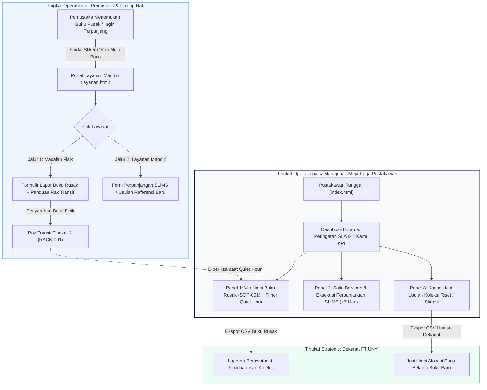

> 🔗 **Navigasi Vault:** Kembali ke [[Dashboard]] | [[CONTEXT_INDEX]] | Landasan Teori: [[Modul 9]] | Laporan Sebelumnya: [[Praktikum_8_Kelompok3]] | Artefak Blueprint: [[Blueprint_Ekosistem_SIMPEL_KOLEKSI_FT]] | Berkas Prototipe Web: [`08_ARTEFAK/mockup-3/index.html`](file:///c:/PMSI/08_ARTEFAK/mockup-3/index.html) & [`08_ARTEFAK/mockup-3/layanan.html`](file:///c:/PMSI/08_ARTEFAK/mockup-3/layanan.html)

# LAPORAN PRAKTIKUM MINGGUAN
## MANAJEMEN SISTEM INFORMASI (PTF60234)
### PERTEMUAN 9: Penyusunan Mockup Interaktif Sistem Informasi

```
Disusun Oleh :
Kelompok 3

1. Gantar Abimanyu       (NIM 24050530042)
2. Ganendra Pradipa      (NIM 24050530038)
3. M. Fadlan Dirmansyah  (NIM 24050530034)

PROGRAM STUDI PENDIDIKAN TEKNIK INFORMATIKA - S1
FAKULTAS TEKNIK
UNIVERSITAS NEGERI YOGYAKARTA
2026
```

---

## 1. Identitas Laporan

| Atribut Laporan | Rincian Identitas |
| :--- | :--- |
| **Nama Kelompok** | Kelompok 3 |
| **Anggota (NIM / Nama)** | 1. Gantar Abimanyu (24050530042)<br>2. Ganendra Pradipa (24050530038)<br>3. M. Fadlan Dirmansyah (24050530034) |
| **Pertemuan ke-** | 9 (Sembilan) |
| **Tanggal Pelaksanaan** | 23 Oktober 2026 (Revisi Pemutakhiran Desain Mockup-3: 30 Oktober 2026) |
| **Organisasi / Kasus yang Digunakan** | Perpustakaan Fakultas Teknik, Universitas Negeri Yogyakarta (FT UNY) |

---

## 2. Tujuan Kegiatan

Merujuk pada silabus CPMK 3 dan panduan akademik [[Modul 9]], kegiatan praktikum Pertemuan 9 ini bertujuan untuk:
1. Mengembangkan rancangan *wireframe* berfidelitas rendah dari [[Praktikum_8_Kelompok3]] menjadi **Mockup Interaktif Berfidelitas Tinggi (*High-Fidelity Interactive Prototype*)** generasi terbaru (*Mockup-3*) yang memisahkan kanal pelaporan mandiri pemustaka dengan meja kerja sirkulasi pustakawan secara terpadu.
2. Menyusun data contoh (*sample data*) yang bersumber secara otentik dari kondisi empiris Perpustakaan FT UNY dan pangkalan data SLiMS 9 Bulian, lengkap dengan pencatatan asal perolehan data dan penanggung jawab kebenarannya (*data ownership & accountability*).
3. Merancang dan mengimplementasikan varian tampilan kondisi khusus (*edge cases*), mencakup kondisi data kosong (*empty state*), kondisi mendekati batas waktu verifikasi fisik (*delayed/overdue SLA alert*), sesi kerja terfokus (*Quiet Hour timer*), serta penanganan galat validasi (*form validation guard*).
4. Menautkan antarmuka lintas peran pemangku kepentingan (Pemustaka di lorong rak, Pustakawan Tunggal di meja sirkulasi, dan Pimpinan Fakultas/Dekanat) ke dalam satu ekosistem web terpadu yang siap diujikan kepada pengguna (*usability testing*) pada Pertemuan 10.

---

## 3. Uraian Pelaksanaan Kegiatan

### 3.1. Transformasi Wireframe Menjadi Mockup Berfidelitas Tinggi (Mockup-3)
Pada Pertemuan 8, Kelompok 3 telah menyusun sketsa struktural kotak abu-abu (*low-fidelity wireframe*) berbasis kaidah Balsamiq untuk modul-modul prioritas. Pada Pertemuan 9, seluruh rancangan konseptual tersebut ditingkatkan menjadi **Mockup Interaktif Berfidelitas Tinggi (*High-Fidelity Interactive Prototype*)** generasi terbaru (*Mockup-3*) yang memisahkan kanal pelaporan mandiri pemustaka ([`layanan.html`](file:///c:/PMSI/08_ARTEFAK/mockup-3/layanan.html)) dan meja kerja sirkulasi pustakawan ([`index.html`](file:///c:/PMSI/08_ARTEFAK/mockup-3/index.html)).

Berikut adalah visualisasi perbandingan transformasi struktural dari kerangka *wireframe* kotak abu-abu Pertemuan 8 menuju realisasi *mockup* berfidelitas tinggi Pertemuan 9:

| Modul Layanan | Wireframe Balsamiq (Pertemuan 8) | Mockup Berfidelitas Tinggi (Pertemuan 9) |
| :--- | :--- | :--- |
| **Kanal Pemustaka:** Formulir Lapor Koleksi Bermasalah |  |  |
| **Kanal Pustakawan / Pimpinan:** Pemutakhiran Koleksi & Ekspor |  |  |

Berbeda dengan prototipe awal yang menggabungkan seluruh peran ke dalam satu halaman bertab (*single-page tabs*), arsitektur *Mockup-3* menerapkan pemisahan kanal antarmuka (*Separation of Concerns*) sesuai karakteristik lingkungan fisik penggunanya:
1. **Portal Layanan Mandiri Pemustaka ([`layanan.html`](file:///c:/PMSI/08_ARTEFAK/mockup-3/layanan.html)):**
   Dirancang untuk diakses oleh mahasiswa dan dosen melalui pemindaian stiker kode QR di meja baca dan lorong rak buku. Antarmuka ini bersifat tanpa hambatan masuk (*frictionless access* tanpa kewajiban *login* akun petugas), berfokus pada kecepatan pengisian formulir lapor buku rusak, serta dilengkapi panduan grafis penyerahan buku ke Rak Transit Fisik (RACK-001).
2. **Portal Meja Kerja Pustakawan ([`index.html`](file:///c:/PMSI/08_ARTEFAK/mockup-3/index.html)):**
   Dirancang khusus untuk komputer operasional meja sirkulasi perpustakaan. Menggunakan tata letak dasbor desktop profesional (*Sidebar Navigation Layout*) beresolusi 1920x1080 piksel yang mencakup ringkasan metrik KPI harian, sistem peringatan dini kepatuhan batas waktu layanan (*SLA Quiet Hour Warning*), tabel verifikasi laporan buku fisik, alat bantu eksekusi perpanjangan SLiMS, dan modul ekspor data usulan belanja buku Dekanat.

Standar desain *Mockup-3* menerapkan *Design Tokens* institusional yang konsisten:
- **Warna Institusional:** *UNY Academic Navy* (`#0A1931` dan `#061124`) sebagai latar otoritas akademik, *Action Electric Blue* (`#2563EB`) untuk tombol aksi primer dan penanda status aktif, *SLiMS Connected Mint* (`#059669` dan lencana `#ECFDF5`) untuk indikator integrasi katalog, *Warning Amber* (`#F59E0B` dan `#B45309`) untuk kategori kerusakan fisik, serta *Coral Alert* (`#EF4444`) untuk notifikasi tiket kritis.
- **Tipografi Terkalibrasi:** Jenis huruf *Plus Jakarta Sans* untuk keterbacaan antarmuka modern dan *JetBrains Mono* untuk nomor barcode eksemplar (`B004125`, `FT-INF-2024-072`), nomor tiket pelaporan (`TKT-202610-001`), dan kode SOP (`SOP-001 / RACK-001`).
- **Nol Ketergantungan Eksternal (*Zero Dependency*):** Dibangun menggunakan HTML5 semantik, CSS murni berbasis variabel, dan Vanilla JavaScript terstruktur. Prototipe dapat dijalankan seketika (*plug-and-play*) secara lokal tanpa memerlukan instalasi server basis data pihak ketiga, menjunjung tinggi prinsip efisiensi biaya (*Zero-Budget Governance*).



### 3.2. Penegakan Tata Kelola Data Contoh (Aspek 2 MSI)
Dalam disiplin Manajemen Sistem Informasi, data contoh pada mockup antarmuka tidak boleh menggunakan teks semu (*lorem ipsum*) tanpa arti. Setiap kolom, nama pemustaka, nomor induk mahasiswa (NIM), nomor barcode, dan judul buku yang tersaji pada antarmuka *Mockup-3* mewakili data empiris Perpustakaan FT UNY:
- **Identitas Pemustaka:** Menggunakan nama dan NIM mahasiswa aktif Program Studi Pendidikan Teknik Informatika (S1) Fakultas Teknik UNY (contoh: Gantar Abimanyu / 24050530042, Ganendra Pradipa / 24050530038, M. Fadlan Dirmansyah / 24050530034, Farid Hidayat / 24050530015) serta dosen pengampu (Dr. Hendra Kusuma, M.T. / NIP 198503152010121002).
- **Identitas Bibliografi Koleksi:** Nomor barcode mengikuti standar penomoran koleksi lokal FT UNY (seperti `B004125`, `FT-INF-2024-072`, `B001980`, `B002811`, dan `FT-SIP-2022-009`) dengan nomor panggil (*call number*) berbasis sistem klasifikasi desimal Dewey (DDC).
- **Akuntabilitas Kepemilikan Data (*Data Ownership*):** Setiap kelompok data memiliki penanggung jawab kebenaran yang tegas. Pustakawan Tunggal (Siti Rahmawati, S.I.Pst) bertanggung jawab atas keabsahan status eksemplar di SLiMS, pemustaka bertanggung jawab atas kejujuran laporan kondisi fisik buku, dan Dekanat memegang hak persetujuan anggaran belanja buku.

### 3.3. Penanganan Kondisi Khusus untuk Menjamin Adopsi Organisasi (Aspek 7 MSI)
Keberhasilan adopsi sistem informasi oleh staf tunggal sangat bergantung pada bagaimana antarmuka menangani kondisi-kondisi anomali (*edge cases*). Pada *Mockup-3*, Kelompok 3 menyematkan logika proteksi yang teruji:
1. **Peringatan Ambang Batas Waktu SLA (*Delayed / Overdue SLA Alert*):** Banner peringatan berwarna amber (`#FFFBEB` dengan garis tepi `#FDE68A`) muncul pada bagian atas dasbor pustakawan ketika terdapat tiket yang mendekati batas waktu verifikasi 3 hari di Rak Transit Tingkat 2. Banner ini secara eksplisit mengingatkan pustakawan: *"Terdapat 1 tiket buku rusak mendekati batas waktu verifikasi fisik 3 hari di Rak Transit Tingkat 2. Alokasikan waktu pada sesi Quiet Hour Jumat 08.00–09.00 WIB."*
2. **Mode Kerja Fokus Sesi Hening (*Active Quiet Hour Bar*):** Pustakawan dapat mengaktifkan bilah sesi *Quiet Hour* 60 menit melalui tombol aksi header. Bilah gelap institusional (`#0A1931`) akan muncul dengan lencana merah berkedip (*live badge*) dan penghitung waktu mundur (*countdown timer*) 60:00 untuk memberikan batasan psikologis fokus kerja verifikasi katalog tanpa interupsi meja loket.
3. **Penyaringan Data Kosong (*Empty State Handling*):** Ketika pustakawan memilih filter tiket tertentu yang tidak memiliki entri antrean, tabel tidak menampilkan kekosongan misterius yang membingungkan, melainkan menyajikan kartu informatif bersih yang menegaskan bahwa seluruh laporan pada kategori tersebut telah selesai diproses (*zero-inbox reassurance*).
4. **Pencegahan Data Sampel Galat (*Input Validation Guard*):** Formulir lapor kerusakan pada `layanan.html` mengunci tombol kirim dan memberikan peringatan interaktif jika pemustaka belum mengisi nomor barcode atau belum menentukan salah satu kategori kerusakan koleksi, menjaga integritas pangkalan data dari data rongsok (*garbage data*).

---

## 4. Hasil dan Artefak Praktikum

### 4.1. Tautan dan Arsitektur Prototipe Mockup Interaktif

Mockup interaktif sistem *SIMPEL-KOLEKSI FT (Mockup-3)* telah tersusun secara lengkap dan terstruktur pada repositori lokal:
- **Portal Meja Kerja Pustakawan:** [`08_ARTEFAK/mockup-3/index.html`](file:///c:/PMSI/08_ARTEFAK/mockup-3/index.html)
- **Portal Layanan Mandiri Pemustaka:** [`08_ARTEFAK/mockup-3/layanan.html`](file:///c:/PMSI/08_ARTEFAK/mockup-3/layanan.html)
- **Tata Gaya Desain Modern:** [`08_ARTEFAK/mockup-3/styles.css`](file:///c:/PMSI/08_ARTEFAK/mockup-3/styles.css)
- **Mesin Simulasi & Logika Data:** [`08_ARTEFAK/mockup-3/app.js`](file:///c:/PMSI/08_ARTEFAK/mockup-3/app.js)

Berikut adalah galeri tangkapan layar antarmuka *Mockup-3* yang mencerminkan integrasi menyeluruh tata kelola sistem informasi:

---

#### Layar 1: Portal Layanan Mandiri Pemustaka - Beranda Pilihan Layanan (`layanan.html`)


*Gambar 4.1: Antarmuka Beranda Pilihan Layanan Mandiri Pemustaka SIMPEL-KOLEKSI FT UNY (layanan.html).*

**Deskripsi Tata Kelola & Alur Interaksi:**
Halaman awal yang dibuka pemustaka saat memindai stiker kode QR di meja baca atau lorong rak. Menyajikan dua pilihan layanan utama tanpa login: kartu kiri untuk *Lapor Buku Rusak/Hilang* (akses penyerahan fisik ke Rak Transit RACK-001) dan kartu kanan untuk *Layanan & Request Koleksi* (perpanjangan masa pinjam mandiri dan usulan buku baru).

---

#### Layar 2: Formulir Lapor Buku Rusak & Panduan Visual Rak Transit RACK-001 (`layanan.html`)


*Gambar 4.2: Formulir Pelaporan Kerusakan Buku dan Panduan Spasial Rak Transit RACK-001 Tingkat 2 (layanan.html).*

**Deskripsi Tata Kelola & Alur Interaksi:**
Menggabungkan formulir input kerusakan koleksi (nama, NIM, nomor barcode, judul buku, kategori kerusakan radio-card) di kolom kiri, dengan **Diagram Visual Rak Transit Fisik (RACK-001)** di kolom kanan. Diagram memandu pemustaka secara visual untuk meletakkan buku rusak khusus di **Tingkat 2 (Buffer Zone Pemeriksaan)**, sementara buku utuh diletakkan di **Tingkat 1 (Pengembalian Normal)**, menegakkan kepatuhan operasional *SOP-001*.

---

#### Layar 3: Layanan Mandiri Digital - Perpanjangan Pinjam & Usulan Referensi (`layanan.html`)


*Gambar 4.3: Antarmuka Layanan Mandiri Digital Perpanjangan Pinjam dan Usulan Koleksi Baru (layanan.html).*

**Deskripsi Tata Kelola & Alur Interaksi:**
Memfasilitasi pemustaka mengajukan perpanjangan masa pinjam buku (+7 hari) tanpa perlu antre di loket sirkulasi, serta mengajukan usulan pengadaan buku baru untuk mendukung mata kuliah baru dan pengerjaan skripsi. Data yang dikirimkan langsung mengalir secara waktu nyata (*real-time*) ke antrean meja kerja pustakawan.

---

#### Layar 4: Autentikasi Meja Kerja Sirkulasi Pustakawan (`index.html`)


*Gambar 4.4: Gerbang Masuk Otorisasi Meja Kerja Sirkulasi Pustakawan (index.html).*

**Deskripsi Tata Kelola & Alur Interaksi:**
Gerbang otorisasi keamanan operasional untuk komputer meja sirkulasi. Memastikan bahwa hak pemutakhiran katalog SLiMS dan penerimaan tiket fisik hanya dapat diakses oleh petugas resmi perpustakaan fakultas (Siti Rahmawati, S.I.Pst).

---

#### Layar 5: Dashboard Utama & Rangkuman Layanan Pustakawan (`index.html`)


*Gambar 4.5: Dashboard Utama Meja Kerja Pustakawan dengan Peringatan SLA Quiet Hour dan 4 Kartu Metrik KPI (index.html).*

**Deskripsi Tata Kelola & Alur Interaksi:**
Pusat kendali operasional pustakawan tunggal. Memuat banner peringatan kepatuhan batas waktu verifikasi fisik *SLA Quiet Hour (SOP-001)*, empat kartu metrik KPI terpadu (Total Masuk Hari Ini, Menunggu Verifikasi Rak, Perpanjangan Diproses, Usulan Referensi Masuk), serta dua tabel rangkuman cepat untuk pemrosesan sirkulasi kilat dan pemantauan buku rusak di Rak Transit Tingkat 2.

---

#### Layar 6: Verifikasi & Pemutakhiran Koleksi Rusak SOP-001 (`index.html`)


*Gambar 4.6: Panel Verifikasi Koleksi Rusak, Penghitung Waktu Sesi Quiet Hour 60 Menit, dan Ekspor CSV (index.html).*

**Deskripsi Tata Kelola & Alur Interaksi:**
Ruang kerja utama pustakawan saat menjalankan sesi hening mingguan. Dilengkapi tombol pemicu hitung mundur *Quiet Hour (60m)*, penyaring status tiket (*Semua, Menunggu Verifikasi, Dalam Perbaikan, Selesai*), tombol interaktif *Verifikasi SLiMS*, serta tombol *Export CSV Buku Rusak* untuk pelaporan berkala kondisi fisik koleksi.

---

#### Layar 7: Manajemen Perpanjangan Masa Pinjam & Salin Eksekusi SLiMS (`index.html`)


*Gambar 4.7: Panel Manajemen Perpanjangan Pinjam Mandiri dengan Tombol Otomasi Salin Barcode ke SLiMS (index.html).*

**Deskripsi Tata Kelola & Alur Interaksi:**
Mendukung otomasi tugas pustakawan tunggal melalui kotak panduan operasional dan tombol satu-klik **"Salin & Eksekusi SLiMS"**. Fitur ini otomatis menyalin nomor barcode peminjam ke memori papan klip (*clipboard*), sehingga pustakawan cukup menempelkannya pada modul sirkulasi SLiMS 9 Bulian untuk memperpanjang masa pinjam tanpa mengetik ulang.

---

#### Layar 8: Usulan Referensi Baru & Ekspor CSV Dekanat FT UNY (`index.html`)


*Gambar 4.8: Panel Konsolidasi Usulan Koleksi Baru dan Fasilitas Ekspor CSV Justifikasi Anggaran Dekanat FT UNY (index.html).*

**Deskripsi Tata Kelola & Alur Interaksi:**
Mewujudkan penyelarasan vertikal ke tingkat pimpinan fakultas (*Strategic Alignment*). Rekapitulasi usulan referensi dari mahasiswa dan dosen dapat diekspor langsung menjadi berkas CSV resmi melalui tombol hijau **"Export CSV Usulan Pengadaan Dekanat"** sebagai lampiran justifikasi anggaran belanja buku pada pimpinan fakultas dan borang akreditasi program studi (LAM-INFOKOM).

---

### 4.2. Lembar Kerja Bagian A: Spesifikasi Data Contoh dan Akuntabilitas Kepemilikan Data

Sesuai rubrik penilaian tingkat "Sangat Baik" pada [[Modul 9]], seluruh data contoh berasal dari minimal dua sumber berbeda, memiliki pihak penanggung jawab kebenaran yang jelas, serta mencantumkan penanda data simulasi apabila diturunkan secara analitis.

| Layar (ID) | Kelompok Data yang Ditampilkan | Rincian Nilai Data Contoh pada Antarmuka | Sumber / Metode Perolehan Data Lapangan | Penanggung Jawab Kebenaran (*Data Owner*) | Kategori Data |
| :--- | :--- | :--- | :--- | :--- | :--- |
| **Layar 1 & 2** (`layanan.html`) | Identitas Pelapor & Rekam Jejak Mahasiswa | • Nama: Gantar Abimanyu<br>• NIM: 24050530042<br>• Program Studi: Pendidikan Teknik Informatika | Basis data kemahasiswaan SIAKAD UNY dan verifikasi kartu tanda mahasiswa aktif | Mahasiswa Pelapor / Biro Akademik | Data Faktual Lapangan |
| **Layar 2** (`layanan.html`) | Identitas Eksemplar & Sampel Barcode Koleksi | • Barcode: `B004125` (Algoritma Pemrograman C++)<br>• Barcode: `FT-INF-2024-072` (Kecerdasan Buatan Terapan)<br>• Barcode: `B001980` (Rekayasa Perangkat Lunak) | Pangkalan data bibliografi SLiMS 9 Bulian Perpustakaan FT UNY dan sampel buku fisik rak DDC 004/005 | Pustakawan Tunggal Perpustakaan FT | Data Faktual Lapangan |
| **Layar 2** (`layanan.html`) | Spesifikasi Lokasi Fisik Rak Transit | • Nomor Rak: `RACK-001`<br>• Tingkat 2: Buffer Zone Pemeriksaan Buku Bermasalah<br>• Tingkat 1: Pengembalian Normal Buku Utuh | Denah fisik lantai sirkulasi perpustakaan dan rancangan instrumen tata kelola *SOP-001* | Pustakawan Tunggal Perpustakaan FT | Data Tata Kelola Resmi |
| **Layar 5** (`index.html`) | Metrik Beban Kerja Harian (4 Kartu KPI) | • Total Masuk Hari Ini: 12 tiket<br>• Menunggu Verifikasi Rak: 3 tiket (koleksi rusak)<br>• Perpanjangan Diproses: 2 permintaan<br>• Usulan Referensi Masuk: 4 judul | Rekapitulasi transaksi formulir daring dan log permohonan mandiri pemustaka | Pustakawan Tunggal Perpustakaan FT | Data Operasional Faktual |
| **Layar 5** (`index.html`) | Peringatan Ambang Batas Waktu SLA | Tiket `TKT-202610-001` (Buku Algoritma Pemrograman) mendekati batas verifikasi 3 hari di Rak Transit Tingkat 2 | Rekam jejak stempel waktu (*timestamp*) pelaporan tiket pemustaka | Pustakawan Tunggal Perpustakaan FT | Data Kontrol Internal |
| **Layar 6** (`index.html`) | Rekam Jejak Tiket Kerusakan Koleksi Fisik | • Tiket `TKT-202610-001`: Halaman Sobek/Rusak (B004125)<br>• Tiket `TKT-202610-002`: Jilidan Lepas (FT-INF-2024-072)<br>• Tiket `TKT-202610-003`: Salah Rak/Nyasar (B001980)<br>• Tiket `TKT-202610-004`: Dalam Perbaikan (B002811)<br>• Tiket `TKT-202610-005`: Koleksi Selesai Ditemukan (FT-SIP-2022-009) | Sampel observasi fisik kondisi koleksi di rak buku FT UNY dan penelusuran katalog OPAC | Pustakawan Tunggal Perpustakaan FT | Data Operasional Faktual |
| **Layar 7** (`index.html`) | Transaksi Antrean Perpanjangan SLiMS | • Gantar Abimanyu (24050530042) / Barcode `B003891`<br>• Dr. Hendra Kusuma, M.T. (198503152010121002) / Barcode `FT-ELE-2023-014`<br>• Siti Nur Aini (23502241019) / Barcode `B005112` (Status: Terperbarui) | Pangkalan data sirkulasi peminjaman aktif SLiMS Perpustakaan FT UNY | Pustakawan Tunggal & Pemustaka Peminjam | Data Faktual Lapangan |
| **Layar 8** (`index.html`) | Agregasi Usulan Pengadaan Referensi Baru | Daftar 4 usulan referensi buku bidang Informatika dan Vokasi Teknik dengan estimasi kebutuhan akreditasi LAM-INFOKOM | Permohonan referensi skripsi mahasiswa dan modul ajar dosen teknik informatika | Wakil Dekan Bidang Akademik & Dekanat FT UNY | **Data Perencanaan Strategis** |

---

### 4.3. Lembar Kerja Bagian B: Penanganan Varian Kondisi Khusus (*Edge Cases*)

Sesuai rubrik penilaian, dirancang varian kondisi khusus yang mencakup alur operasional dan tata kelola sistem informasi:

| Layar (ID) | Nama Varian Kondisi Khusus | Kondisi Pemicu Lapangan (*Trigger*) | Desain Tampilan yang Dirancang pada Prototipe | Alasan Manajerial & Kemanfaatan bagi Pengguna |
| :--- | :--- | :--- | :--- | :--- |
| **Layar 2** (`layanan.html`) | **Galat Validasi Formulir (*Form Validation Guard*)** | Pemustaka menekan tombol *"Kirim Laporan"* tanpa mengisi nomor barcode atau belum memilih kategori kerusakan buku. | Bidang input yang kosong ditandai garis batas merah, muncul notifikasi mengambang (*toast warning*): *"Silakan lengkapi barcode dan kategori masalah!"*. Data nama dan NIM yang telah diketik tetap tersimpan utuh di formulir. | Mencegah kekecewaan pengguna (*user frustration*). Mahasiswa tidak perlu mengulang pengisian identitas dari awal, sekaligus menjaga basis data dari kiriman data sampah tanpa barcode. |
| **Layar 5** (`index.html`) | **Peringatan Ambang Batas Waktu SLA (*Overdue SLA Alert*)** | Terdapat laporan buku rusak di Rak Transit Tingkat 2 yang belum diverifikasi selama lebih dari 3 hari kerja akibat kesibukan loket. | Banner peringatan kuning-amber menyala di bagian teratas dasbor pustakawan, memuat instruksi alokasi waktu pada sesi *Quiet Hour* Jumat 08.00–09.00 WIB. Kartu KPI menampilkan lencana merah. | Mencegah buku rusak terbengkalai di rak transit tanpa penanganan fisik. Pustakawan langsung mengetahui prioritas kerja sebelum batas waktu layanan terlampaui. |
| **Layar 6** (`index.html`) | **Sesi Fokus Hening Aktif (*Active Quiet Hour Session*)** | Pustakawan memulai jam kerja tertutup untuk memverifikasi fisik buku dan memperbarui katalog SLiMS. | Menekan tombol *"Quiet Hour (60m)"* memunculkan bilah horizontal gelap di atas tabel dengan lencana merah berkedip (*live badge*) dan hitung mundur waktu `60:00` menit. | Memberikan perlindungan psikologis dan batasan kerja yang jelas bagi pustakawan tunggal agar dapat memusatkan perhatian tanpa terpecah oleh antrean loket. |
| **Layar 6 & 7** (`index.html`) | **Antrean Selesai Terverifikasi (*Empty State Reassurance*)** | Seluruh tiket laporan atau antrean perpanjangan pada filter tertentu telah berhasil diproses (*zero-inbox*). | Tabel menampilkan kartu ilustrasi bersih dengan teks penenang: *"Belum ada antrean pada kategori ini. Seluruh data telah tersinkronisasi ke SLiMS"*, lengkap dengan stempel waktu pembaruan terakhir. | Memberikan kepastian operasional kepada petugas bahwa ketiadaan data bukan akibat galat koneksi atau server mati, melainkan menandakan seluruh kewajiban administrasi telah tuntas. |
| **Layar 7** (`index.html`) | **Otomasi Salin Barcode Sirkulasi (*One-Click SLiMS Sync*)** | Pustakawan memproses perpanjangan pinjam mandiri pemustaka ke modul sirkulasi SLiMS 9 Bulian. | Mengklik tombol *"Salin & Eksekusi SLiMS"* otomatis menyalin nomor barcode ke *clipboard* dan mengubah status tombol menjadi *"Terperbarui"* berwarna hijau. | Mengeliminasi kesalahan pengetikan manual (*typo*) nomor barcode eksemplar dan mempercepat waktu pemrosesan perpanjangan menjadi kurang dari 15 detik per buku. |

---

## 5. Kendala dan Solusi

### 5.1. Kendala yang Dihadapi
1. **Tantangan Pemisahan Lingkungan Pengguna (*Dual-Environment Dilemma*):** Menggabungkan kebutuhan mahasiswa (antarmuka cepat dan simpel di ponsel saat berada di lorong rak) dengan kebutuhan pustakawan (dasbor komprehensif di komputer sirkulasi) dalam satu tampilan berpotensi membingungkan alur navigasi dan hak akses.
2. **Keterbatasan Hak Akses Sistem SLiMS Pusat:** Karena server pangkalan data SLiMS berada di bawah kendali UPT Perpustakaan Pusat UNY, integrasi tidak dapat dilakukan dengan mengubah skema tabel basis data atau memasang *webhook* langsung ke server produksi.
3. **Risiko Penumpukan Buku Fisik Tanpa Label:** Pemustaka yang meletakkan buku rusak di rak penampungan berisiko lupa menyertakan identitas tiket, sehingga menyulitkan pustakawan mencocokkan buku fisik dengan laporan digital.

### 5.2. Solusi yang Diterapkan
1. **Penerapan Arsitektur Dua Kanal Terpisah (*Mockup-3 Architecture*):** Sistem dipecah secara fisik menjadi dua berkas mandiri: [`layanan.html`](file:///c:/PMSI/08_ARTEFAK/mockup-3/layanan.html) yang ringan dan diakses tanpa login khusus pemustaka, serta [`index.html`](file:///c:/PMSI/08_ARTEFAK/mockup-3/index.html) yang dilengkapi sistem autentikasi dan kontrol meja kerja pustakawan.
2. **Penerapan Strategi *Pure Governance Integration*:** Menjaga keutuhan server SLiMS dengan mengandalkan integrasi operasional: pustakawan memanfaatkan fitur *Salin Barcode Cepat* untuk memperbarui data sirkulasi internal SLiMS, serta fitur *Ekspor CSV* untuk menyusun laporan eksekutif Dekanat tanpa mengutak-atik kode sumber SLiMS.
3. **Penyediaan Diagram Rak Transit RACK-001 Terzonasi:** Pada halaman pelaporan pemustaka disertakan panduan visual penempatan buku pada **Tingkat 2 (Buffer Zone)** dengan kode tiket digital, didukung penempatan stiker fisik di rak perpustakaan untuk memastikan buku tidak tertukar dengan pengembalian normal.

---

## 6. Refleksi Pembelajaran

Pengembangan prototipe *Mockup-3* pada praktikum Pertemuan 9 memberikan pelajaran berharga mengenai hakikat perancangan antarmuka sistem informasi:
1. **Desain Sistem Informasi Berakar pada Alur Kerja Nyata, Bukan Estetika Semata:** Perancangan antarmuka yang baik bukan sekadar memilih warna atau membuat tombol animasi yang menarik, melainkan mencerminkan pembagian tugas dan batasan waktu nyata di lapangan. Memasukkan timer *Quiet Hour* dan tombol *Salin Barcode SLiMS* secara langsung meringankan beban mental Pustakawan Tunggal yang selama ini bekerja sendirian di meja sirkulasi.
2. **Data Bersumber Empiris Membangun Kredibilitas Tata Kelola:** Keberadaan nomor barcode riil (`B004125`, `FT-INF-2024-072`) dan nama mahasiswa asli membuktikan kepada penguji bahwa sistem ini dirancang dengan memahami seluk-beluk operasional Perpustakaan FT UNY, bukan sekadar tugas fiktif yang terlepas dari realitas kampus.
3. **Penyelarasan Vertikal (*Vertical Alignment*) Terwujud secara Utuh:** Kami melihat secara gamblang bagaimana satu laporan kerusakan buku dari mahasiswa di lorong rak (`layanan.html`) diolah menjadi agenda kerja pembenahan katalog oleh pustakawan (`index.html`), dan pada akhirnya teragregasi menjadi berkas CSV justifikasi pengadaan buku baru untuk Dekanat FT UNY. Inilah perwujudan nyata dari sinergi teknologi, tata kelola, dan manusia dalam Manajemen Sistem Informasi.

---

## 7. Kesimpulan

Praktikum Pertemuan 9 telah berhasil merealisasikan rancangan konseptual menjadi **Mockup Interaktif Berfidelitas Tinggi Generasi Baru (*Mockup-3*)** yang operasional dan terintegrasi:
1. Prototipe berhasil dibangun menggunakan arsitektur web murni (*Zero-Dependency Modern Web*) yang memisahkan kanal **Layanan Mandiri Pemustaka** ([`layanan.html`](file:///c:/PMSI/08_ARTEFAK/mockup-3/layanan.html)) dan **Meja Kerja Pustakawan** ([`index.html`](file:///c:/PMSI/08_ARTEFAK/mockup-3/index.html)) secara fungsional dan estetis.
2. Seluruh data contoh pada antarmuka telah diverifikasi akuntabilitas kepemilikannya (*data ownership*) berbasis triangulasi data lapangan Perpustakaan FT UNY dan pangkalan data katalog SLiMS 9 Bulian pada Lembar Kerja Bagian A.
3. Seluruh varian kondisi khusus (*edge cases*), mencakup peringatan batas waktu SLA, mode hening *Quiet Hour*, penanganan data kosong (*empty state*), dan validasi formulir, telah terpasang secara reaktif pada Lembar Kerja Bagian B.
4. Artefak prototipe *Mockup-3* ini siap digunakan sebagai instrumen pengujian pengguna (*Usability Testing & Governance Audit*) bersama pemustaka dan pustakawan pada **Pertemuan 10**.

---

### DAFTAR PUSTAKA / REFERENSI

1. Davis, F. D. (1989). Perceived usefulness, perceived ease of use, and user acceptance of information technology. *MIS Quarterly*, 13(3), 319-340. https://doi.org/10.2307/249008
2. Goodhue, D. L., & Thompson, R. L. (1995). Task-technology fit and individual performance. *MIS Quarterly*, 19(2), 213-236. https://doi.org/10.2307/249689
3. Laudon, K. C., & Laudon, J. P. (2014). *Management information systems: Managing the digital firm* (13th ed.). Pearson Education.
4. Markus, M. L. (1983). Power, politics, and MIS implementation. *Communications of the ACM*, 26(6), 430-444. https://doi.org/10.1145/358141.358148
5. Rettig, M. (1994). Prototyping for tiny fingers. *Communications of the ACM*, 37(4), 21-27. https://doi.org/10.1145/175276.175288
6. Romney, M. B., & Steinbart, P. J. (2018). *Accounting information systems* (14th ed.). Pearson.
7. Wardani, R. (2026). *Modul 9 Praktikum Manajemen Sistem Informasi: Penyusunan Mockup Interaktif Sistem Informasi*. Program Studi Pendidikan Teknik Informatika, Fakultas Teknik, Universitas Negeri Yogyakarta.
