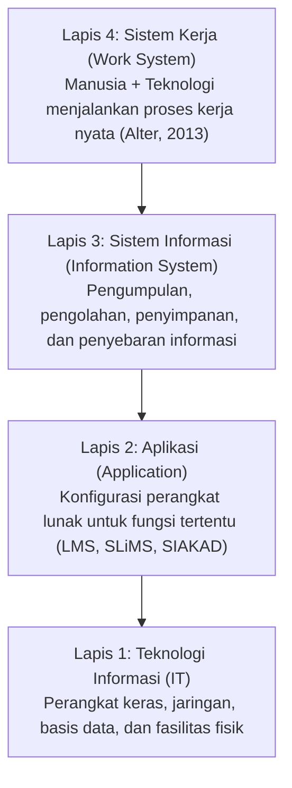

# Bab 1: Manajemen Sistem Informasi dalam Organisasi

> 🔗 **Navigasi:** [[Dashboard]] | [[CONTEXT_INDEX]] | [[SOURCE_INVENTORY]] | [[Modul 1]] | [[Laporan_Praktikum_Pertemuan_1_Kelompok 3]] | [[Bab_2_Data_dan_Pengambilan_Keputusan]]

Modul pembelajaran teori ini disusun oleh Dr. Ratna Wardani, S.Si., M.T. untuk mata kuliah Manajemen Sistem Informasi (MSI) pada Program Studi S1 Pendidikan Teknik Informatika Fakultas Teknik Universitas Negeri Yogyakarta. Modul ini menggunakan pendekatan *Theory-to-Action* dan *Activity-Based Learning* guna meletakkan pemahaman manajerial yang kokoh sebelum mahasiswa melangkah ke aspek perancangan teknis.

---

## 🎯 1. Capaian Pembelajaran Bab

Setelah mempelajari bab ini, mahasiswa diharapkan mampu:
1. Menjelaskan konsep Manajemen Sistem Informasi (MSI) dan membedakannya secara tegas dari Sistem Informasi (SI) dan Sistem Informasi Manajemen (SIM).
2. Memahami sistem informasi sebagai sumber daya strategis (*organizational resource*) yang wajib dikelola untuk menghasilkan nilai nyata (*value*).
3. Menganalisis relasi timbal balik antara organisasi, manajemen, proses bisnis, informasi, data, dan teknologi.
4. Mengidentifikasi peran penting *Information System Manager* (IS Manager) atau *Chief Information Officer* (CIO) sebagai jembatan antara kebutuhan organisasi dan kapabilitas sistem informasi.
5. Memetakan ekosistem sistem informasi organisasi (*Organizational IS Map*) sebagai pijakan evaluasi peran SI dalam menopang proses kerja dan pengambilan keputusan.

---

## ❓ 2. Pertanyaan Pemantik Diskusi Manajerial

1. Sebuah universitas memiliki 25 aplikasi yang aktif. Mengapa jumlah aplikasi yang melimpah tidak dapat dijadikan indikator bahwa sistem informasi di institusi tersebut telah dikelola dengan baik?
2. Jika platform *Learning Management System* (LMS) sering mengalami gangguan akses saat ujian, siapa pihak yang paling bertanggung jawab: tim pemrogram (*programmer*), IS Manager, atau manajemen puncak?
3. Sebuah sekolah memiliki alokasi anggaran teknologi yang sangat terbatas. Siapa pihak yang seharusnya menentukan prioritas investasi sistem informasi?
4. Apakah seluruh permasalahan organisasi yang berkaitan dengan teknologi informasi selalu harus diselesaikan melalui pembuatan aplikasi perangkat lunak baru?

---

## 📖 3. Studi Kasus Pembuka: Sekolah dengan Terlalu Banyak Sistem

### Latar Belakang Masalah
SMA Digital Nusantara melaksanakan program transformasi digital selama tiga tahun berturut-turut. Hasilnya, sekolah tersebut membangun sepuluh aplikasi terpisah:
- Sistem Informasi Akademik (SIAKAD)
- *Learning Management System* (LMS)
- Sistem Presensi Digital (kartu tap)
- Aplikasi Ujian Daring
- Sistem Pembayaran SPP
- Sistem Informasi Perpustakaan
- Sistem Penerimaan Peserta Didik Baru (PPDB)
- Aplikasi Komunikasi Guru dan Orang Tua
- Penyimpanan Awan (*Cloud Storage*)
- Lembar Kerja Mandiri (*Spreadsheet*)

### Temuan Evaluasi Operasional
Meskipun secara teknis seluruh aplikasi dapat diakses tanpa galat pemrograman, evaluasi mendalam menunjukkan fakta kritis:
- Terjadi ketidaksinkronan data siswa antara sistem akademik dan LMS.
- Guru mengeluhkan beban kerja berulang karena harus memasukkan data nilai yang sama ke berbagai sistem yang terisolasi (*silo*).
- Sistem presensi kartu tap tidak terhubung dengan catatan bimbingan konseling dan izin wali kelas.
- Sebagian besar staf pengajar memutuskan kembali menggunakan lembar kerja *spreadsheet* pribadi demi kepraktisan kerja.
- Tanggung jawab penanganan masalah operasional menjadi saling lempar antar-staf.

Ketika tim teknis TI menyatakan, *"Secara teknis, seluruh sistem berjalan lancar tanpa kendala server,"* Kepala Sekolah merespons dengan pertanyaan reflektif: *"Jika seluruh sistem berjalan baik, mengapa organisasi kita justru semakin terbebani masalah?"*

---

## 🧠 4. Kerangka Konseptual: Tiga Pertanyaan Fundamental MSI

Manajemen Sistem Informasi tidak berfokus pada baris kode perangkat lunak, melainkan menjawab tiga pertanyaan mendasar:

| Pilar Pertanyaan | Aspek Fokus | Uraian Konseptual |
| :--- | :--- | :--- |
| **Apa yang Dikelola?** | *Resource* | Sumber daya manusia (*people*), teknologi (*technology*), data (*data*), proses kerja (*process*), dan struktur organisasi (*organization*) dikelola sebagai satu kesatuan utuh. |
| **Siapa Memutuskan?** | *Capability & Governance* | Penetapan pihak yang memiliki hak wewenang formal (*decision rights*) untuk menentukan prioritas investasi, arsitektur, dan alokasi sumber daya SI. |
| **Bagaimana Menghasilkan Nilai?** | *Outcome to Value* | Cara mengonfigurasi sumber daya dan kapabilitas agar bermuara pada hasil kerja (*outcome*) dan nilai tambah (*value*) yang terukur bagi kelangsungan organisasi. |

---

## 🔍 5. Membedakan Empat Lapis Analisis Sistem

Kesalahan umum dalam pengelolaan TI berakar dari tertukarnya batas analisis:

1. **Teknologi Informasi (TI):** Komponen fisik seperti server, jaringan komputer, kabel, dan infrastruktur penyimpanan data.
2. **Aplikasi (*Application*):** Paket perangkat lunak yang dikonfigurasi untuk menjalankan tugas spesifik, seperti SLiMS atau SIAKAD.
3. **Sistem Informasi (SI):** Keseluruhan proses pengumpulan, penyimpanan, pengolahan, dan pendistribusian informasi bagi pengguna.
4. **Sistem Kerja (*Work System*):** Interaksi dinamis antara manusia, prosedur operasional, dan teknologi dalam melahirkan produk atau layanan (Alter, 2013).

---

## ⚖️ 6. Perbandingan Konseptual: SI, SIM, dan MSI

Dr. Ratna Wardani menegaskan pemilahan tiga istilah yang sering disalahpahami dalam perkuliahan:

| Dimensi | Sistem Informasi (SI) | Sistem Informasi Manajemen (SIM) | Manajemen Sistem Informasi (MSI) |
| :--- | :--- | :--- | :--- |
| **Fokus Utama** | Bagaimana sistem beroperasi secara teknis dan fungsional. | Bagaimana informasi disajikan untuk mendukung keputusan manajemen. | Bagaimana sistem informasi dikelola sebagai sumber daya strategis organisasi. |
| **Pertanyaan Kunci** | Bagaimana cara sistem mengolah data menjadi informasi? | Informasi apa yang dibutuhkan pimpinan untuk pengendalian dan evaluasi? | Kebijakan, struktur, dan tata kelola apa yang diperlukan agar portofolio SI menghasilkan nilai? |
| **Cakupan** | Arsitektur perangkat keras, perangkat lunak, basis data, dan antarmuka. | Laporan berkala, dashboard pimpinan, metrik kinerja, dan agregasi data. | *Governance*, strategi investasi, mitigasi risiko, manajemen perubahan, dan evaluasi portofolio. |

---

## 👥 7. Landasan Teoretis: Perspektif Sosio-Teknis (*Socio-Technical Systems*)

Keberhasilan sistem informasi lahir dari penyelarasan antara subsistem teknis dan subsistem sosial, bukan dari keunggulan teknis semata:
- **Trist & Bamforth (1951):** Penelitian pada tambang batu bara membuktikan bahwa mekanisasi teknologi tinggi yang mengabaikan relasi kerja tim justru merusak produktivitas kerja.
- **Emery & Trist (1960):** Merumuskan formal sistem sosio-teknis sebagai organisasi terbuka.
- **Cherns (1976):** Prinsip *Joint Optimization*, menegaskan bahwa sistem teknis dan sistem sosial tidak boleh dioptimasi secara terpisah.
- **Bostrom & Heinen (1977):** Sebagian besar kegagalan implementasi SI merupakan kegagalan pemahaman aspek sosial, bukan kegagalan teknis.
- **Orlikowski (1992):** Konsep *Duality of Technology*, teknologi menstrukturkan cara manusia bekerja, sekaligus terus dibentuk dan dimodifikasi oleh praktik pengguna.

### Empat Pilar Sistem Sosio-Teknis
1. **Orang dan Struktur (*People & Structure*):** Peran pegawai, kompetensi individu, pembagian hierarki, dan wewenang formal.
2. **Tugas dan Proses (*Work & Process*):** Urutan prosedur operasional, alur komunikasi kerja, dan kebiasaan penanganan tugas harian.
3. **Teknologi dan Data (*Technology & Data*):** Spesifikasi server, arsitektur basis data, jaringan komunikasi, dan perangkat lunak.
4. **Budaya dan Konteks (*Culture & Context*):** Nilai institusi, resistensi psikologis terhadap perubahan, norma kerja, dan regulasi eksternal.

---

## 💎 8. Konfigurasi Sumber Daya Menjadi Nilai (*Resource-to-Value Chain*)

Aset teknologi yang dibeli mahal tidak dengan sendirinya memberikan faedah bagi institusi. Organisasi wajib membangun kapabilitas sebelum nilai dapat dipetik:

$$\text{Resource} \longrightarrow \text{Capability} \longrightarrow \text{Process Improvement} \longrightarrow \text{Organizational Outcome} \longrightarrow \text{Value}$$

Sebagai ilustrasi: pengadaan perangkat lunak LMS hanyalah sebuah *Resource*. Nilai pembelajaran baru tercipta jika institusi memiliki *Capability* berupa rancangan instruksional dosen, tata kelola materi yang terstruktur, dan bimbingan teknis yang konsisten.

### Dimensi Nilai Sistem Informasi (*IS Value*)
Organisasi menanamkan investasi SI untuk memperoleh manfaat konkret:
- **Efektivitas (*Effectiveness*):** Pencapaian target layanan secara tepat mutu.
- **Efisiensi (*Efficiency*):** Pengurangan waktu tunggu dan penghapusan input data berulang.
- **Kualitas Keputusan (*Decision Quality*):** Ketersediaan data akurat tepat waktu bagi para pengambil keputusan.
- **Kualitas Layanan (*Service Quality*):** Pengguna merasakan kepastian dan transparansi interaksi layanan.
- **Pengendalian (*Control*):** Rekam jejak audit (*audit trail*) yang rapi dan terukur.
- **Ketahanan (*Resilience*):** Layanan kritis tetap berfungsi stabil saat menghadapi beban puncak atau gangguan jaringan.

---

## 🩺 9. Metode Diagnosis 4 Lapis Masalah

Manajer sistem informasi tidak boleh terjebak pada penyelesaian instan di permukaan (*solution fixation*):

| Lapisan Masalah | Definisi | Contoh Gejala Kasus |
| :--- | :--- | :--- |
| **1. Gejala (*Symptom*)** | Tanda kasat mata yang dikeluhkan pengguna. | Guru enggan menggunakan aplikasi presensi dan kembali mencatat di kertas. |
| **2. Masalah (*Problem*)** | Kondisi riil yang menghambat pencapaian hasil kerja. | Data kehadiran siswa terlambat masuk ke ruang bimbingan konseling selama 2 minggu. |
| **3. Mekanisme (*Mechanism*)** | Alur proses yang menjelaskan bagaimana masalah melahirkan gejala. | Antarmuka aplikasi presensi membutuhkan 5 kali klik per siswa sehingga memakan waktu 20 menit per jam pelajaran. |
| **4. Kondisi Sistem (*System Condition*)** | Kebijakan dasar atau struktur tata kelola yang membiarkan mekanisme bertahan. | Pengadaan aplikasi dilakukan secara sepihak oleh unit TI tanpa melibatkan survei alur kerja guru di kelas. |

---

## 🏛️ 10. Peran IS Manager / CIO dan Sembilan Domain Keputusan MSI

IS Manager atau CIO berperan sebagai penghubung antara strategi bisnis institusi dan kapabilitas teknologi. Ruang lingkup keputusan MSI mencakup sembilan domain:
1. **IS Strategy:** Penyelarasan arah sistem informasi dengan tujuan jangka panjang organisasi.
2. **IS Planning & Investment:** Perencanaan portofolio inisiatif dan kelayakan anggaran investasi.
3. **IS Governance:** Pembagian hak keputusan formal dan akuntabilitas hasil.
4. **IS Resource Management:** Pengelolaan kompetensi tim teknis, infrastruktur, dan lisensi.
5. **IS Implementation:** Manajemen proyek penerapan solusi baru dan adopsi pengguna.
6. **IS Service Management:** Standar mutu layanan operasional, *helpdesk*, dan penanganan insiden.
7. **IS Risk, Security, Privacy & Compliance:** Manajemen kerentanan, kepatuhan undang-undang data pribadi, dan mitigasi bencana.
8. **IS Performance & Value:** Evaluasi pencapaian target efisiensi dan laba nilai organisasi.
9. **Digital Transformation:** Pembaruan model kerja dan budaya kolaborasi berbasis kapabilitas digital.

---

## 🔄 11. Tata Kelola (*Governance*) versus Manajemen (*Management*)

Pemisahan fungsi ini menjadi penentu ketertiban organisasi:
- **Tata Kelola (*Governance*):** Berfokus pada arah (*Direct*), evaluasi usulan (*Evaluate*), dan pengawasan hasil (*Monitor*). Menjawab pertanyaan: *"Siapa yang berwenang menetapkan arah kebijakan dan prioritas?"*
- **Manajemen (*Management*):** Berfokus pada perencanaan teknis (*Plan*), pembangunan sistem (*Build*), pengoperasian harian (*Run*), dan pemantauan rutin (*Monitor*). Menjawab pertanyaan: *"Siapa yang bertugas melaksanakan keputusan tersebut secara operasional?"*

Rujukan standar internasional yang mengatur pembagian ini mencakup **ISO/IEC 38500:2024** dan **COBIT 2019**.

---

## 💡 12. Refleksi dan Integrasi Kasus: Perpustakaan FT UNY

Konsep fundamental Bab 1 ini menjadi landasan utama bagi proyek tata kelola Perpustakaan Fakultas Teknik UNY oleh Kelompok 3:

1. **SLiMS sebagai Bagian dari Sistem Sosio-Teknis:**
   Perangkat lunak SLiMS 9 Bulian di Perpustakaan FT UNY telah beroperasi dengan baik secara teknis. Keterlambatan pembaruan status koleksi bukan disebabkan oleh galat kode program SLiMS, melainkan akibat keterbatasan subsistem sosial: perpustakaan hanya dikelola oleh satu orang pustakawan tunggal yang harus merangkap tiga fungsi layanan sekaligus (sirkulasi, referensi, dan repositori skripsi).
2. **Kesesuaian dengan Doktrin Pure Governance:**
   Mengacu pada kritik studi kasus sekolah di Bab 1, menambah aplikasi baru justru menimbulkan redundansi input data dan membebani pustakawan tunggal. Solusi yang dirancang Kelompok 3 adalah perbaikan sistem kerja (*work system*) melalui instrumen tata kelola murni: **SOP Quiet Hour**, **Rak Transit Fisik**, dan **Formulir Google Form QR Code**.
3. **Keterhubungan Tingkatan Organisasi:**
   Sistem informasi sirkulasi di perpustakaan bukan sekadar urusan peminjaman harian mahasiswa (tingkat operasional), melainkan menjadi sumber data rekapitulasi borang akreditasi program studi (tingkat manajerial) dan penentuan pagu anggaran pengadaan buku tahunan oleh Dekanat FT UNY (tingkat strategis).

---

## 📚 13. Referensi Dokumen

- Dr. Ratna Wardani, S.Si., M.T. (2026). *Modul Pembelajaran Manajemen Sistem Informasi - Bab 1: Manajemen Sistem Informasi dalam Organisasi*. S1 Pendidikan Teknik Informatika, Fakultas Teknik UNY.
- Pearlson, K. E., Saunders, C. S., & Galletta, D. F. (2024). *Managing and Using Information Systems: A Strategic Approach* (8th ed.). Wiley.
- Alter, S. (2013). Work System Theory: Overview of Core Concepts, Extensions, and Challenges for the Future. *Journal of the Association for Information Systems*, 14(2), 72–121.
- Bostrom, R. P., & Heinen, J. S. (1977). MIS Problems and Failures: A Socio-Technical Perspective. *MIS Quarterly*, 1(3), 17–32.
- ISO/IEC. (2024). *ISO/IEC 38500:2024 Information technology - Governance of IT for the organization*.
