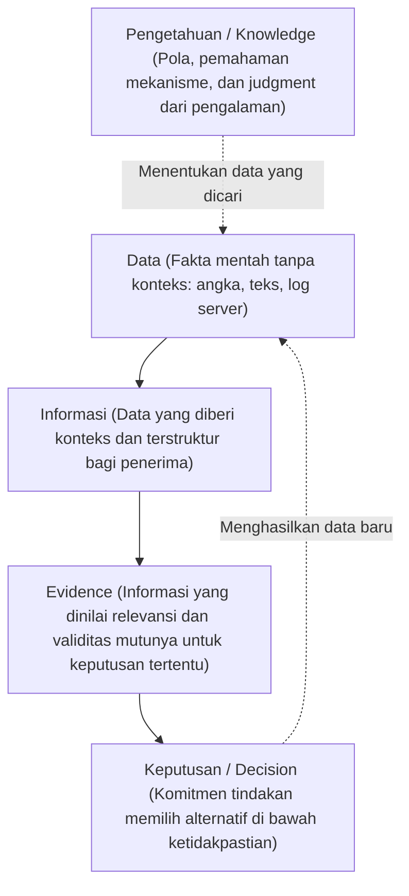

# Bab 2: Data, Informasi, Pengetahuan, dan Keputusan Organisasi

> 🔗 **Navigasi:** [[Dashboard]] | [[CONTEXT_INDEX]] | [[SOURCE_INVENTORY]] | [[Modul 2]] | [[Praktikum_2_Kelompok_3_revisi]] | [[Bab_1_Manajemen_Sistem_Informasi_dalam_Organisasi]] | [[Bab_3_Proses_Bisnis_Stakeholder_dan_Nilai_Organisasi]]

Modul pembelajaran teori Bab 2 ini disusun oleh Dr. Ratna Wardani, S.Si., M.T. sebagai kelanjutan dari fondasi pemahaman sosio-teknis sistem informasi. Bab ini membedah hakikat data, transformasi informasi, serta bagaimana keputusan institusi didasarkan pada bukti (*evidence-based decision making*), bukan sekadar akumulasi angka mentah dalam basis data.

---

## 🎯 1. Capaian Pembelajaran Bab

Setelah menyelesaikan materi ini, mahasiswa diharapkan mampu:
1. Membedakan secara analitis antara data, informasi, pengetahuan, bukti (*evidence*), dan keputusan manajerial.
2. Memahami bahwa transformasi data menjadi keputusan bukanlah jalur otomatis satu arah, melainkan proses dua arah yang memerlukan pemodelan dan pertimbangan manusia (*human judgment*).
3. Menerapkan konsep kesesuaian penggunaan (*fitness for use*) dalam menilai mutu informasi.
4. Menetapkan keputusan fokus (*focal decision*) sebagai titik awal audit kebutuhan sistem informasi.
5. Mengevaluasi kualitas data berdasarkan lima dimensi utama: akurasi, kelengkapan, ketepatan waktu, konsistensi, dan relevansi.
6. Menelusuri asal-usul data (*provenance*), alur transformasi data (*lineage*), dan konteks pendukung (*metadata*).
7. Mengidentifikasi kesenjangan antara aliran informasi (*information flow*) dan aliran kewenangan keputusan (*decision flow*).
8. Mengaudit potensi bias, keterwakilan, dan ketidakhadiran data (*missingness*) dalam pengambilan kebijakan.

---

## ⚠️ 2. Empat Tantangan Penggunaan Data dalam Organisasi

Ketersediaan volume data yang masif dalam server sering kali tidak membantu pimpinan organisasi karena empat kendala nyata:
1. **Masalah Relevansi:** Data berstatus benar secara teknis, namun tidak relevan dengan pertanyaan strategis yang harus dijawab oleh pimpinan.
2. **Masalah Ketepatan Waktu:** Data yang sangat presisi menjadi tidak bernilai jika tiba di meja pengambil keputusan setelah waktu tenggat terlewati. Waktu adalah dimensi kualitas kritis.
3. **Masalah Keterlakanaan dan Kepemilikan (*Actionability & Ownership*):** Tampilan visual dashboard menyajikan grafik yang indah, namun tidak memuat pemilik keputusan (*decision owner*), batasan waktu tindak lanjut, indikator keberhasilan, dan alternatif tindakan konkret.
4. **Masalah Integritas Makna:** Angka mentah disamakan dengan fakta kebijakan tanpa memverifikasi aturan bisnis yang menyertainya saat pencatatan awal dilakukan.

---

## 📖 3. Studi Kasus Pembuka: Lonjakan Angka Alpa 15% di SMA Digital Nusantara

### Fakta Peristiwa
Sistem presensi digital berbasis tap kartu di SMA Digital Nusantara menerbitkan laporan berkala otomatis. Laporan tersebut memperlihatkan lonjakan angka ketidakhadiran tanpa keterangan (alpa) siswa sebesar 15% pada bulan pertama semester ganjil. Laporan ini langsung masuk ke dashboard Wakil Kepala Sekolah Bidang Kesiswaan. Pimpinan merasa perlu segera memberlakukan sanksi disiplin massal kepada siswa yang tercatat alpa.

### Hasil Investigasi Audit Informasi
Investigasi mendalam mengungkap fakta operasional yang terdistorsi:
- Angka 15% benar secara teknis penghitungan log kartu presensi.
- Namun, pada minggu yang sama, siswa tingkat akhir sedang melaksanakan ujian praktik kejuruan di laboratorium luar kelas, sehingga mereka tidak melakukan tap kartu di gerbang utama.
- Catatan izin dispensasi guru pembimbing tersimpan manual di buku catatan guru piket dan tidak terhubung ke basis data presensi kartu.
- Catatan penanganan siswa sakit berada di ruang Bimbingan Konseling (BK) pada aplikasi komputer mandiri yang berbeda.
- Definisi kata "alpa" pada sistem tap gerbang berbeda dengan definisi "alpa" menurut peraturan tata tertib kesiswaan sekolah.

**Pelajaran Manajerial:** Angka 15% benar secara teknis, namun maknanya palsu sebagai bukti kebijakan (*evidence*). Memutuskan kebijakan disiplin tanpa audit kualitas informasi akan menghukum siswa yang sebenarnya hadir secara sah di laboratorium.

---

## 🪜 4. Model Berlapis: Data, Informasi, Pengetahuan, Evidence, dan Keputusan

Transformasi dari fakta lapangan menuju tindakan manajerial terbagi ke dalam lima lapisan:

| Tingkatan | Definisi Operasional | Ilustrasi pada Kasus Presensi |
| :--- | :--- | :--- |
| **Data** | Catatan mentah tanpa makna mandiri. | Log string: `UID-2049, 2026-09-08 07:15:22, GATE-01, NULL`. |
| **Informasi** | Data yang telah terikat dengan identitas dan status waktu. | Siswa bernama Ahmad tidak melakukan pemindaian kartu gerbang pada hari Selasa. |
| **Evidence** | Informasi yang telah diaudit validitasnya untuk menjawab pertanyaan kebijakan. | Ahmad tidak tap kartu gerbang karena sedang berada di Bengkel Otomotif dengan surat tugas No. 042. |
| **Pengetahuan** | Pemahaman pola kerja, kebiasaan organisasi, dan korelasi antar-faktor. | Pemahaman bahwa setiap pekan ujian praktik selalu memicu penurunan persentase tap gerbang jika dispensasi tidak diinput ke sistem. |
| **Keputusan** | Komitmen memilih tindakan terencana dari berbagai alternatif. | Menolak pengeluaran surat peringatan disiplin dan memperbarui prosedur input izin kolektif guru praktik. |

---

## 🎯 5. Kesesuaian Penggunaan (*Fitness for Use*)

Kualitas informasi tidak bernilai mutlak, melainkan bersifat kontekstual bergantung pada keputusan yang didukung (*Fitness for Use*, Wang & Strong, 1996):
- Keputusan operasional harian membutuhkan data real-time dengan presisi perorangan (contoh: apakah Ahmad hadir hari ini?).
- Keputusan manajerial bulanan membutuhkan data tren agregat (contoh: persentase kehadiran per kelas).
- Keputusan strategis tahunan membutuhkan indikator kepatuhan jangka panjang untuk akreditasi (contoh: rasio kehadiran siswa dalam 1 tahun ajaran).

Informasi yang berkualitas tinggi untuk satu level keputusan dapat menjadi tidak bernilai untuk level keputusan lainnya.

---

## 🧭 6. Keputusan Fokus (*Focal Decision*) sebagai Titik Awal Audit

Perancangan alur sistem informasi tidak boleh dimulai dari pertanyaan *"Data apa yang bisa kita kumpulkan?"*, melainkan harus berangkat dari: *"Keputusan apa yang harus diambil organisasi?"*

### Tiga Komponen Keputusan Fokus:
1. **Identifikasi Keputusan:** Rumuskan rumusan keputusan secara spesifik, tentukan pemilik keputusan tunggal (*decision owner*), dan tentukan tenggat waktu penetapan.
2. **Pemetaan Alternatif dan Kriteria:** Jabarkan opsi tindakan yang tersedia, tentukan parameter penilaian kelayakan, dan ukur sifat keterbalikan keputusan (*reversibility*).
3. **Kebutuhan Bukti Minimum:** Tentukan ambang batas data minimum yang mutlak diperlukan untuk mengambil komitmen tindakan, guna menghindari penumpukan data yang sia-sia (*information overload*).

---

## 📊 7. Lima Dimensi Kualitas Informasi

Audit kualitas data SMA Digital Nusantara dilakukan dengan menguji lima dimensi utama:

| Dimensi Kualitas | Definisi Standar | Temuan Evaluasi Lapangan |
| :--- | :--- | :--- |
| **1. Akurasi (*Accuracy*)** | Data mencerminkan kondisi riil di lapangan tanpa kekeliruan pencatatan. | Tap kartu akurat mencatat ketiadaan sentuhan fisik, tetapi tidak mencerminkan kehadiran fisik siswa di ruang laboratorium. |
| **2. Kelengkapan (*Completeness*)** | Seluruh data yang disyaratkan untuk mengambil keputusan telah terhimpun utuh. | Tidak lengkap karena catatan bimbingan konseling dan surat izin guru piket tidak masuk ke sistem digital. |
| **3. Ketepatan Waktu (*Timeliness*)** | Informasi tersedia tepat pada saat jendela waktu keputusan terbuka. | Data tap tersedia real-time, namun data validasi klarifikasi wali kelas terlambat dua pekan sehingga tidak sinkron. |
| **4. Konsistensi (*Consistency*)** | Definisi istilah, format data, dan satuan ukur seragam di seluruh subsistem. | Inkonsisten. Definisi "alpa" pada sistem tap gerbang adalah "tidak menempelkan kartu", sedangkan definisi tata tertib sekolah adalah "tidak hadir belajar tanpa izin sah". |
| **5. Relevansi (*Relevance*)** | Data secara langsung menjawab parameter pilihan alternatif keputusan. | Data presensi gerbang saat pekan ujian praktik memiliki relevansi yang sangat rendah untuk mengukur kedisiplinan belajar siswa. |

---

## 🔍 8. Silsilah Data (*Provenance*), Transformasi (*Lineage*), dan Konteks (*Metadata*)

Setiap angka yang tertera di layar dashboard harus dapat dipertanggungjawabkan melalui tiga instrumen pelacakan:
1. **Asal-Usul Data (*Provenance*):** Menjawab pertanyaan dari mana data berasal, siapa petugas yang mencatat, instrumen apa yang digunakan, dan dalam kondisi apa data tersebut direkam.
2. **Konteks Pendukung (*Metadata*):** Informasi yang menjelaskan data, mencakup definisi operasional variabel, satuan ukur, versi aplikasi, batasan populasi, dan aturan validasi yang berlaku.
3. **Alur Transformasi Data (*Data Lineage*):** Jejak perjalanan data dari sumber input (*source*), pengubahan format (*transform*), penggabungan (*aggregate*), penampilan visual (*dashboard*), hingga menjadi dasar tindakan (*decision*).

---

## ⚠️ 9. Bias, Keterwakilan, dan Ketidakhadiran Data (*Missing Data*)

Data tidak pernah menjadi cermin netral dari realitas. Angka dalam sistem merupakan hasil dari keputusan manusia tentang apa yang dipilih untuk diukur dan apa yang diabaikan:
- **Missing Data Bukan Berarti Nol:** Data yang tidak tercatat selalu memiliki akar penyebab struktural (alat rusak, petugas terdistraksi, pengguna enggan mengisi, atau ketiadaan kolom input).
- **Pola Missingness Sistematis:** Jika data izin siswa kejuruan hilang karena tidak ada mekanisme input dari bengkel praktik, sistem melahirkan bias yang merugikan kelompok siswa tertentu. Audit integritas data merupakan bagian integral dari keadilan tata kelola institusi.

---

## 🤝 10. Pengetahuan Tacit versus Pengetahuan Eksplisit

Organisasi menjalankan operasinya melalui kombinasi dua bentuk pengetahuan:
- **Pengetahuan Eksplisit (*Explicit Knowledge*):** Pengetahuan yang telah diformalkan ke dalam dokumen tertulis, dokumen Standar Operasional Prosedur (SOP), buku panduan, basis data, dan aturan logika perangkat lunak.
- **Pengetahuan Tacit (*Tacit Knowledge*):** Pemahaman mendalam, intuisi, dan kearifan yang melekat pada pengalaman kerja individu. Sebagai contoh: guru wali kelas memahami karakter siswa Ahmad yang rajin sehingga meragukan catatan alpa sistem gerbang.

Organisasi yang sehat memfasilitasi konversi pengetahuan tacit menjadi aturan eksplisit melalui audit operasional secara berkala.

---

## ⚖️ 11. Nilai Tambah Informasi (*Value of Information - VoI*)

Pencarian data tambahan membutuhkan biaya yang tidak sedikit (waktu staf, biaya verifikasi, gangguan fokus kerja, dan penundaan layanan). Prinsip ekonomi informasi menetapkan:

$$\text{Value of Information (VoI)} = \text{Ekspektasi Nilai Keputusan dengan Informasi Baru} - \text{Ekspektasi Nilai Keputusan Awal}$$

Pencarian data tambahan harus dihentikan ketika biaya perolehannya melampaui nilai tambah keputusan yang dihasilkan (*Decision Threshold*).

---

## 💡 12. Refleksi dan Integrasi Kasus: Perpustakaan FT UNY

Teori mutu informasi dan keputusan di Bab 2 memberikan landasan ilmiah bagi pemecahan masalah di Perpustakaan FT UNY:

1. **Focal Decision di Perpustakaan FT UNY:**
   - *Tingkat Operasional:* "Apakah eksemplar buku ini benar-benar tersedia di rak sirkulasi saat mahasiswa mencarinya, atau sedang berada di tumpukan pengembalian / hilang?"
   - *Tingkat Strategis Dekanat:* "Berapa rasio pemanfaatan koleksi per program studi untuk menetapkan pagu alokasi anggaran buku tahunan secara berbasis bukti?"
2. **Audit Lineage Data Koleksi SLiMS:**
   Data status buku di OPAC SLiMS mengalami keterlambatan (*lag*) karena pemustaka mengembalikan buku di meja sirkulasi, namun pemindaian barcode ke komputer tertunda saat antrean padat. Buku secara fisik sudah ada di ruang perpustakaan, tetapi status OPAC masih menyatakan "Dipinjam".
3. **Penanganan Missing Data & Rak Transit:**
   Buku yang ditaruh sembarangan oleh pengunjung di meja baca merupakan bentuk *missing data* fisik. Penyediaan **Rak Transit** dan pemilahan fisik buku sebelum pemindaian barcode saat sesi **Quiet Hour** merupakan implementasi konkret penjaminan silsilah data (*data provenance*) agar angka pada SLiMS kembali mencerminkan realitas fisik rak.

---

## 📚 13. Referensi Dokumen

- Dr. Ratna Wardani, S.Si., M.T. (2026). *Modul Pembelajaran Manajemen Sistem Informasi - Bab 2: Data & Keputusan: Data, Informasi, Pengetahuan, dan Keputusan Organisasi*. S1 Pendidikan Teknik Informatika, Fakultas Teknik UNY.
- Wang, R. Y., & Strong, D. M. (1996). Beyond Accuracy: What Data Quality Means to Data Consumers. *Journal of Management Information Systems*, 12(4), 5–33.
- Nonaka, I., & Takeuchi, H. (1995). *The Knowledge-Creating Company: How Japanese Companies Create the Dynamics of Innovation*. Oxford University Press.
- Choo, C. W. (2006). *The Knowing Organization: How Organizations Use Information to Construct Meaning, Create Knowledge, and Make Decisions*. Oxford University Press.
