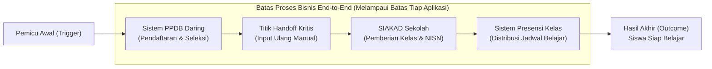
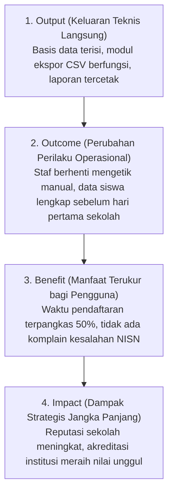

# Bab 3: Proses Bisnis, Stakeholder, dan Nilai Organisasi

> 🔗 **Navigasi:** [[Dashboard]] | [[CONTEXT_INDEX]] | [[SOURCE_INVENTORY]] | [[Modul 3]] | [[Praktikum_3_Kelompok_3_Revisi]] | [[Bab_2_Data_dan_Pengambilan_Keputusan]] | [[Bab_4_Evaluasi_Alternatif_Solusi_dan_Keputusan_Investasi_SI]]

Modul pembelajaran teori Bab 3 ini disusun oleh Dr. Ratna Wardani, S.Si., M.T. untuk menanamkan wawasan bahwa keunggulan sistem informasi tidak diukur dari kecanggihan teknis perangkat lunak semata, melainkan dari kemampuannya mentransformasi proses kerja organisasi, menjawab kebutuhan pemangku kepentingan (*stakeholders*), dan menciptakan nilai nyata (*value*).

---

## 🎯 1. Capaian Pembelajaran Bab

Setelah mempelajari bab ini, mahasiswa diharapkan mampu:
1. Menjelaskan konsep proses bisnis, pemangku kepentingan (*stakeholders*), dan nilai organisasi dalam konteks tata kelola sistem informasi.
2. Memetakan alur proses bisnis secara menyeluruh dari ujung ke ujung (*end-to-end*), mencakup titik serah-terima (*handoff*), waktu tunggu (*waiting time*), dan gejala friksi operasional.
3. Menganalisis profil pemangku kepentingan secara komprehensif menggunakan tujuh dimensi, melampaui matriks konvensional *power-interest*.
4. Mengevaluasi akar masalah (*root cause*) proses berbasis bukti empiris, guna mencegah perumusan solusi prematur (*solution fixation*).
5. Merumuskan proposisi nilai (*value proposition*) dan memprioritaskan peluang perbaikan sistem kerja berdasarkan dampak nyata bagi organisasi.

---

## ❓ 2. Pertanyaan Pemantik Diskusi

1. Mengapa sebuah aplikasi perangkat lunak yang berjalan tanpa kendala teknis tidak selalu menjamin proses kerja organisasi di sekitarnya berjalan efisien?
2. Siapa sebenarnya pemangku kepentingan dalam suatu alur kerja, di luar mereka yang memiliki jabatan struktural formal?
3. Bagaimana cara membedakan gejala masalah yang tampak di permukaan dari mekanisme akar masalah yang sebenarnya?
4. Mengapa nilai (*value*) yang dihasilkan oleh suatu sistem informasi dapat dirasakan berbeda-beda oleh masing-masing kelompok pengguna?

---

## 📖 3. Studi Kasus Pembuka: Friksi Proses PPDB Digital SMA Digital Nusantara

### Situasi Operasional
SMA Digital Nusantara telah mengoperasikan sistem Penerimaan Peserta Didik Baru (PPDB) daring yang berfungsi mulus. Calon siswa dapat mendaftar dengan lancar, sistem melakukan pemeringkatan nilai secara otomatis, dan pengumuman hasil seleksi dipublikasikan tepat waktu.

### Gejala Friksi yang Muncul
Meskipun sistem PPDB dinyatakan sukses secara teknis oleh tim pengembang, panitia penerimaan di sekolah tetap harus mengetik ulang seluruh data pendaftar yang diterima ke dalam lembar kerja (*spreadsheet*) manual setiap tahun ajaran baru. Alasan utamanya: basis data sistem PPDB daring tidak memiliki jembatan integrasi ke Sistem Informasi Akademik (SIAKAD) sekolah.

Dampak buruk yang timbul:
- Terjadi kesalahan ejaan nama siswa dan penomoran NISN yang tertukar.
- Siswa yang telah dinyatakan lulus seleksi dan membayar biaya pendaftaran belum tercatat di daftar presensi kelas pada hari pertama masuk sekolah.
- Terjadi pergeseran beban kerja (*burden shifting*) di mana panitia PPDB merasa tugasnya telah selesai, sementara bagian tata usaha akademik menanggung beban koreksi data selama berbulan-bulan.

**Pelajaran Kunci:** Batas aplikasi bukanlah batas proses organisasi. Proses penerimaan siswa baru baru benar-benar selesai ketika siswa terdaftar sah di kelas dan siap belajar, bukan saat tombol "Selesai" pada aplikasi PPDB ditekan oleh pengembang.

---

## 🌐 4. Pemikiran End-to-End dan Aliran Nilai (*Value Stream*)

Proses bisnis adalah rangkaian aktivitas terstruktur yang mengubah masukan (*input*) menjadi hasil akhir (*outcome*) bernilai melalui keterlibatan peran manusia, aturan kerja, keputusan, data, dan teknologi pendukung:

Pendekatan *Value Stream Mapping* (Rother & Shook, 1999) memetakan aliran nilai dari pemicu awal hingga tercapainya hasil akhir, guna mendeteksi pemborosan (*waste*), waktu tunggu, dan titik rawan kesalahan manusia.

---

## ⚖️ 5. Kondisi Aktual (AS-IS) versus Desain Ideal (TO-BE)

Diagnosis tata kelola wajib didasarkan pada fakta operasional riil di lapangan, bukan sekadar dokumen prosedur di atas kertas:
- **Kondisi AS-IS:** Menggambarkan bagaimana proses kerja benar-benar dijalankan oleh staf sehari-hari, termasuk seluruh jalan pintas (*workarounds*) dan penyesuaian informal.
- **Kondisi TO-BE:** Rencana perbaikan bagaimana proses kerja seharusnya berjalan setelah dilakukan intervensi tata kelola dan teknologi.

### Jalur Normal versus Jalur Pengecualian (*Exception Path*)
- **Jalur Normal (*Happy Path*):** Skenario ideal di mana semua berkas lengkap, jaringan internet stabil, dan transaksi berjalan tanpa hambatan.
- **Jalur Pengecualian (*Exception Path*):** Skenario saat terjadi anomali (berkas salah format, jaringan terputus, atau data ganda). Jalur perkecualian ini sering diabaikan dalam perancangan sistem informasi, padahal justru menjadi sumber 80% keterlambatan operasional.

---

## ⏱️ 6. Friksi Proses: Handoff, Waktu Sentuh, dan Waktu Tunggu

Dalam rekayasa proses bisnis (Davenport, 1993), friksi terbesar sering kali tersembunyi di sela-sela antar-aktivitas:
1. **Titik Serah-Terima (*Handoff*):** Setiap perpindahan tanggung jawab antar-petugas atau antar-sistem membawa risiko hilangnya konteks informasi. Titik handoff manual dari panitia PPDB ke staf akademik adalah sarang utama terjadinya galat ejaan data.
2. **Waktu Sentuh (*Touch Time*):** Durasi waktu nyata yang dihabiskan petugas untuk memproses suatu berkas secara aktif (contoh: mengetik data membutuhkan waktu 5 menit).
3. **Waktu Tunggu (*Waiting Time*):** Durasi berkas terhenti diam menunggu giliran diverifikasi atau dipindahkan (contoh: berkas mengendap di meja verifikator selama 3 hari).
4. **Total Waktu Siklus (*Lead Time*):** Akumulasi total waktu sejak proses dipicu hingga hasil diserahkan kepada penerima manfaat:

$$\text{Lead Time} = \text{Total Touch Time} + \text{Total Waiting Time}$$

Sebagian besar organisasi yang mengeluhkan lambatnya layanan memiliki *Touch Time* yang sangat singkat, tetapi menderita *Waiting Time* yang berlebihan.

---

## 🚨 7. Empat Gejala Inefisiensi Proses Kerja

Pengamat proses wajib mengenali empat petunjuk klinis ketidakefisienan:

| Gejala Proses | Definisi dan Ciri Utama | Manifestasi Kasus |
| :--- | :--- | :--- |
| **1. Pengerjaan Ulang (*Rework*)** | Aktivitas terpaksa diulang kembali karena mutu keluaran awal tidak memenuhi syarat. | Panitia mengetik ulang nama siswa karena format kolom sistem sebelumnya tidak sinkron. |
| **2. Titik Hambatan (*Bottleneck*)** | Satu tahap operasional memiliki kapasitas terendah sehingga membatasi kelancaran seluruh sistem. | Antrean verifikasi menumpuk pada satu orang petugas yang memegang hak akses akun admin. |
| **3. Kasus Perkecualian (*Exception*)** | Peristiwa di luar prosedur standar yang gagal ditangani sistem sehingga memerlukan intervensi ad-hoc. | Siswa pindahan luar daerah yang tidak memiliki nomor registrasi daring standar. |
| **4. Jalan Pintas (*Workaround*)** | Cara alternatif tidak resmi yang diciptakan pegawai karena sistem formal dianggap kaku atau lambat. | Penggunaan lembar kerja *spreadsheet* pribadi dan grup pesan instan untuk membagi tugas. |

---

## 🗑️ 8. Klasifikasi Aktivitas: Menambah Nilai versus Pemborosan (*Muda*)

Mengadopsi prinsip efisiensi proses kerja (Ohno, 1988), seluruh aktivitas dalam sistem informasi dikelompokkan ke dalam tiga kategori:
1. **Aktivitas Bernilai Tambah (*Value-Adding*):** Aktivitas yang secara langsung mentransformasi masukan menjadi hasil yang dihargai oleh pengguna (contoh: validasi keabsahan ijazah pendaftar).
2. **Aktivitas Pendukung yang Diperlukan (*Necessary Support / Non-Value Adding*):** Aktivitas yang tidak langsung menghasilkan nilai, namun wajib dijalankan karena kepatuhan regulasi atau kendali administratif (contoh: pencatatan log akses sistem dan pencadangan basis data).
3. **Pemborosan (*Waste / Muda*):** Aktivitas yang mengonsumsi waktu dan tenaga tanpa memberi manfaat sama sekali (contoh: merekap ulang data yang sudah pernah dimasukkan pengguna di portal awal).

---

## 🧬 9. Penalaran Sebab-Akibat Berbasis Bukti (*Causal Reasoning*)

Dalam merumuskan masalah, analisis tidak boleh melompat langsung dari gejala ke tebakan solusi:

$$\text{Gejala Kasat Mata} \longrightarrow \text{Batasan & Asumsi} \longrightarrow \text{Penyebab Terdekat (Proximate Cause)} \longrightarrow \text{Mekanisme Sistemik}$$

Contoh penelusuran kasus PPDB:
- *Gejala:* Terjadi salah ketik nama siswa di SIAKAD.
- *Penyebab Terdekat:* Panitia memasukkan data secara manual melalui keyboard dengan tergesa-gesa.
- *Mekanisme Sistemik:* Pengadaan sistem PPDB dan pengadaan SIAKAD dilakukan pada tahun berbeda oleh vendor terpisah tanpa klausul integrasi Application Programming Interface (API) dalam dokumen pengadaan.

---

## 👥 10. Analisis Pemangku Kepentingan Melampaui Matriks Power-Interest

Pemetaan pemangku kepentingan konvensional yang hanya melihat kekuatan (*power*) dan minat (*interest*) sering mengabaikan pihak-pihak yang lemah secara politis namun sangat rentan terhadap dampak sistem. Dr. Ratna Wardani menetapkan tujuh dimensi analisis pemangku kepentingan:

| Dimensi Analisis | Fokus Pertanyaan Manajerial | Contoh Profil Kasus |
| :--- | :--- | :--- |
| **1. Kepentingan (*Interest*)** | Apa keuntungan yang diharapkan atau kerugian yang dicemaskan dari perubahan alur kerja? | Guru ingin data siswa langsung siap pakai tanpa perlu melapor ke admin. |
| **2. Pengaruh (*Influence*)** | Seberapa besar wewenang formal untuk menentukan keberhasilan atau penghentian inisiatif? | Kepala Sekolah memegang persetujuan anggaran lisensi perangkat lunak. |
| **3. Paparan Risiko (*Risk Exposure*)** | Siapa pihak yang paling menderita kerugian jika sistem informasi mengalami kegagalan? | Wali kelas menanggung beban psikologis komplain orang tua murid saat rapot salah cetak. |
| **4. Keaktifan Pelibatan (*Engagement*)** | Seberapa aktif pihak tersebut dilibatkan dalam perancangan prosedur baru selama ini? | Bagian akademik jarang diajak berdiskusi saat tim pengembang merancang portal pendaftaran. |
| **5. Tingkat Keterdampakan (*Affectedness*)** | Siapa pihak yang beban kerjanya bertambah paling drastis meskipun tidak memiliki hak suara? | Staf administrasi honorer yang ditugaskan mengetik ulang ribuan baris spreadsheet. |
| **6. Kontribusi Sumber Daya (*Contribution*)** | Siapa pihak yang menyumbangkan tenaga kerja, pasokan data, atau fasilitas fisik utama? | Orang tua calon siswa yang mengunggah dokumen pindaian dan mengisi biodata mandiri. |
| **7. Kebutuhan Informasi (*Information Need*)** | Data spesifik apa yang mutlak disyaratkan agar peran pihak tersebut dapat berjalan prima? | Guru BK membutuhkan riwayat kesehatan khusus siswa baru sebelum masa orientasi dimulai. |

---

## ⛓️ 11. Rantai Nilai 4 Lapis: Output, Outcome, Benefit, dan Impact

Manajer sistem informasi dilarang mengukur kesuksesan proyek hanya dari keluaran teknis:

---

## 🎯 12. Perumusan Problem Statement yang Netral Solusi (*Solution-Neutral*)

Kesalahan fatal dalam manajemen sistem informasi adalah merumuskan pernyataan masalah yang telah terkontaminasi oleh usulan solusi prematur:
- ❌ **Pernyataan Masalah Prematur:** *"Sekolah membutuhkan aplikasi mobile terintegrasi untuk menyatukan PPDB dan SIAKAD."* (Klaim ini langsung mengunci pemikiran organisasi pada pembuatan aplikasi baru tanpa menguji opsi alternatif).
- ✅ **Pernyataan Masalah Netral Solusi:** *"Panitia PPDB dan staf akademik tidak memiliki mekanisme validasi terpadu untuk memastikan data siswa baru tercatat secara akurat di sistem akademik sebelum tahun ajaran dimulai, sehingga memicu pengetikan manual berulang dan risiko salah penempatan kelas."*

---

## 💡 13. Refleksi dan Integrasi Kasus: Perpustakaan FT UNY

Konsep Bab 3 ini menjadi fondasi utama dalam membedah alur sirkulasi buku di Perpustakaan FT UNY oleh Kelompok 3:

1. **Pemetaan End-to-End Alur Sirkulasi Koleksi:**
   Batas alur sirkulasi buku bukan berhenti saat pemustaka meletakkan buku di meja petugas, melainkan berakhir ketika buku telah terverifikasi secara fisik dan status eksemplarnya di SLiMS OPAC telah berubah menjadi "Tersedia di Rak".
2. **Friksi Handoff dan Bottleneck Tunggal:**
   Perpustakaan FT UNY memiliki *single point of bottleneck*: hanya ada satu orang pustakawan yang melayani transaksi peminjaman, melayani pencarian skripsi, dan mengecek fisik buku. Setiap ada gelombang mahasiswa yang mengembalikan buku, terjadi *waiting time* panjang sebelum buku tersebut dapat diinput kembali ke SLiMS.
3. **Mengeliminasi Pemborosan (*Waste*) melalui Pure Governance:**
   Daripada memaksakan pembangunan aplikasi baru yang justru menambah beban entri data bagi pustakawan tunggal, solusi yang dirancang Kelompok 3 mengeliminasi *waste* melalui:
   - **Formulir Google Form QR Code:** Memindahkan beban pencatatan mandiri (*self-reporting*) kepada pemustaka saat mengembalikan buku.
   - **Rak Transit:** Menghilangkan kebingungan pencarian buku di rak koleksi utama sebelum diverifikasi.
   - **SOP Quiet Hour:** Mengisolasi waktu verifikasi tanpa interupsi layanan meja sirkulasi, sehingga *lead time* pembaruan data SLiMS menjadi teratur dan terprediksi.

---

## 📚 14. Referensi Dokumen

- Dr. Ratna Wardani, S.Si., M.T. (2026). *Modul Pembelajaran Manajemen Sistem Informasi - Bab 3: Proses Bisnis, Stakeholder, dan Nilai Organisasi*. S1 Pendidikan Teknik Informatika, Fakultas Teknik UNY.
- Davenport, T. H. (1993). *Process Innovation: Reengineering Work through Information Technology*. Harvard Business School Press.
- Rother, M., & Shook, J. (1999). *Learning to See: Value Stream Mapping to Create Value and Eliminate Muda*. Lean Enterprise Institute.
- Freeman, R. E. (1984). *Strategic Management: A Stakeholder Approach*. Pitman.
- Ohno, T. (1988). *Toyota Production System: Beyond Large-Scale Production*. Productivity Press.
