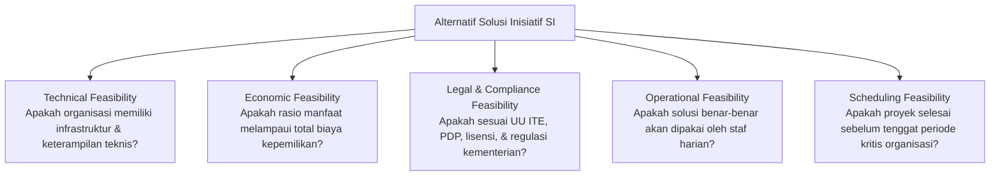

# Bab 4: Evaluasi Alternatif Solusi dan Keputusan Investasi SI

> 🔗 **Navigasi:** [[Dashboard]] | [[CONTEXT_INDEX]] | [[SOURCE_INVENTORY]] | [[Modul 4]] | [[Praktikum_4_Kelompok3_revisi]] | [[Bab_3_Proses_Bisnis_Stakeholder_dan_Nilai_Organisasi]] | [[Bab_5_Tata_Kelola_Sistem_Informasi]]

Modul pembelajaran teori Bab 4 ini disusun oleh Dr. Ratna Wardani, S.Si., M.T. untuk membimbing mahasiswa dalam mengambil keputusan investasi sistem informasi secara rasional, objektif, dan dapat dipertanggungjawabkan (*defensible decision*). Bab ini menjembatani rumusan masalah pada Bab 3 menuju pemilihan alternatif solusi berbasis bukti komparatif.

---

## 🎯 1. Capaian Pembelajaran Bab

Setelah menyelesaikan bab ini, mahasiswa diharapkan mampu:
1. Membandingkan kelebihan, kelemahan, dan pertimbangan (*trade-offs*) dari tiga jalur pengadaan solusi sistem informasi: membangun sendiri (*build*), membeli paket jadi (*buy*), dan mengonfigurasi sistem yang sudah ada (*configure*).
2. Mengevaluasi kelayakan setiap alternatif menggunakan kerangka analisis kelayakan komprehensif TELOS (*Technical, Economic, Legal, Operational, Scheduling*).
3. Menganalisis biaya dan manfaat secara menyeluruh, mencakup komponen berwujud (*tangible*) maupun tidak berwujud (*intangible*).
4. Memperhitungkan Total Biaya Kepemilikan (*Total Cost of Ownership - TCO*) sepanjang siklus hidup sistem.
5. Menilai profil risiko spesifik yang melekat pada masing-masing alternatif solusi.
6. Menerapkan pemikiran portofolio proyek (*portfolio thinking*, McFarlan, 1981) untuk mencegah kelebihan beban sumber daya organisasi.
7. Menyusun Matriks Evaluasi Solusi SI multi-kriteria untuk merumuskan rekomendasi manajerial yang transparan.

---

## ❓ 2. Pertanyaan Pemantik Diskusi

1. Mengapa sebuah organisasi wajib mempertimbangkan lebih dari satu alternatif solusi sebelum memutuskan investasi sistem informasi?
2. Apa perbedaan mendasar antara solusi yang layak secara teknis (*technically feasible*) dan solusi yang layak secara operasional (*operationally feasible*)?
3. Mengapa manfaat yang tidak dapat dinilai dengan angka finansial (*intangible benefits*) tetap harus diperhitungkan dalam evaluasi investasi?
4. Mengapa keputusan proyek sistem informasi tidak boleh dinilai sebagai inisiatif mandiri yang terisolasi dari proyek-proyek lain di organisasi?

---

## 📖 3. Studi Kasus Pembuka: Tiga Proposal, Satu Keputusan di SMA Digital Nusantara

### Situasi Dilema
Menanggapi masalah ketidaksinkronan data PPDB dan SIAKAD yang dibahas pada Bab 3, manajemen SMA Digital Nusantara menerima tiga proposal solusi berbeda dari para pemangku kepentingan:
- **Proposal A (Build):** Staf pengembang internal mengusulkan pembuatan modul integrasi mandiri dari nol (*custom development*).
- **Proposal B (Buy):** Vendor perangkat lunak menawarkan modul integrasi siap pakai berbasis komputasi awan (*commercial off-the-shelf software / SaaS*) dengan biaya langganan tahunan.
- **Proposal C (Configure):** Guru staf TI menyarankan meminta vendor penyedia SIAKAD saat ini untuk mengaktifkan fitur impor data terstruktur yang sebenarnya sudah tersedia di paket langganan lama.

### Tantangan Manajerial
Ketiga proposal terdengar sangat menjanjikan dari sudut pandang masing-masing pengusul. Namun, pihak manajemen sekolah tidak memiliki instrumen baku untuk membandingkan ketiganya secara adil. Tanpa evaluasi kelayakan dan analisis risiko terstruktur, keputusan investasi rentan dipengaruhi oleh kedekatan personal atau sekadar mencari opsi yang tampak paling murah di awal.

---

## 🛣️ 4. Tiga Jalur Solusi SI: Build, Buy, atau Configure

Organisasi memiliki tiga pendekatan strategis dalam memenuhi kebutuhan sistem informasi:

| Parameter Evaluasi | 1. Membangun Sendiri (Build) | 2. Membeli Paket Jadi (Buy) | 3. Mengonfigurasi Sistem (Configure) |
| :--- | :--- | :--- | :--- |
| **Kelebihan Utama** | Penyesuaian penuh (*custom fit*) terhadap alur kerja unik organisasi dan kepemilikan kode sumber. | Cepat diimplementasikan, fitur telah teruji di banyak institusi lain, dan pembaruan disediakan vendor. | Biaya investasi finansial paling rendah, waktu peluncuran sangat cepat, dan memanfaatkan aset yang sudah ada. |
| **Kelemahan & Trade-off** | Membutuhkan waktu lama, menuntut keahlian teknis tinggi, dan beban pemeliharaan jangka panjang bertumpu pada staf internal. | Organisasi terpaksa mengubah kebiasaan kerja agar tunduk pada batasan aplikasi, serta biaya lisensi berulang. | Fleksibilitas terbatas pada kapasitas fitur bawaan yang tersedia, serta tidak dapat diubah secara radikal. |
| **Kondisi Penggunaan Tepat** | Kebutuhan organisasi sangat spesifik dan merupakan keunggulan kompetitif inti yang tidak dijual di pasar. | Kebutuhan bersifat generik dan organisasi tidak memiliki tim pengembang perangkat lunak mandiri. | Masalah utama organisasi terletak pada tata kelola dan konfigurasi penggunaan, bukan ketiadaan perangkat lunak. |

---

## 📐 5. Kerangka Analisis Kelayakan Komprehensif (TELOS Framework)

Sebelum membandingkan angka biaya, seluruh alternatif wajib lolos uji kelayakan lima dimensi (Hall, 2007):

1. **Kelayakan Teknis (*Technical Feasibility*):** Ketersediaan perangkat keras, jaringan, keahlian bahasa pemrograman, dan kompatibilitas sistem.
2. **Kelayakan Ekonomi (*Economic Feasibility*):** Ketersediaan pagu dana anggaran dan tingkat pengembalian investasi (*return on investment*).
3. **Kelayakan Hukum (*Legal Feasibility*):** Kepatuhan terhadap Undang-Undang Perlindungan Data Pribadi (UU PDP), kepemilikan lisensi hak cipta, dan kepatuhan akreditasi.
4. **Kelayakan Operasional (*Operational Feasibility*):** Kesesuaian sistem dengan beban kerja manusia, resistensi budaya kerja, dan kemudahan pengoperasian bagi staf pengguna akhir.
5. **Kelayakan Waktu (*Scheduling Feasibility*):** Kepastian bahwa sistem siap beroperasi sebelum momen puncak layanan dimulai (contoh: sebelum tahun ajaran baru dibuka).

---

## 💰 6. Analisis Biaya dan Manfaat: Tangible versus Intangible

Evaluasi yang cermat tidak boleh hanya menghitung angka di kuitansi pembelian:

| Klasifikasi | Komponen Biaya (*Cost*) | Komponen Manfaat (*Benefit*) |
| :--- | :--- | :--- |
| **Berwujud (*Tangible*)** (Dapat dihitung langsung dalam satuan rupiah) | - Biaya pembelian lisensi awal perangkat lunak. - Biaya server dan perangkat pemindai fisik. - Honorarium instruktur pelatihan staf. | - Penghematan biaya lembur pengetikan data manual. - Pengurangan konsumsi kertas dan tinta cetak form. - Penurunan denda keterlambatan pelaporan eksternal. |
| **Tidak Berwujud (*Intangible*)** (Bernilai strategis tinggi namun sulit dikuantifikasi angka) | - Beban psikologis stres pegawai saat masa adaptasi. - Waktu produktif staf inti yang teralihkan dari tugas utama. - Risiko friksi antar-unit kerja saat migrasi data. | - Peningkatan kepuasan dan kepercayaan wali murid. - Citra dan reputasi institusi meningkat sebagai sekolah modern. - Ketenangan kerja staf dan kejelasan akuntabilitas tugas. |

### Total Biaya Kepemilikan (*Total Cost of Ownership - TCO*)
Biaya sistem informasi mencakup gunung es pembiayaan sepanjang siklus hidupnya:

$$\text{TCO} = \text{Biaya Akuisisi Awal} + \text{Biaya Implementasi & Pelatihan} + \text{Biaya Pemeliharaan Rutin} + \text{Biaya Peningkatan & Dukungan Teknis}$$

Sering kali opsi *Build* tampak gratis di awal karena dikerjakan oleh staf sendiri, namun memicu TCO yang membengkak di kemudian hari akibat ketiadaan dokumentasi kode saat pengembang mengundurkan diri.

---

## ⚠️ 7. Pemetaan Profil Risiko per Alternatif Solusi

Setiap jalur membawa jenis kerentanan manajerial yang khas:
- **Risiko Jalur Build:** Ketergantungan kritis pada satu-dua individu pengembang (*key person dependency*), keterlambatan jadwal penyelesaian (*schedule slippage*), dan dokumentasi teknis yang buruk.
- **Risiko Jalur Buy:** Terkunci pada satu vendor (*vendor lock-in*), kenaikan tarif sewa lisensi sepihak di tahun berikutnya, dan lambatnya respons bantuan teknis vendor pihak ketiga.
- **Risiko Jalur Configure:** Batasan fitur bawaan aplikasi yang tidak dapat dipaksakan melayani skenario perkecualian (*rigid functionality*), serta ketergantungan pada stabilitas platform induk.

---

## 🗂️ 8. Pendekatan Portofolio SI (*Portfolio Thinking*, McFarlan, 1981)

Keputusan investasi sistem informasi tidak boleh diputuskan secara parsial. Manajemen wajib memandang proyek baru dalam konteks kapasitas portofolio organisasi secara keseluruhan:
- Apakah staf TI sedang menangani proyek migrasi server besar pada saat yang bersamaan?
- Apakah staf operasional yang ditargetkan menggunakan sistem baru sedang disibukkan oleh akreditasi program studi?
- Menggabungkan proyek pengembangan baru (*Build*) di tengah keterbatasan staf akan meningkatkan risiko kegagalan gabungan (*aggregated failure risk*).

Menggunakan *Strategic Grid* McFarlan, inisiatif TI diklasifikasikan ke dalam empat kuadran:
1. **Strategic:** Inisiatif krusial bagi operasional harian dan penentu keunggulan masa depan.
2. **Turnaround:** Inisiatif baru dengan potensi strategis tinggi yang masih dalam tahap eksplorasi.
3. **Factory:** Sistem yang wajib hidup stabil untuk menjaga denyut nadi harian organisasi (contoh: sistem sirkulasi peminjaman).
4. **Support:** Sistem pendukung yang bermanfaat meningkatkan efisiensi staf, namun tidak fatal jika mengalami penundaan.

---

## 📊 9. Matriks Evaluasi Solusi SI Multi-Kriteria

Untuk menghasilkan rekomendasi yang transparan, kriteria disusun dalam bentuk matriks terbobot:

| Parameter Evaluasi | Alternatif A (Build Kustom) | Alternatif B (Buy SaaS Vendor) | Alternatif C (Configure Eksisting) |
| :--- | :--- | :--- | :--- |
| **Kelayakan Teknis (T)** | Rendah (Keterbatasan tim TI internal) | Tinggi (Sistem stabil di komputasi awan) | Tinggi (Fitur ekspor impor sudah ada) |
| **Kelayakan Operasional (O)** | Sedang (Memerlukan pelatihan antarmuka baru) | Sedang (Staf harus adaptasi menu vendor) | **Sangat Tinggi (Alur kerja sudah familiar)** |
| **Total Biaya Kepemilikan (TCO)** | Tinggi tersembunyi (Beban gaji & perawatan) | Tinggi terprediksi (Biaya langganan tahunan) | **Sangat Rendah (Nol biaya investasi baru)** |
| **Kecepatan Penerapan (S)** | Lambat (4 sampai 6 bulan pengembangan) | Cepat (1 bulan proses pengadaan) | **Sangat Cepat (1 sampai 2 minggu konfigurasi)** |
| **Risiko Utama** | Sistem mangkrak jika staf pengembang pindah | Ketergantungan kontrak vendor jangka panjang | Keterbatasan otomatisasi penuh antarsistem |
| **Dampak Portofolio** | Membebani staf TI yang sedang merawat SIAKAD | Membutuhkan alokasi anggaran kas tahunan | Paling aman dan tidak mengganggu inisiatif lain |

---

## 💡 10. Refleksi dan Integrasi Kasus: Perpustakaan FT UNY

Analisis Bab 4 menjadi landasan akademik ilmiah yang memvalidasi keputusan **Pure Governance** yang dipilih oleh Kelompok 3 untuk Perpustakaan Fakultas Teknik UNY:

1. **Rasionalisasi Penolakan Jalur Build:**
   Kelompok 3 secara sadar menolak usulan membangun portal web perpustakaan baru atau aplikasi mobile peminjaman mandiri. Berdasarkan kelayakan operasional (*Operational Feasibility*), perpustakaan hanya memiliki **1 orang pustakawan tunggal**. Jika dibangun sistem aplikasi baru dari nol, pustakawan tunggal akan mengalami *cognitive overload* dan kebingungan melakukan pemeliharaan perangkat lunak (*maintenance nightmare*) di samping melayani pemustaka.
2. **Rasionalisasi Penolakan Jalur Buy:**
   Pengadaan gerbang sensor otomatis RFID atau paket perangkat lunak perpustakaan komersial berharga puluhan hingga ratusan juta rupiah tidak lolos kelayakan ekonomi (*Economic Feasibility*). Perpustakaan tingkat fakultas di UNY tidak memegang kas otonom tersendiri untuk investasi perangkat keras mandiri (*zero-budget constraint*).
3. **Kemenangan Mutlak Jalur Configure (Pure Governance):**
   Kelompok 3 memilih jalur pengoptimalan konfigurasi sistem yang telah ada dipadukan dengan tata kelola fisik:
   - **Google Form QR Code:** Menggunakan platform formulir awan yang gratis, stabil, dan telah familiar digunakan mahasiswa di ponsel pintar mereka.
   - **Rak Transit Fisik:** Penataan furnitur rak yang sudah tersedia di ruang perpustakaan sebagai penyangga sirkulasi.
   - **SOP Quiet Hour:** Penataan jadwal kerja pustakawan selama 30 sampai 60 menit per pekan untuk memvalidasi data pengembalian ke database lokal SLiMS.
   Solusi ini meraih skor kelayakan operasional tertinggi, waktu implementasi tercepat, dan membebaskan fakultas dari beban anggaran tambahan.

---

## 📚 11. Referensi Dokumen

- Dr. Ratna Wardani, S.Si., M.T. (2026). *Modul Pembelajaran Manajemen Sistem Informasi - Bab 4: Evaluasi Alternatif Solusi dan Keputusan Investasi SI*. S1 Pendidikan Teknik Informatika, Fakultas Teknik UNY.
- Hall, J. A. (2007). *Accounting Information Systems* (5th ed.). Thomson South-Western.
- McFarlan, F. W. (1981). Portfolio Approach to Information Systems. *Harvard Business Review*, 59(5), 142–150.
- Pearlson, K. E., Saunders, C. S., & Galletta, D. F. (2024). *Managing and Using Information Systems: A Strategic Approach* (8th ed.). Wiley.
- Weill, P., & Ross, J. W. (2004). *IT Governance: How Top Performers Manage IT Decision Rights for Superior Results*. Harvard Business School Press.
