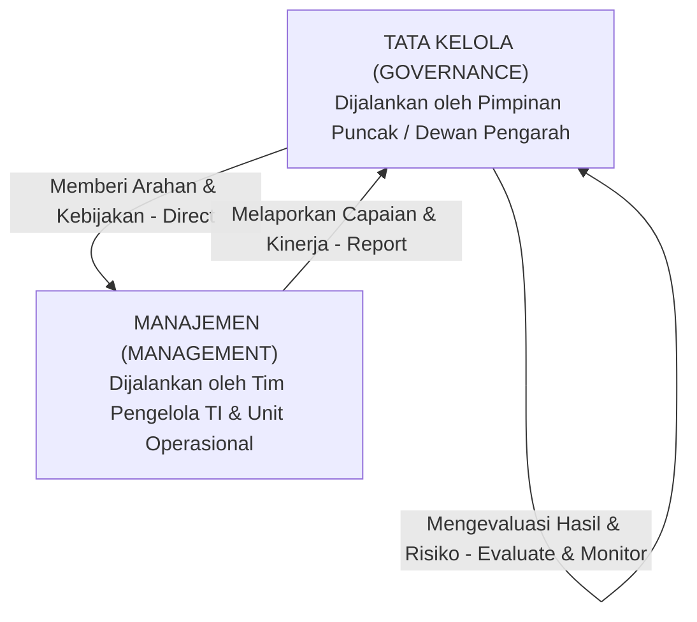

# Bab 5: Tata Kelola Sistem Informasi (IS Governance)

> 🔗 **Navigasi:** [[Dashboard]] | [[CONTEXT_INDEX]] | [[SOURCE_INVENTORY]] | [[Modul 5]] | [[Praktikum_5_Kelompok3]] | [[Bab_4_Evaluasi_Alternatif_Solusi_dan_Keputusan_Investasi_SI]] | [[Bab_6_Kerangka_Governance_TI_ISO_dan_COBIT]]

Modul pembelajaran teori Bab 5 ini disusun oleh Dr. Ratna Wardani, S.Si., M.T. untuk menuntun mahasiswa memahami aspek paling krusial dalam keberhasilan sistem informasi: **Tata Kelola Sistem Informasi (*IS Governance*)**. Bab ini menjawab pertanyaan mendasar mengenai siapa yang memiliki hak wewenang membuat keputusan (*decision rights*) dan siapa yang memikul tanggung jawab atas hasil dari keputusan tersebut (*accountability*).

---

## 🎯 1. Capaian Pembelajaran Bab

Setelah menyelesaikan materi ini, mahasiswa diharapkan mampu:
1. Membedakan fungsi tata kelola (*governance*) dari fungsi manajemen (*management*) secara mendalam dalam operasional organisasi.
2. Menganalisis lima domain keputusan teknologi informasi menurut model Weill & Ross (2004) beserta implikasinya terhadap struktur wewenang institusi.
3. Mengidentifikasi enam pola tipe dasar (*governance archetypes*) dalam pengambilan keputusan sistem informasi.
4. Memisahkan secara tegas antara hak mengambil keputusan (*decision rights*) dan akuntabilitas hasil kerja (*accountability*).
5. Merancang struktur tata kelola sistem informasi yang memenuhi empat prinsip tata kelola yang baik (*good governance*).

---

## ❓ 2. Pertanyaan Pemantik Diskusi

1. Mengapa sebuah rekomendasi sistem informasi yang secara substansi teknis dinilai sangat baik dapat tertahan berbulan-bulan di meja pimpinan tanpa kepastian?
2. Apakah seluruh jenis keputusan teknologi informasi seharusnya diambil oleh pejabat atau unit yang sama?
3. Apa perbedaan hukum dan manajerial antara memiliki wewenang membuat keputusan (*decision rights*) dengan memikul tanggung jawab atas dampak hasilnya (*accountability*)?
4. Bagaimana mekanisme organisasi dalam menentukan pihak mana yang wajib memegang kendali penentu, dan pihak mana yang sekadar perlu dimintai pendapat atau diinformasikan?

---

## 📖 3. Studi Kasus Pembuka: Rekomendasi yang Tertahan di SMA Digital Nusantara

### Situasi Kebuntuan
Menindaklanjuti hasil evaluasi Bab 4, proposal pengadaan modul integrasi PPDB dan SIAKAD telah diajukan ke rapat pimpinan sekolah untuk mendapatkan persetujuan akhir. Secara substansi teknis dan perhitungan biaya, dokumen evaluasi sudah lengkap dan dinilai sangat layak.

Namun, tiga minggu berlalu tanpa ada keputusan penetapan resmi. Dokumen rekomendasi tersebut mengambang bukan karena ditolak, melainkan karena kebingungan struktural:
- **Kepala Sekolah** berasumsi bahwa persetujuan cukup diputuskan oleh Koordinator TI sekolah.
- **Koordinator TI** merasa tidak memiliki wewenang anggaran sehingga meminta persetujuan Wakil Kepala Sekolah Bidang Sarana dan Prasarana.
- **Wakil Kepala Sekolah Sarana** merasa urusan ini berkaitan dengan penerimaan siswa baru sehingga wajib melibatkan Wakil Kepala Sekolah Bidang Kurikulum dan Kesiswaan.
- **Wakil Kepala Sekolah Kurikulum** enggan menandatangani karena belum pernah dilibatkan dalam perancangan spesifikasi awal.

### Inti Permasalahan
Kebuntuan ini terjadi bukan karena para pejabat tidak kompeten, melainkan karena organisasi tidak pernah merancang struktur tata kelola (*governance structure*) keputusan teknologi informasi secara eksplisit. Ketiadaan batasan wewenang yang jelas memicu fenomena saling lempar tanggung jawab (*buck-passing*) dan kelumpuhan pengambilan keputusan (*decision paralysis*).

---

## 🏛️ 4. Tata Kelola (*Governance*) versus Manajemen (*Management*)

Tata kelola bukanlah aktivitas operasional membuat keputusan harian, melainkan menetapkan aturan main tentang bagaimana keputusan dibuat:

| Dimensi | Tata Kelola Sistem Informasi (Governance) | Manajemen Sistem Informasi (Management) |
| :--- | :--- | :--- |
| **Pertanyaan Kunci** | *"Siapa yang berhak memutuskan arah dan bagaimana hasilnya diawasi?"* | *"Bagaimana cara menjalankan rencana tersebut secara efektif dan efisien?"* |
| **Fokus Utama** | Penetapan kerangka wewenang, alokasi nilai strategis, prioritas investasi, dan batas toleransi risiko. | Perencanaan teknis harian, penulisan kode, instalasi server, pelayanan tiket gangguan, dan pelatihan pengguna. |
| **Aktivitas Baku** | Menilai usulan (*Evaluate*), memberikan arahan resmi (*Direct*), dan mengawasi kepatuhan (*Monitor*). | Merencanakan (*Plan*), membangun solusi (*Build*), menjalankan layanan (*Run*), dan memantau operasi (*Monitor*). |

---

## 🌐 5. Lima Domain Keputusan TI (Weill & Ross, 2004)

Organisasi yang berhasil mengelola teknologi tidak menyerahkan seluruh keputusan kepada unit TI semata. Keputusan TI dipilah ke dalam lima domain terpisah:

| Domain Keputusan | Definisi dan Pertanyaan Strategis | Pihak yang Ideal Terlibat |
| :--- | :--- | :--- |
| **1. Prinsip TI (*IT Principles*)** | Panduan filosofis tingkat tinggi tentang bagaimana teknologi informasi diposisikan dalam organisasi untuk mendukung visi jangka panjang. | Pimpinan puncak institusi (Direksi, Rektor, Kepala Sekolah) bersama kepala TI. |
| **2. Arsitektur TI (*IT Architecture*)** | Standar pengorganisasian data, integrasi aplikasi, dan protokol komunikasi agar seluruh sistem dapat saling bertukar data secara aman. | Arsitek sistem, spesialis basis data, dan tim teknis senior TI. |
| **3. Strategi Infrastruktur TI (*IT Infrastructure*)** | Penentuan penyediaan layanan bersama, kapasitas komputasi awan, jaringan lokal (LAN/Wi-Fi), dan pusat data pendukung. | Manajer infrastruktur TI, administrator jaringan, dan bagian pengadaan fisik. |
| **4. Kebutuhan Aplikasi Bisnis (*Business Application Needs*)** | Penetapan spesifikasi fungsional perangkat lunak yang dibutuhkan unit kerja untuk menyelesaikan tugas harian. | Pemimpin unit kerja operasional (pengguna bisnis) bekerja sama dengan analis sistem. |
| **5. Investasi dan Prioritas TI (*IT Investment & Prioritization*)** | Keputusan alokasi pagu dana kas organisasi: berapa besar dana yang disetujui dan program mana yang didahulukan pelaksanaannya. | Komite anggaran pimpinan puncak bersama pemilik proses bisnis utama. |

---

## 👑 6. Pola Tipe Dasar Tata Kelola (*Governance Archetypes*)

Weill & Ross mengidentifikasi enam variasi pola kekuasaan yang menentukan siapa pemegang hak keputusan:

1. **Monarki Bisnis (*Business Monarchy*):** Keputusan dipegang penuh secara terpusat oleh pimpinan puncak organisasi (Direktur, Dekan, Kepala Sekolah) tanpa dominasi spesialis teknis.
2. **Monarki TI (*IT Monarchy*):** Keputusan diambil secara mutlak oleh pimpinan unit teknologi informasi (CIO, Kepala UPT Komputer) berdasarkan pertimbangan teknis murni.
3. **Feodal (*Feudal*):** Masing-masing unit kerja (fakultas, departemen, atau prodi) mengambil keputusan secara mandiri dan terisolasi sesuai kepentingan lokal unitnya sendiri.
4. **Federal (*Federal*):** Keputusan dirumuskan bersama melalui konsensus antara pimpinan pusat organisasi dan perwakilan unit-unit kerja pelaksana di lapangan.
5. **Duopoli TI (*IT Duopoly*):** Keputusan disepakati melalui kemitraan sejajar antara pimpinan unit TI dan satu kelompok pimpinan unit bisnis terkait.
6. **Anarki (*Anarchy*):** Tidak ada struktur tata kelola resmi; masing-masing individu staf bebas membeli atau membuat sistem sendiri-sendiri tanpa koordinasi.

---

## ⚖️ 7. Hak Pengambilan Keputusan (*Decision Rights*) versus Akuntabilitas (*Accountability*)

Salah satu distorsi terbesar dalam organisasi adalah ketidaksesuaian antara wewenang dan beban pertanggungjawaban:
- **Hak Keputusan (*Decision Rights*):** Kewenangan legal formal yang diberikan kepada individu atau komite untuk menetapkan suatu pilihan (contoh: Wakil Kepala Sekolah Sarana menandatangani kontrak modul vendor).
- **Akuntabilitas (*Accountability*):** Kewajiban moral dan administratif untuk mempertanggungjawabkan konsekuensi keberhasilan maupun kegagalan dari keputusan tersebut di hadapan dewan pengawas atau yayasan (contoh: Kepala Sekolah memikul akuntabilitas atas lancarnya tahun ajaran baru).

Prinsip tata kelola yang sehat menegaskan: pihak yang memegang hak keputusan wajib memikul akuntabilitas yang proporsional. Memberikan wewenang tanpa akuntabilitas melahirkan arogansi kekuasaan, sedangkan membebankan akuntabilitas tanpa hak keputusan melahirkan frustrasi kerja staf di lapangan.

---

## 🌟 8. Empat Prinsip Tata Kelola Sistem Informasi yang Baik (*Good Governance*)

Struktur tata kelola yang dirancang wajib memenuhi empat parameter kepatuhan:
1. **Transparansi (*Transparency*):** Mekanisme, jadwal, dan kriteria pengambilan keputusan diketahui dan dapat diakses terbuka oleh seluruh pemangku kepentingan yang terdampak.
2. **Kejelasan (*Clarity*):** Setiap domain keputusan memiliki pemilik wewenang yang eksplisit tertulis dalam surat keputusan resmi, bukan sekadar kebiasaan lisan.
3. **Pelibatan Proporsional (*Proportional Involvement*):** Pihak yang terdampak dilibatkan sesuai porsinya (sebagai pemutus, konsultan, atau penerima informasi), tanpa menciptakan birokrasi berlebihan.
4. **Akuntabilitas Tegas (*Clear Accountability*):** Terdapat kejelasan konsekuensi kinerja jika sistem yang diputuskan gagal memenuhi sasaran layanan yang ditargetkan.

---

## 💡 9. Refleksi dan Integrasi Kasus: Perpustakaan FT UNY

Konsep Bab 5 memberikan kejernihan penataan batas wewenang dalam proyek tata kelola Perpustakaan Fakultas Teknik UNY oleh Kelompok 3:

1. **Pemetaan Batas Wewenang Vertikal Tiga Tingkatan:**
   - *Tingkat Strategis (Dekanat FT UNY):* Memegang *Monarki Bisnis* untuk domain **IT Investment & Prioritization** (penetapan alokasi anggaran buku tahunan dan legalisasi jam layanan operasional).
   - *Tingkat Manajerial (Kepala Perpustakaan / Tim Akreditasi):* Memegang pola *Federal* untuk domain **Business Application Needs** (menyelaraskan format laporan sirkulasi dengan standar Borang Akreditasi LAM-INFOKOM Kriteria 5).
   - *Tingkat Operasional (Pustakawan Tunggal):* Memegang hak kendali lokal (*Local Operational Rights*) untuk pemutakhiran data bibliografi, pencatatan eksemplar di rak, dan pelaksanaan sesi verifikasi.
2. **Keterbatasan Hak Akses SLiMS dan Pencegahan Konflik Wewenang:**
   Pustakawan tunggal memiliki hak wewenang (*decision rights*) operasional sirkulasi harian pada aplikasi SLiMS 9 Bulian lokal. Namun, pustakawan tidak memiliki wewenang untuk:
   - Menghapus eksemplar koleksi (*weeding*) tanpa berita acara resmi yang disetujui Pimpinan Fakultas.
   - Mengubah konfigurasi arsitektur basis data (*IT Architecture*) yang terpusat di server UPT Pusat Komputer UNY.
3. **Penyelarasan RACI dalam Solusi Pure Governance:**
   Dengan mengadopsi model *IT Duopoly* antara Pustakawan Tunggal dan Komisi Sarana Fakultas, penerapan instrumen **SOP Quiet Hour**, **Formulir Google Form QR Code**, dan **Rak Transit Fisik** disahkan melalui surat tugas resmi pimpinan fakultas. Hal ini memberikan perlindungan hukum bagi pustakawan saat menutup sementara meja layanan sirkulasi selama 30 sampai 60 menit per pekan untuk fokus memvalidasi integritas data SLiMS.

---

## 📚 10. Referensi Dokumen

- Dr. Ratna Wardani, S.Si., M.T. (2026). *Modul Pembelajaran Manajemen Sistem Informasi - Bab 5: Tata Kelola Sistem Informasi: Siapa Berwenang Memutuskan, dan Siapa Bertanggung Jawab atas Hasilnya*. S1 Pendidikan Teknik Informatika, Fakultas Teknik UNY.
- Weill, P., & Ross, J. W. (2004). *IT Governance: How Top Performers Manage IT Decision Rights for Superior Results*. Harvard Business School Press.
- Pearlson, K. E., Saunders, C. S., & Galletta, D. F. (2024). *Managing and Using Information Systems: A Strategic Approach* (8th ed.). Wiley.
- ISO/IEC. (2024). *ISO/IEC 38500:2024 Information technology - Governance of IT for the organization*.
