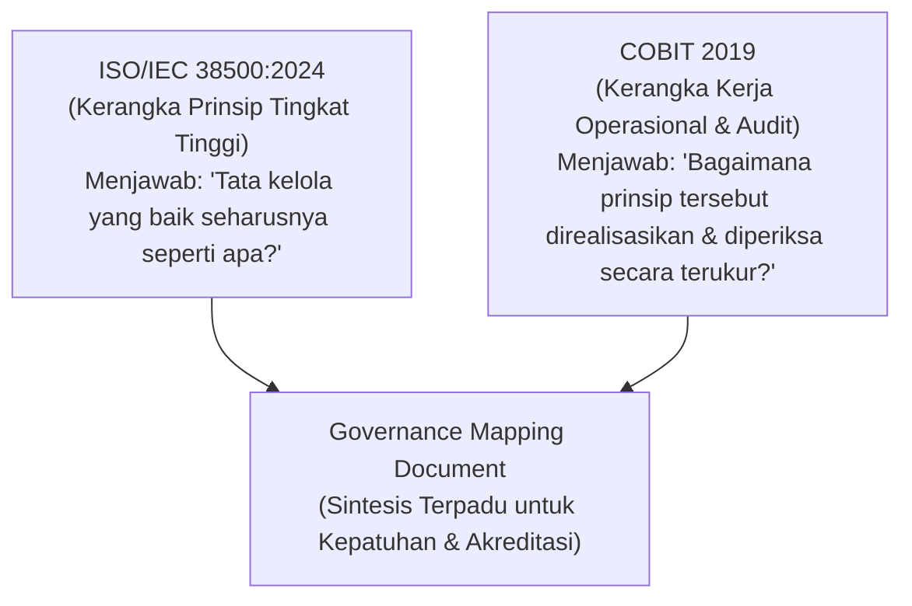
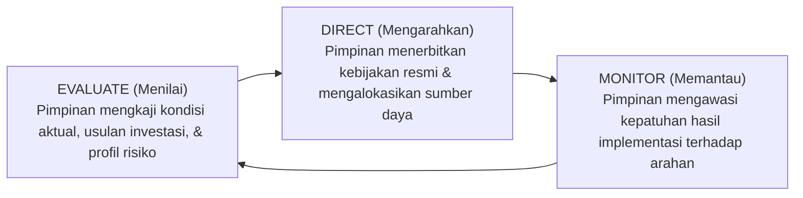
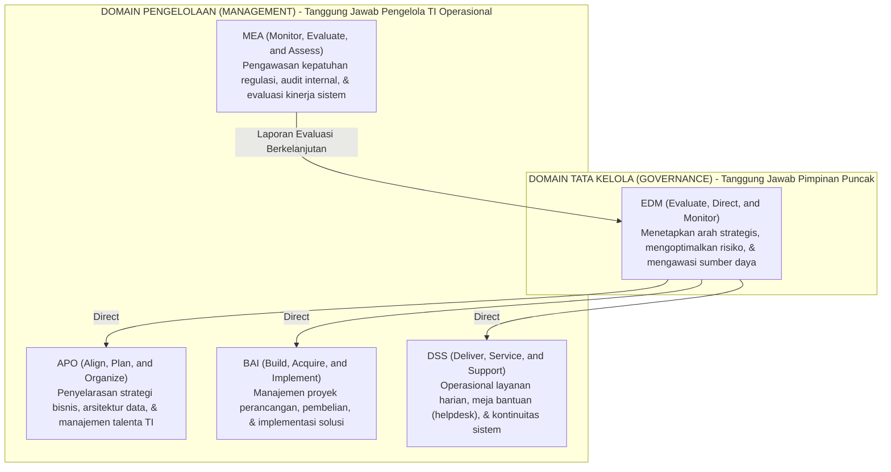

# Bab 6: Kerangka Governance TI: ISO/IEC 38500:2024 dan COBIT 2019

> 🔗 **Navigasi:** [[Dashboard]] | [[CONTEXT_INDEX]] | [[SOURCE_INVENTORY]] | [[Modul 6]] | [[Praktikum_6_Kelompok3]] | [[Bab_5_Tata_Kelola_Sistem_Informasi]] | [[Blueprint_Ekosistem_SIMPEL_KOLEKSI_FT]]

Modul pembelajaran teori Bab 6 ini disusun oleh Dr. Ratna Wardani, S.Si., M.T. untuk membekali mahasiswa dengan standar tata kelola teknologi informasi berkelas internasional. Bab ini memadukan kerangka prinsip tingkat tinggi **ISO/IEC 38500:2024** dengan kerangka sasaran operasional yang terperinci **COBIT 2019** ke dalam satu instrumen terintegrasi bernama *Governance Mapping Document*.

---

## 🎯 1. Capaian Pembelajaran Bab

Setelah mempelajari materi ini, mahasiswa diharapkan mampu:
1. Menjelaskan enam prinsip tata kelola teknologi informasi menurut standar **ISO/IEC 38500:2024** dan menerapkannya pada kasus nyata institusi.
2. Memahami model siklus **Evaluate-Direct-Monitor (EDM)** sebagai mesin penggerak operasional tata kelola TI.
3. Menguraikan struktur lima domain utama **COBIT 2019** (EDM, APO, BAI, DSS, dan MEA) beserta sasaran objektif representatifnya.
4. Memetakan kebutuhan tata kelola internal organisasi ke dalam prinsip ISO/IEC 38500:2024 dan objektif COBIT 2019 yang relevan.
5. Menyusun dokumen pemetaan tata kelola (*Governance Mapping Document*) yang mengintegrasikan kedua kerangka kerja sebagai instrumen audit kesiapan institusi.

---

## ❓ 2. Pertanyaan Pemantik Diskusi

1. Apa perbedaan mendasar antara prinsip tata kelola tingkat tinggi (*high-level principles*) dan kerangka kerja operasional yang mendetail (*operational framework*)?
2. Mengapa sebuah organisasi modern memerlukan lebih dari satu kerangka kerja tata kelola TI secara simultan?
3. Bagaimana siklus *Evaluate-Direct-Monitor* berbeda dari sekadar aktivitas rutin mengawasi pelaksanaan proyek perangkat lunak?
4. Bagaimana cara memeriksa struktur tata kelola internal organisasi agar diakui kepatuhannya oleh asesor audit eksternal?

---

## 📖 3. Studi Kasus Pembuka: Struktur yang Belum Teruji di SMA Digital Nusantara

### Situasi Audit Sertifikasi
SMA Digital Nusantara mengajukan permohonan akreditasi dan sertifikasi tata kelola digital sekolah. Koordinator TI memaparkan bagan struktur tata kelola yang dirancang pada Bab 5 di hadapan tim asesor independen.

Meskipun struktur organisasi internal dinilai logis, asesor melontarkan tiga pertanyaan kritis yang tidak mampu dijawab oleh tim sekolah:
1. *"Prinsip tata kelola baku internasional mana yang menjadi rujukan struktur wewenang ini?"*
2. *"Siklus evaluasi dan pengawasan sistemik seperti apa yang berjalan untuk menjamin mutu layanan TI setiap semester?"*
3. *"Sasaran operasional (*objectives*) audit mana yang digunakan untuk memeriksa efektivitas keputusan manajemen harian?"*

### Akar Masalah
Struktur tata kelola sekolah masih bersifat internal murni (*ad-hoc internal design*). Ketiadaan rujukan terhadap standar formal internasional seperti ISO/IEC 38500 dan COBIT membuat organisasi rentan gagal dalam audit akreditasi eksternal, meskipun operasional harian tampak berjalan tanpa insiden besar.

---

## 🤝 4. Mengapa Memadukan ISO/IEC 38500:2024 dan COBIT 2019?

Kedua kerangka kerja bekerja pada lapis abstraksi yang berbeda dan saling melengkapi secara sinergis:

- **Konsekuensi Ketidakseimbangan:** Organisasi yang hanya berpegang pada prinsip ISO 38500 tanpa COBIT akan terjebak pada slogan etika normatif tanpa instrumen audit konkret. Sebaliknya, organisasi yang hanya menjalankan COBIT tanpa prinsip ISO berisiko terjebak pada beban birokrasi *checklist* teknis yang kehilangan arah nilai strategisnya.

---

## 🏛️ 5. Enam Prinsip Tata Kelola TI (ISO/IEC 38500:2024)

Standar internasional ISO/IEC 38500:2024 menetapkan enam tolok ukur pengarah tata kelola bagi dewan pimpinan organisasi:

| Prinsip Tata Kelola | Penjelasan Substansi | Indikator Kepatuhan |
| :--- | :--- | :--- |
| **1. Tanggung Jawab (*Responsibility*)** | Setiap pihak memahami dan menerima wewenang serta tanggung jawabnya secara eksplisit atas aset dan keputusan TI. | Terdapat surat keputusan tertulis mengenai pembagian wewenang; tidak ada domain keputusan yang tidak bertuan. |
| **2. Strategi (*Strategy*)** | Rencana investasi dan arsitektur TI selaras langsung dengan rencana strategis jangka menengah institusi. | Setiap pengadaan teknologi memiliki justifikasi kontribusi terhadap sasaran strategis organisasi. |
| **3. Akuisisi (*Acquisition*)** | Keputusan belanja TI didasarkan pada analisis biaya, manfaat, risiko, dan kelayakan jangka panjang yang transparan. | Dokumen studi kelayakan komparatif tersedia sebelum dana investasi dicairkan ke vendor. |
| **4. Kinerja (*Performance*)** | Portofolio TI menghasilkan kualitas layanan yang memenuhi kebutuhan proses bisnis saat ini dan masa depan. | Terdapat Perjanjian Tingkat Layanan (*Service Level Agreement - SLA*) dan indikator ketercapaian yang dimonitor rutin. |
| **5. Kepatuhan (*Conformance*)** | Penggunaan sistem informasi tunduk pada peraturan perundang-undangan, standar keselamatan, dan etika data. | Sistem patuh pada undang-undang perlindungan data pribadi dan pedoman akreditasi resmi. |
| **6. Perilaku Manusia (*Human Behaviour*)** | Kebijakan sistem informasi menghargai kebutuhan psikologis, budaya kerja, dan keterbatasan fisik pengguna manusia. | Solusi TI tidak membebani staf dengan stres kognitif berlebihan atau beban kerja rangkap yang tidak manusiawi. |

---

## 🔄 6. Model Siklus Operasional Evaluate-Direct-Monitor (EDM)

Keenam prinsip ISO/IEC 38500:2024 digerakkan melalui siklus berkelanjutan tiga tahap:

1. **Evaluate (Menilai):** Pimpinan puncak secara proaktif menilai tren permintaan masa depan, kapasitas sistem saat ini, serta alternatif opsi sebelum krisis terjadi.
2. **Direct (Mengarahkan):** Pimpinan menetapkan regulasi tertulis, menunjuk penanggung jawab resmi, dan mengalokasikan anggaran pendukung.
3. **Monitor (Memantau):** Pimpinan secara berkala menerima laporan kinerja dan metrik deviasi untuk memastikan instruksi dijalankan dengan benar.

---

## 💥 7. Studi Kasus Mendalam: Insiden KRS Online Universitas Cendana Mandiri

### Kronologi Krisis Layanan
Universitas Cendana Mandiri memiliki 4.000 mahasiswa aktif (mengalami lonjakan dari 2.500 mahasiswa dalam 2 tahun terakhir). Infrastruktur server Kartu Rencana Studi (KRS) memiliki kapasitas maksimal 1.200 sesi bersamaan tanpa pernah ditinjau ulang.

Pada hari pertama pengisian KRS pukul 08.00 WIB:
- Pukul 08.05 WIB: Sekitar 3.100 sesi pengguna masuk secara serentak (permintaan mencapai 2,6 kali lipat dari kapasitas server).
- Halaman web menjadi sangat lambat dan memunculkan galat server (*internal server error 500*).
- Pukul 09.30 WIB: Terjadi penumpukan antrean ratusan mahasiswa di depan kantor bagian akademik. Wakil Rektor Akademik (Prof. Hendra) menegur keras Kepala UPT Komputer (Pak Bima).
- Pukul 11.00 WIB: Pak Bima menambah alokasi memori server virtual dan me-restart layanan web; sistem berangsur pulih. Pimpinan memperpanjang masa KRS selama dua hari sebagai kompensasi.

Pada semester berikutnya, peristiwa yang persis sama terulang kembali dengan durasi gangguan mencapai 4 jam.

### Analisis Kritis: Kegagalan Manajemen atau Kegagalan Tata Kelola?
Tindakan teknis Pak Bima menambah RAM dan merestart server adalah tindakan di **Lapis Manajemen (*Management Layer*)**. Tindakan manajemen dapat memperbaiki insiden darurat, namun tidak akan pernah mampu melenyapkan akar masalah jika **Lapis Tata Kelola (*Governance Layer*)** pimpinan lumpuh:

| Tahap Siklus | Realitas yang Terjadi pada Kasus KRS | Kondisi yang Seharusnya Dijalankan Tata Kelola |
| :--- | :--- | :--- |
| **EVALUATE** | Tidak ada pimpinan yang membandingkan tren lonjakan 4.000 mahasiswa dengan daya tampung 1.200 sesi server sebelum semester dibuka. | Wakil Rektor mengevaluasi laporan kapasitas server dan menyadari defisit daya tampung 2 bulan sebelum masa registrasi. |
| **DIRECT** | Tidak ada kebijakan preventif; pimpinan hanya merespons secara panik saat antrean massa sudah membludak di lorong gedung. | Pimpinan menetapkan kebijakan pembagian jadwal KRS bergilir per angkatan dan menyetujui anggaran penambahan kapasitas awan sementara (*elastic scaling*). |
| **MONITOR** | Pimpinan baru menyadari kegagalan sistem dari jeritan protes mahasiswa di media sosial dan kegaduhan fisik di kantor akademik. | Pimpinan memantau dasbor beban server secara real-time dan menerima laporan kepatuhan waktu respons layanan setiap jam. |

---

## 🧩 8. Kerangka Kerja COBIT 2019

COBIT 2019 diterbitkan oleh ISACA sebagai kerangka kerja komprehensif yang membagi tata kelola dan pengelolaan TI institusi ke dalam lima domain:

### Sasaran Objektif Representatif COBIT 2019
Setiap domain memiliki kode objektif spesifik yang dapat diuji dalam audit:
1. **EDM01 (Ensured Governance Framework Setting and Maintenance):** Menjamin ketersediaan struktur tata kelola TI tertulis yang dipelihara konsisten.
2. **APO03 (Managed Enterprise Architecture):** Mengelola arsitektur enterprise agar aplikasi dan aliran data organisasi saling terhubung mulus.
3. **BAI03 (Managed Solutions Identification and Build):** Mengelola identifikasi kebutuhan solusi dan kelayakan teknis sebelum sistem diadopsi.
4. **DSS02 (Managed Service Requests and Incidents):** Menangani keluhan layanan pengguna dan gangguan operasional harian secara cepat dan terekam.
5. **MEA01 (Managed Performance and Conformance Monitoring):** Memantau indikator kinerja layanan TI dan kepatuhan terhadap standar regulasi eksternal.

---

## 📑 9. Dokumen Pemetaan Tata Kelola (*Governance Mapping Document*)

Integrasi antara ISO/IEC 38500:2024 dan COBIT 2019 dituangkan dalam format matriks kepatuhan audit:

| Prinsip ISO/IEC 38500 | Domain & Objektif COBIT 2019 | Bukti Nyata Pelaksanaan Organisasi (*Audit Evidence*) |
| :--- | :--- | :--- |
| **Responsibility** | **EDM01** (Setting Governance Framework) | SK Penetapan struktur wewenang wewenang formal per domain keputusan TI. |
| **Strategy** | **APO03** (Managed Enterprise Architecture) | Dokumen cetak biru keselarasan arsitektur data dengan rencana strategis 5 tahunan. |
| **Acquisition** | **BAI03** (Managed Solutions Build/Acquisition) | Laporan studi kelayakan alternatif solusi (Build-Buy-Configure) beserta TCO. |
| **Performance** | **MEA01** (Performance & Conformance Monitoring) | Laporan pemenuhan standar waktu tanggap sistem dan tingkat ketersediaan layanan. |
| **Conformance** | **MEA01** / **EDM03** (Risk & Compliance Optimization) | Berita acara audit kepatuhan regulasi perlindungan data pribadi dan rekam log audit. |
| **Human Behaviour** | **APO07** / **DSS02** (Human Resources & User Support) | Survei beban kerja staf, program bimbingan teknis, dan prosedur penanganan komplain. |

---

## 💡 10. Refleksi dan Integrasi Kasus: Perpustakaan FT UNY

Penerapan kerangka kerja Bab 6 menjadi landasan pertahanan akademik (*defense-readiness*) yang sangat kuat bagi Kelompok 3 di hadapan Dosen Pengampu (Dr. Ratna Wardani):

1. **Penyelarasan Siklus EDM pada Sirkulasi Koleksi SLiMS:**
   - *Evaluate:* Mengevaluasi fakta empiris bahwa 1 pustakawan tunggal melayani sirkulasi fisik mahasiswa, repositori skripsi, dan administrasi borang prodi secara serentak.
   - *Direct:* Pimpinan Fakultas Teknik menerbitkan Surat Penugasan resmi mengenai penetapan **SOP Quiet Hour**, penempatan **Rak Transit**, dan legalitas pelaporan mandiri via **Google Form QR Code**.
   - *Monitor:* Pustakawan dan Tim Akreditasi memantau berkurangnya disparitas status buku antara fisik rak dan OPAC SLiMS secara berkala setiap hari Jumat.
2. **Kepatuhan Enam Prinsip ISO/IEC 38500 pada Kasus Perpustakaan:**
   - *Responsibility:* Kejelasan wewenang operasional di tangan Pustakawan Tunggal, wewenang anggaran di tangan Dekanat FT UNY, dan wewenang infrastruktur server di tangan UPT Komputer Pusat.
   - *Strategy:* Penyelarasan pembaruan sirkulasi SLiMS dengan pemenuhan bukti dukung Kriteria 5 Akreditasi Program Studi (LAM-INFOKOM).
   - *Acquisition:* Pilihan solusi tata kelola nol-anggaran (*zero budget*) memanfaatkan furnitur rak transit dan formulir awan yang telah ada.
   - *Performance:* Sasaran mutu pembaruan status buku di SLiMS diselesaikan maksimum 1x24 jam melalui sesi terfokus *Quiet Hour*.
   - *Conformance:* Kepatuhan terhadap Undang-Undang Perpustakaan No. 43 Tahun 2007 dan Standar Nasional Perpustakaan (SNP 2024).
   - *Human Behaviour:* Menghindari kelelahan kognitif (*cognitive overload*) pustakawan akibat interupsi pemustaka saat melakukan pemindaian barcode ke komputer.
3. **Penyelarasan Objektif COBIT 2019:**
   - **EDM01:** Legalisasi tata kelola sirkulasi perpustakaan tingkat fakultas.
   - **APO03:** Arsitektur 4-layer (Business, Data, Application, Technology) yang menghubungkan pemustaka, SLiMS, dan Borang Akreditasi.
   - **DSS02:** Penanganan komplain mahasiswa terkait buku hilang atau terselip di rak koleksi.
   - **MEA01:** Monitoring rutin tingkat keterpakaian koleksi buku oleh program studi di lingkungan Fakultas Teknik UNY.

---

## 📚 11. Referensi Dokumen

- Dr. Ratna Wardani, S.Si., M.T. (2026). *Modul Pembelajaran Manajemen Sistem Informasi - Bab 6: Kerangka Governance TI: ISO/IEC 38500:2024 dan COBIT 2019*. S1 Pendidikan Teknik Informatika, Fakultas Teknik UNY.
- ISO/IEC. (2024). *ISO/IEC 38500:2024 Information technology - Governance of IT for the organization*. International Organization for Standardization.
- ISACA. (2018). *COBIT 2019 Framework: Governance and Management Objectives*. Information Systems Audit and Control Association.
- Weill, P., & Ross, J. W. (2004). *IT Governance: How Top Performers Manage IT Decision Rights for Superior Results*. Harvard Business School Press.
- Pearlson, K. E., Saunders, C. S., & Galletta, D. F. (2024). *Managing and Using Information Systems: A Strategic Approach* (8th ed.). Wiley.
