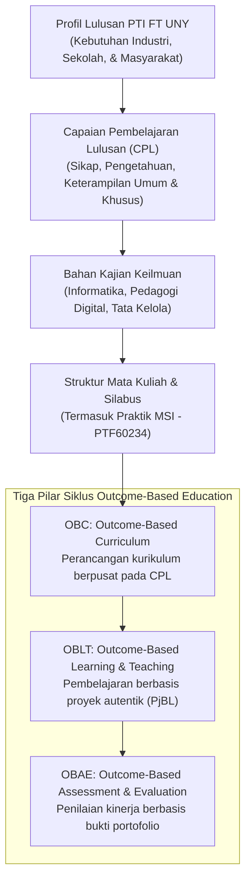

# Dasar Pengembangan Kurikulum Pendidikan Vokasional Informatika FT UNY

> 🔗 **Navigasi:** [[Dashboard]] | [[CONTEXT_INDEX]] | [[SOURCE_INVENTORY]] | [[Modul 1]] | [[CONTRIBUTING]] | [[Bab_1_Manajemen_Sistem_Informasi_dalam_Organisasi]]

Dokumen referensi akademik ini disusun oleh Ponco Walipranoto, M.Pd. dari Program Studi Pendidikan Teknik Informatika (PTI) Fakultas Teknik Universitas Negeri Yogyakarta (2026). Dokumen ini menguraikan arsitektur pengembangan kurikulum pendidikan tinggi vokasional bidang informatika, memetakan Capaian Pembelajaran Lulusan (CPL), serta menjelaskan kedudukan mata kuliah **Praktik Manajemen Sistem Informasi (PTF60234)** dalam membekali kompetensi mahasiswa S1 PTI.

---

## 🎯 1. Rasional Pengembangan Kurikulum Vokasional Abad ke-21

Kurikulum merupakan instrumen strategis institusi pendidikan tinggi untuk menyiapkan lulusan yang adaptif terhadap disrupsi teknologi digital. Tiga pendorong utama pengembangan kurikulum di PTI FT UNY meliputi:
1. **Perubahan Cepat IPTEKS:** Kemunculan kecerdasan buatan (*Artificial Intelligence*), komputasi awan, Internet of Things (IoT), dan teknologi imersif menuntut lulusan yang kritis, kreatif, dan memiliki literasi digital tingkat lanjut.
2. **Kebutuhan Dunia Usaha dan Dunia Industri (DUDI):** Industri menuntut keselarasan antara kompetensi teknis rekayasa perangkat lunak dengan kecakapan non-teknis (*soft skills*), seperti komunikasi manajerial, pemecahan masalah sistemik, dan kepemimpinan tim.
3. **Dinamika Generasi Pembelajar:** Transformasi dari metode ceramah pasif menuju pembelajaran berbasis proyek (*Project-Based Learning*) dan pengalaman praktik autentik di laboratorium dan lapangan.

---

## 🎓 2. Paradigma Outcome-Based Education (OBE)

Kurikulum PTI FT UNY beroperasi penuh di bawah paradigma *Outcome-Based Education* (OBE), di mana seluruh proses pendidikan dimulai dari perumusan hasil belajar yang diharapkan (*intended learning outcomes*), bukan sekadar menyusun daftar mata kuliah:

---

## 🏛️ 3. Landasan Filosofis: Eklektif-Inkorporatif

Pendidikan vokasional informatika di FT UNY berpijak pada sintesis empat aliran filsafat pendidikan:
1. **Realisme:** Menekankan penguasaan unjuk kerja nyata, keterampilan teknis terukur, dan latihan ketangkasan di laboratorium komputer.
2. **Idealisme:** Menanamkan integritas moral, etika profesi teknologi informasi, dan pembentukan karakter manusia seutuhnya.
3. **Pragmatisme:** Mengadopsi prinsip belajar sambil melakukan (*learning by doing*), pemecahan masalah kasus nyata, dan penyusunan proyek aplikatif.
4. **Rekonstruksionisme:** Memosisikan lulusan sebagai agen pembaruan sosial yang mampu memanfaatkan teknologi untuk mengatasi disparitas layanan publik di masyarakat.

---

## ⚖️ 4. Lima Landasan Pengembangan Kurikulum

Penyusunan kurikulum PTI FT UNY mengunci lima pilar legal dan sosiologis:
- **Landasan Filosofis:** Pandangan hidup Pancasila dan tujuan pendidikan nasional.
- **Landasan Sosiologis:** Kebutuhan masyarakat terhadap layanan transformasi digital di sektor pendidikan dan kejuruan.
- **Landasan Psikologis:** Teori belajar konstruktivistik dan perkembangan kognitif mahasiswa generasi digital.
- **Landasan Historis:** Warisan kelembagaan kejuruan Fakultas Teknik UNY yang berevolusi dari pencetak guru kejuruan teknik menuju pusat keunggulan teknologi terapan.
- **Landasan Yuridis:** Undang-Undang Pendidikan Tinggi No. 12 Tahun 2012, Kerangka Kualifikasi Nasional Indonesia (KKNI), Standar Nasional Pendidikan Tinggi (SN-Dikti), dan Peraturan Akademik UNY.

---

## 👨‍💼 5. Profil Lulusan Program Studi S1 PTI FT UNY

Lulusan S1 Pendidikan Teknik Informatika dipersiapkan untuk mengemban lima profil profesi utama:

| Profil Lulusan | Deskripsi Peran Profesi | Relevansi dengan Mata Kuliah MSI |
| :--- | :--- | :--- |
| **1. Pendidik Bidang TI** | Guru informatika di SMK/SMA yang merancang dan mengevaluasi pembelajaran berbasis teknologi. | Memahami tata kelola laboratorium sekolah dan manajemen sistem informasi akademik. |
| **2. Instruktur Industri TI** | Profesional pelatihan yang merancang modul pengembangan kompetensi digital bagi tenaga kerja industri. | Mampu menganalisis kebutuhan kompetensi sumber daya manusia dan kesenjangan adopsi teknologi. |
| **3. Tenaga Kependidikan / Pengelola SI** | Pengelola sistem informasi, administrator basis data, dan penanggung jawab layanan digital di institusi pendidikan. | **Sangat Relevan:** Menguasai tata kelola SI, SOP layanan, audit data, dan manajemen perubahan sistem. |
| **4. Tenaga Ahli Rekayasa TI** | Pengembang perangkat lunak, arsitek sistem, dan konsultan solusi digital untuk pemecahan masalah organisasi. | Menilai kelayakan sistem informasi menggunakan kerangka TELOS dan model keselarasan proses bisnis. |
| **5. Wirausahawan TI (*Technopreneur*)** | Pendiri rintisan usaha teknologi yang mengembangkan produk digital dan media edukatif inovatif. | Memahami analisis biaya-manfaat (TCO) dan proposisi nilai investasi teknologi informasi. |

---

## 📊 6. Struktur Kurikulum 148 SKS dan Kedudukan Praktik MSI

Kurikulum S1 PTI FT UNY menuntut penyelesaian minimal 148 Satuan Kredit Semester (SKS) yang ditempuh dalam 8 semester reguler:
- **MKPKP (Mata Kuliah Keahlian Program Studi):** 75 SKS.
- **MKPLK (Mata Kuliah Praktik Lapangan & Komunitas):** 18 SKS.
- **MKPK (Mata Kuliah Pedagogi Kejuruan):** 11 SKS.
- **MKDK (Mata Kuliah Dasar Kependidikan):** 10 SKS.
- **MKKPP (Mata Kuliah Keterampilan Penunjang Profesi):** 10 SKS.
- **MKWK, MKF, MKWU, MKTK:** 24 SKS.

### Kedudukan Mata Kuliah Praktik Manajemen Sistem Informasi (PTF60234)
Mata kuliah **Praktik Manajemen Sistem Informasi** berbobot 2 SKS di Semester 5 merupakan bagian inti dari rumpun **MKPKP**:
- Menghubungkan mata kuliah teknis semester sebelumnya (Basis Data, Rekayasa Perangkat Lunak, Jaringan Komputer) dengan perspektif manajerial organisasi.
- Mengembangkan kompetensi CPL dalam aspek perancangan arsitektur sistem informasi, penetapan Standar Operasional Prosedur (SOP), penyusunan jadwal proyek (WBS, Gantt, PERT), dan mitigasi resistensi pemangku kepentingan.

---

## 🔄 7. Penjaminan Mutu Berkelanjutan: Siklus PPEPP

Penjaminan mutu kurikulum dan perkuliahan di lingkungan FT UNY dikawal melalui siklus PPEPP:
1. **Penetapan:** Perumusan standar kompetensi CPL, silabus Rencana Pembelajaran Semester (RPS), dan rubrik penilaian modul.
2. **Pelaksanaan:** Proses perkuliahan interaktif berbasis proyek riil di lapangan (*real-world case project*).
3. **Evaluasi:** Pengukuran ketercapaian nilai CPMK mahasiswa pada setiap modul praktikum.
4. **Pengendalian:** Analisis kesenjangan jika terdapat kompetensi yang belum tercapai secara optimal.
5. **Peningkatan:** Pemutakhiran studi kasus, modul ajar, dan metode praktikum secara berkala setiap tahun ajaran baru.

---

## 💡 8. Relevansi bagi Proyek Praktikum Perpustakaan FT UNY

Dokumen kurikulum ini mempertegas mengapa proyek praktikum kelompok di Perpustakaan FT UNY memiliki bobot akademik yang tinggi:
- **Studi Kasus Autentik di Lingkungan Kampus:** Mengambil objek nyata di lingkungan Fakultas Teknik UNY membuktikan kemampuan mahasiswa dalam melakukan pemecahan masalah (*problem solving*) pada ekosistem terdekatnya.
- **Penyelarasan Kompetensi Vokasional:** Proyek ini membuktikan bahwa mahasiswa tidak hanya menguasai keterampilan teknis komputer (*hard skills*), melainkan mampu merancang tata kelola organisasi (*Pure Governance*), menyusun analisis pemangku kepentingan, merancang SOP operasional, dan menyajikan laporan eksekutif berstandar profesional.

---

## 📚 9. Referensi Dokumen

- Walipranoto, P. (2026). *Dasar Pengembangan Kurikulum Pendidikan Vokasional Informatika*. Jurusan Pendidikan Teknik Elektronika dan Informatika, Fakultas Teknik, Universitas Negeri Yogyakarta.
- Kurikulum Program Studi Pendidikan Teknik Informatika S1 FT UNY Tahun 2025/2026.
- Kementerian Pendidikan Tinggi, Sains, dan Teknologi. (2024). *Panduan Penyusunan Kurikulum Pendidikan Tinggi Berbasis Outcome-Based Education (OBE)*.
