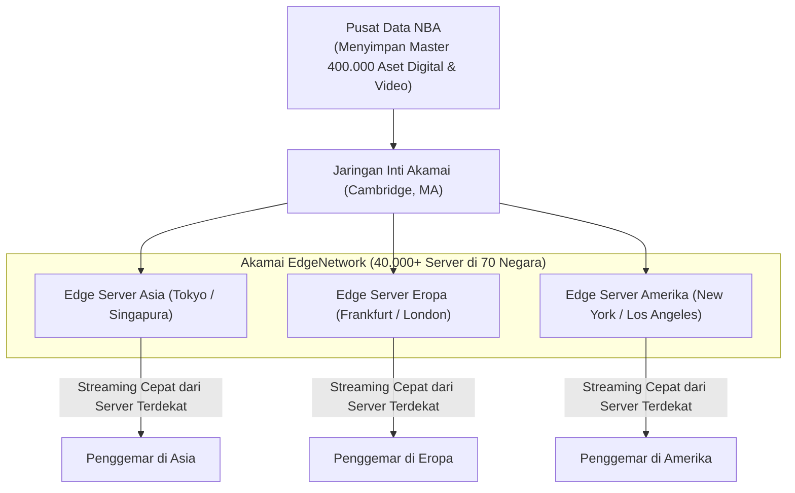

# Studi Kasus: NBA Bersaing melalui Pengiriman Global dengan Akamai OS Streaming

> 🔗 **Navigasi:** [[Dashboard]] | [[CONTEXT_INDEX]] | [[SOURCE_INVENTORY]] | [[Modul 3]] | [[Bab_3_Proses_Bisnis_Stakeholder_dan_Nilai_Organisasi]] | [[Studi_Kasus_UPS_DIAD_IV]]

Dokumen referensi studi kasus internasional ini diadaptasi dari karya Kenneth C. Laudon dan Jane P. Laudon dalam *Management Information Systems* (Chapter 3, Case 1: *National Basketball Association: Competing on Global Delivery With Akamai OS Streaming*). Kasus ini menggambarkan bagaimana sebuah organisasi olahraga global memanfaatkan arsitektur jaringan komputasi terdistribusi (*Content Delivery Network - CDN*) dan ekosistem kemitraan strategis untuk mengatasi hambatan infrastruktur internet konvensional.

---

## 📌 1. Profil Organisasi dan Latar Belakang Masalah

- **Entitas Kasus:** National Basketball Association (NBA).
- **Skala Pasar:** Terdiri atas 30 tim waralaba (*franchise*) di Amerika Serikat dan Kanada, disiarkan di 212 negara dalam 42 bahasa.
- **Inventaris Aset Digital:** Situs NBA.com mengelola lebih dari 400.000 aset digital, mencakup lebih dari 15.000 video pertandingan definisi tinggi (*high definition*), umpan data RSS, modul permainan interaktif, dan statistik pemain secara langsung.
- **Tantangan Arsitektur:** Penggemar di seluruh dunia menuntut pemutaran klip video pertandingan yang lancar tanpa terputus (*buffering*). Protokol arsitektur internet konvensional pada dasarnya tidak dirancang untuk melayani streaming video bervolume raksasa secara serentak dari satu server pusat perusahaan ke jutaan perangkat di belahan benua yang berbeda.

---

## 🌐 2. Solusi Teknologi: Arsitektur Akamai EdgeNetwork

Untuk mengatasi kemacetan transmisi data global (*network congestion and latency*), NBA bermitra dengan **Akamai Technologies, Inc.**, pelopor platform komputasi terdistribusi global:

### Mekanisme Kerja EdgeNetwork
1. **Penempatan Server di Tepi Jaringan (*Edge Servers*):** Akamai menempatkan lebih dari 40.000 server di 70 negara pada titik simpul penyedia layanan internet lokal (ISP).
2. **Penyimpanan Singgahan Pintar (*Intelligent Caching*):** Ketika pengguna mengakses klip video di NBA.com, sistem secara otomatis mengarahkan permintaan ke server Akamai terdekat dengan lokasi fisik pengguna, bukan ke server induk NBA.
3. **Penyalinan Transparan (*Transparent Mirroring*):** Konten statis (HTML, CSS, gambar) dan aliran video di-cache di server lokal hanya jika terdapat permintaan riil dari kawasan tersebut, sehingga menghemat konsumsi lebar pita (*bandwidth*).
4. **Layanan Geolokasi (EdgeScape):** Mengidentifikasi lokasi negara, kota, dan kualitas koneksi pengguna secara real-time guna menyajikan iklan yang dipersonalisasi dan penyesuaian kualitas video (*adaptive bitrate streaming*).
5. **Akamai Stream OS:** Platform otomatisasi yang mengelola alur kerja publikasi 45.000 aset media NBA ke berbagai saluran distribusi digital.

---

## 📈 3. Dampak Bisnis dan Pencapaian Nilai Strategis

Penerapan solusi arsitektur Akamai menghasilkan dampak bisnis yang fenomenal bagi NBA:
- **Lonjakan Lalu Lintas Pengguna:** Pengunjung unik NBA.com melonjak mencapai lebih dari 35 juta pengguna global per bulan di 222 negara.
- **Efisiensi Biaya Infrastruktur:** NBA mampu melayani rekor lonjakan lalu lintas global tanpa perlu membangun server raksasa sendiri atau menambah jumlah staf TI secara drastis.
- **Peningkatan Pendapatan:** Jangkauan global yang stabil dan bebas gangguan mendongkrak pendapatan iklan digital NBA sebesar 500% sejak masa awal implementasi.

---

## 🧠 4. Analisis Strategis Berbasis Teori Porter

### Model Kekuatan Kompetitif (*Porter's Five Forces Model*)
1. **Persaingan Antar-Kompetitor:** NBA bersaing merebut perhatian penonton global melawan liga olahraga raksasa lainnya (MLB, NFL, NHL, dan Liga Sepak Bola Eropa). Streaming video berkualitas tinggi menjaga loyalitas penggemar muda yang beralih ke media digital.
2. **Kekuatan Tawar Pelanggan:** Penggemar modern memiliki toleransi sangat rendah terhadap video yang lambat. Akamai menjamin kepuasan pengalaman menonton yang konsisten di mana pun penggemar berada.
3. **Ancaman Produk Pengganti:** Platform hiburan video lain (YouTube, platform streaming film) menjadi kompetitor waktu luang. NBA merespons dengan menyediakan konten ringkasan instan dan permainan interaktif (*fantasy league*).

### Strategi Generik Porter (*Porter's Generic Strategies*)
NBA menerapkan strategi **Diferensiasi (*Differentiation Strategy*)** melalui kualitas pengiriman konten premium, dipadukan dengan **Fokus Pasar Global (*Global Market Focus*)**.

### Konsep Ekosistem Strategis (*Strategic Ecosystem*)
NBA tidak berposisi sebagai perusahaan teknologi murni, melainkan fokus pada kompetensi intinya: menyajikan pertandingan basket kelas dunia. Melalui kemitraan strategis dengan Akamai, NBA membentuk ekosistem nilai di mana masing-masing pihak saling memperkuat tanpa perlu menduplikasi investasi infrastruktur.

---

## 💡 5. Relevansi bagi Praktikum Tata Kelola MSI (Perpustakaan FT UNY)

Pelajaran arsitektur dari kasus NBA dan Akamai memberikan wawasan aplikatif bagi pengelolaan sistem informasi kampus:

| Prinsip Kasus NBA & Akamai | Implikasi Konseptual MSI | Aplikasi pada Ekosistem Perpustakaan FT UNY |
| :--- | :--- | :--- |
| **Pemisahan Inti Bisnis vs Infrastruktur** | Organisasi tidak harus membangun seluruh fasilitas teknis sendiri; gunakan platform eksternal yang sudah teruji. | Perpustakaan FT UNY tidak perlu menyewa server mahal; cukup memanfaatkan infrastruktur server SLiMS UPT Komputer UNY yang dipadukan dengan Google Form awan. |
| **Arsitektur Caching & Akses Lokal** | Mengurangi beban server pusat dengan menyediakan mekanisme akses yang dekat dengan pengguna. | Menempatkan informasi ketersediaan buku populer pada katalog fisik dan daftar pengumuman ringkas di pintu masuk perpustakaan. |
| **Mitigasi Lonjakan Beban (*Traffic Spikes*)** | Sistem harus dirancang memiliki penyangga (*buffer*) saat terjadi lonjakan permintaan bersamaan. | Penggunaan **Rak Transit** berfungsi sebagai penyangga fisik (*physical cache buffer*) sebelum data buku diproses masuk ke basis data SLiMS saat masa puncak pengembalian akhir semester. |

---

## 📚 6. Referensi Dokumen

- Laudon, K. C., & Laudon, J. P. (2013). *Management Information Systems: Managing the Digital Firm* (13th ed.). Pearson Education. Chapter 3, Case 1: *National Basketball Association: Competing on Global Delivery With Akamai OS Streaming*.
- Porter, M. E. (1985). *Competitive Advantage: Creating and Sustaining Superior Performance*. Free Press.
