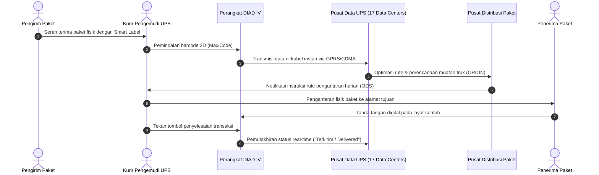

# Studi Kasus: Operasi Global UPS dengan DIAD IV

> 🔗 **Navigasi:** [[Dashboard]] | [[CONTEXT_INDEX]] | [[SOURCE_INVENTORY]] | [[Modul 1]] | [[Bab_1_Manajemen_Sistem_Informasi_dalam_Organisasi]] | [[Studi_Kasus_NBA_Akamai]]

Dokumen referensi studi kasus internasional ini diadaptasi dari buku teks babon *Essentials of Management Information Systems* karya Kenneth C. Laudon dan Jane P. Laudon (Chapter 1, Case 1: *UPS Global Operations with the DIAD IV*). Kasus ini menjadi contoh klasik dunia industri mengenai bagaimana investasi teknologi informasi mentransformasi perusahaan logistik fisik konvensional menjadi entitas bisnis digital (*digital firm*) berskala global.

---

## 📌 1. Profil Organisasi dan Ringkasan Eksekutif

- **Entitas Kasus:** United Parcel Service (UPS).
- **Skala Operasional:** Mengirimkan lebih dari 14 juta paket setiap hari ke lebih dari 200 negara dan teritori di seluruh dunia.
- **Tenaga Kerja Lapangan:** Didukung oleh lebih dari 70.000 pengemudi kurir yang terhubung secara nirkabel secara langsung ke 17 pusat data utama UPS di dunia.
- **Sejarah Transformasi:** Didirikan pada tahun 1907 sebagai layanan kurir pengantar pesan lokal, UPS bertransformasi melalui investasi teknologi informasi multi-miliar dolar sejak tahun 1990 untuk membangun platform teknologi pelacakan terpadu.

---

## 📱 2. Evolusi Perangkat DIAD (Delivery Information Acquisition Device)

Tulang punggung operasional lapangan UPS adalah perangkat genggam (*handheld computer*) bernama **DIAD** yang pertama kali diperkenalkan pada tahun 1991. Generasi keempat perangkat ini, yaitu **DIAD IV**, menghadirkan lompatan kemampuan signifikan:

### Spesifikasi Teknis DIAD IV
- **Sistem Operasi:** Windows CE .NET.
- **Prosesor:** Intel XScale berkecepatan 400 MHz.
- **Memori Internal:** 128 MB RAM (20 kali lipat kapasitas DIAD III).
- **Layar Tampilan:** Layar warna 2,8 inci x 2,1 inci dengan pengkodean warna pesan (*color-coded alerts*) untuk instruksi mendesak.
- **Konektivitas Nirkabel Multi-Jalur:**
  - Modem radio seluler bawaan (GPRS dan CDMA) untuk transmisi data jarak jauh dari jalan raya.
  - Konektivitas nirkabel Wi-Fi (802.11b) untuk sinkronisasi otomatis saat pengemudi tiba di kantor pusat distribusi (*Package Center*).
  - Bluetooth dan inframerah (IrDA) untuk berkomunikasi dengan pemindai cincin (*ring scanner*) dan printer portabel.
  - Modem akustik cadangan (*dial-up*) jika jaringan seluler terputus total.
- **Fitur Navigasi Satelit (GPS):** Dilengkapi modul GPS terintegrasi untuk memandu rute penjemputan dan pengantaran paket secara presisi.
- **Daya Tahan Baterai & Fisik:** Baterai Lithium-ion 3.200 mAh yang bertahan satu hari kerja penuh, dengan rancang bangun tahan banting (*rugged design*) terhadap benturan dan suhu ekstrem.

---

## 📦 3. Alur Pelacakan Paket End-to-End dengan Smart Labels

UPS mengintegrasikan pergerakan fisik barang dengan aliran data digital melalui label pintar (*Smart Labels*):

1. **Smart Labels:** Label paket memuat barcode dua dimensi (*MaxiCode*) yang berisi data lengkap alamat tujuan, jenis layanan, dan nomor resi pelacakan unik.
2. **On-Demand Services (ODS):** Setiap pagi, pengemudi masuk ke sistem ODS melalui DIAD untuk mengunduh daftar lokasi penjemputan terjadwal. Sepanjang hari, kantor pusat pengiriman dapat menambahkan titik jemput baru secara seketika (*on-the-fly*) berdasarkan posisi koordinat GPS armada terdekat.
3. **Eliminasi Formulir Kertas:** Penggunaan DIAD berhasil mengeliminasi lebih dari 59 juta lembar kertas formulir tanda terima fisik setiap tahunnya.

---

## 💡 4. Analisis Manajerial dan Relevansi bagi Praktikum MSI

Studi kasus UPS DIAD IV memberikan pelajaran berharga yang relevan dengan prinsip tata kelola sistem informasi:

| Konsep Kunci Kasus UPS | Relevansi Konseptual MSI | Aplikasi pada Kasus Perpustakaan FT UNY |
| :--- | :--- | :--- |
| **Integrasi Fisik dan Digital** | Data status digital di server harus mencerminkan posisi fisik barang di dunia nyata secara seketika (*real-time synchronization*). | Menghilangkan jeda waktu antara buku yang dikembalikan secara fisik di meja dengan pembaruan status eksemplar di SLiMS OPAC. |
| **Pemindaian Barcode Tunggal** | Transaksi diselesaikan melalui pemindaian satu kali (*single scan*) tanpa pengetikan ulang manual oleh kurir. | Memprioritaskan pemindaian barcode eksemplar buku langsung ke SLiMS, bukan mengetik ulang nomor barcode di lembar manual. |
| **Eliminasi Kertas Berulang** | Mengurangi beban kerja staf lapangan dengan memindahkan proses pencatatan ke instrumen digital terstruktur. | Mengganti buku catatan pengembalian manual dengan formulir digital terstruktur (**Formulir Google Form QR Code**). |
| **Keberlanjutan Layanan (*Resilience*)** | Perangkat DIAD memiliki multi-konektivitas nirkabel dan modem cadangan agar pengemudi tidak pernah terputus dari sistem. | Menyiapkan prosedur kontinjensi (*fallback procedure*) pencatatan fisik di **Rak Transit** saat jaringan lokal kampus mengalami gangguan (*offline mode*). |

---

## 📚 5. Referensi Dokumen

- Laudon, K. C., & Laudon, J. P. (2013). *Essentials of Management Information Systems* (10th ed.). Pearson Education. Chapter 1, Case 1: *UPS Global Operations with the DIAD IV*.
