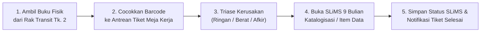
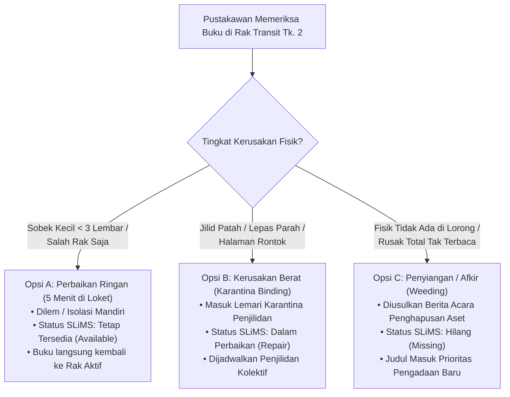
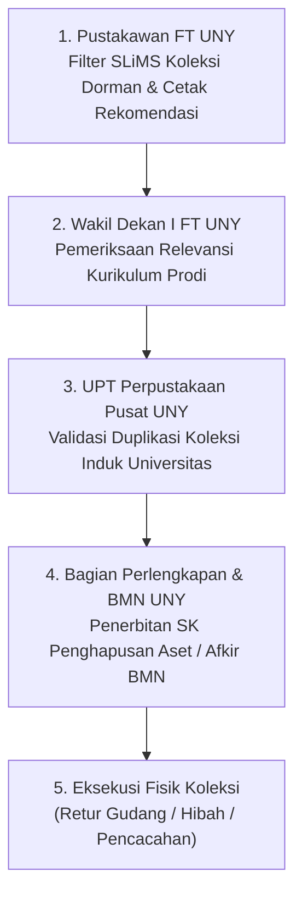

# BUKU PEDOMAN STANDAR OPERASIONAL PROSEDUR (SOP) FISIK & TATA KELOLA SIRKULASI
## SISTEM INFORMASI MANAJEMEN PENGELOLAAN KOLEKSI (SIMPEL-KOLEKSI)
### FAKULTAS TEKNIK — UNIVERSITAS NEGERI YOGYAKARTA

---

**Nomor Dokumen:** SOP/FT-UNY/PERPUS/2026/001  
**Revisi:** 01 (Edisi Standarisasi Tata Kelola)  
**Tanggal Berlaku:** 2 November 2026  
**Otoritas Penerbit:** Unit Pelaksana Teknis (UPT) Perpustakaan Fakultas Teknik UNY  
**Disahkan Oleh:** Wakil Dekan Bidang Akademik, Kemahasiswaan, dan Alumni FT UNY  
**Tim Penyusun:** Tim Standarisasi Tata Kelola Layanan Perpustakaan Fakultas Teknik UNY  

---

## LEMBAR PENGESAHAN DOKUMEN TATA KELOLA

Dokumen **Buku Pedoman Standar Operasional Prosedur (SOP) Fisik & Tata Kelola Sirkulasi Koleksi (SIMPEL-KOLEKSI FT UNY)** ini telah ditelaah secara substantif, divalidasi bersama pemangku kepentingan unit kerja, serta disahkan sebagai pedoman operasional baku pelayanan kepustakaan pada Fakultas Teknik Universitas Negeri Yogyakarta berpedoman pada Peraturan Menteri Pendayagunaan Aparatur Negara dan Reformasi Birokrasi Nomor 35 Tahun 2012.

| Peran Pengesahan | Nama Pejabat & NIP | Status Pengesahan |
| :--- | :--- | :--- |
| **Pustakawan Pengelola FT UNY** | **Abdul / Danar, S.I.Pst.**<br>NIP. 19920512 201903 1 045 | Diterima sebagai Standar Operasional Layanan<br>Tanggal: 30 Oktober 2026 |
| **Koordinator Tata Usaha FT UNY** | **Kepala Bagian Tata Usaha FT UNY**<br>NIP. 19780315 200501 1 003 | Diverifikasi untuk Kepatuhan Administrasi<br>Tanggal: 31 Oktober 2026 |
| **Menyetujui & Mengesahkan:**<br>**Wakil Dekan Bidang Akademik FT UNY** | **Prof. Dr. Eng. Ir. Wakil Dekan I, M.T.**<br>NIP. 19740812 200003 1 002 | Disahkan Menjadi Regulasi Resmi Fakultas<br>Tanggal: 2 November 2026 |

---

## KATA PENGANTAR

Puji syukur dipanjatkan ke hadirat Tuhan Yang Maha Esa atas diterbitkannya **Buku Pedoman Standar Operasional Prosedur (SOP) Fisik & Tata Kelola Sirkulasi SIMPEL-KOLEKSI FT UNY**. Dokumen pedoman ini disusun sebagai landasan normatif, administratif, dan operasional guna mengurai hambatan tata kelola pada pengelolaan kepustakaan Fakultas Teknik Universitas Negeri Yogyakarta.

Filosofi dasar yang melandasi buku pedoman ini berakar pada paradigma **Tata Kelola Sistem Terpadu (Integrated Information Governance)**. Permasalahan penumpukan koleksi rusak, keterlambatan perpanjangan masa pinjam, dan kekosongan data sirkulasi untuk Borang Akreditasi LAM-INFOKOM Kriteria 5 diselesaikan melalui penataan proses kerja dan perlindungan waktu layanan. Sistem otomasi *SLiMS 9 Bulian* yang sudah berjalan didukung oleh instrumen tata laksana yang jelas, alur penyangga fisik (*buffer zone*), dan penjadwalan terfokus (*Quiet Hour*).

Buku pedoman ini menetapkan standar operasional terintegrasi yang menjembatani interaksi pemustaka di meja baca, rak koleksi, meja sirkulasi, hingga pelaporan strategis kepada Dekanat Fakultas Teknik. Semoga buku pedoman ini menjadi rujukan baku peningkatan mutu pelayanan berkelanjutan (*continuous quality improvement*) di lingkungan Fakultas Teknik UNY.

Yogyakarta, 2 November 2026  
**Tim Standarisasi Layanan Perpustakaan FT UNY**

---

## DAFTAR ISI

1. **BAB I: PENDAHULUAN & PRINSIP TATA KELOLA**
   - 1.1 Latar Belakang Masalah Operasional Pustakawan Tunggal
   - 1.2 Maksud dan Tujuan Penerbitan SOP
   - 1.3 Ruang Lingkup Pemberlakuan
   - 1.4 Prinsip Dasar: *Pure Governance* & Penyelarasan Vertikal (*Vertical Alignment*)
2. **BAB II: STRUKTUR PERAN & MATRIKS AKUNTABILITAS (RACI)**
   - 2.1 Identifikasi Pemangku Kepentingan
   - 2.2 Matriks Akuntabilitas RACI (Operasional, Manajerial, Strategis)
3. **BAB III: STANDAR OPERASIONAL PROSEDUR 001 (SOP-001) — SESI JAM TENANG (QUIET HOUR)**
   - 3.1 Definisi & Jadwal Baku *Quiet Hour*
   - 3.2 Protokol Pengalihan Meja Layanan Sirkulasi
   - 3.3 Broadcast Pengumuman Live ke Portal Pemustaka
   - 3.4 Alur Kerja Verifikasi Fisik & Pemutakhiran Pangkalan Data SLiMS 9 Bulian
4. **BAB IV: STANDAR OPERASIONAL PROSEDUR 002 (SOP-002 / RACK-001) — TATA KELOLA FISIK BUFFER ZONE RAK TRANSIT**
   - 4.1 Spesifikasi Fisik & Zonasi Rak Transit (`RACK-001`)
   - 4.2 Tata Cara Peletakan Buku Tingkat 1 (Pengembalian Normal)
   - 4.3 Tata Cara Peletakan Buku Tingkat 2 (Koleksi Rusak & Salah Rak)
   - 4.4 Larangan & Pengamanan Fisik Eksemplar Koleksi
5. **BAB V: STANDAR OPERASIONAL PROSEDUR 003 (SOP-003 / FORM-001) — LAYANAN MANDIRI PEMUSTAKA VIA QR CODE**
   - 5.1 Distribusi Media Akses Fisik (Stiker QR Meja Baca & Rak)
   - 5.2 Prosedur Pelaporan Mandiri Kerusakan & Koleksi Salah Letak
   - 5.3 Prosedur Pengajuan Perpanjangan Masa Pinjam Tanpa Antre
   - 5.4 Prosedur Pengajuan Permintaan Referensi Baru & Tugas Akhir
   - 5.5 Standar Waktu Layanan / *Service Level Agreement* (SLA)
6. **BAB VI: STANDAR OPERASIONAL PROSEDUR 004 (SOP-004) — PROTOKOL TRIASE FISIK KOLEKSI BERMASALAH**
   - 6.1 Klasifikasi Kerusakan Koleksi Berdasarkan Bukti Lapangan
   - 6.2 Keputusan Triase Kategori A: Perbaikan Cepat 5 Menit di Meja Loket
   - 6.3 Keputusan Triase Kategori B: Karantina Penjilidan Ulang (*Binding*)
   - 6.4 Keputusan Triase Kategori C: Penyiangan Koleksi / Penghapusan Aset (*Weeding*)
7. **BAB VII: STANDAR OPERASIONAL PROSEDUR 005 (SOP-005) — DISPOSISI EKSEKUTIF & AKREDITASI LAM-INFOKOM**
   - 7.1 Ekstraksi Log Sirkulasi Berkala SLiMS 9 Bulian
   - 7.2 Prosedur Penerbitan Lembar Disposisi Ber-Kop Surat FT UNY
   - 7.3 Verifikasi Anggaran Belanja Prioritas Prodi oleh Wakil Dekan I
8. **BAB VIII: PENGAWASAN, AUDIT MUTU INTERNAL, & SANKSI KEPATUHAN**
   - 8.1 Evaluasi Kepatuhan Pustakawan & Pemustaka
   - 8.2 Mekanisme Penanganan Anomali / *Contingency Plan*
9. **BAB IX: STANDAR OPERASIONAL PROSEDUR 006 (SOP-006) — PENYIANGAN & KURASI KOLEKSI USANG (WEEDING & BMN DEACCESSIONING)**
   - 9.1 Kriteria Seleksi Teknis Koleksi Dorman & Kedaluwarsa
   - 9.2 Alur Koordinasi Penyiangan Koleksi Antar-Unit & Birokrasi BMN
   - 9.3 Format Berita Acara Rekomendasi Penyiangan Aset Pustaka
   - 9.4 Pilihan Tindak Lanjut Fisik Koleksi Hasil Penyiangan
10. **BAB X: STANDAR OPERASIONAL PROSEDUR 007 (SOP-007) — PEMINJAMAN BERSYARAT MASA TRANSISI SEMESTER (SIAKAD ROLLOVER GAP)**
    - 10.1 Penanganan Disinkronisasi Data Keanggotaan Awal Semester
    - 10.2 Prosedur Validasi Fisik KTM/KRS Aktif & Batas Pinjam Bersyarat
    - 10.3 Rekonsiliasi Status SLiMS Pasca Impor Database IT Pusat
11. **BAB XI: STANDAR OPERASIONAL PROSEDUR 008 (SOP-008) — KONTINGENSI MATI LISTRIK & PEMULIHAN SISTEM (OFFLINE BLACKOUT RECOVERY)**
    - 11.1 Format Baku Buku Log Darurat Sirkulasi Loket
    - 11.2 Batas Waktu Pemulihan (*Data Recovery SLA* Maksimal 120 Menit)
    - 11.3 Tata Cara Salin Cepat Batch Barcode ke SLiMS
12. **BAB XII: STANDAR OPERASIONAL PROSEDUR 009 (SOP-009) — SUPERVISI & KONTROL MUTU TENAGA BANTUAN MAGANG/PKL**
    - 12.1 Penyekatan Wewenang & Larangan Akses Akun Master SLiMS
    - 12.2 Prosedur Entri Draf SIMPEL-KOLEKSI & Validasi Tunggal Pustakawan
13. **BAB XIII: STANDAR OPERASIONAL PROSEDUR 010 (SOP-010) — PEMELIHARAAN SARANA FISIK DUDUKAN AKRILIK & STIKER QR CODE**
    - 13.1 Standar Material Dudukan Akrilik A6 & Stiker Vinil Tahan Gores
    - 13.2 Jadwal Audit Fisik Kelayakan & Pembersihan Berkala
14. **LAMPIRAN FORMULIR & ARTEFAK VISUAL**

---

# BAB I: PENDAHULUAN & PRINSIP TATA KELOLA

### 1.1 Latar Belakang Masalah Operasional Pustakawan Tunggal
Berdasarkan data observasi dan wawancara lapangan di Perpustakaan Fakultas Teknik UNY, rata-rata kunjungan pemustaka mencapai 52 mahasiswa per hari dengan kapasitas staf pengelola perpustakaan hanya **1 (satu) orang pustakawan fungsional** (didampingi 1 staf paruh waktu). Kondisi ini menciptakan fenomena *Single Point of Failure*, di mana seluruh transaksi fisik (sirkulasi, pengembalian, perbaikan buku rusak, pengecekan lorong rak, hingga penyusunan laporan akreditasi) bertumpu pada satu individu.

Permasalahan yang muncul di lapangan mencakup:
1. **Penumpukan Buku Rusak Fisik di Bawah Meja Loket:** Buku sobek atau jilidan lepas yang diserahkan mahasiswa tidak sempat ditindaklanjuti karena pustakawan terikat melayani antrean peminjaman.
2. **Koleksi Salah Rak (*Misplaced Books*):** Buku yang salah ditaruh oleh mahasiswa terselip di lorong prodi lain, mengakibatkan buku tertera *Tersedia (Available)* di katalog OPAC namun fisik raib di rak.
3. **Keterlambatan Input Perpanjangan:** Mahasiswa terpaksa datang mengetuk loket hanya untuk perpanjangan pinjam 7 hari, menimbulkan *cognitive fatigue* bagi pustakawan.
4. **Distorsi Data Borang Akreditasi LAM-INFOKOM Kriteria 5:** Ketiadaan pencatatan sirkulasi yang mutakhir menyebabkan angka pemanfaatan koleksi tampak rendah saat audit mutu.

### 1.2 Maksud dan Tujuan Penerbitan SOP
Buku Pedoman SOP ini disusun untuk:
1. Menghadirkan **prosedur kerja terstandar** yang memisahkan transaksi tatap muka dengan pekerjaan administrasi pengolahan koleksi secara terencana.
2. Mengurangi beban kerja mental (*cognitive load*) pustakawan melalui mekanisme layanan mandiri pemustaka (*self-service*) berbasis kode QR.
3. Menjamin keterlacakan fisik buku rusak melalui fasilitas fisik penampung sementara (**Rak Transit Tingkat 2**).
4. Menyediakan alur terpadu pengusulan buku referensi baru yang langsung bermuara pada persetujuan anggaran Wakil Dekan I FT UNY.

### 1.3 Ruang Lingkup Pemberlakuan
SOP ini mengikat seluruh pihak yang berinteraksi dalam ekosistem Perpustakaan FT UNY:
- **Pemustaka:** Mahasiswa Jenjang S1, D4/Vokasi, Dosen Fakultas Teknik, dan Tenaga Kependidikan.
- **Pustakawan Pengelola:** Seluruh pengelola meja sirkulasi perpustakaan tingkat fakultas.
- **Pimpinan Fakultas:** Wakil Dekan Bidang Akademik, Kemahasiswaan, dan Alumni (Wadek I) selaku pengambil keputusan anggaran.

### 1.4 Prinsip Dasar: *Pure Governance* & Penyelarasan Vertikal
SOP ini dibangun di atas doktrin **Pure Governance (Tata Kelola Murni)**:
> *"Penyelesaian persoalan sistem informasi perpustakaan tidak harus dilakukan dengan membangun perangkat lunak baru dari nol (software fetish). Solusi terbaik adalah menata proses bisnis manusia, aturan fisik, dan perlindungan jam kerja, dengan tetap mendudukkan pangkalan data SLiMS 9 Bulian sebagai Single Source of Truth."*

Prinsip **Penyelarasan Vertikal 3 Tingkat Organisasi**:
```
┌────────────────────────────────────────────────────────────────────────┐
│ TINGKAT STRATEGIS (DEKANAT / WAKIL DEKAN I)                            │
│ Kebijakan Pagu Anggaran, Validasi Borang LAM-INFOKOM Kriteria 5        │
└───────────────────────────────────┬────────────────────────────────────┘
                                    │ Lembar Disposisi Resmi Ber-Kop FT
┌───────────────────────────────────▼────────────────────────────────────┐
│ TINGKAT MANAJERIAL (PUSTAKAWAN PENGELOLA)                              │
│ Quiet Hour (60 Menit), Batch SLiMS, Triase Fisik 3 Opsi                │
└───────────────────────────────────┬────────────────────────────────────┘
                                    │ Tiket Laporan & Fisik Rak Transit
┌───────────────────────────────────▼────────────────────────────────────┐
│ TINGKAT OPERASIONAL (PEMUSTAKA / MAHASISWA & DOSEN)                    │
│ Scan Stiker QR Meja/Rak, Lapor Mandiri, Buffer Zone Rak Transit        │
└────────────────────────────────────────────────────────────────────────┘
```

---

# BAB II: STRUKTUR PERAN & MATRIKS AKUNTABILITAS (RACI)

Untuk mencegah tumpang tindih tanggung jawab dalam organisasi perpustakaan berkaryawan tunggal, seluruh aktivitas tata kelola diatur menggunakan matriks **RACI (*Responsible, Accountable, Consulted, Informed*)**:

| Kode Aktivitas | Uraian Aktivitas Tata Kelola | Mahasiswa (Pemustaka) | Pustakawan Sirkulasi | Kepala Perpus FT | Wadek I FT UNY |
| :--- | :--- | :---: | :---: | :---: | :---: |
| **ACT-01** | Pelaporan kerusakan koleksi via Stiker QR di meja baca | **R** | **A** | I | I |
| **ACT-02** | Peletakan fisik buku di Rak Transit Tingkat 2 | **R** | **A** | I - | - |
| **ACT-03** | Pelaksanaan jam tenang (*Quiet Hour*) 60 menit per minggu | I | **A / R** | C | I |
| **ACT-04** | Triase fisik buku rusak (5 menit di loket vs karantina binding) | - | **A / R** | C | - |
| **ACT-05** | Eksekusi massal perpanjangan sirkulasi pada SLiMS 9 Bulian | I | **A / R** | I | - |
| **ACT-06** | Penyusunan rekap usulan buku & cetak Lembar Disposisi Kop FT | I | **R** | C | **A** |
| **ACT-07** | Pengesahan disposisi pagu anggaran pengadaan referensi baru | - | C | I | **A / R** |
| **ACT-08** | Ekstraksi log sirkulasi untuk Borang Akreditasi LAM-INFOKOM | - | **R** | **A** | I |

*Keterangan Singkatan:*  
- **R (Responsible):** Pihak yang melaksanakan tugas operasional secara langsung.  
- **A (Accountable):** Pihak penanggung jawab tunggal mutlak atas keberhasilan aktivitas.  
- **C (Consulted):** Pihak yang dimintai masukan atau telaah dua arah.  
- **I (Informed):** Pihak yang menerima laporan satu arah atas hasil keputusan.  

---

# BAB III: STANDAR OPERASIONAL PROSEDUR 001 (SOP-001)
## PENGELOLAAN SESI JAM TENANG (QUIET HOUR) & PEMUTAKHIRAN DATA TERFOKUS

### 3.1 Definisi & Jadwal Baku Quiet Hour
**Quiet Hour (Jam Tenang Operasional)** adalah alokasi waktu resmi berdurasi **60 (enam puluh) menit per minggu** di mana loket layanan sirkulasi tatap muka dihentikan sementara, guna memberikan waktu tanpa interupsi bagi pustakawan untuk memeriksa fisik buku di Rak Transit dan memutakhirkan data pangkalan data katalog SLiMS 9 Bulian.

- **Jadwal Baku Resmi:** Setiap hari **Jumat, pukul 08.00 – 09.00 WIB** (waktu dengan frekuensi kunjungan terendah berdasarkan audit log sirkulasi mingguan).
- **Sesi Ekstra (Kondisional):** Jika antrean buku rusak pada sistem meja kerja mencapai status *SLA Kritis (>3 Hari)* sebanyak $\ge 5$ eksemplar, pustakawan berhak mengaktifkan sesi Quiet Hour insidental selama 30 menit pada pukul 13.00 – 13.30 WIB dengan persetujuan Kepala Perpustakaan.

### 3.2 Protokol Pengalihan Meja Layanan Sirkulasi
1. Pustakawan menempatkan papan akrilik fisik di atas meja loket bertuliskan:  
   `"LOKET TATAP MUKA DIALIHKAN KE LAYANAN MANDIRI (SESI QUIET HOUR: PENGOLAHAN KOLEKSI FISIK & DATA SLiMS). SILAKAN SCAN QR ATAU LETAKKAN BUKU DI RAK TRANSIT."`
2. Pintu akses sirkulasi tidak dikunci; pemustaka tetap diizinkan membaca di ruang baca dengan tenang.

### 3.3 Broadcast Pengumuman Live ke Portal Pemustaka
1. Pustakawan membuka antarmuka Meja Kerja Pustakawan (`index.html`) $\rightarrow$ klik tombol **`[Quiet Hour (60m) + Broadcast ke QR]`**.
2. Sistem secara otomatis mencatat `quietHourActive: true` pada penyimpanan sinkronisasi.
3. Layar ponsel seluruh mahasiswa yang mengakses layanan mandiri (`layanan.html`) seketika memunculkan **Banner Peringatan Oranye-Kuning Berdenyut** yang berbunyi:  
   `"PENGUMUMAN LOKET SIRKULASI: Sesi Quiet Hour Sedang Berlangsung. Layanan tatap muka dihentikan sementara. Silakan isi form QR dan letakkan fisik buku pada Rak Transit Tingkat 2."`

### 3.4 Alur Kerja Verifikasi Fisik & Pemutakhiran SLiMS
Pustakawan menjalankan 4 tahapan verifikasi berurutan selama 60 menit:


---

# BAB IV: STANDAR OPERASIONAL PROSEDUR 002 (SOP-002 / RACK-001)
## TATA KELOLA FISIK BUFFER ZONE RAK TRANSIT

### 4.1 Spesifikasi Fisik & Zonasi Rak Transit (`RACK-001`)
Fasilitas **Rak Transit (RACK-001)** ditempatkan pada posisi strategis di samping kanan meja sirkulasi utama perpustakaan, berjarak maksimal 1,5 meter dari jangkauan pustakawan, dengan konstruksi besi bertingkat dua yang diberi label akrilik berwarna kontras:

```
┌────────────────────────────────────────────────────────────────────────┐
│  RAK TRANSIT BUFFER ZONE KOLEKSI PERPUSTAKAAN FT UNY (RACK-001)        │
├────────────────────────────────────────────────────────────────────────┤
│  [TINGKAT 2]  ZONA MERAH: PEMERIKSAAN KERUSAKAN & SALAH RAK (QR)       │
│  • Khusus buku halaman sobek, punggung jilid lepas, atau salah lorong  │
│  • Mahasiswa wajib lapor via formulir QR sebelum menaruh di sini       │
│  • Diaudit oleh pustakawan saat sesi Quiet Hour                        │
├────────────────────────────────────────────────────────────────────────┤
│  [TINGKAT 1]  ZONA HIJAU: PENGEMBALIAN BACA NORMAL DI TEMPAT           │
│  • Untuk buku utuh tanpa cacat yang selesai dibaca di ruang baca       │
│  • Tidak memerlukan pelaporan tiket QR                                 │
│  • Siap dilakukan *shelving* rutin kembali ke lorong rak DDC           │
└────────────────────────────────────────────────────────────────────────┘
```

### 4.2 Tata Cara Peletakan Buku Tingkat 1 (Pengembalian Normal)
1. Pemustaka yang selesai membaca buku di ruang baca dan tidak bermaksud meminjam pulang, dilarang mengembalikan buku secara mandiri ke lorong rak utama guna menghindari salah letak (*misplacement*).
2. Pemustaka meletakkan buku secara horizontal atau vertikal rapi di **Tingkat 1 (Zona Hijau)**.
3. Setiap sore pk 15.30 WIB, staf perpustakaan menyisir Tingkat 1 dan mengembalikan buku ke lorong DDC yang tepat.

### 4.3 Tata Cara Peletakan Buku Tingkat 2 (Kerusakan & Salah Rak)
1. Buku yang dijumpai memiliki cacat fisik (robek, coretan tinta parah, sampul lepas, basah) atau ditemukan tersasar di prodi lain **wajib diletakkan di Tingkat 2 (Zona Merah)**.
2. Pemustaka wajib memindai Stiker QR di dekat rak atau meja baca sebelum meletakkan buku, untuk menerbitkan ID Tiket Resmi (contoh: `TKT-202610-001`).
3. Dilarang keras menaruh buku yang belum dilaporkan via QR di Tingkat 2 lebih dari 2 eksemplar tanpa catatan.

### 4.4 Pengamanan Fisik Koleksi
- Buku yang berada di Tingkat 2 berstatus **"Dalam Pengawasan Karantina Ringan"**.
- Mahasiswa lain dilarang meminjam atau mengambil buku dari Tingkat 2 sebelum pustakawan menyelesaikan verifikasi triase.

---

# BAB V: STANDAR OPERASIONAL PROSEDUR 003 (SOP-003 / FORM-001)
## LAYANAN MANDIRI PEMUSTAKA BERBASIS AKSES STIKER QR CODE

### 5.1 Distribusi Media Akses Fisik (Stiker QR)
Media akses cepat stiker QR vinil tahan gores (*scratch-resistant laminate*) ditempatkan pada titik-titik krusial:
1. **Di Meja Baca:** 1 stiker akrilik berdiri per meja baca komunal (total 12 unit).
2. **Di Ujung Lorong Rak:** 1 stiker pada setiap ujung rak prodi (PTI, TI, PTE, PTM, PTSP).
3. **Di Samping Rak Transit (`RACK-001`):** 1 poster stiker instruksi berukuran A4.

Setiap stiker memuat QR Code statis yang mengarah ke URL tunggal: `layanan.html`.

### 5.2 Prosedur Pelaporan Mandiri Kerusakan & Salah Rak
1. Pemustaka membuka kamera ponsel dan memindai stiker QR.
2. Pada layar utama, pemustaka memilih kartu **`[Lapor Buku Bermasalah]`**.
3. Pemustaka mengisikan formulir identitas:
   - *Nama Lengkap Pelapor* (Wajib)
   - *NIM Pelapor* (Wajib)
   - *Nomor Barcode / ID Eksemplar Buku* (Wajib, tertera di sampul belakang)
   - *Judul Koleksi* (Wajib)
   - *Kategori Masalah:* Halaman Sobek, Jilidan Lepas, Salah Rak, atau Tidak Ditemukan.
   - *Catatan Tambahan Lokasi* (Opsional).
4. **Validasi Sorotan Galat Spesifik (*Inline Error Focus*):** Jika terdapat kolom wajib yang belum terisi, sistem secara otomatis memberi sorotan garis merah tebal dan memfokuskan kursor ke kolom tersebut **tanpa menghapus data yang telah diketik sebelumnya**.
5. Pemustaka menekan tombol **`[Kirim Laporan & Terbitkan Tiket Konfirmasi]`**.
6. Sistem menerbitkan **Slip Tiket Digital** yang mencantumkan:
   - Nomor Tiket Unik (Format: `TKT-YYYYMM-XXX`)
   - Estimasi Waktu Penanganan / SLA: *Diverifikasi saat sesi Quiet Hour Jumat (Maks. 3 Hari Kerja)*.
   - Instruksi fisik: Segera serahkan buku ke **Rak Transit Tingkat 2**.

### 5.3 Prosedur Pengajuan Perpanjangan Masa Pinjam Tanpa Antre
1. Pemustaka membuka portal QR $\rightarrow$ pilih kartu **`[Pilih Layanan & Request]`** $\rightarrow$ buka tab **`Perpanjangan Masa Pinjam Buku`**.
2. Pemustaka mengisi: *Nama*, *NIM/ID Anggota*, *Nomor Barcode Buku*, *Judul Buku*, dan *Nomor WhatsApp Aktif*.
3. **Aturan Bisnis Perpanjangan:**
   - Masa pinjam diperpanjang **+7 hari kerja**.
   - Buku **tidak perlu dibawa ke perpustakaan**.
   - Maksimal perpanjangan mandiri adalah 1 (satu) kali per eksemplar. Jika ingin memperpanjang kedua kalinya, buku wajib dibawa ke loket untuk pemeriksaan fisik.
4. Pemustaka menekan **`[Ajukan Perpanjangan Pinjam SLiMS]`**. Tiket terbit dengan kode `EXT-YYYYMM-XXX` dengan SLA maksimal 1x24 jam kerja.

### 5.4 Prosedur Pengajuan Permintaan Referensi Baru & Pengadaan Partisipatif
1. **Pengusulan Mandiri Terbuka Sepanjang Tahun (24/7):** Untuk memutus hambatan komunikasi linier di mana pustakawan menunggu prodi dan pengadaan menjadi terhambat, mekanisme pengusulan buku dibuka secara partisipatif sepanjang tahun tanpa menunggu surat edaran dinas. Dosen pembimbing, mahasiswa skripsi, dan peneliti dapat mengusulkan literatur kapan saja melalui portal SIMPEL-KOLEKSI (`layanan.html`).
2. Pemustaka membuka tab **`Request Referensi & Usulan Buku Baru`**.
3. Pemustaka mengisi: *Nama Pengusul*, *NIM/NIP*, *Status (Mahasiswa S1/D4/Dosen)*, *Program Studi*, *Judul Buku / Topik Riset*, *Keperluan (Tugas Akhir / Perkuliahan / Riset Laboratorium)*, dan *Nomor WhatsApp*.
4. **Verifikasi Duplikasi Katalog Terpusat:** Sebelum data diajukan ke pimpinan, pustakawan mencocokkan judul usulan pada pangkalan data induk SLiMS universitas guna mencegah pembelian eksemplar ganda yang sebenarnya sudah tersedia di fakultas lain.
5. **Penetapan Skala Prioritas Pengadaan:** Pustakawan mengelompokkan usulan berdasarkan 3 tingkat urgensi:
   - **Prioritas 1 (Tinggi / Urgen):** Literatur rujukan wajib Skripsi/Tugas Akhir mahasiswa tingkat akhir dan pemenuhan buku teks inti Borang Akreditasi LAM-INFOKOM program studi.
   - **Prioritas 2 (Sedang):** Buku teks pengayaan materi perkuliahan teori mingguan.
   - **Prioritas 3 (Rendah):** Bahan bacaan literasi umum, minat bakat, dan buku populer.
6. Laporan tercatat dengan ID `REQ-YYYYMM-XXX` dan secara otomatis dikompilasi ke draf **Lembar Disposisi Anggaran Dekanat Ber-Kop Surat FT UNY** pada setiap siklus rapat anggaran fakultas.

### 5.5 Standar Waktu Layanan (Service Level Agreement / SLA)

| Jenis Layanan Mandiri | Target SLA Penyelesaian | Indikator Status di Sistem | Tindak Lanjut Bila Lewat SLA |
| :--- | :---: | :--- | :--- |
| **Lapor Buku Rusak Fisik** | $\le 3$ Hari Kerja | Hijau $\rightarrow$ Kuning $\rightarrow$ Merah | Wajib verifikasi pada sesi Quiet Hour darurat |
| **Perpanjangan Pinjam SLiMS** | $\le 24$ Jam Kerja | Menunggu Eksekusi $\rightarrow$ Diperpanjang | Pustakawan ditegur saat evaluasi mingguan |
| **Request Buku Referensi Baru** | $\le 1$ Semester (Pagu RKAF) | Menunggu Telaah $\rightarrow$ Masuk Disposisi | Dimasukkan ke rekapitulasi rapat pagu Wadek I |

---

# BAB VI: STANDAR OPERASIONAL PROSEDUR 004 (SOP-004)
## PROTOKOL TRIASE FISIK KOLEKSI BERMASALAH

Pada saat pelaksanaan Quiet Hour, pustakawan dilarang memperlakukan seluruh buku rusak secara seragam. Pustakawan wajib melakukan triase fisik ke dalam **3 (tiga) kategori penanganan SOP**:



### 6.1 Rincian Keputusan Triase

#### Opsi A: Perbaikan Ringan di Meja Loket (Selesai 5 Menit)
- **Kriteria Fisik:** Halaman sobek tepi kurang dari 3 lembar, lembar sampul luar terlipat, atau murni salah lorong rak DDC.
- **Tindakan Fisik:** Diberi selotip mika perpustakaan atau lem kertas di meja sirkulasi.
- **Tindakan SLiMS:** Status eksemplar **tetap `Tersedia (Available)`**.
- **Disposisi Fisik:** Buku langsung dikembalikan ke rak lorong koleksi aktif hari itu juga.

#### Opsi B: Kerusakan Berat / Karantina Penjilidan (*Binding*)
- **Kriteria Fisik:** Blok jahitan punggung buku terlepas, jilidan keras (*hardcover*) patah, atau lembar isi rontok $>10$ halaman.
- **Tindakan Fisik:** Buku dipindahkan dari Rak Transit Tingkat 2 ke **Lemari Karantina Penjilidan**.
- **Tindakan SLiMS:** Status eksemplar diubah pada menu Bibliografi/Item SLiMS menjadi **`Dalam Perbaikan (Repair)`**.
- **Efek di OPAC:** Pemustaka lain yang mencari buku tersebut akan membaca keterangan *"Buku sedang dalam proses perbaikan fisik oleh pustakawan"*, sehingga tidak menimbulkan pencarian sia-sia di lorong rak.

#### Opsi C: Fisik Raib / Penyiangan Aset (*Weeding*)
- **Kriteria Fisik:** Fisik buku tidak ditemukan setelah penyisiran 3 kali lorong rak, atau kondisi buku terkena jamur/air parah sehingga tidak layak pakai.
- **Tindakan SLiMS:** Status eksemplar diubah menjadi **`Hilang (Missing)`**.
- **Tindakan Lanjutan:** Dimasukkan ke dalam Berita Acara Penyiangan Koleksi dan otomatis diusulkan pengadaannya pada Lembar Disposisi Dekanat.

### 6.2 Prosedur Pencatatan Riwayat Kondisi Buku & Mitigasi Kerusakan Berulang
Untuk menghindari praktik perbaikan fisik yang bersifat tambal-sulam sementara tanpa evaluasi ketahanan jangka panjang, tata kerja pencatatan riwayat diatur sebagai berikut:
1. **Pencatatan Riwayat Kondisi (*Condition History Log*):** Setiap tindakan triase dicatat pada pangkalan data riwayat buku dengan merekam: *Tanggal Verifikasi*, *Barcode Koleksi*, *Jenis Kerusakan*, *ID Pustakawan Pemeriksa*, dan *Opsi Tindakan*.
2. **Aturan Mitigasi Kerusakan Berulang (*Recurrent Damage Rule*):** Apabila suatu eksemplar buku tercatat mengalami kerusakan berulang $\ge 2$ kali dalam kurun waktu 1 (satu) tahun ajaran berjalan, pustakawan **dilarang melakukan Opsi A (Perbaikan Ringan di Loket)**.
3. Eksemplar tersebut wajib langsung dialihkan ke **Opsi B (Karantina Penjilidan Ulang Total / Re-binding)** atau diputuskan masuk **Opsi C (Diusulkan Penggantian Eksemplar Baru)** pada Lembar Disposisi Anggaran Dekanat FT UNY.

---

# BAB VII: STANDAR OPERASIONAL PROSEDUR 005 (SOP-005)
## PENYELARASAN MANAJERIAL KE STRATEGIS: DISPOSISI EKSEKUTIF & AKREDITASI

### 7.1 Ekstraksi Log Sirkulasi Berkala SLiMS 9 Bulian
Setiap akhir bulan, pustakawan menjalankan fitur pelaporan sirkulasi SLiMS 9 Bulian:
1. Pustakawan mengekspor log peminjaman per Program Studi ke format `.CSV`.
2. Data diolah menggunakan template matriks akreditasi (`TMP-001`) untuk menghitung:
   $$\text{Rasio Keterpakaian Koleksi} = \frac{\text{Jumlah Transaksi Pinjam Buku Prodi}}{\text{Total Sivitas Akademika Aktif Prodi}} \times 100\%$$
3. Angka ini dimasukkan ke dalam pangkalan data **Borang Akreditasi LAM-INFOKOM Kriteria 5**.

### 7.2 Prosedur Penerbitan Lembar Disposisi Ber-Kop Surat FT UNY
Wakil Dekan Bidang Akademik menolak lembar pengajuan anggaran pengadaan buku yang hanya berbentuk berkas spreadsheet mentah. Oleh karena itu, prosedur penerbitan surat dinas resmi diatur sebagai berikut:

```
┌────────────────────────────────────────────────────────────────────────┐
│ KEMENTERIAN PENDIDIKAN TINGGI, SAINS, DAN TEKNOLOGI                   │
│ UNIVERSITAS NEGERI YOGYAKARTA — FAKULTAS TEKNIK                        │
│ UNIT PELAKSANA TEKNIS PERPUSTAKAAN FAKULTAS TEKNIK                     │
│ Kampus Karangmalang, Yogyakarta 55281 | Telp. (0274) 586168            │
├────────────────────────────────────────────────────────────────────────┤
│ LEMBAR DISPOSISI & USULAN PENGADAAN BUKU REFERENSI BARU                │
│ Nomor Dokumen: 042/UN34.15/PERPUS-FT/X/2026                            │
│ Dasar Usulan : Pemenuhan Borang Akreditasi LAM-INFOKOM Kriteria 5      │
├────────────────────────────────────────────────────────────────────────┤
│ Yth. Wakil Dekan Bidang Akademik FT UNY,                               │
│ Berdasarkan usulan sivitas akademika dan evaluasi rasio pemanfaatan    │
│ SLiMS (Prodi PTI mencapai 94,1%), kami ajukan pengadaan prioritas:     │
│                                                                        │
│ [TABEL REKAPITULASI BUKU, PRODI, KEPERLUAN, ESTIMASI ANGGARAN]         │
│ Total Estimasi Pagu Anggaran Pengadaan: Rp 3.450.000 (Contoh)          │
├────────────────────────────────────────────────────────────────────────┤
│ Menyetujui Disposisi Anggaran:          Yogyakarta, 2 November 2026    │
│ Wakil Dekan Bidang Akademik FT UNY      Diajukan: Pustakawan Pengelola │
│                                                                        │
│ ( Prof. Dr. Eng. Ir. Wadek I, M.T. )    ( Abdul / Danar, S.I.Pst. )    │
│ NIP. 19740812 200003 1 002              NIP. 19920512 201903 1 045     │
└────────────────────────────────────────────────────────────────────────┘
```

1. Pustakawan membuka antarmuka Meja Kerja $\rightarrow$ tab **Request Referensi** $\rightarrow$ klik **`[Cetak Lembar Disposisi Ber-Kop FT UNY]`**.
2. Sistem menyusun tabel daftar judul buku yang berstatus `IN_PROCUREMENT` (Usulan Prioritas) beserta estimasi harga rata-rata 3 eksemplar per judul.
3. Pustakawan mencetak dokumen (`window.print()`) dalam format kertas A4 standar yang bebas dari notifikasi alert, elemen navigasi, atau tombol website.
4. Dokumen fisik dibawa ke ruang pimpinan dekanat untuk penandatanganan dan pengesahan pagu RKAF Tahun Anggaran berikutnya.

---

# BAB VIII: PENGAWASAN, AUDIT MUTU INTERNAL, & SANKSI KEPATUHAN

### 8.1 Evaluasi Kepatuhan
1. **Audit Kepatuhan Pustakawan:** Kepala Perpustakaan FT UNY melakukan audit mingguan setiap hari Senin pagi untuk memastikan:
   - Tidak ada tiket buku rusak di Rak Transit Tingkat 2 yang berlabel *Merah (Lewat SLA >3 Hari)*.
   - Tidak ada permohonan perpanjangan pinjam mandiri yang terbengkalai $>24$ jam.
2. **Audit Kepatuhan Pemustaka:** Mahasiswa yang terbukti sengaja menyembunyikan buku rusak di dalam laci meja baca tanpa melapor via QR dikenai peringatan lisan dan pembekuan hak pinjam selama 14 hari kerja.

### 8.2 Rencana Kontinjensi (*Contingency Plan*)
1. **Bila Koneksi Internet Kampus Putus:** Mahasiswa menuliskan nomor barcode dan NIM pada slip kertas formulir darurat manual berukuran saku yang tersedia di saku samping Rak Transit `RACK-001`.
2. **Bila Pustakawan Cuti / Berhalangan Hadir:** Staf pembantu sirkulasi bertugas menempelkan pengumuman perpanjangan otomatis masa pinjam buku selama pustakawan tidak berada di tempat guna mencegah denda sistemik pada SLiMS.

---

# BAB IX: STANDAR OPERASIONAL PROSEDUR 006 (SOP-006)
## PENYIANGAN & KURASI KOLEKSI USANG (WEEDING & BMN DEACCESSIONING)

### 9.1 Kriteria Seleksi Teknis Koleksi Dorman & Kedaluwarsa
Untuk mencegah penumpukan 2.349 koleksi textbook yang tidak lagi relevan dengan kurikulum teknik terkini, pustakawan dilarang menyiangi buku secara subjektif. Pustakawan wajib berpegang pada 3 kriteria kuantitatif:
1. **Usia Terbitan Koleksi:** Buku teks bidang ilmu teknik/komputer yang telah berusia $\ge 10$ tahun sejak tahun cetak pertama.
2. **Frekuensi Sirkulasi Nol (*Dormant State*):** Eksemplar buku tidak pernah tercatat dipinjam sama sekali ($\text{Frekuensi} = 0$) dalam kurun waktu minimal 4 (empat) semester berturut-turut pada pangkalan data SLiMS.
3. **Kondisi Keilmuan Usang (*Obsolescence*):** Memuat standar teknis, bahasa pemrograman, atau regulasi industri yang sudah dicabut/dinyatakan tidak berlaku oleh lembaga standar nasional/internasional (misal: kurikulum kuras, standar ISO lama).

### 9.2 Alur Koordinasi Penyiangan Koleksi & Birokrasi BMN
Mengingat seluruh buku perpustakaan berstatus Barang Milik Negara (BMN), pustakawan tingkat fakultas dilarang keras membuang, merusak, atau menghibahkan buku secara sepihak. Alur birokrasi wajib mengikuti rantai komando berikut:



### 9.3 Format Berita Acara Rekomendasi Penyiangan Aset Pustaka
Pustakawan wajib melampirkan berkas Berita Acara Resmi ber-Kop Surat Fakultas Teknik dengan memuat rincian:
- Nomor Inventaris / Barcode SLiMS
- Judul Buku, Pengarang, dan Tahun Terbit
- Tanggal Terakhir Dipinjam
- Rekomendasi Tindak Lanjut: `Retur Gudang Simpan`, `Hibah ke Sekolah Binaan FT`, atau `Pemusnahan/Afkir Fisik`.

### 9.4 Pilihan Tindak Lanjut Fisik Koleksi Hasil Penyiangan
1. **Retur ke Gudang Arsip Cadangan (Deposit Storage):** Disimpan untuk kebutuhan pelacakan histori keilmuan atau akreditasi masa lampau (maksimal 1 eksemplar master).
2. **Hibah Komunitas / Sekolah Kejuruan Binaan:** Buku teknik terapan yang masih memiliki nilai dasar dapat dihibahkan resmi melalui persetujuan Dekanat kepada SMK binaan FT UNY.
3. **Pencacahan Berita Acara (Pemusnahan Terbuka):** Buku rusak total dan tidak terbaca dimusnahkan secara fisik dengan disaksikan petugas BMN universitas.

### 9.5 Siklus Penggantian Koleksi Usang (*Collection Replacement Lifecycle Loop*)
Penyiangan koleksi tidak boleh menciptakan kekosongan referensi kurikulum. Oleh karena itu, SOP menegaskan siklus penggantian wajib:
1. **Penerbitan Daftar Judul Pengganti (*Replacement Recommendation List*):** Setiap judul buku yang disahkan untuk diafkir secara otomatis dicatat ke dalam pangkalan data usulan pengadaan sebagai rekomendasi penggantian dengan buku bertopik setara edisi terbaru.
2. **Koordinasi Kebutuhan Kurikulum Prodi:** Pustakawan mengirimkan daftar judul yang diafkir kepada Koordinator Program Studi terkait untuk mendapatkan rekomendasi judul literatur mutakhir (terbitan $\le 5$ tahun terakhir) guna menjaga rasio kecukupan pustaka pada Borang Akreditasi LAM-INFOKOM Kriteria 5.
3. Daftar judul pengganti ini langsung diintegrasikan ke draf **Lembar Disposisi Anggaran Dekanat FT UNY** pada pengajuan anggaran semester berikutnya.

---

# BAB X: STANDAR OPERASIONAL PROSEDUR 007 (SOP-007)
## PROTOKOL PEMINJAMAN BERSYARAT MASA TRANSISI SEMESTER (SIAKAD ROLLOVER GAP)

### 10.1 Penanganan Disinkronisasi Data Keanggotaan Awal Semester
Pada masa libur semester dan minggu awal perkuliahan baru, sering terjadi keterlambatan sinkronisasi data mahasiswa aktif dari SIAKAD ke SLiMS oleh tim IT Pusat. Akibatnya, mahasiswa yang sudah membayar UKT/registrasi ulang terblokir dengan keterangan *Status Tidak Aktif*. Pustakawan dilarang menolak mahasiswa yang membutuhkan referensi perkuliahan.

### 10.2 Prosedur Validasi Fisik & Batas Pinjam Bersyarat (*Provisional Lending*)
1. Mahasiswa menunjukkan bukti KRS Aktif yang telah disetujui Dosen Pembimbing Akademik (DPA) melalui gawai atau Kartu Tanda Mahasiswa (KTM) fisik.
2. Pustakawan mencatat transaksi pada fitur **Antrean Transisi Sementara SIMPEL-KOLEKSI** (bukan langsung menolak di meja sirkulasi).
3. **Ketentuan Kuota Transisi:** Mahasiswa hanya diizinkan meminjam maksimal **1 (satu) eksemplar** dengan durasi peminjaman terbatas **3 (tiga) hari kerja**.

### 10.3 Rekonsiliasi Status SLiMS Pasca Impor Database IT Pusat
Setelah tim IT Pusat selesai mengimpor data SIAKAD ke database SLiMS, pustakawan memindahkan seluruh antrean transisi ke status peminjaman normal 7 hari tanpa mengenakan denda penalti masa tunggu.

---

# BAB XI: STANDAR OPERASIONAL PROSEDUR 008 (SOP-008)
## KONTINGENSI MATI LISTRIK & PEMULIHAN SISTEM (OFFLINE BLACKOUT RECOVERY)

### 11.1 Format Baku Buku Log Darurat Sirkulasi Loket
Apabila pasokan listrik padam atau jaringan kampus mengalami *downtime*, layanan sirkulasi tidak boleh dihentikan total. Pustakawan wajib membuka **Buku Log Cadangan Fisik Sampul Merah** yang diletakkan di samping komputer loket, dengan format kolom baku:
- Tanggal & Jam Transaksi
- Nomor Barcode Buku (Wajib disalin dari stiker barcode fisik)
- NIM & Nama Lengkap Peminjam
- Nomor HP / WhatsApp Aktif
- Paraf Peminjam & Paraf Petugas Loket

### 11.2 Batas Waktu Pemulihan (*Data Recovery SLA* Maksimal 120 Menit)
Pustakawan wajib menegakkan disiplin pemulihan: **Maksimal 120 menit (2 jam) setelah listrik atau jaringan internet kembali normal**, pustakawan wajib menyalin seluruh data dari Buku Log Cadangan Fisik ke sistem SLiMS. Pustakawan dilarang pulang sebelum data offline terekonsiliasi penuh.

### 11.3 Tata Cara Salin Cepat Batch Barcode ke SLiMS
Untuk menghemat waktu, pustakawan mengetikkan barcode ke fitur masukan kilat SIMPEL-KOLEKSI, lalu menekan tombol **Salin Format Batch SLiMS** untuk di-paste langsung ke fitur Sirkulasi Cepat SLiMS 9 Bulian dalam sekali eksekusi.

---

# BAB XII: STANDAR OPERASIONAL PROSEDUR 009 (SOP-009)
## SUPERVISI & KONTROL MUTU TENAGA BANTUAN MAGANG / PKL (INTERN QC GATE)

### 12.1 Penyekatan Wewenang & Larangan Akses Akun Master SLiMS
Guna mencegah kerusakan integritas pangkalan data katalog akibat kelalaian atau *human error*, mahasiswa magang / PKL:
1. **Dilarang keras** memiliki atau menggunakan akun login administrator SLiMS tingkat pengubah data master katalog.
2. **Dilarang keras** melakukan penghapusan eksemplar atau mengubah nomor panggil (*call number*) secara mandiri.

### 12.2 Prosedur Entri Draf SIMPEL-KOLEKSI & Validasi Tunggal Pustakawan
1. Tenaga magang bertugas membantu penyisiran fisik rak, mencatat buku yang terlipat, atau mengumpulkan buku dari Rak Transit.
2. Tenaga magang menginput temuan ke dalam portal antrean SIMPEL-KOLEKSI yang berstatus **`DRAFT_INTERN`**.
3. Pustakawan utama melakukan verifikasi silang fisik buku dengan data layar, lalu menekan tombol persetujuan disposisi resmi ke SLiMS. Tanggung jawab hukum dan akurasi data tetap berada di tangan pustakawan pengelola fungsional.

---

# BAB XIII: STANDAR OPERASIONAL PROSEDUR 010 (SOP-010)
## PEMELIHARAAN SARANA FISIK DUDUKAN AKRILIK & STIKER QR CODE

### 13.1 Standar Material Sarana Fisik QR Code
Untuk memastikan durabilitas terhadap gesekan tangan pemustaka, tumpahan air minum, dan kelembapan ruangan:
1. **Dudukan Meja Baca:** Wajib menggunakan papan akrilik bening model *T-Stand* atau *Tent-Card* ukuran A6 (10,5 x 14,8 cm) dengan ketebalan minimal 2 mm.
2. **Stiker Rak & Pintu:** Wajib menggunakan stiker bahan *Vinyl Doff* yang dilapisi laminasi dingin anti-gores (*anti-scratch cold lamination*). Dilarang menggunakan kertas HVS biasa yang ditempel isolasi bening.

### 13.2 Jadwal Audit Fisik Kelayakan & Pembersihan Berkala
1. **Pembersihan Mingguan:** Setiap Jumat pagi sebelum pembukaan sesi *Quiet Hour*, petugas menyeka permukaan akrilik dengan kain mikrofiber lembut.
2. **Audit Keterbacaan Bulanan:** Setiap awal bulan kalender, pustakawan melakukan uji pindai acak menggunakan kamera ponsel standar pada 5 titik dudukan meja untuk memastikan QR Code tidak mengalami abrasi tinta atau pudar. Stiker yang rusak wajib diganti baru dalam waktu 1 x 24 jam kerja.

---

# LAMPIRAN: ALUR PROSEDUR KERJA LAMA VS BARU

| Indikator Kerja | Prosedur Kerja Lama (Sebelum SIMPEL-KOLEKSI) | Prosedur Kerja Baru (Sesuai Buku Pedoman SOP) |
| :--- | :--- | :--- |
| **Kanal Lapor Buku Rusak** | Tatap muka langsung di loket sirkulasi, memotong antrean peminjam lain. | Mandiri via Scan Stiker QR Meja/Rak (`layanan.html`) dari ponsel pemustaka. |
| **Lokasi Fisik Buku Rusak** | Ditaruh tercecer di lantai, bawah meja loket, atau terselip di rak prodi lain. | Ditempatkan khusus di **Rak Transit Tingkat 2 (`RACK-001`)** berstatus karantina. |
| **Waktu Pustakawan Mengecek** | Sporadis, tanpa jadwal teratur, baru diperiksa jika ada komplain mahasiswa. | Terjadwal disiplin pada **Sesi Quiet Hour (Jumat pk 08.00–09.00 WIB, 60 Menit)**. |
| **Triase Kerusakan Buku** | Tidak ada triase; buku dibiarkan terbengkalai tanpa pembaruan status SLiMS. | **Triase 3-Opsi SOP-004:** Ringan (5m di loket) vs Karantina Binding vs Weeding/Afkir. |
| **Perpanjangan Pinjam** | Wajib membawa buku fisik dan mengantre di loket sirkulasi. | Mengisi form online tanpa membawa buku, dieksekusi massal (*Batch*) oleh pustakawan. |
| **Pembaruan Status SLiMS** | Sering terlambat berminggu-minggu, katalog OPAC tidak akurat. | Terhubung langsung dengan SLA maksimal 3 hari kerja berlabel *Pill* status visual. |
| **Usulan Belanja ke Dekanat** | Berkas spreadsheet CSV mentah tanpa dasar pemanfaatan koleksi yang jelas. | **Lembar Disposisi Resmi Ber-Kop FT UNY** lengkap dengan justifikasi akreditasi. |

---
**DITETAPKAN DI:** KAMPUS KARANGMALANG, YOGYAKARTA  
**PADA TANGGAL:** 2 NOVEMBER 2026  
**UNIT PELAKSANA TEKNIS PERPUSTAKAAN FAKULTAS TEKNIK UNY**  
*SIMPEL-KOLEKSI — Pure Governance for Academic Information Excellence*
