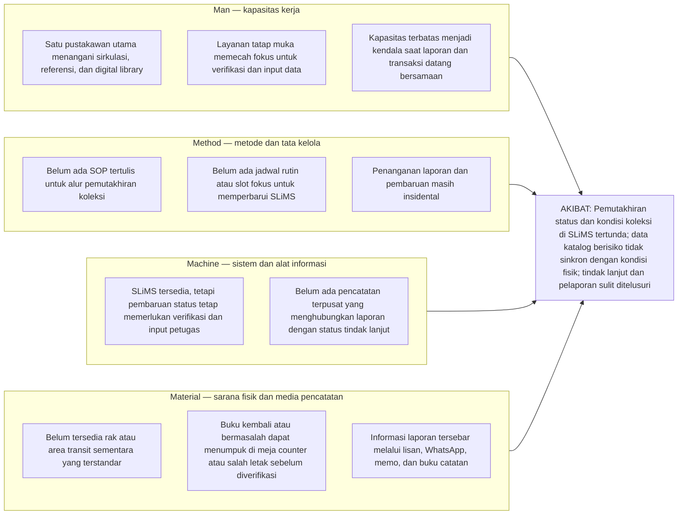

# Fishbone Analisis Masalah SIMPEL-KOLEKSI

## Masalah utama

**Pemutakhiran status dan kondisi koleksi pada SLiMS sering tertunda**, sehingga data katalog berisiko tidak sesuai dengan kondisi fisik koleksi dan tindak lanjut laporan sulit ditelusuri.

> Batasan konteks: satu pustakawan utama menangani tiga fungsi layanan dan melayani rata-rata 52 pemustaka per hari. Kondisi SDM ini merupakan batasan kapasitas operasional, bukan akar masalah yang perlu “diperbaiki” dengan menyalahkan petugas.

## Diagram sebab-akibat 4M

## Pembacaan akar masalah

Faktor kapasitas pustakawan memperbesar dampak interupsi, tetapi akar yang dapat ditangani proyek berada pada tata kelola proses: **belum ada alur kerja terpadu yang mengatur pelaporan, transit fisik, verifikasi, jadwal pemutakhiran, dan rekam jejak penyelesaian**. Karena itu, fokus intervensi SIMPEL-KOLEKSI adalah standardisasi proses dan dukungan kerja, dengan SLiMS tetap menjadi sumber data katalog.

## Hubungan sebab dan intervensi proyek

| Faktor penyebab | Intervensi dalam proyek |
|---|---|
| Laporan masuk dari berbagai saluran dan catatan tersebar | Form pelaporan mandiri dan pencatatan tiket terpusat |
| Buku belum memiliki area transit sebelum verifikasi | Rak Transit dan signage alur pengembalian |
| Pemutakhiran dilakukan insidental dan terpotong layanan | SOP dan jadwal kerja terfokus (*Quiet Hour*) |
| Status tindak lanjut sulit ditelusuri | Log status dan prosedur verifikasi serta pembaruan SLiMS |
| Kapasitas kerja terbatas | Mengurangi perpindahan fokus melalui alur mandiri dan pemrosesan terjadwal; bukan menambah beban aplikasi baru |

## Catatan penggunaan

Diagram ini merangkum analisis masalah proyek dari temuan Praktikum 3. Pernyataan tentang kondisi lapangan mengikuti hasil wawancara dan observasi yang dicatat dalam laporan; akibat seperti risiko ketidaksinkronan dan keterlambatan tindak lanjut merupakan hubungan analitis yang dijelaskan di sana.
