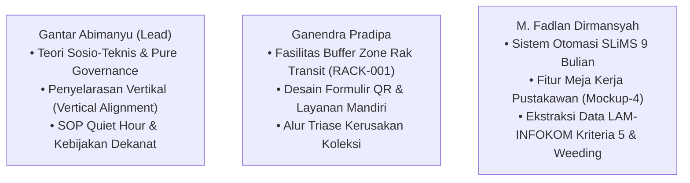

# Materi & Panduan Slide Presentasi Responsi MSI (10 Menit)
## Rekayasa Tata Kelola Sirkulasi Koleksi dan Perlindungan Waktu Kerja Pustakawan Tunggal
### Ekosistem SIMPEL-KOLEKSI | UPT Perpustakaan Fakultas Teknik Universitas Negeri Yogyakarta

> **Panduan Akademik Kelompok 3:**  
> 1. **Gantar Abimanyu** (NIM 24050530042) – *Lead Coordinator, Tata Kelola & Vertical Alignment*  
> 2. **Ganendra Pradipa** (NIM 24050530038) – *Kanal Pemustaka, Fasilitas Fisik Rak Transit & SOP*  
> 3. **M. Fadlan Dirmansyah** (NIM 24050530034) – *Operasional SLiMS, Mockup Meja Kerja, & Validasi*  
> 
> **Prinsip Utama:** Dokumen ini memadukan seluruh artefak nyata kelompok ([[buku-sop-digital]], [[mockup-4]], [[Praktikum_10_Kelompok3]], dan [[catatan_5]]) ke dalam format siap uji. Angka usulan atau target tidak boleh diklaim sebagai hasil implementasi riil produksi.

---

# BAGIAN I: CETAK BIRU SLIDE PPT RESPONSI 10 MENIT (SLIDE-BY-SLIDE TIMEBOXING)

Presentasi responsi dibatasi ketat selama **10 menit (600 detik)**. Struktur ini membagi presentasi ke dalam **8 slide berkepadatan tinggi** dengan alokasi waktu presisi.

```mermaid
flowchart LR
    S1["Slide 1 (0:00-1:15)<br/>Latar Belakang & Realitas Lapangan"] --> S2["Slide 2 (1:15-2:30)<br/>Akar Masalah & Doktrin Tata Kelola"]
    S2 --> S3["Slide 3 (2:30-4:00)<br/>Solusi Fisik & 10 SOP A4"]
    S3 --> S4["Slide 4 (4:00-5:30)<br/>Kanal Pemustaka (layanan.html)"]
    S4 --> S5["Slide 5 (5:30-7:00)<br/>Meja Kerja Pustakawan (index.html)"]
    S5 --> S6["Slide 6 (7:00-8:15)<br/>Vertical Alignment & LAM-INFOKOM"]
    S6 --> S7["Slide 7 (8:15-9:15)<br/>Validasi Stakeholder Modul 10"]
    S7 --> S8["Slide 8 (9:15-10:00)<br/>Kesimpulan, Batasan, & Q&A"]
```

---

### Slide 1: Judul & Realitas Empiris Lapangan
* **Alokasi Waktu:** Menit 00:00 – 01:15 (75 Detik)
* **Presenter:** Gantar Abimanyu
* **Tata Letak Visual Slide:**
  * **Judul Utama:** Rekayasa Tata Kelola Sirkulasi Koleksi dan Perlindungan Waktu Kerja Pustakawan Tunggal Melalui Ekosistem SIMPEL-KOLEKSI FT UNY.
  * **Identitas Tim:** Kelompok 3 – Pendidikan Teknik Informatika FT UNY (Gantar, Ganendra, Fadlan).
  * **3 Kartu Fakta Empiris (Hasil Observasi & Wawancara Pustakawan Pak Danar / Abdul):**
    1. *Beban Rasio Ekstrem:* **1 Pustakawan Fungsional Tunggal** melayani **>3.000 mahasiswa aktif** dari 6 jurusan.
    2. *Tingginya Interupsi:* Rata-rata **52 transaksi tatap muka per hari** di meja loket sirkulasi.
    3. *Dampak Fisik:* Buku rusak menumpuk di lantai/bawah meja dan buku terselip (*misplaced*) di lorong rak DDC sehingga katalog OPAC SLiMS tidak sinkron dengan fisik riil.
* **Naskah Lisan Resmi (Verbatim):**
  > "Selamat pagi Ibu Ratna dan Bapak/Ibu Penguji. Proyek kami berangkat dari temuan empiris pada UPT Perpustakaan Fakultas Teknik UNY. Perpustakaan melayani lebih dari 3.000 mahasiswa aktif, namun meja sirkulasi harian hanya ditangani oleh satu orang pustakawan fungsional, yaitu Pak Danar atau Pak Abdul.
  > 
  > Dengan rata-rata 52 transaksi tatap muka per hari, pustakawan mengalami keterbatasan kapasitas kerja antara melayani antrean fisik peminjaman dan memutakhirkan data koleksi di sistem otomasi SLiMS 9 Bulian. Dampaknya, buku rusak terbengkalai tanpa status jelas dan koleksi selesai baca terselip di lorong rak lain, menyebabkan informasi ketersediaan koleksi di katalog OPAC mengalami distorsi."

---

### Slide 2: Diagnosis Akar Masalah & Doktrin *Pure Governance*
* **Alokasi Waktu:** Menit 01:15 – 02:30 (75 Detik)
* **Presenter:** Gantar Abimanyu
* **Tata Letak Visual Slide:**
  * **Diagram 5-Whys Runtun:** Keterlambatan input SLiMS $\leftarrow$ Pustakawan terinterupsi antrean $\leftarrow$ Belum ada jadwal kerja khusus & SOP baku $\leftarrow$ Budaya kerja reaktif.
  * **Tabel Komparasi:** *Mengapa Bukan Membuat Aplikasi Web/Mobile Baru?*
    * Solusi Software Baru: Duplikasi database SLiMS, beban server TIK UNY, menambah beban belajar pustakawan non-IT.
    * Solusi Tata Kelola (*Pure Governance*): Mengoptimalkan SLiMS yang sudah ada, merekayasa alur kerja fisik, zero-budget, implementasi instan 1–2 minggu.
  * **Pilar Doktrin Bu Ratna (Catatan 5):** *Analogi Regulasi SIAKAD* (Perubahan aturan kerja mendahului implementasi sistem teknis).
* **Naskah Lisan Resmi (Verbatim):**
  > "Melalui dekomposisi 5-Why pada Modul 3, kami merumuskan bahwa akar masalah bukanlah ketiadaan aplikasi software, melainkan belum adanya tata kerja tertulis yang mengatur alokasi waktu terproteksi dan standarisasi alur fisik buku.
  > 
  > Sesuai arahan Ibu Ratna pada Catatan Kelas 5, intervensi MSI sejati berpegang pada doktrin Pure Governance. Perpustakaan telah memiliki SLiMS 9 Bulian yang andal. Membangun aplikasi katalog baru justru merupakan kesalahan teknosentris yang memicu redundansi data dan izin berbelit ke UPT TIK. Mengambil analogi kelahiran SIAKAD yang didahului oleh keputusan pimpinan menghapus tanda tangan basah KRS kertas, SIMPEL-KOLEKSI diawali dengan merekayasa regulasi tata kerja organisasi terlebih dahulu."

---

### Slide 3: Intervensi Fisik & Regulasi: Buku Pedoman 10 SOP A4
* **Alokasi Waktu:** Menit 02:30 – 04:00 (90 Detik)
* **Presenter:** Ganendra Pradipa
* **Tata Letak Visual Slide:**
  * **Gambar Visual Artefak:** Sampul Naskah A4 Resmi *Buku Pedoman SOP Fisik SIMPEL-KOLEKSI FT UNY* lengkap Stempel Pengesahan Dekanat (Wadek I & Kabag TU).
  * **3 Intervensi Fisik & Prosedural Baku:**
    1. **SOP-001 Sesi Jam Tenang (*Quiet Hour*):** 60 menit terproteksi (Jumat pk 08.00–09.00 WIB) tanpa layanan tatap muka agar pustakawan memproses data SLiMS.
    2. **SOP-002 Buffer Zone Rak Transit (`RACK-001`):** Tingkat 2 untuk Koleksi Rusak/Salah Rak (SLA 3 Hari) & Tingkat 1 untuk Selesai Baca di Tempat.
    3. **SOP-004 Protokol Triase Kerusakan 3-Jalur:** Jalur A (Perbaikan Ringan 5 Menit Loket), Jalur B (Karantina Binding Ruang Preservasi), Jalur C (Usul Afkir / Weeding BMN).
  * **Kaidah RACI:** *Prinsip Tunggal Accountable (No Double-A)* mencegah lempar tanggung jawab.
* **Naskah Lisan Resmi (Verbatim):**
  > "Langkah konkret tata kelola kami tuangkan ke dalam Buku Pedoman SOP Fisik standar format A4 yang disahkan Dekanat FT UNY, memuat 10 bab SOP operasional.
  > 
  > Tiga pilar operasional utamanya meliputi: Pertama, SOP Quiet Hour selama 60 menit setiap Jumat pagi di mana loket ditutup sementara agar pustakawan fokus menginput data SLiMS tanpa interupsi. Kedua, penyediaan sarana fisik Buffer Zone Rak Transit RACK-001 dua tingkat di samping loket untuk memutus tumpukan buku di lantai. Ketiga, SOP Triase 3-Jalur yang memberi kepastian apakah buku cukup diperbaiki 5 menit di loket, dikarantina jilid, atau diajukan afkir. Seluruh aktivitas diikat oleh matriks RACI dengan penanggung jawab tunggal."

---

### Slide 4: Artefak Digital: SIMPEL-KOLEKSI Kanal Pemustaka (`layanan.html`)
* **Alokasi Waktu:** Menit 04:00 – 05:30 (90 Detik)
* **Presenter:** Ganendra Pradipa
* **Tata Letak Visual Slide:**
  * **Tangkapan Layar Mobile:** Antarmuka portal mandiri `layanan.html` (diakses via Stiker QR akrilik di 12 meja baca dan tiang rak).
  * **Fitur Utama Kanal Pemustaka:**
    * *Lapor Buku Rusak / Salah Rak:* Menggantikan lapor lisan, pemustaka menaruh buku di Rak Transit Tingkat 2.
    * *Preservasi Data Input (Inline Error Validation):* Isian formulir tidak hilang saat atribut barcode belum lengkap.
    * *Perpanjangan Pinjam Mandiri:* Tambahan masa pinjam +7 hari kerja tanpa membawa fisik buku ke loket.
    * *Usulan Referensi Terbuka (Bypass Surat Kaprodi):* Dosen dan mahasiswa dapat mengusulkan referensi skripsi/RPS kapan saja 24/7.
* **Naskah Lisan Resmi (Verbatim):**
  > "Untuk menghilangkan antrean di depan loket, kami membangun kanal pemustaka mandiri mobile-first melalui SIMPEL-KOLEKSI yang diakses via stiker QR di meja baca.
  > 
  > Mahasiswa yang menemukan buku robek atau terselip cukup memindai QR, mengisi 4 data pokok, dan meletakkan buku di Rak Transit. Antarmuka kami menerapkan mekanisme preservasi data input sehingga ketikan mahasiswa tidak terhapus saat terjadi kesalahan validasi. Mahasiswa juga dapat memperpanjang masa pinjam secara mandiri tanpa membawa fisik buku ke loket. Selain itu, merespons arahan Ibu Ratna di Catatan 5, kami memutus inefisiensi surat dinas tahunan dengan menyediakan formulir usulan koleksi terbuka sepanjang tahun saat dosen menyusun RPS semester baru."

---

### Slide 5: Artefak Digital: SIMPEL-KOLEKSI Meja Kerja Pustakawan (`index.html`)
* **Alokasi Waktu:** Menit 05:30 – 07:00 (90 Detik)
* **Presenter:** M. Fadlan Dirmansyah
* **Tata Letak Visual Slide:**
  * **Tangkapan Layar Desktop:** Meja Kerja Pustakawan `index.html` (Mockup-4).
  * **4 Fitur Solutif Meja Kerja:**
    1. *Instant Search Bar Meja Kerja:* Kolom pencarian instan pada tabel perpanjangan & buku rusak (hasil perbaikan dari kritik lapangan agar pustakawan tidak perlu menggulir tabel manual saat jam sibuk).
    2. *Timer Quiet Hour 60 Menit & Live Broadcast:* Menghitung mundur sesi tenang dan otomatis menyalakan banner peringatan di HP pemustaka.
    3. *Batch Execution SLiMS:* Pustakawan mengeksekusi perpanjangan massal sekaligus.
    4. *Panel Otomasi Weeding (Koleksi Usang):* Query pemfilteran otomatis koleksi sains-teknologi usang ($\ge$10 tahun / misal buku Pascal $\rightarrow$ Python) untuk berita acara BMN.
* **Naskah Lisan Resmi (Verbatim):**
  > "Di sisi pengelola, kami menghadirkan Meja Kerja Pustakawan SIMPEL-KOLEKSI pada Mockup-4. Berdasarkan kritik langsung saat pengujian loket yang ramai, kami menyematkan kolom pencarian instan sehingga saat mahasiswa menanyakan perpanjangan, pustakawan dapat menemukan data dalam hitungan detik tanpa menggulir tabel satu per satu.
  > 
  > Saat sesi Quiet Hour diaktifkan, meja kerja menyinkronkan banner pengumuman darurat secara real-time ke layar HP mahasiswa agar tidak mengetuk loket. Pustakawan mengeksekusi perpanjangan secara massal di SLiMS. Menindaklanjuti arahan Catatan 5 Bu Ratna, meja kerja ini juga dilengkapi panel otomasi penyiangan atau weeding untuk memfilter 2.349 buku berstatus usang secara otomatis berdasarkan kriteria BMN, membebaskan pustakawan dari seleksi fisik manual."

---

### Slide 6: Penyelarasan Vertikal (*Vertical Alignment*) & LAM-INFOKOM Kriteria 5
* **Alokasi Waktu:** Menit 07:00 – 08:15 (75 Detik)
* **Presenter:** M. Fadlan Dirmansyah
* **Tata Letak Visual Slide:**
  * **Matriks 3 Tingkatan Organisasi:**
    * *Tingkat Operasional:* Mahasiswa scan QR $\rightarrow$ Pustakawan eksekusi batch SLiMS.
    * *Tingkat Manajerial:* Rekapitulasi log sirkulasi & Penerbitan Lembar Disposisi Ber-Kop FT UNY.
    * *Tingkat Strategis (Dekanat):* Persetujuan Rencana Anggaran Biaya (RAB) buku & Borang Akreditasi LAM-INFOKOM Kriteria 5.
  * **Formula Rasio Borang Kriteria 5:**  
    $$\text{Rasio Pemanfaatan Koleksi} = \left( \frac{\sum \text{Eksemplar Terpinjam}}{\sum \text{Total Mahasiswa Aktif}} \right) \times 100\%$$
* **Naskah Lisan Resmi (Verbatim):**
  > "Kekuatan utama rancangan kami terletak pada Penyelarasan Vertikal Tiga Tingkatan Organisasi. Aktivitas penataan buku di lantai operasional terhubung langsung hingga ke meja Dekanat.
  > 
  > Melalui integrasi data SLiMS yang mutakhir, pustakawan menerbitkan Lembar Disposisi Resmi ber-Kop Surat FT UNY yang memuat justifikasi angka pemanfaatan koleksi. Angka ini menjadi instrumen esensial bagi Wakil Dekan Bidang Akademik untuk menandatangani anggaran belanja buku tahunan dan memenuhi Kriteria 5 Borang Akreditasi LAM-INFOKOM mengenai rasio ketersediaan serta aksesibilitas sumber pustaka prodi teknik."

---

### Slide 7: Hasil Validasi Pemangku Kepentingan (Modul 10)
* **Alokasi Waktu:** Menit 08:15 – 09:15 (60 Detik)
* **Presenter:** Gantar Abimanyu
* **Tata Letak Visual Slide:**
  * **Metodologi Pengujian:** *Decision Scenario Testing* (Bukan sekadar usability tombol UI, melainkan apakah informasi memadai untuk mengambil keputusan manajerial $\le 5$ menit).
  * **Komposisi 7 Responden Transparan:**
    * *2 Pustakawan Nyata FT UNY:* Pak Danar / Dapa (NIP 199712052023022002) & Pak Abdul (NIP 199205122019031045).
    * *2 Pemustaka Nyata FT UNY:* Wildan & Daffa.
    * *3 Simulasi Peran Mahasiswa PTI:* Saipul, Rahmat, Ahmad Zaky.
  * **Tindakan Perbaikan Nyata:** Temuan ketiadaan fitur filter melahirkan Mockup-4; potensi penolakan diselesaikan dengan papan panduan akrilik.
* **Naskah Lisan Resmi (Verbatim):**
  > "Pada Modul 10, kami memvalidasi artefak prototipe ini langsung bersama 7 responden, yang mengikutsertakan 2 pustakawan nyata pengelola FT UNY, yaitu Pak Danar dan Pak Abdul. Pengujian menggunakan metode Decision Scenario Testing untuk mengukur keyakinan pustakawan dalam mengambil keputusan triase.
  > 
  > Hasil validasi membuktikan bahwa informasi pada meja kerja memungkinkan pustakawan menuntaskan triase dalam waktu rata-rata di bawah 5 menit. Kritik konstruktif dari Pak Abdul regarding kesulitan mencari data saat loket padat langsung kami wujudkan melalui revisi Mockup-4 dengan menambahkan instant search bar, membuktikan kedewasaan iterasi desain kelompok kami."

---

### Slide 8: Kesimpulan, Batasan Proyek, & Sesi Diskusi
* **Alokasi Waktu:** Menit 09:15 – 10:00 (45 Detik)
* **Presenter:** Gantar Abimanyu
* **Tata Letak Visual Slide:**
  * **3 Kesimpulan Kunci:**
    1. Masalah MSI terbukti merupakan masalah sosio-teknis dan tata kelola beban kerja, bukan ketiadaan software.
    2. Ekosistem SIMPEL-KOLEKSI melindungi waktu pustakawan tanpa mengganggu layanan pemustaka.
    3. Alur data fisik menjamin kepastian pasokan data untuk akreditasi fakultas.
  * **Batasan Proyek (*Zero-Touch Infrastructure*):** SLiMS 9 Bulian tetap menjadi *Single Source of Truth*; proyek tidak menyusupkan skrip modifikasi database pusat UNY tanpa izin.
  * **Ucapan Penutup & Kesiapan Tanya-Jawab.**
* **Naskah Lisan Resmi (Verbatim):**
  > "Sebagai kesimpulan, SIMPEL-KOLEKSI membuktikan bahwa solusi Manajemen Sistem Informasi tidak selalu berarti membangun aplikasi baru, melainkan bagaimana menata regulasi, melindungi waktu kerja manusia, dan mengalirkan data yang sahih bagi keputusan pimpinan.
  > 
  > Kami memegang teguh batasan etika akademik bahwa SLiMS tetap merupakan Single Source of Truth tanpa modifikasi database pusat yang melanggar kewenangan. Demikian presentasi dari Kelompok 3, kami siap berdiskusi dan menerima masukan dari Ibu Ratna. Terima kasih."

---

# BAGIAN II: MATERI SUBSTANTIF & KONSOLIDASI ARTEFAK REPOSITORI

Bagian ini merangkum data teknis dan dokumen pendukung di repositori sebagai rujukan mendalam apabila dosen penguji mengajukan pertanyaan detail.

### 1. Data Lapangan & Profil Organisasi
* **Unit Kajian:** UPT Perpustakaan Fakultas Teknik Universitas Negeri Yogyakarta (Kampus Karangmalang).
* **Aktor Lapangan Nyata:** 
  * Pustakawan Fungsional: Danar / Abdul, S.I.Pst. (NIP. 19920512 201903 1 045).
  * Pejabat Pengesah Dekanat: Wakil Dekan Bidang Akademik FT UNY (Prof. Dr. Eng. Ir. Wadek I, M.T., NIP. 19740812 200003 1 002) dan Koordinator TU FT UNY (NIP. 19780315 200501 1 003).
* **Beban Operasional:** Melayani 6 Jurusan Teknik (Pendidikan Teknik Elektro, Elektronika, Mesin, Sipil & Perencanaan, Boga & Busana, serta PTIK) dengan >3.000 mahasiswa aktif.
* **Volume Sirkulasi:** Rata-rata 52 transaksi tatap muka per hari; 2.349 judul koleksi buku teks teknik.
* **Sistem Informasi Eksisting:** SLiMS 9 Bulian (*Senayan Library Management System*) berbasis Web Apache/MySQL lokal jaringan kampus UNY.

### 2. Dekomposisi 10 SOP Baku pada Buku Pedoman Naskah A4
Seluruh ketentuan operasional telah dikodifikasikan secara resmi dalam format A4 berstandar naskah dinas institusi pada [`08_ARTEFAK/buku-sop-digital`](file:///c:/PMSI/08_ARTEFAK/buku-sop-digital/):
1. **SOP-001 (Pengelolaan Sesi Quiet Hour):** Penghentian loket tatap muka 60 menit setiap Jumat pk 08.00–09.00 WIB; pemasangan papan akrilik fisik di meja sirkulasi; aktivasi timer dan banner live broadcast ke portal mahasiswa.
2. **SOP-002 (Buffer Zone Rak Transit RACK-001):** Alokasi fisik Rak Transit 2 tingkat di samping loket. Tingkat 2 (Atas) untuk buku rusak & salah rak (SLA maksimal 3 hari kerja). Tingkat 1 (Bawah) untuk pengembalian selesai baca di tempat guna mencegah fenomena salah rak (*misplaced books*).
3. **SOP-003 (Layanan Mandiri QR Code & Perpanjangan Pinjam):** Penempatan stiker QR vinil anti-gores pada 12 meja baca komunal; formulir berfitur *inline error preservation*; perpanjangan pinjam mandiri +7 hari kerja tanpa perlu membawa fisik buku ke meja sirkulasi.
4. **SOP-004 (Protokol Triase Kerusakan Koleksi):** Pemeriksaan buku Rak Transit Tingkat 2 pada sesi Quiet Hour.
   * *Jalur A (Perbaikan Ringan):* Sobek $\le$ 3 lembar / salah rak $\rightarrow$ perbaikan langsung $\le 5$ menit di loket $\rightarrow$ status SLiMS tetap *Available*.
   * *Jalur B (Kerusakan Berat):* Jilidan lepas / lembaran hilang $\rightarrow$ karantina ruang penjilidan $\rightarrow$ status SLiMS *Repair*.
   * *Jalur C (Afkir / Penyiangan):* Hilang $\ge$ 3 siklus pencarian rak / rusak total $\rightarrow$ pengajuan hapus BMN $\rightarrow$ status SLiMS *Missing/Weeding*.
5. **SOP-005 (Penyelarasan Disposisi Dekanat & Borang LAM-INFOKOM):** Ekstraksi log sirkulasi SLiMS ke format Lembar Disposisi Ber-Kop Surat FT UNY untuk persetujuan anggaran belanja buku baru Wadek I berbasis bukti pemanfaatan Kriteria 5.
6. **SOP-006 (Penyiangan & Kurasi Buku Usang / Weeding BMN):** Kriteria kuantitatif usia buku $\ge$ 10 tahun dan frekuensi sirkulasi nol selama $\ge$ 4 semester; alur birokrasi legalitas penghapusan aset BMN.
7. **SOP-007 (Peminjaman Bersyarat Transisi Semester / SIAKAD Rollover Gap):** Layanan pinjam bersyarat maksimal 1 eksemplar selama 3 hari bagi mahasiswa aktif yang belum tersinkronisasi di SLiMS akibat siklus impor data IT Pusat.
8. **SOP-008 (Kontingensi Mati Listrik & Pemulihan Sistem):** Pencatatan manual loket pada Buku Log Cadangan Sampul Merah; SLA pemulihan data maksimal 120 menit pasca listrik menyala via fitur *Salin Batch SLiMS*.
9. **SOP-009 (Supervisi Tenaga Bantuan Magang/PKL):** Penyekatan akun master katalog SLiMS; mahasiswa magang hanya menginput data berstatus `DRAFT_INTERN` yang wajib divalidasi tunggal oleh pustakawan fungsional.
10. **SOP-010 (Pemeliharaan Sarana Fisik QR Code):** Standar material akrilik T-Stand A6 tebal 2 mm dan stiker vinyl doff laminasi dingin; jadwal audit pemindaian bulanan.

---

# BAGIAN III: BANK PERTANYAAN KRITIS PENGUJI & TANGKISAN ARGUMEN

Berikut adalah tangkisan argumen berbobot akademis tinggi untuk pertanyaan jebakan yang sering diajukan dosen:

### 🥊 Q1: "Kalian mahasiswa Teknologi Informasi, kenapa solusinya cuma SOP, Rak Transit, dan formulir QR? Kenapa tidak koding aplikasi web/mobile baru dari nol?"
> **Tangkisan Argumen Resmi:**  
> *"Izin menjawab Ibu Ratna. Berdasarkan filosofi Manajemen Sistem Informasi, intervensi sistem tidak selalu identik dengan penambahan perangkat lunak baru (Pure Governance). Dari hasil observasi dan wawancara lapangan, masalah di Perpustakaan FT UNY bukanlah ketiadaan aplikasi, melainkan **ketidakmampuan pustakawan tunggal menginput data akibat interupsi fisik antrean loket**.*  
> 
> *SLiMS 9 Bulian sudah berstatus sangat mumpuni sebagai standar perpustakaan universitas. Jika kami membuat software baru: (1) Akan terjadi duplikasi database katalog yang memicu inkonsistensi data; (2) Membebani infrastruktur server UPT TIK UNY; dan (3) Menambah beban pustakawan tunggal non-IT yang harus mengelola 2 sistem sekaligus. Solusi SOP Quiet Hour, Rak Transit, dan formulir QR code justru memecahkan sumbatan operasional seketika tanpa memerlukan biaya pengadaan software baru."*

---

### 🥊 Q2: "Apa hubungannya SOP operasional Quiet Hour dan Rak Transit di lantai bawah dengan Dekanat FT UNY di lantai atas?"
> **Tangkisan Argumen Resmi:**  
> *"Hubungannya terletak pada **Penyelarasan Vertikal Tiga Tingkatan Organisasi (Vertical Alignment)**:*  
> 1. *Di tingkat **Operasional**, SOP Quiet Hour dan Rak Transit melindungi waktu kerja pustakawan untuk memperbarui data pengembalian di SLiMS secara disiplin.*  
> 2. *Di tingkat **Manajerial**, data SLiMS yang mutakhir memungkinkan ekstraksi angka rasio keterpakaian buku riil ke dalam format Lembar Disposisi Ber-Kop FT UNY.*  
> 3. *Di tingkat **Strategis**, Dekanat (Wakil Dekan I) membutuhkan kepastian data pemanfaatan riil ini untuk mengesahkan pagu anggaran belanja buku tahunan dan membuktikan pemenuhan Borang Akreditasi LAM-INFOKOM Kriteria 5. Tanpa SOP di tingkat operasional, data strategis pimpinan di atas akan mengalami distorsi (under-reporting)."*

---

### 🥊 Q3: "Bagaimana jika mahasiswa tetap malas scan QR dan pustakawan lupa menjalankan sesi Quiet Hour?"
> **Tangkisan Argumen Resmi:**  
> *"Kami memitigasinya melalui dua instrumen kendali:*  
> 1. *Untuk **Pemustaka**: Formulir QR didesain sangat ringkas (hanya 4 atribut wajib) dengan mekanisme inline error preservation. Kami juga memasang Signage akrilik tepat di atas Rak Transit. Sekalipun mahasiswa tidak memindai QR, buku tetap tertampung di Rak Transit Tingkat 2 dan tidak menumpuk di meja loket pustakawan.*  
> 2. *Untuk **Pustakawan**: Quiet Hour ditetapkan pada hari dan jam dengan transaksi terendah (Jumat pk 08.00–09.00 WIB) dan disinkronkan dengan live broadcast banner pada portal mahasiswa. Di sisi tata kelola, kepatuhan Quiet Hour diawasi langsung oleh Kepala Perpustakaan melalui audit mingguan (SOP-008)."*

---

### 🥊 Q4: "Pada RACI Matrix kalian, mengapa tidak ada huruf 'I' (Informed) pada anggota kelompok internal?"
> **Tangkisan Argumen Resmi:**  
> *"Karena kelompok kami beranggotakan 3 orang dan mengadopsi model kerja kolaboratif agile. Setiap anggota kelompok internal bertindak aktif sebagai pelaksana tugas (Responsible) atau penanggung jawab mutlak (Accountable) per deliverable. Memberikan status 'Informed' (hanya menerima laporan) kepada anggota kelompok sendiri akan memicu difusi tanggung jawab dan inefisiensi tim. Status 'Informed' secara murni dialokasikan kepada pemangku kepentingan eksternal, yaitu Dekanat FT UNY dan Mahasiswa."*

---

### 🥊 Q5: "Apa yang melandasi perubahan dari Mockup-3 ke Mockup-4?"
> **Tangkisan Argumen Resmi:**  
> *"Perubahan ke Mockup-4 dilandasi oleh temuan langsung saat pengujian bersama pustakawan nyata (Pak Danar dan Pak Abdul) pada Modul 10:*  
> 1. *Pustakawan mengeluhkan kesulitan saat antrean loket ramai menanyakan status perpanjangan buku, di mana petugas harus menggulir tabel satu per satu secara manual. Kami meresponsnya dengan menambahkan **Instant Search Bar** pada tabel meja kerja.*  
> 2. *Menindaklanjuti arahan Catatan 5 Bu Ratna, kami menyematkan **Panel Otomasi Weeding (Penyiangan Buku Usang)** berbasis query filter tahun terbit $\ge$ 10 tahun agar pustakawan tidak terbebani menyisir koleksi usang secara fisik.*  
> 3. *Kami menambahkan fitur **Preservasi Data Input** pada kanal pemustaka agar ketikan tidak terhapus saat terjadi kegagalan validasi."*

---

# BAGIAN IV: SPESIALISASI PERAN & REKAP HAFALAN KILAT (CHEAT SHEET)

### 👥 Pembagian Suara Anggota Kelompok (Sesi Presentasi & Tanya-Jawab)

### ⚡ Hafalan 30 Detik (Elevator Pitch)
* **Masalah:** Pemutakhiran data sirkulasi SLiMS tertunda akibat pustakawan tunggal terinterupsi 52 antrean loket/hari.
* **Akar:** Belum ada SOP tertulis, ketiadaan jadwal proteksi kerja, dan penanganan buku rusak yang sporadis.
* **Solusi Fisik & Tata Kelola:** Buku Pedoman 10 SOP A4 disahkan Dekanat + Rak Transit 2 Tingkat (`RACK-001`) + Sesi Quiet Hour 60 menit/minggu.
* **Solusi Digital:** SIMPEL-KOLEKSI (`layanan.html` untuk pemustaka mandiri via QR; `index.html` meja kerja pustakawan berfitur instant search, live broadcast quiet hour, dan filter weeding otomatis).
* **Dampak Strategis:** Data sirkulasi mutakhir memasok bukti riil Lembar Disposisi Wadek I dan Borang Akreditasi LAM-INFOKOM Kriteria 5.
* **Batasan:** SLiMS 9 Bulian tetap *Single Source of Truth*; solusi bersifat *Zero-Touch Infrastructure*.

---
*Dokumen ini merupakan standar resmi responsi Kelompok 3 Praktikum Manajemen Sistem Informasi FT UNY.*
